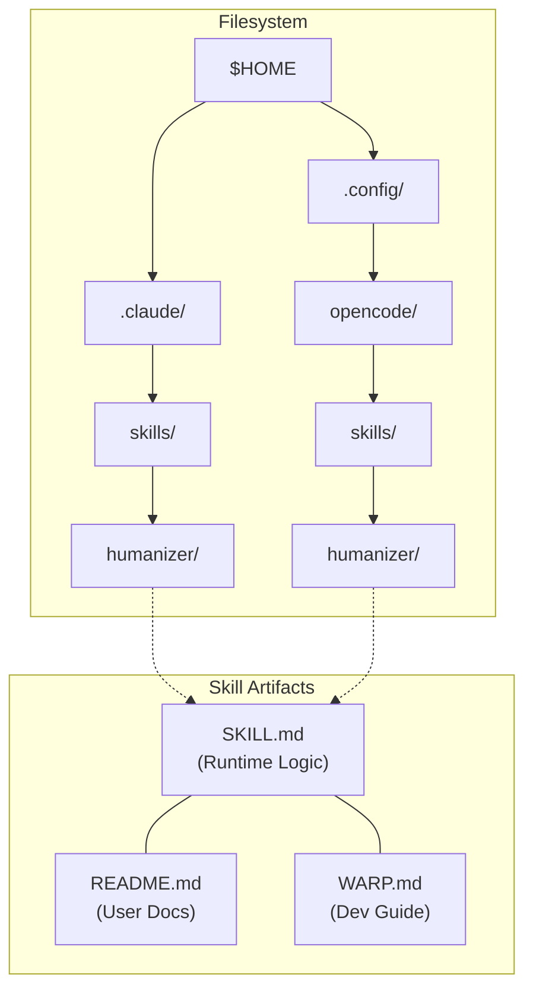
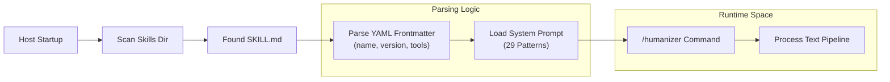

<!-- source: DeepWiki mcp.deepwiki.com · repo blader/humanizer · page 2.1 Installation · fetched 2026-10-26 -->

# Installation

<details>
<summary>Relevant source files</summary>

The following files were used as context for generating this wiki page:

- [README.md](README.md)
- [WARP.md](WARP.md)

</details>


## Purpose and Scope

This page provides detailed instructions for installing the Humanizer skill into both **Claude Code** and **OpenCode**. It covers the directory structure requirements, two installation methods (git clone and manual copy), and file placement verification. For usage instructions after installation, see [Using the Humanizer Skill](). For information about maintaining and updating the skill files, see [Maintenance Guidelines]().

## Prerequisites

The Humanizer skill requires:

- **Claude Code** or **OpenCode** environment with skill loading capability.
- **File system access** to create directories in the respective configuration paths.
- **Git** (optional, only required for the git clone installation method).

The skill has no external binary dependencies; it is implemented as a Markdown-based skill artifact [WARP.md:5-9]().

## System-Specific Directory Structures

Both tools load skills from standardized directory hierarchies. While they have different default paths, OpenCode maintains compatibility by also scanning the Claude Code skills directory [README.md:39-40]().

### Claude Code Structure
**Path:** `~/.claude/skills/humanizer/` [README.md:12-13]()

### OpenCode Structure
**Path:** `~/.config/opencode/skills/humanizer/` [README.md:28-29]()

**Installation Directory Diagram**



Sources: [README.md:7-40](), [WARP.md:12-21]()

### Required vs. Optional Files

| File | Status | Purpose |
|------|--------|---------|
| `SKILL.md` | **Required** | The "runtime" artifact containing YAML metadata and the editor prompt [WARP.md:8-9](). |
| `README.md` | Optional | Human-readable installation, usage, and pattern overview [WARP.md:10-10](). |
| `WARP.md` | Optional | Developer guidance and maintenance protocols [WARP.md:1-3](). |

Sources: [WARP.md:12-21]()

## Installation Method 1: Git Clone (Recommended)

The recommended method clones the repository directly into the skills directory. This allows for easy updates via `git pull`.

### For Claude Code
```bash
mkdir -p ~/.claude/skills
git clone https://github.com/blader/humanizer.git ~/.claude/skills/humanizer
```
Sources: [README.md:11-14](), [WARP.md:25-29]()

### For OpenCode
```bash
mkdir -p ~/.config/opencode/skills
git clone https://github.com/blader/humanizer.git ~/.config/opencode/skills/humanizer
```
Sources: [README.md:27-30]()

## Installation Method 2: Manual Copy

If you already have the repository elsewhere or wish to install only the core logic, copy the `SKILL.md` file manually.

### For Claude Code
```bash
mkdir -p ~/.claude/skills/humanizer
cp SKILL.md ~/.claude/skills/humanizer/
```
Sources: [README.md:18-21](), [WARP.md:33-35]()

### For OpenCode
```bash
mkdir -p ~/.config/opencode/skills/humanizer
cp SKILL.md ~/.config/opencode/skills/humanizer/
```
Sources: [README.md:34-37]()

## Data Flow and Runtime Loading

When the skill is invoked, the host application (Claude Code or OpenCode) parses the Markdown file to extract instructions and metadata.

**Skill Loading and Execution Flow**



Sources: [WARP.md:8-16](), [README.md:91-145]()

## Verification

### Confirm Installation
Verify the directory contains the necessary runtime artifact:
```bash
# Claude Code
ls -l ~/.claude/skills/humanizer/SKILL.md

# OpenCode
ls -l ~/.config/opencode/skills/humanizer/SKILL.md
```

### Confirm Metadata
Check that the skill file contains the correct version and metadata:
```bash
head -n 10 ~/.claude/skills/humanizer/SKILL.md
```
Expected output should include `name: humanizer`, a version (e.g., `version: 2.5.1`), and `allowed-tools: []` [WARP.md:14-16]().

### Test Invocation
Restart your terminal or the AI tool and run:
```
/humanizer
```
If successful, the tool will acknowledge the command and wait for text input [README.md:43-57]().

## Troubleshooting

- **Command Not Found:** Ensure the directory is named exactly `humanizer`. Both Claude Code and OpenCode use the directory name to register the slash command.
- **Version Mismatch:** If the skill behavior seems outdated, verify that the `version` field in `SKILL.md` matches the latest release [WARP.md:42-46]().
- **OpenCode Compatibility:** If using OpenCode, remember that it also scans `~/.claude/skills/`, so you do not need to install it twice if you use both tools [README.md:39-40]().

Sources: [README.md:5-40](), [WARP.md:1-53]()

---

