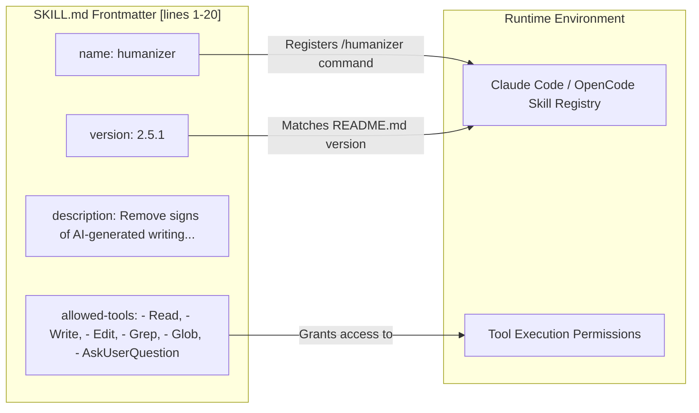
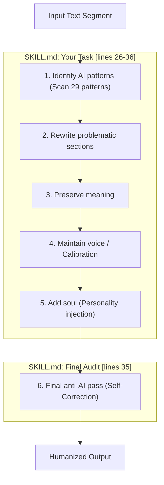

<!-- source: DeepWiki mcp.deepwiki.com · repo blader/humanizer · page 2.2 Using the Humanizer Skill · fetched 2026-10-26 -->

# Using the Humanizer Skill

<details>
<summary>Relevant source files</summary>

The following files were used as context for generating this wiki page:

- [README.md](README.md)
- [SKILL.md](SKILL.md)

</details>


This page explains how to invoke and use the Humanizer skill in Claude Code and OpenCode, including invocation methods, input/output formats, processing workflow, and practical usage examples.

---

## Invocation Methods

The Humanizer skill can be invoked in two ways within the terminal environment:

### Direct Skill Command

Use the `/humanizer` command. The model will then prompt for the text or context:

```bash
/humanizer

[paste your AI-generated text here]
```

### Natural Language Prompt

Alternatively, ask the model directly to humanize text. This triggers the skill because the skill's name and description match the request:

```text
Please humanize this text: [your text]
```

Both methods load the skill from the respective installation directory (e.g., `~/.claude/skills/humanizer/SKILL.md`) and execute the transformation pipeline.

Sources: [README.md:41-63](), [SKILL.md:1-12]()

---

## Skill Metadata and Configuration

The skill's YAML frontmatter defines its runtime identity and permissions within the Claude Code/OpenCode ecosystem.

**Code Entity Space Mapping:**



| Field | Value | Purpose |
|-------|-------|---------|
| `name` | `humanizer` | Identifier for skill invocation via `/` command. [SKILL.md:2]() |
| `version` | `2.5.1` | Current version (must match README.md). [SKILL.md:3]() |
| `allowed-tools` | `Read`, `Write`, `Edit`, `Grep`, `Glob`, `AskUserQuestion` | Tools the model is permitted to use to process files or ask for clarification. [SKILL.md:13-19]() |

Sources: [SKILL.md:1-20](), [README.md:3]()

---

## Voice Calibration

A unique feature of the Humanizer is **Voice Calibration**, which allows the skill to match a specific user's writing style rather than just defaulting to a generic "clean" tone.

### Input Expectations for Calibration
The skill can analyze a writing sample provided either inline or via a file path. It looks for:
- Sentence length patterns (short vs. long). [SKILL.md:43]()
- Word choice level (casual vs. academic). [SKILL.md:44]()
- Punctuation habits (dashes, semicolons, etc.). [SKILL.md:46]()

### Usage Pattern
```text
/humanizer

Use my writing style from ./docs/my_article.md as a reference.
Now humanize this text: [AI text]
```

Sources: [SKILL.md:38-57](), [README.md:65-80]()

---

## Processing Pipeline

The skill follows a multi-step transformation pipeline to ensure the output moves from "AI-generated" to "Human-sounding."

**Natural Language Space to Code Entity Space:**



### Key Stages
1. **Pattern Identification**: Scans for the 29 patterns defined in `SKILL.md`. [SKILL.md:30]()
2. **Personality Injection**: Applies the "PERSONALITY AND SOUL" guidelines, such as adding opinions, varying rhythm, and acknowledging complexity. [SKILL.md:59-84]()
3. **Anti-AI Pass**: The model is prompted to perform a self-audit: *"What makes the below so obviously AI generated?"* and then revise based on its own findings. [SKILL.md:35]()

Sources: [SKILL.md:26-36](), [SKILL.md:59-91]()

---

## Pattern Detection Architecture

The skill employs multi-layer detection across 29 specific patterns categorized into five groups.

| Category | Patterns | Examples |
|----------|----------|----------|
| **Content** | 1–6 | Significance inflation, notability name-dropping. [SKILL.md:92-148]() |
| **Language** | 7–13 | AI vocabulary (e.g., "testament"), passive voice, rule of three. [SKILL.md:151-240]() |
| **Style** | 14–19, 26–29 | Em dash overuse, Title Case headings, fragmented headers. [SKILL.md:243-348]() |
| **Communication** | 20–22 | Chatbot artifacts ("I hope this helps"), sycophantic tone. [SKILL.md:351-377]() |
| **Filler & Hedging** | 23–25 | "In order to", excessive hedging, generic conclusions. [SKILL.md:380-405]() |

Sources: [SKILL.md:92-405](), [README.md:91-145]()

---

## Usage Examples

### Example 1: Removing "AI Slop"
**Input:**
> "The project stands as a testament to our commitment to innovation, marking a pivotal moment in the landscape."

**Command:**
`/humanizer [text]`

**Output:**
> "We built this to solve the latency issues we saw last quarter. It's a big step for the team."

**Analysis:**
- Removed "testament" (Pattern #7). [SKILL.md:154]()
- Removed "pivotal moment" (Pattern #1). [SKILL.md:96]()
- Simplified copula "stands as" (Pattern #8). [SKILL.md:183]()

### Example 2: Personality Injection
**Input:**
> "The data indicates that remote work has both benefits and drawbacks. Productivity is high but isolation is a factor."

**Output:**
> "I’m torn on remote work. On one hand, I'm shipping more code than ever. On the other, I sometimes realize I haven't spoken to a real person in three days. It’s a weird trade-off."

**Analysis:**
- Applied "Have opinions" rule. [SKILL.md:73]()
- Applied "Use 'I' when it fits". [SKILL.md:79]()

Sources: [SKILL.md:85-90](), [README.md:147-172]()

---

## Output and Interpretation

The skill produces the humanized text as its primary output. In some cases, it may provide a brief explanation of the "tells" it identified during the final anti-AI pass.

**Summary of Output Components:**
- **Revised Text**: The final version with patterns removed and voice applied.
- **Audit Findings**: (Optional) Brief list of what made the original text sound like an LLM. [SKILL.md:35]()

Sources: [SKILL.md:35](), [README.md:147-172]()

---

