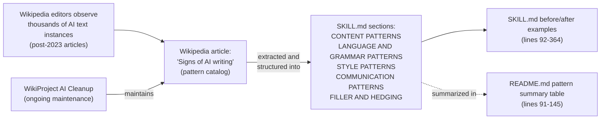
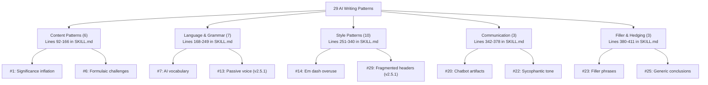
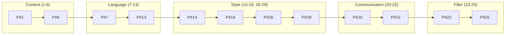
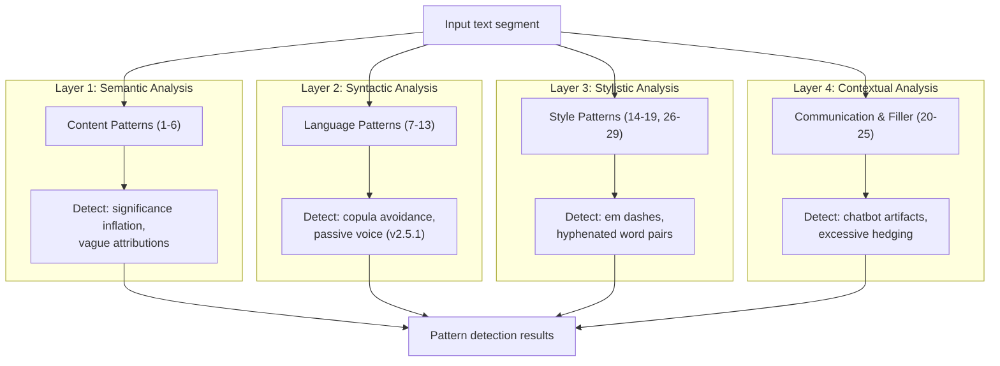
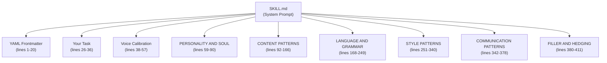

<!-- source: DeepWiki mcp.deepwiki.com · repo blader/humanizer · page 3.1 Pattern Overview and Categories · fetched 2026-10-26 -->

# Pattern Overview and Categories

Relevant source files

The following files were used as context for generating this wiki page:

- [README.md](README.md)
- [SKILL.md](SKILL.md)

## Purpose and Scope

This page introduces the taxonomic foundation of the Humanizer skill: the 29 AI writing patterns organized into five categories. It explains the Wikipedia source material, the categorical organization, and how patterns are numbered and structured in the codebase. Note that as of version 2.5.1, the pattern library has expanded from the original 24 to 29 total patterns to cover more nuanced stylistic and grammatical AI-isms.

Sources: [SKILL.md:3-10](), [README.md:91-145]()

## Wikipedia Foundation: Empirical Source Material

The Humanizer skill is based entirely on [Wikipedia's "Signs of AI writing" guide](https://en.wikipedia.org/wiki/Wikipedia:Signs_of_AI_writing), maintained by WikiProject AI Cleanup. This guide was created through empirical analysis of thousands of instances of AI-generated text appearing on Wikipedia after 2023.

### Key Insight from Wikipedia

The Wikipedia article states: "LLMs use statistical algorithms to guess what should come next. The result tends toward the most statistically likely result that applies to the widest variety of cases."

This observation explains why AI writing exhibits predictable patterns—it gravitates toward generic, statistically-likely constructions rather than specific, opinionated, or unusual language choices.

Sources: [README.md:83-90](), [SKILL.md:24-24]()

### Knowledge Flow: Wikipedia to SKILL.md

Sources: [README.md:83-91](), [SKILL.md:24-25](), [SKILL.md:92-364]()

## Pattern Taxonomy: Five Categories

The 29 patterns are organized into five categories based on the linguistic level they address. The current version (2.5.1) includes several recent additions to the Style and Language categories.

| Category | Pattern Count | Focus Area | Analysis Level |
|----------|--------------|------------|----------------|
| **Content Patterns** | 6 | What is said (semantic content) | Meaning and claims |
| **Language & Grammar** | 7 | How it's said (syntax and word choice) | Grammatical structures |
| **Style Patterns** | 10 | How it looks (formatting and typography) | Visual presentation |
| **Communication** | 3 | Chatbot conversation artifacts | Conversational context |
| **Filler & Hedging** | 3 | Unnecessary qualifiers and words | Rhetorical efficiency |

Sources: [README.md:91-145](), [SKILL.md:92-364]()

### Category Taxonomy Diagram

Sources: [SKILL.md:92-411](), [README.md:91-145]()

## Pattern Numbering System

Patterns are numbered sequentially from 1 to 29. Note that due to version updates (v2.3.0 through v2.5.1), the numbering in the Style category jumps from #19 to #26 to accommodate the expansion of the pattern set while maintaining internal categorization.

### Numbering Scheme (v2.5.1)

Sources: [README.md:91-145]()

### Pattern Numbering in Code

The pattern numbers appear in both documentation files. In `SKILL.md`, patterns are defined by their section headings, while `README.md` references them by number in its summary table.

| File | Pattern Reference Format | Line Examples |
|------|-------------------------|---------------|
| SKILL.md | Section headings with numbers | [SKILL.md:94](), [SKILL.md:168](), [SKILL.md:251]() |
| README.md | Table with `#` prefix | [README.md:97](), [README.md:108](), [README.md:120]() |

Sources: [SKILL.md:92-411](), [README.md:91-145]()

## Category Definitions and Analysis Levels

The system utilizes a multi-layer analysis approach, progressing from semantic content to surface-level formatting.

### Multi-Layer Analysis Architecture

Sources: [SKILL.md:92-411]()

## Code Structure: Categories to SKILL.md Sections

The `SKILL.md` file implements the pattern taxonomy through a hierarchical section structure. Each category becomes a top-level section with H2 headings.

### SKILL.md Section Mapping

Sources: [SKILL.md:1-411]()

### Section Line Number Reference (v2.5.1)

| Category | Section Header Line | First Pattern Line | Pattern Count |
|----------|--------------------|--------------------|---------------|
| Content | [SKILL.md:92]() | [SKILL.md:94]() | 6 |
| Language & Grammar | [SKILL.md:168]() | [SKILL.md:170]() | 7 |
| Style | [SKILL.md:251]() | [SKILL.md:253]() | 10 |
| Communication | [SKILL.md:342]() | [SKILL.md:344]() | 3 |
| Filler & Hedging | [SKILL.md:380]() | [SKILL.md:382]() | 3 |

Sources: [SKILL.md:92-411]()

## Pattern Structure: Common Elements

Each pattern in `SKILL.md` follows a consistent structure:

1. **Pattern heading** (H3) - Number and name.
2. **Words to watch** - Lexical triggers (e.g., [SKILL.md:96]()).
3. **Problem statement** - Explanation of the AI-ism (e.g., [SKILL.md:98]()).
4. **Before example** - AI-generated text (e.g., [SKILL.md:100-101]()).
5. **After example** - Humanized correction (e.g., [SKILL.md:103-104]()).

Sources: [SKILL.md:92-411]()

---

