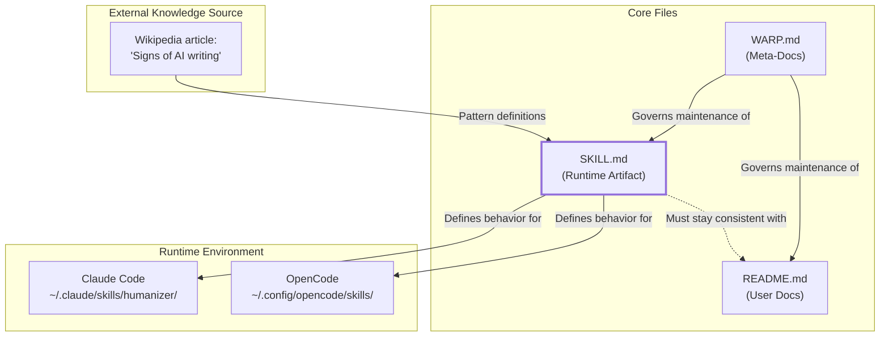
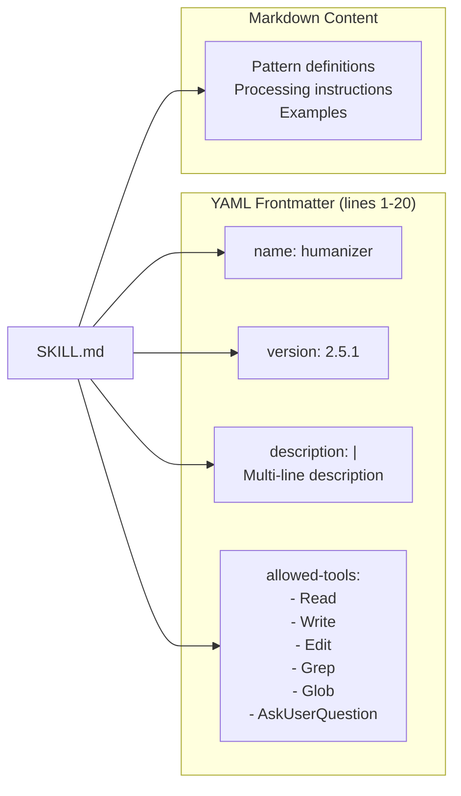
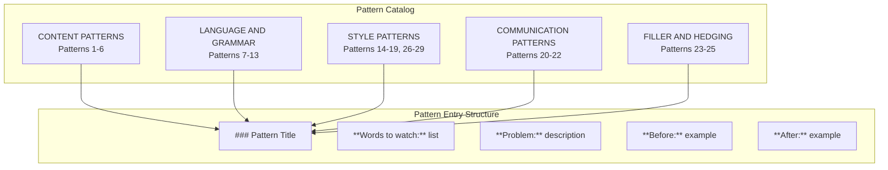
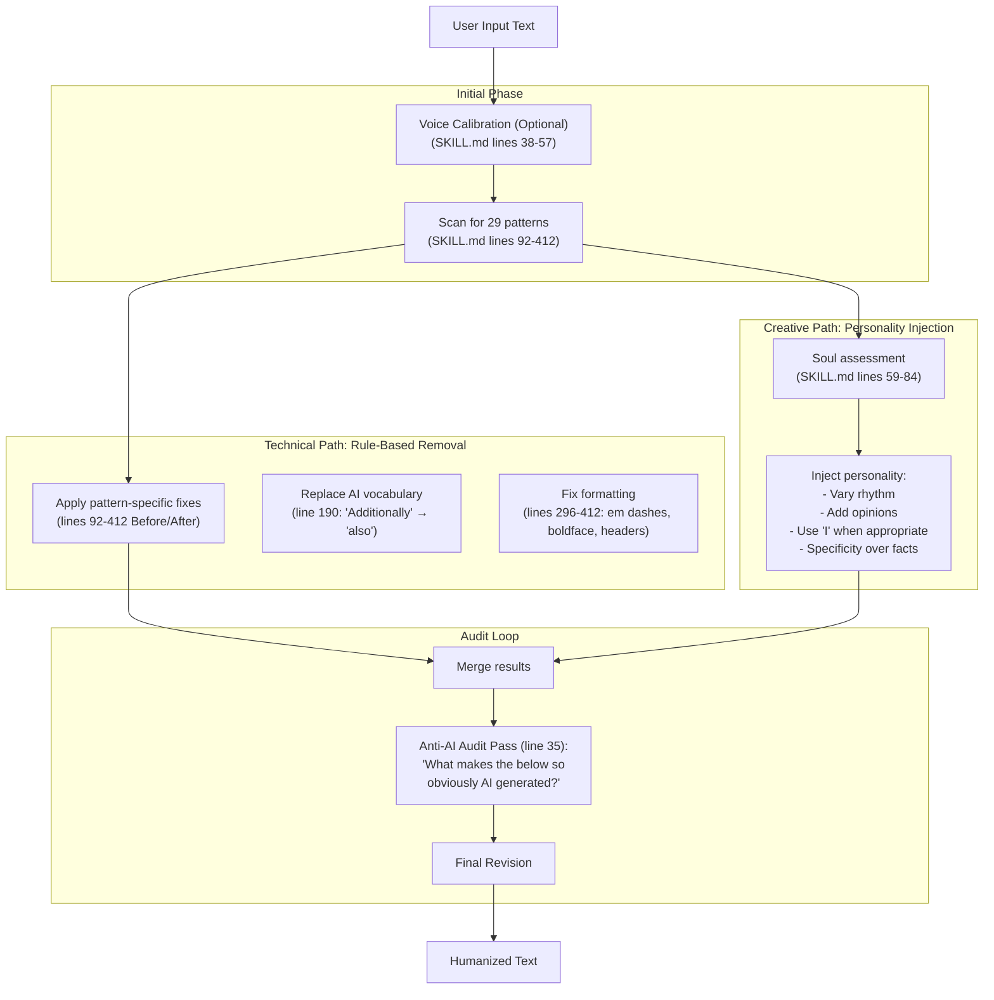
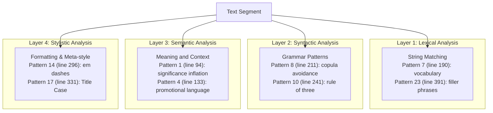

<!-- source: DeepWiki mcp.deepwiki.com · repo blader/humanizer · page 4 Architecture and Implementation · fetched 2026-10-26 -->

# Architecture and Implementation

Relevant source files

The following files were used as context for generating this wiki page:

- [README.md](README.md)
- [SKILL.md](SKILL.md)
- [WARP.md](WARP.md)

## Purpose and Scope

This page documents the technical architecture of the Humanizer system, explaining how a set of Markdown files implements a sophisticated text transformation pipeline. It covers the three-file structure, runtime loading mechanism, pattern detection layers, and transformation strategies.

For installation procedures and user-facing invocation methods, see [Installation and Usage](#2). For detailed documentation of the 29 patterns themselves, see [AI Writing Patterns](#3). For maintenance workflows and version synchronization, see [Developer Guide](#5).

---

## Three-File System Architecture

The Humanizer system consists of three Markdown files, each serving a distinct architectural purpose:

| File | Role | Audience | Authority Level |
|------|------|----------|----------------|
| `SKILL.md` | Runtime artifact | Claude Code / OpenCode | **Source of truth** |
| `README.md` | User documentation | Human developers/users | Derived from SKILL.md |
| `WARP.md` | Meta-documentation | Repository maintainers | Governance rules |

**Source-of-Truth Hierarchy**

The hierarchy enforces a strict update protocol: changes are made to `SKILL.md` first, then propagated to `README.md` following synchronization rules defined in `WARP.md`.

**Sources:** [WARP.md:6-21](), [SKILL.md:1-20](), [README.md:1-146]()

---

## YAML Frontmatter and Runtime Loading

The `SKILL.md` file begins with YAML frontmatter that defines metadata consumed by the Claude Code and OpenCode runtimes:

**Frontmatter Structure**

| Field | Type | Purpose | Location |
|-------|------|---------|----------|
| `name` | String | Skill identifier for invocation | [SKILL.md:2]() |
| `version` | Semver | Version tracking (must match README) | [SKILL.md:3]() |
| `description` | Multi-line string | Skill capabilities summary | [SKILL.md:4-10]() |
| `allowed-tools` | Array | Permitted tool invocations | [SKILL.md:13-19]() |

The runtime loads this frontmatter to register the skill, then parses the Markdown content as the transformation prompt.

**Sources:** [SKILL.md:1-20](), [WARP.md:13-16]()

---

## Pattern Catalog Structure

The 29 patterns are organized into five categories within `SKILL.md`, each corresponding to a different analysis layer:

**Pattern Organization in SKILL.md**

Each pattern entry follows a consistent template that enables both human comprehension and AI pattern-matching during transformation.

**Sources:** [SKILL.md:92-412](), [README.md:91-146]()

---

## Processing Pipeline: Dual-Purpose Architecture

The transformation pipeline operates through two parallel processing paths that merge before a final quality assurance audit:

**Processing Pipeline with Code Entities**

**Technical Path** applies mechanical transformations based on pattern rules (e.g., lexical replacement, syntactic simplification).

**Creative Path** addresses the harder problem of "soulless" writing by detecting monotonous rhythm and injecting authentic voice, opinions, and varied sentence structures.

**Sources:** [SKILL.md:26-35](), [SKILL.md:38-57](), [SKILL.md:59-90]()

---

## Multi-Layer Pattern Detection

Pattern detection employs four distinct analysis layers:

**Four-Layer Detection Architecture**

| Layer | Analysis Type | Example Patterns |
|-------|---------------|------------------|
| **Lexical** | String/phrase matching | AI vocabulary (#7), filler phrases (#23), chatbot artifacts (#20) |
| **Syntactic** | Grammatical structure | Copula avoidance (#8), negative parallelisms (#9), passive voice (#13) |
| **Semantic** | Meaning and context | Significance inflation (#1), vague attributions (#5), promotional language (#4) |
| **Stylistic** | Formatting metadata | Em dash overuse (#14), boldface (#15), Title Case (#17), emojis (#18) |

**Sources:** [SKILL.md:92-412](), [README.md:91-146]()

---

## Remediation Strategies

Once patterns are detected, the system applies specific remediation strategies:

1.  **Replace**: Simple substitution (e.g., "Additionally" → "also" [SKILL.md:190]()).
2.  **Remove**: Deletion (e.g., chatbot artifacts [SKILL.md:353](), emojis [SKILL.md:344]()).
3.  **Expand**: Adding specificity to vague claims (e.g., Pattern #5 [SKILL.md:150]()).
4.  **Simplify**: Reducing complex constructions (e.g., copula avoidance [SKILL.md:211]()).
5.  **Reformat**: Fixing styling (e.g., Title Case to sentence case [SKILL.md:331]()).

**Sources:** [SKILL.md:92-412]()

---

## Quality Assurance and Personality Injection

The QA process involves a recursive loop:
1.  **Anti-AI Pass**: The model asks itself, "What makes the below so obviously AI generated?" [SKILL.md:35]().
2.  **Personality Injection**: Applying the "Soul" criteria—varying rhythm, having opinions, and acknowledging complexity [SKILL.md:71-84]().

This ensures the output is not just pattern-free but genuinely human-sounding.

**Sources:** [SKILL.md:35](), [SKILL.md:59-90]()

---

## File Synchronization Protocol

Strict consistency is maintained between `SKILL.md` and `README.md` as governed by `WARP.md`:

- **Version number match**: [SKILL.md:3]() and [README.md:135]() must be identical.
- **Pattern numbering**: Consistent across both files (currently 29 patterns).
- **Version history**: Updated in `README.md` whenever `SKILL.md` behavior changes.

**Sources:** [WARP.md:42-53](), [SKILL.md:3](), [README.md:91]()

---

