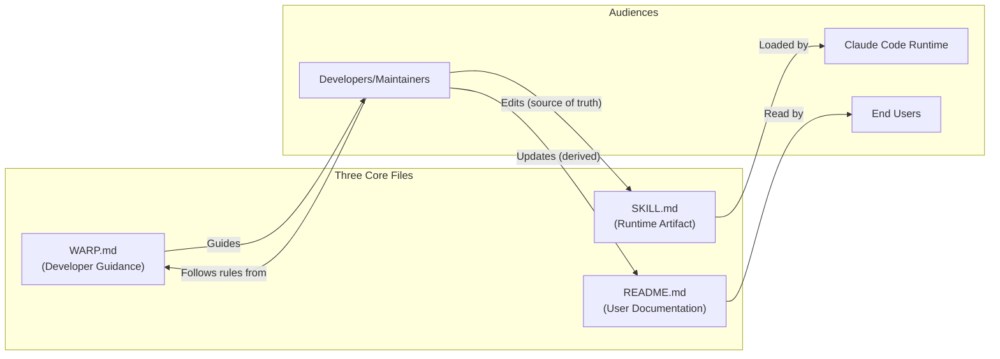
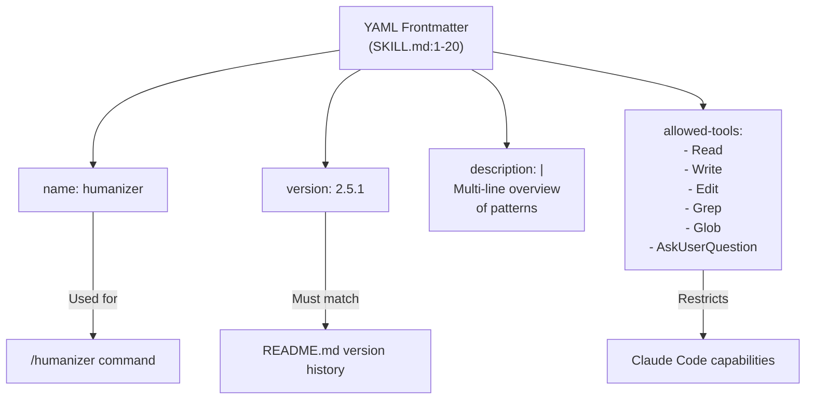
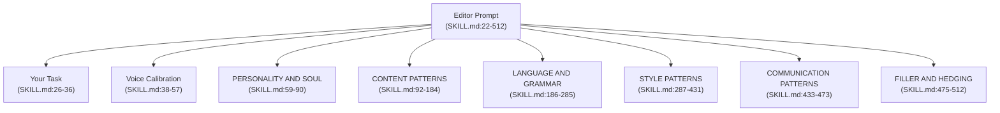
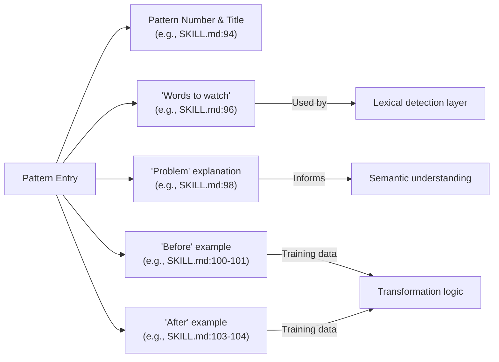
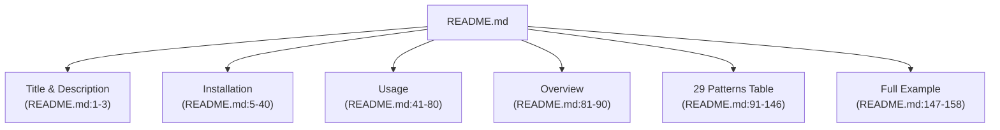
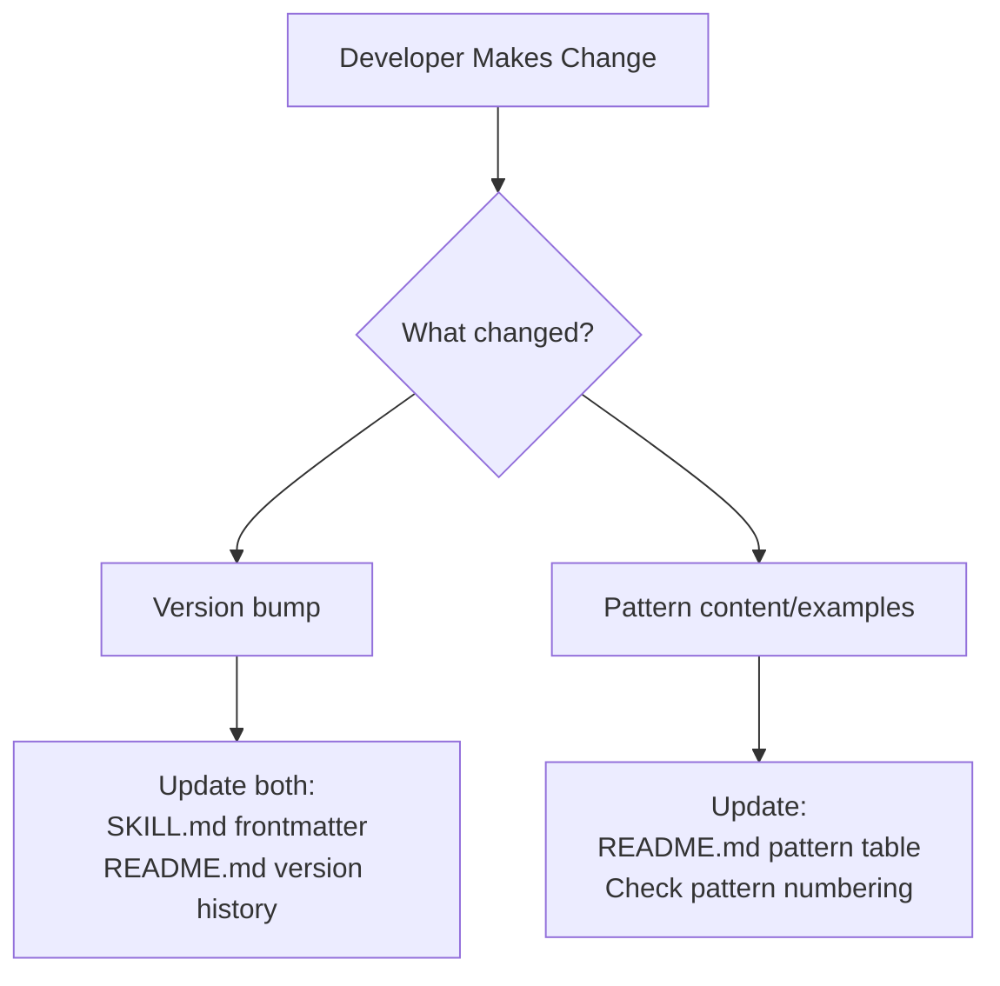

<!-- source: DeepWiki mcp.deepwiki.com · repo blader/humanizer · page 4.2 File Structure and Components · fetched 2026-10-26 -->

# File Structure and Components

Relevant source files

The following files were used as context for generating this wiki page:

- [README.md](README.md)
- [SKILL.md](SKILL.md)
- [WARP.md](WARP.md)

This page provides detailed documentation of the three core files in the Humanizer repository: `SKILL.md` (runtime artifact), `README.md` (user documentation), and `WARP.md` (meta-documentation). Each section explains the internal structure, content organization, and specific components within these files. For information about how these files relate to each other and the overall system architecture, see [System Architecture](#4.1). For maintenance workflows and synchronization requirements, see [Synchronization Protocol](#5.2).

---

## Overview: Three-File System

The Humanizer skill consists of exactly three Markdown files, each serving a distinct purpose and audience.

**Sources:** [README.md:1-158](), [SKILL.md:1-512](), [WARP.md:1-53]()

---

## SKILL.md: Runtime Artifact

`SKILL.md` is the authoritative source of truth consumed directly by the Claude Code and OpenCode runtimes. It consists of two main components: YAML frontmatter (metadata) and the editor prompt (processing instructions).

### YAML Frontmatter Structure

The frontmatter at [SKILL.md:1-20]() defines metadata and runtime configuration:

| Field | Type | Purpose | Value |
|-------|------|---------|-------|
| `name` | String | Skill identifier for invocation | `humanizer` |
| `version` | String (SemVer) | Version tracking (must match README) | `2.5.1` |
| `description` | Multi-line string | Skill summary and pattern preview | [SKILL.md:4-10]() |
| `allowed-tools` | Array | Permitted Claude Code tools | `[Read, Write, Edit, Grep, Glob, AskUserQuestion]` |

**Sources:** [SKILL.md:1-20]()

### Editor Prompt Structure

The editor prompt begins at [SKILL.md:22]() and contains the complete processing instructions. It is organized into several functional blocks:

**Sources:** [SKILL.md:22-512]()

### Pattern Entry Structure

Each of the 29 patterns follows a consistent structure. For example, Pattern #1 at [SKILL.md:94-105]():

| Component | Purpose | Example Content |
|-----------|---------|-----------------|
| Pattern Number & Title | Identifies the pattern | `### 1. Undue Emphasis on Significance, Legacy, and Broader Trends` |
| **Words to watch** | Lexical triggers for detection | `stands/serves as, is a testament/reminder, pivotal/crucial role` |
| **Problem** | Explains why this is AI-like | `LLM writing puffs up importance by adding statements...` |
| **Before** | AI-generated example | `marking a pivotal moment in the evolution of...` |
| **After** | Humanized version | `was established in 1989 to collect regional statistics` |

**Sources:** [SKILL.md:94-105](), [SKILL.md:188-198](), [SKILL.md:289-298]()

### Pattern Categories and Distribution (v2.5.1)

The 29 patterns are grouped into five categories:

| Category | Line Range | Pattern Count | Pattern Numbers |
|----------|------------|---------------|-----------------|
| CONTENT PATTERNS | [SKILL.md:92-184]() | 6 | #1-6 |
| LANGUAGE AND GRAMMAR | [SKILL.md:186-285]() | 7 | #7-13 |
| STYLE PATTERNS | [SKILL.md:287-431]() | 10 | #14-19, #26-29 |
| COMMUNICATION PATTERNS | [SKILL.md:433-473]() | 3 | #20-22 |
| FILLER AND HEDGING | [SKILL.md:475-512]() | 3 | #23-25 |

**Sources:** [SKILL.md:92-512]()

---

## README.md: User Documentation

`README.md` serves as human-readable documentation for end users. It mirrors content from `SKILL.md` but in a more compact format, including installation paths and usage examples.

### Document Structure

**Sources:** [README.md:1-158]()

### Installation and Usage Components

The `README.md` provides specific commands for both Claude Code and OpenCode:

- **Installation Paths:** `~/.claude/skills/humanizer` [README.md:13]() and `~/.config/opencode/skills/humanizer` [README.md:29]().
- **Voice Calibration:** Instructions for matching personal writing styles [README.md:65-80]().
- **Command Invocation:** Documentation of the `/humanizer` command [README.md:46, 54]().

**Sources:** [README.md:5-80]()

---

## WARP.md: Developer Guidance

`WARP.md` provides meta-documentation for developers. It explains the relationship between files and critical synchronization requirements.

### Key Files Section

The "Key files (and how they relate)" section at [WARP.md:12-21]() defines the source-of-truth hierarchy:

| File | Role | Key Content |
|------|------|-------------|
| `SKILL.md` | **Source of truth** | YAML frontmatter, canonical pattern list, and detailed prompt logic. |
| `README.md` | Derived documentation | Installation, usage, and a summarized 29-pattern table. |

Critical rule from [WARP.md:21]():
> When changing behavior/content, treat `SKILL.md` as the source of truth, and update `README.md` to stay consistent.

**Sources:** [WARP.md:12-21]()

### Versioning and Synchronization

The "Making changes safely" section at [WARP.md:41-53]() defines requirements for versioning and prompt maintenance:

- **Version Matching:** `SKILL.md` frontmatter `version` [SKILL.md:3]() must match the project's state.
- **Pattern Stability:** Maintainers must keep pattern numbering stable [WARP.md:50]() because the `README.md` table references them [README.md:95-145]().
- **Non-obvious fixes:** Tricky failure mode resolutions should be documented [WARP.md:53]().

**Sources:** [WARP.md:41-53]()

---

## Validation Checklist

From [WARP.md:48-53](), maintainers must verify:

| Check | SKILL.md Location | README.md Location | Requirement |
|-------|-------------------|-------------------|-------------|
| YAML valid | [SKILL.md:1-20]() | N/A | Valid YAML syntax, proper indentation |
| Version match | [SKILL.md:3]() | N/A | Current project version (v2.5.1) |
| Pattern numbers | [SKILL.md:94-512]() | [README.md:95-145]() | Sequential 1-29, no gaps |
| Pattern Count | [SKILL.md:7]() | [README.md:91]() | Must reflect 29 patterns |

**Sources:** [SKILL.md:1-512](), [README.md:1-158](), [WARP.md:41-53]()

---

