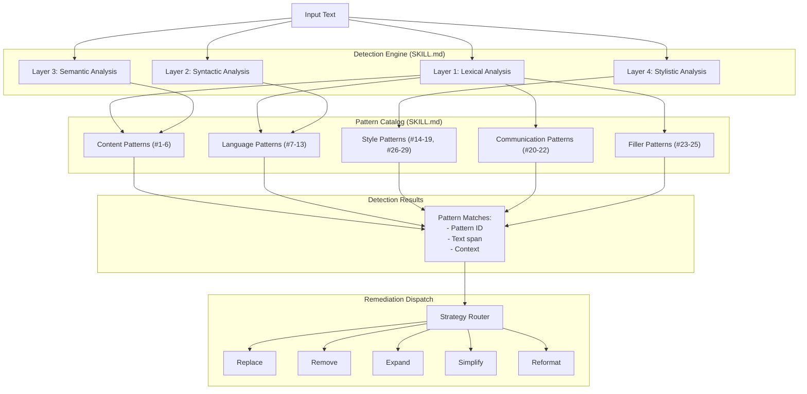
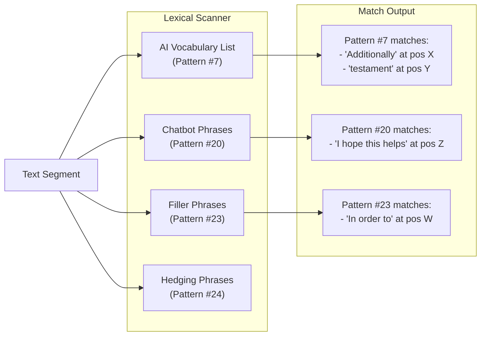
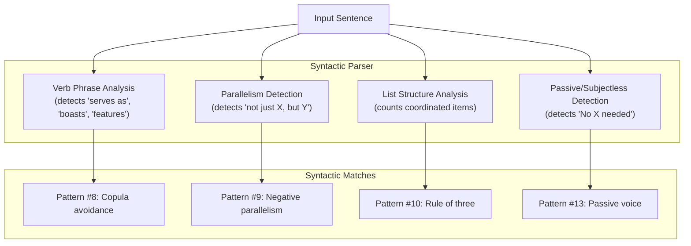
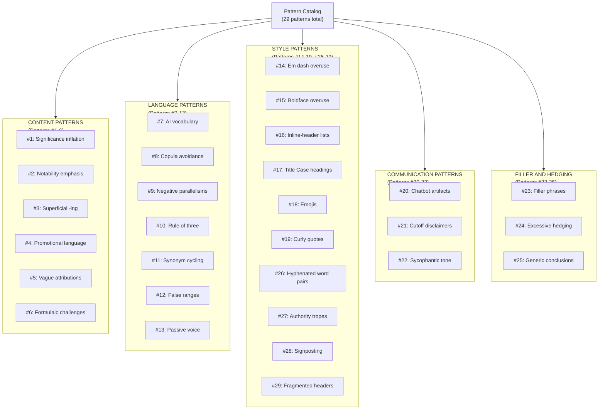

<!-- source: DeepWiki mcp.deepwiki.com · repo blader/humanizer · page 4.4 Pattern Detection and Remediation · fetched 2026-10-26 -->

# Pattern Detection and Remediation

Relevant source files

The following files were used as context for generating this wiki page:

- [README.md](README.md)
- [SKILL.md](SKILL.md)

This page documents the technical mechanisms by which the Humanizer skill identifies AI writing patterns in input text and applies appropriate transformations to remediate them. It covers the four-layer detection architecture (lexical, syntactic, semantic, stylistic), the pattern catalog structure, and the remediation strategies employed by the system.

For information about the overall processing pipeline and how detection fits into the complete transformation workflow, see [Processing Pipeline](#4.3). For details on the quality assurance checks that validate remediation effectiveness, see [Quality Assurance and Personality Injection](#4.5).

---

## Detection Architecture Overview

The Humanizer employs a multi-layer analysis architecture that scans input text at four distinct levels of abstraction. Each layer operates independently and can identify different categories of AI writing patterns. The detection system processes text segments and produces a set of pattern matches, each associated with a pattern ID (1-29), text location, and implicit confidence based on the specificity of the match.

**Detection-to-Remediation Architecture**

Sources: [SKILL.md:26-36](), [README.md:91-145]()

---

## Four-Layer Analysis System

### Layer 1: Lexical Analysis

Lexical analysis performs direct pattern matching against known AI vocabulary, filler phrases, and chatbot artifacts. This is the most straightforward detection layer, operating on surface-level text features.

**Pattern Categories Detected:**
- Pattern #7: AI vocabulary words [SKILL.md:162-170]()
- Pattern #20: Chatbot artifacts [SKILL.md:330-341]()
- Pattern #23: Filler phrases [SKILL.md:372-381]()
- Pattern #24: Excessive hedging [SKILL.md:383-393]()

**Detection Mechanism:**

The lexical layer scans for specific word sequences and phrases enumerated in the pattern catalog. For example:

| Pattern | Detection Target | Example Match |
|---------|------------------|---------------|
| #7 (AI vocabulary) | `Additionally`, `testament`, `landscape`, `showcasing`, `delve`, `intricate`, `tapestry` | "Additionally, a distinctive feature..." |
| #20 (Chatbot artifacts) | `I hope this helps`, `Let me know`, `Would you like...`, `Certainly!` | "I hope this helps! Let me know if..." |
| #23 (Filler phrases) | `In order to`, `Due to the fact that`, `At this point in time` | "In order to achieve this goal" |
| #24 (Excessive hedging) | `could potentially possibly`, `might have some effect` | "It could potentially possibly be argued" |

**Lexical Pattern Matching Flow**

Sources: [SKILL.md:162-170](), [SKILL.md:330-341](), [SKILL.md:372-393]()

---

### Layer 2: Syntactic Analysis

Syntactic analysis identifies grammatical constructions and sentence patterns characteristic of AI-generated text. This layer operates on the structural level, detecting how words are arranged rather than which specific words appear.

**Pattern Categories Detected:**
- Pattern #8: Copula avoidance [SKILL.md:188-199]()
- Pattern #9: Negative parallelisms [SKILL.md:201-211]()
- Pattern #10: Rule of three [SKILL.md:213-223]()
- Pattern #11: Synonym cycling (elegant variation) [SKILL.md:225-235]()
- Pattern #12: False ranges [SKILL.md:237-247]()
- Pattern #13: Passive voice / subjectless fragments [SKILL.md:249-259]()

**Detection Mechanism:**

The syntactic layer recognizes grammatical patterns through structural matching:

| Pattern | Syntactic Structure | Example |
|---------|---------------------|---------|
| #8 (Copula avoidance) | `[subject] serves as [noun]` | "Gallery 825 serves as LAAA's exhibition space" |
| #9 (Negative parallelisms) | `It's not just X, it's Y` | "It's not just about the beat; it's part of the aggression" |
| #10 (Rule of three) | Lists of exactly 3 items | "innovation, inspiration, and insights" |
| #13 (Passive voice) | Subjectless fragments | "No configuration file needed" |

**Syntactic Pattern Analysis Flow**

Sources: [SKILL.md:188-259]()

---

### Layer 3: Semantic Analysis

Semantic analysis operates at the meaning level, identifying content that exhibits AI-characteristic interpretations, attributions, or framing. This requires contextual understanding beyond surface features.

**Pattern Categories Detected:**
- Pattern #1: Significance inflation [SKILL.md:94-105]()
- Pattern #2: Notability name-dropping [SKILL.md:107-118]()
- Pattern #3: Superficial -ing analyses [SKILL.md:120-131]()
- Pattern #4: Promotional language [SKILL.md:133-144]()
- Pattern #5: Vague attributions [SKILL.md:146-159]()
- Pattern #27: Persuasive authority tropes [SKILL.md:304-314]()

**Detection Mechanism:**

The semantic layer identifies patterns through meaning-level analysis:

| Pattern | Semantic Indicator | Example |
|---------|-------------------|---------|
| #1 (Significance inflation) | Grandiose claims about importance | "marking a pivotal moment in the evolution of..." |
| #3 (Superficial -ing) | Present participle phrases adding fake depth | "reflecting the community's deep connection to the land" |
| #27 (Authority tropes) | Pseudo-philosophical framing | "At its core, what matters is..." |

Sources: [SKILL.md:94-159](), [SKILL.md:304-314]()

---

### Layer 4: Stylistic Analysis

Stylistic analysis examines formatting, punctuation, and visual presentation patterns. This layer detects AI writing signatures that appear in how text is formatted rather than what it says.

**Pattern Categories Detected:**
- Pattern #14: Em dash overuse [SKILL.md:262-273]()
- Pattern #15: Boldface overuse [SKILL.md:275-285]()
- Pattern #16: Inline-header lists [SKILL.md:288-299]()
- Pattern #17: Title Case headings [SKILL.md:301-311]()
- Pattern #18: Emojis [SKILL.md:314-325]()
- Pattern #26: Hyphenated word pairs [SKILL.md:292-302]()
- Pattern #28: Signposting announcements [SKILL.md:316-326]()

**Detection Mechanism:**

| Pattern | Stylistic Feature | Detection Method |
|---------|------------------|------------------|
| #14 (Em dash overuse) | Frequency of `—` (em dash) | Count em dashes per sentence; flag if excessive |
| #16 (Inline-header lists) | Bullet items starting with `**Header:**` | Regex match for bold headers in lists |
| #28 (Signposting) | Phrases announcing future content | Detect "Let's dive in", "Here's what you need to know" |

Sources: [SKILL.md:262-326]()

---

## Pattern Catalog Structure

The pattern catalog is defined in [SKILL.md:94-396]() and organized into five categorical sections. Each pattern entry follows a consistent structure optimized for both human readability and AI processing.

### Catalog Organization (v2.5.1)

Sources: [SKILL.md:94-396](), [README.md:91-145]()

---

## Remediation Strategies

### Strategy 1: Replace
**Application:** Simple word or phrase substitution where a direct equivalent exists.
- **Pattern #7 (AI vocabulary):** `Additionally` → `also` [SKILL.md:162-170]()
- **Pattern #23 (Filler phrases):** `In order to` → `To` [SKILL.md:372-381]()

### Strategy 2: Remove
**Application:** Complete deletion of content that adds no value.
- **Pattern #18 (Emojis):** Remove entirely [SKILL.md:314-325]()
- **Pattern #20 (Chatbot artifacts):** Remove `I hope this helps!` [SKILL.md:330-341]()
- **Pattern #28 (Signposting):** Remove "Let's dive in" [SKILL.md:316-326]()

### Strategy 3: Expand
**Application:** Replace vague or generic content with specific, verifiable information.
- **Pattern #5 (Vague attributions):** Replace `Experts believe` with specific source citation [SKILL.md:146-159]()
- **Pattern #25 (Generic conclusions):** Replace `The future looks bright` with specific plans [SKILL.md:395-405]()

### Strategy 4: Simplify
**Application:** Reduce grammatical complexity.
- **Pattern #8 (Copula avoidance):** `serves as` → `is` [SKILL.md:188-199]()
- **Pattern #13 (Passive voice):** Convert subjectless fragments to active voice [SKILL.md:249-259]()

### Strategy 5: Reformat
**Application:** Fix visual presentation and formatting.
- **Pattern #14 (Em dash overuse):** Replace `—` with commas or periods [SKILL.md:262-273]()
- **Pattern #16 (Inline-header lists):** Convert to prose [SKILL.md:288-299]()

Sources: [SKILL.md:94-405]()

---

