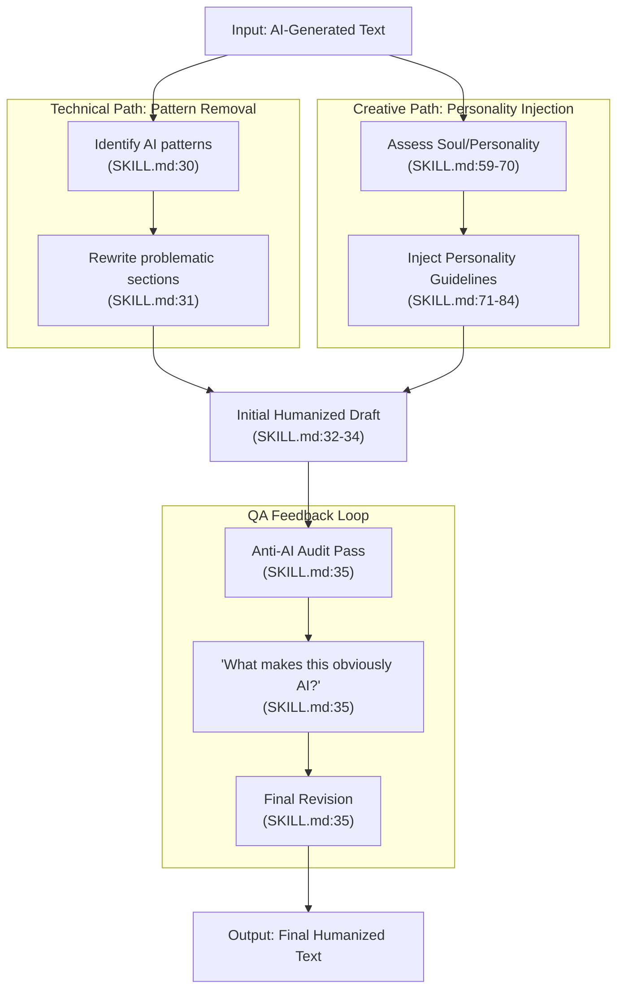
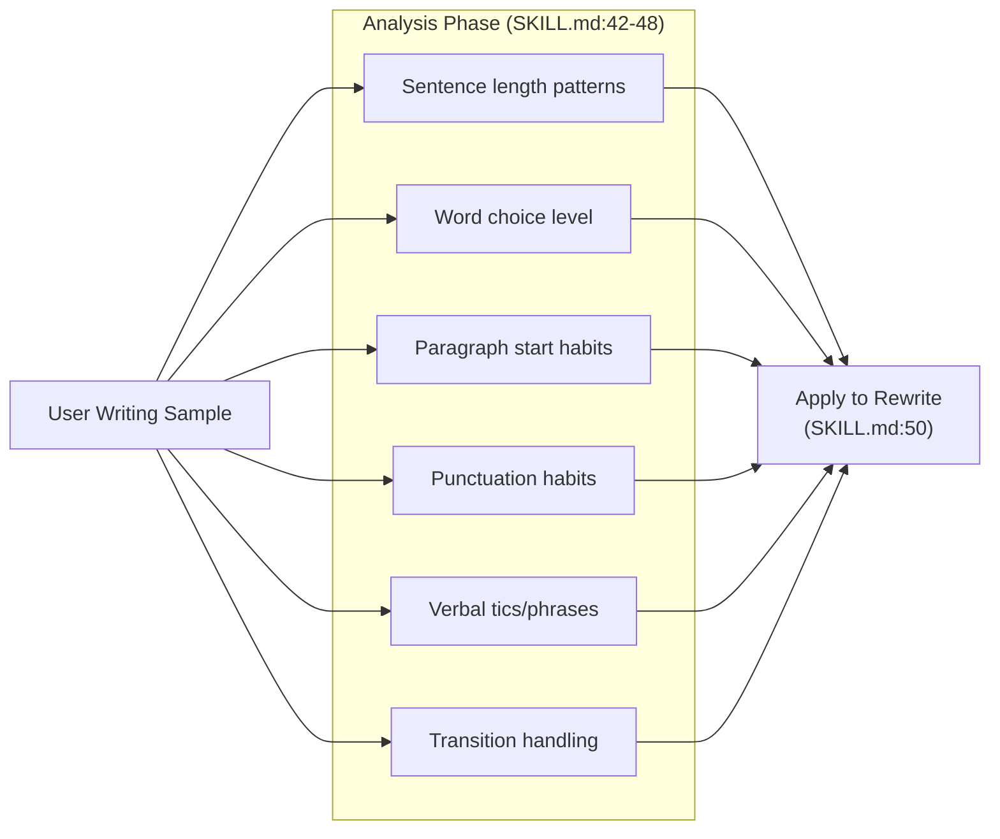

<!-- source: DeepWiki mcp.deepwiki.com · repo blader/humanizer · page 4.5 Quality Assurance and Personality Injection · fetched 2026-10-26 -->

# Quality Assurance and Personality Injection

Relevant source files

The following files were used as context for generating this wiki page:

- [README.md](README.md)
- [SKILL.md](SKILL.md)

## Purpose and Scope

This document covers the quality assurance framework and personality injection mechanisms that ensure Humanizer's output is not merely pattern-free but genuinely human-sounding. While pattern detection and remediation handles the technical removal of AI writing markers, this component addresses the more challenging problem: preventing sterile, voiceless output that is technically "clean" but obviously machine-generated.

The quality assurance system implements a mandatory anti-AI audit pass and a feedback loop that triggers re-processing when output fails validation. The personality injection system provides concrete guidelines for adding "soul" to writing—opinions, varied rhythm, complexity acknowledgment, first-person perspective, and emotional specificity.

---

## Dual-Purpose Processing Architecture

The Humanizer employs a parallel processing model that separates technical pattern removal from creative personality enhancement. Both processes operate simultaneously on input text and merge before the final quality validation pass.

**Sources:** [SKILL.md:26-36](), [SKILL.md:59-90]()

This architecture ensures that text passing through Humanizer undergoes both mechanical pattern correction and holistic voice enhancement. The final audit pass prevents output of text that meets technical criteria but fails human authenticity tests.

---

## Quality Assurance Framework: The Anti-AI Pass

The primary QA mechanism is the **Final Anti-AI Pass**. Unlike standard LLM editing, Humanizer is instructed to perform a self-adversarial audit as the final step of the processing pipeline.

### The Audit Protocol
As defined in the system instructions, the model must perform a two-step internal dialogue before finalizing the output:

1.  **Detection:** Ask: "What makes the below so obviously AI generated?" [SKILL.md:35]()
2.  **Remediation:** Answer briefly with remaining "tells," then prompt: "Now make it not obviously AI generated." and perform the final revision. [SKILL.md:35]()

### Quality Check Priorities
During this pass, the system prioritizes five core transformation tasks:
1.  **Identify AI patterns:** Scan for the 29 documented patterns. [SKILL.md:30]()
2.  **Rewrite problematic sections:** Replace AI-isms with natural alternatives. [SKILL.md:31]()
3.  **Preserve meaning:** Ensure the core message is not lost during humanization. [SKILL.md:32]()
4.  **Maintain voice:** Match the intended tone (formal, casual, etc.). [SKILL.md:33]()
5.  **Add soul:** Inject personality to move beyond "clean but sterile" text. [SKILL.md:34]()

**Sources:** [SKILL.md:26-36](), [README.md:85-86]()

---

## Personality Injection System

The personality injection system addresses the core problem that removing AI patterns is insufficient—output must also have an authentic human voice. This system provides concrete, actionable guidelines for adding "soul" to writing.

### Soul Assessment: Identifying Soulless Writing

Even text that passes all 29 pattern checks can exhibit telltale signs of machine generation. The soul assessment phase evaluates indicators of voiceless writing:

| Indicator | Description | Location |
|-----------|-------------|----------|
| **Uniformity** | Every sentence is the same length and structure | [SKILL.md:64]() |
| **Neutrality** | No opinions, just neutral reporting | [SKILL.md:65]() |
| **Certainty** | No acknowledgment of uncertainty or mixed feelings | [SKILL.md:66]() |
| **Detachment** | No first-person perspective when appropriate | [SKILL.md:67]() |
| **Sterility** | No humor, no edge, no personality | [SKILL.md:68]() |
| **Formality** | Reads like a Wikipedia article or press release | [SKILL.md:69]() |

**Sources:** [SKILL.md:59-70]()

### Voice Injection Guidelines

The system implements specific techniques for adding authentic voice to text:

#### 1. Opinion Injection
**Directive:** "Have opinions. Don't just report facts - react to them." [SKILL.md:73]()
**Logic:** Real humans react to the information they share. Neutral listing of pros and cons is a common AI "tell."

#### 2. Rhythm Variation
**Directive:** "Vary your rhythm. Short punchy sentences. Then longer ones... Mix it up." [SKILL.md:75]()
**Logic:** Algorithmic text often clusters around a mean sentence length. Human writing uses cadence for emphasis.

#### 3. Complexity Acknowledgment
**Directive:** "Acknowledge complexity. Real humans have mixed feelings." [SKILL.md:77]()
**Logic:** Replacing "This is impressive" with "This is impressive but also kind of unsettling" creates a human-like cognitive dissonance. [SKILL.md:77-78]()

#### 4. First-Person Perspective
**Directive:** "Use 'I' when it fits. First person isn't unprofessional - it's honest." [SKILL.md:79]()
**Logic:** Phrases like "I keep coming back to..." or "Here's what gets me..." signal a real person is thinking. [SKILL.md:79-80]()

#### 5. Structural Imperfection
**Directive:** "Let some mess in. Perfect structure feels algorithmic." [SKILL.md:81]()
**Logic:** Tangents, asides, and half-formed thoughts mimic the natural human thought process.

**Sources:** [SKILL.md:71-84]()

---

## Voice Calibration

The Humanizer includes an optional calibration step to match a specific user's writing style rather than relying on the default "soul" settings.

### Calibration Logic
If a user provides a sample, the system performs a specific analysis before rewriting:

**Sources:** [SKILL.md:38-52](), [README.md:65-80]()

### Implementation Detail
When a sample is provided, the system is instructed to replace AI patterns with patterns identified in the sample. For example, if a user uses "stuff" and "things," the system must not "upgrade" them to "elements" and "components" during humanization. [SKILL.md:50]()

---

## Personality Transformation Example

The system demonstrates the difference between technically clean but soulless text versus genuinely humanized output through a canonical example:

### Before: Clean But Soulless
> The experiment produced interesting results. The agents generated 3 million lines of code. Some developers were impressed while others were skeptical. The implications remain unclear. [SKILL.md:86]()

### After: Has a Pulse
> I genuinely don't know how to feel about this one. 3 million lines of code, generated while the humans presumably slept. Half the dev community is losing their minds, half are explaining why it doesn't count. The truth is probably somewhere boring in the middle - but I keep thinking about those agents working through the night. [SKILL.md:89]()

**Analysis of Transformation:**
1.  **First Person:** Added "I genuinely don't know." [SKILL.md:79]()
2.  **Rhythm:** Mixed short sentences with longer, descriptive ones. [SKILL.md:75]()
3.  **Specific Feelings:** Replaced "implications remain unclear" with "somewhere boring in the middle" and the image of agents "working through the night." [SKILL.md:83]()

**Sources:** [SKILL.md:85-90]()

---

