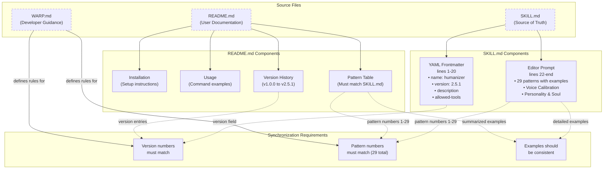
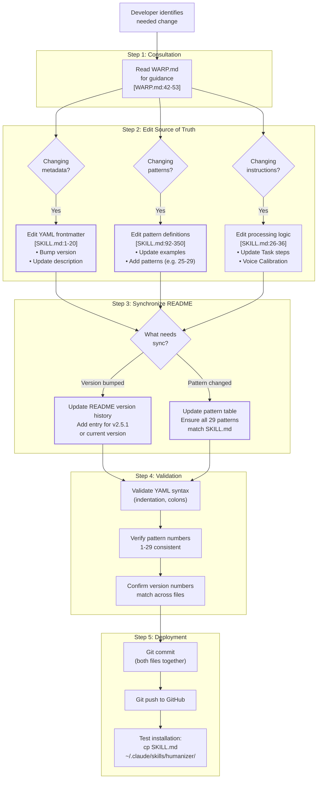
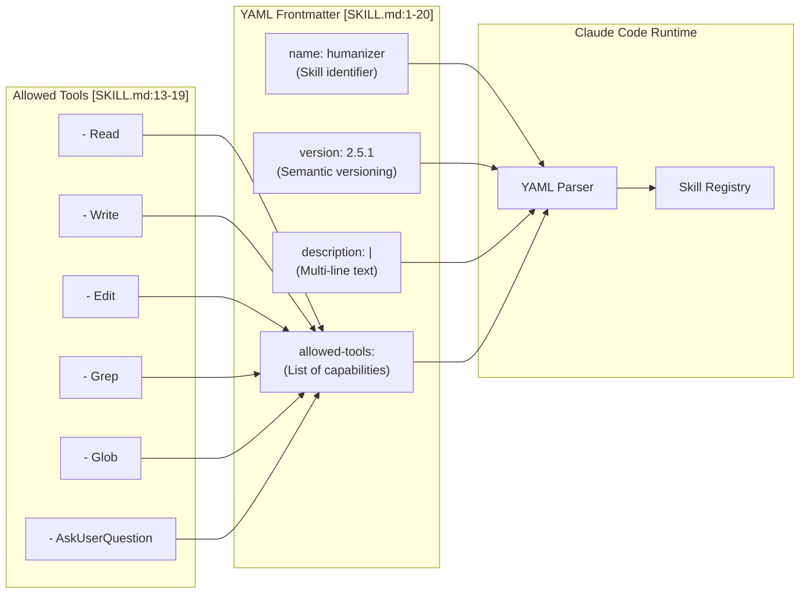

<!-- source: DeepWiki mcp.deepwiki.com · repo blader/humanizer · page 5 Developer Guide · fetched 2026-10-26 -->

# Developer Guide

Relevant source files

The following files were used as context for generating this wiki page:

- [LICENSE](LICENSE)
- [SKILL.md](SKILL.md)
- [WARP.md](WARP.md)

## Purpose and Scope

This guide is for developers and maintainers who need to modify, update, or contribute to the Humanizer skill. It covers the maintenance workflow, file synchronization requirements, versioning protocols, and development best practices specific to this Markdown-based Claude Code skill.

For installation and usage instructions, see [Installation and Usage](#2). For detailed pattern documentation, see [AI Writing Patterns](#3). For technical architecture details, see [Architecture and Implementation](#4).

The Humanizer repository differs from traditional codebases in that it contains no executable code—only three Markdown files that define runtime behavior, user documentation, and maintenance guidance respectively.

Sources: [WARP.md:1-6](), [SKILL.md:1-20]()

---

## Repository Structure

The Humanizer skill consists of three Markdown files with distinct purposes and audiences. Understanding their relationships is critical for maintenance.

### File Relationships and Synchronization

**Key File Locations:**

| File | Purpose | Primary Audience | Lines of Interest |
|------|---------|------------------|-------------------|
| `SKILL.md` | Runtime artifact loaded by Claude Code | Claude AI | [SKILL.md:1-20]() (YAML), [SKILL.md:92-350]() (patterns) |
| `README.md` | Installation and usage documentation | End users | (Usage & Version History) |
| `WARP.md` | Maintenance guidelines | Developers | [WARP.md:12-21]() (file relationships), [WARP.md:42-53]() (editing rules) |

Sources: [WARP.md:12-21](), [SKILL.md:1-20]()

---

## Developer Workflow

The following diagram illustrates the complete workflow for making changes to the Humanizer skill, from initial edit through deployment.

Sources: [WARP.md:42-53](), [SKILL.md:1-350]()

---

## YAML Frontmatter Structure

The YAML frontmatter in `SKILL.md` defines the skill's metadata and capabilities. This structure is parsed by Claude Code at runtime.

**Critical YAML Fields:**

| Field | Type | Purpose | Editing Rules |
|-------|------|---------|---------------|
| `name` | String | Skill identifier used in `/humanizer` command | Never change (breaks existing installations) [SKILL.md:2]() |
| `version` | String | Semantic version number | Must match README version history [SKILL.md:3](), [WARP.md:43-46]() |
| `description` | Multi-line | Displayed in skill list | Update when behavior changes significantly [SKILL.md:4-10]() |
| `allowed-tools` | List | Permissions for file operations | Current tools: Read, Write, Edit, Grep, Glob, AskUserQuestion [SKILL.md:13-19]() |

Sources: [SKILL.md:1-20](), [WARP.md:43-46]()

---

## Key Development Concepts

### Source of Truth Hierarchy

The repository maintains a strict hierarchy to prevent documentation drift:

1. **SKILL.md** is the canonical source of truth for all behavior and pattern definitions [WARP.md:21]().
2. **README.md** is derived documentation that must be updated to match SKILL.md changes [WARP.md:21]().
3. **WARP.md** is meta-documentation that defines the synchronization rules [WARP.md:1-3]().

**Rule:** Never edit README.md independently. Always edit SKILL.md first, then synchronize README.md according to the rules in WARP.md.

Sources: [WARP.md:12-21]()

### Pattern Numbering Stability

The patterns are numbered 1-29 across both SKILL.md and README.md. Pattern numbers are referenced in:

- [SKILL.md:92-350]() - Detailed pattern definitions with examples.
- User documentation and README pattern summaries.

**Rule:** Keep the pattern numbering stable unless intentionally re-numbering. The numbering in SKILL.md must remain consistent with the README table.

Sources: [WARP.md:49-50](), [SKILL.md:92-350]()

### Versioning Protocol

Version numbers use semantic versioning and must be synchronized:

- **SKILL.md YAML frontmatter:** [SKILL.md:3]() - `version: 2.5.1`
- **README.md version history:** Must contain a matching entry describing changes.

**Rule:** Every version bump requires a corresponding entry in README.md version history describing what changed.

Sources: [WARP.md:42-46](), [SKILL.md:3]()

### Non-Obvious Fixes

When fixing tricky failure modes (e.g., repeated mis-edits or unexpected tone shifts), document the fix in README.md's version history. This helps future maintainers understand why certain prompt instructions exist.

Sources: [WARP.md:51-53]()

---

## Validation Checklist

Before committing changes, verify:

- [ ] YAML frontmatter is syntactically valid [SKILL.md:1-20]().
- [ ] Version number in [SKILL.md:3]() matches the latest entry in README.md.
- [ ] Pattern numbers 1-29 are consistent between SKILL.md and README.md [WARP.md:49-50]().
- [ ] Non-obvious fixes are documented in the version history [WARP.md:51-53]().
- [ ] Both SKILL.md and README.md are committed together to maintain sync.

Sources: [WARP.md:42-53]()

---

## Next Steps

For detailed information on specific maintenance tasks:

- **[Maintenance Guidelines](#5.1)** — Explain WARP.md's role as meta-documentation and the workflow for making changes.
- **[Synchronization Protocol](#5.2)** — Document critical synchronization requirements for versioning and the 29-pattern set.
- **[Version History and Evolution](#5.3)** — Document the history through v2.5.1, including the major v2.0.0 rewrite and recent pattern additions.

Sources: [WARP.md:1-53]()

---

