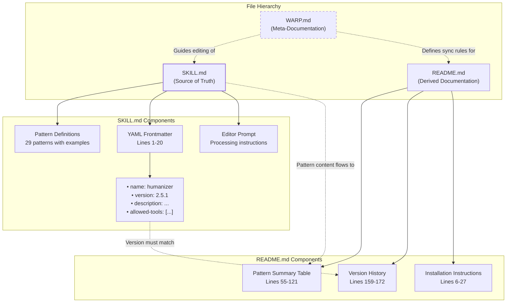
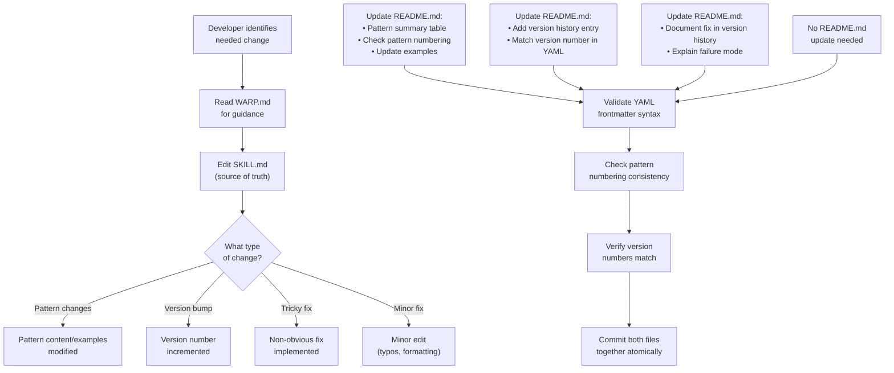

<!-- source: DeepWiki mcp.deepwiki.com · repo blader/humanizer · page 5.1 Maintenance Guidelines · fetched 2026-10-26 -->

# Maintenance Guidelines

<details>
<summary>Relevant source files</summary>

The following files were used as context for generating this wiki page:

- [SKILL.md](SKILL.md)
- [WARP.md](WARP.md)

</details>


## Purpose and Scope

This page documents the maintenance workflow for the Humanizer skill, including editing procedures, synchronization requirements, and validation checks. It explains the role of `WARP.md` as meta-documentation, the source-of-truth hierarchy between files, and the rules for keeping `SKILL.md` and `README.md` consistent.

The current version of the system (v2.5.1) tracks 29 distinct AI writing patterns. Maintaining this catalog requires strict adherence to synchronization protocols to prevent documentation drift between the runtime instructions and the user-facing documentation.

**Sources:** [WARP.md:1-53](), [SKILL.md:1-20](), [README.md:1-25]()

---

## WARP.md: Meta-Documentation for Developers

`WARP.md` serves as the developer's guide for maintaining the Humanizer skill. It provides authoritative guidance on the file structure, editing workflow, and synchronization requirements.

### Role and Contents

| Aspect | Description |
|--------|-------------|
| **Primary Audience** | Developers and maintainers (especially WARP IDE users) |
| **File Location** | [WARP.md:1-53]() |
| **Key Sections** | Repository overview, file relationships, common commands, safe editing procedures |
| **Authority** | Defines maintenance rules that prevent documentation drift |

The file explicitly states the three-file architecture at [WARP.md:12-21]():

- **`SKILL.md`**: The runtime artifact. Claude Code reads the YAML frontmatter and the editor prompt [WARP.md:8-9]().
- **`README.md`**: Human-readable documentation for installation, usage, and a compact overview of patterns [WARP.md:10-10]().
- **`WARP.md`**: Meta-documentation that guides maintenance of the other two [WARP.md:3-4]().

### Key Maintenance Principle

The fundamental rule for any modification as stated in [WARP.md:21]():

> When changing behavior/content, treat `SKILL.md` as the source of truth, and update `README.md` to stay consistent.

**Sources:** [WARP.md:1-21]()

---

## Source-of-Truth Hierarchy



**Diagram: File Structure and Component Relationships**

The hierarchy enforces unidirectional flow: changes start in `SKILL.md`, propagate to `README.md`, and `WARP.md` governs the process.

**Sources:** [WARP.md:12-21](), [SKILL.md:1-20](), [README.md:55-172]()

---

## YAML Frontmatter Requirements

The YAML frontmatter at [SKILL.md:1-20]() contains the skill's metadata and runtime configuration. This section must maintain valid YAML formatting for the skill to be recognized by `claude-code` or `opencode`.

### Frontmatter Structure

```yaml
---
name: humanizer
version: 2.5.1
description: |
  Remove signs of AI-generated writing from text. Use when editing or reviewing
  text to make it sound more natural and human-written. Based on Wikipedia's
  comprehensive "Signs of AI writing" guide. Detects and fixes patterns including:
  inflated symbolism, promotional language, superficial -ing analyses, vague
  attributions, em dash overuse, rule of three, AI vocabulary words, passive
  voice, negative parallelisms, and filler phrases.
license: MIT
compatibility: claude-code opencode
allowed-tools:
  - Read
  - Write
  - Edit
  - Grep
  - Glob
  - AskUserQuestion
---
```

### Required Fields

| Field | Type | Purpose | Validation |
|-------|------|---------|------------|
| `name` | string | Skill identifier used by Claude Code | Must be `humanizer` [SKILL.md:2]() |
| `version` | string | Semantic version number | Must match `README.md` version history [WARP.md:46]() |
| `description` | multiline string | Skill purpose and capabilities | Summarizes key pattern categories [SKILL.md:4-10]() |
| `allowed-tools` | list | Tools the skill can invoke | Must include: Read, Write, Edit, Grep, Glob, AskUserQuestion [SKILL.md:13-19]() |

**Critical Rule from [WARP.md:49]():** Preserve valid YAML frontmatter formatting and indentation when editing.

**Sources:** [SKILL.md:1-20](), [WARP.md:42-50]()

---

## Editing Workflow



**Diagram: Maintenance Workflow Decision Tree**

### Step-by-Step Process

1. **Read guidance**: Consult [WARP.md:1-53]() before making changes.
2. **Edit source of truth**: Make all behavior/content changes in `SKILL.md` first.
3. **Determine sync requirements**: Use the decision tree above to identify what needs updating in `README.md`.
4. **Update README.md**: Apply required synchronization updates (e.g., the pattern table at [README.md:55-121]()).
5. **Validate**: Run through validation checklist.
6. **Commit atomically**: Commit both files together to prevent partial updates [WARP.md:46-47]().

**Sources:** [WARP.md:41-53](), [SKILL.md:1-20](), [README.md:159-172]()

---

## Synchronization Rules

### Synchronization Triggers

The following changes to `SKILL.md` require corresponding updates to `README.md`:

#### 1. Pattern Content Changes
**Trigger:** Modifications to pattern definitions, examples, or word lists in the `SKILL.md` pattern library.
**Required Updates:**
- Update the pattern summary table at [README.md:55-121]().
- Verify pattern numbers (currently #1-#29) remain consistent [WARP.md:50]().
- Ensure the categorization (Content, Language, Style, Communication, Filler) matches.

#### 2. Version Number Changes
**Trigger:** Version field modified in YAML frontmatter at [SKILL.md:3]().
**Required Updates:**
- Add new entry to "Version History" at [README.md:159-172]().
- Ensure version number matches exactly between files [WARP.md:46]().

#### 3. Non-Obvious Fixes
**Trigger:** Changes that address tricky failure modes, such as repeated mis-edits or unexpected tone shifts [WARP.md:52]().
**Required Updates:**
- Document the fix in the version history at [README.md:159-172]().
- Explain **why** the change was made to prevent future regressions.

### Pattern Numbering Stability
From [WARP.md:50-51]():
> Keep the pattern numbering stable unless you’re intentionally re-numbering (since the README table and examples reference the same numbering).

Pattern numbers serve as stable identifiers. As of v2.5.1, there are 29 patterns.

**Sources:** [WARP.md:42-53](), [SKILL.md:3-20](), [README.md:55-172]()

---

## Validation Checklist

Before committing changes, verify all items in this checklist:

### YAML Frontmatter Validation
- [ ] Valid YAML syntax (no tabs, correct indentation) [WARP.md:49]().
- [ ] All required fields present: `name`, `version`, `description`, `allowed-tools` [SKILL.md:1-20]().
- [ ] `allowed-tools` list includes `Read`, `Write`, `Edit`, `Grep`, `Glob`, `AskUserQuestion` [SKILL.md:13-19]().

### Pattern Consistency Validation
- [ ] Pattern numbers are consistent (#1-#29) in both `SKILL.md` and `README.md` [WARP.md:50]().
- [ ] Pattern names match exactly between the summary table [README.md:55-121]() and the detailed sections in `SKILL.md`.
- [ ] All patterns have both "Before" and "After" examples.

### Version Synchronization Validation
- [ ] Version in `SKILL.md` YAML [SKILL.md:3]() matches the top entry in `README.md` Version History [README.md:160]().
- [ ] Version follows Semantic Versioning (X.Y.Z).
- [ ] Change description is present for the new version.

**Sources:** [WARP.md:42-53](), [SKILL.md:1-20](), [README.md:55-172]()

---

