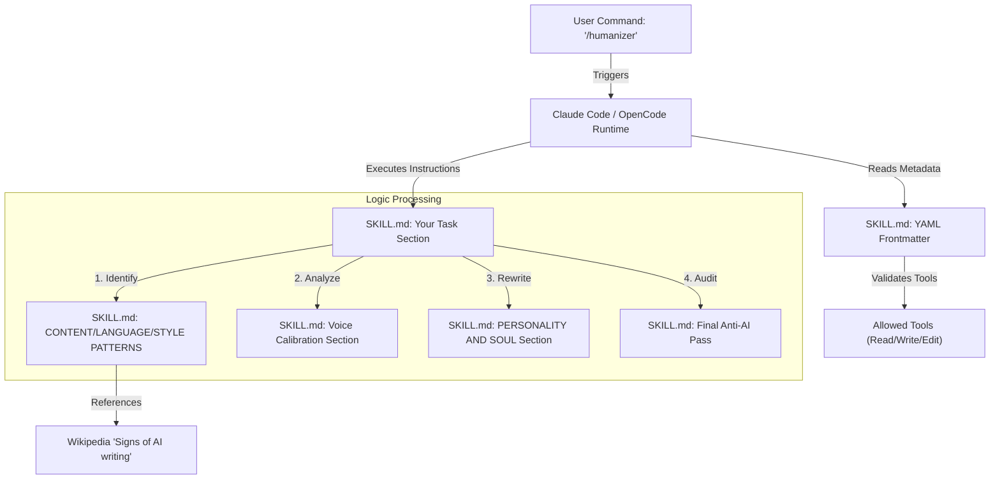
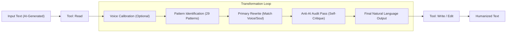

<!-- source: DeepWiki mcp.deepwiki.com · repo blader/humanizer · page 6 Glossary · fetched 2026-10-26 -->

# Glossary

Relevant source files

The following files were used as context for generating this wiki page:

- [LICENSE](LICENSE)
- [README.md](README.md)
- [SKILL.md](SKILL.md)
- [WARP.md](WARP.md)

This glossary provides definitions for codebase-specific terms, jargon, and architectural concepts used in the Humanizer skill. It serves as a reference for onboarding engineers and users to understand the internal logic, pattern categorization, and processing pipeline of the system.

## System Components and Files

### SKILL.md
The primary "runtime" artifact and source of truth for the Humanizer skill [WARP.md:8-9](). It contains YAML frontmatter for metadata (name, version, allowed tools) and the core editor prompt that directs the AI's behavior [SKILL.md:1-20]().

### README.md
The user-facing documentation containing installation instructions, usage examples, and a summarized table of the 29 AI writing patterns [README.md:1-146](). It must be kept in sync with `SKILL.md` regarding versioning and pattern numbering [WARP.md:21-21]().

### WARP.md
Meta-documentation providing guidance for developers and automated tools (like Warp) on how to interact with the repository, maintain file synchronization, and handle versioning [WARP.md:1-53]().

### YAML Frontmatter
The metadata block at the top of `SKILL.md` [SKILL.md:1-20](). It defines the skill's capabilities for Claude Code and OpenCode, including the `allowed-tools` (Read, Write, Edit, Grep, Glob, AskUserQuestion) the AI can use during execution [SKILL.md:13-19]().

**Sources:** [SKILL.md:1-20](), [README.md:1-146](), [WARP.md:1-53]()

---

## Processing Concepts

### Anti-AI Audit Pass
A recursive quality assurance step where the model is prompted to critique its own output by asking, "What makes the below so obviously AI generated?" [SKILL.md:35-35](). The model identifies remaining "tells" and performs a final revision to ensure a natural result [README.md:85-85]().

### Voice Calibration
An optional initialization phase where the user provides a writing sample [SKILL.md:38-38](). The system analyzes sentence rhythm, word choice level, punctuation habits, and transitions to match the user's specific "soul" rather than falling back to a default neutral tone [SKILL.md:40-52]().

### Personality and Soul
A design philosophy in the prompt that prioritizes "messy" human elements—such as opinions, first-person perspective, and varying rhythms—over sterile, perfectly structured, but "soulless" text [SKILL.md:59-84]().

### Wikipedia Foundation
The skill's logic is derived from the "Signs of AI writing" guide maintained by Wikipedia's WikiProject AI Cleanup [SKILL.md:24-24](). This foundation provides the empirical basis for the 29 patterns detected by the system [README.md:83-83]().

**Sources:** [SKILL.md:24-84](), [README.md:83-85]()

---

## Pattern Categories

### Content Patterns
Patterns involving the substance of the text, such as "Significance inflation" (overstating the importance of a topic) or "Vague attributions" (using "experts say" without citations) [SKILL.md:92-146]().

### Language Patterns
Lexical and syntactic "tells," including "AI vocabulary" (words like *testament*, *landscape*, *pivotal*) and "Copula avoidance" (using *serves as* instead of *is*) [SKILL.md:200-264]().

### Style Patterns
Formatting and stylistic choices common in LLM outputs, such as "Em dash overuse," "Inline-header lists," and "Title Case Headings" [SKILL.md:289-400]().

### Communication Patterns
Artifacts of the chatbot-user interaction, such as "Chatbot artifacts" (e.g., "I hope this helps!") and "Sycophantic tone" [SKILL.md:402-430]().

### Filler and Hedging
Phrases that add word count without meaning or excessively qualify statements, such as "In order to" or "could potentially possibly" [SKILL.md:432-463]().

**Sources:** [SKILL.md:92-463](), [README.md:93-146]()

---

## Data Flow and Entity Mapping

The following diagrams illustrate how abstract concepts like "Humanization" are mapped to specific code entities and how data flows through the system.

### Diagram 1: Skill Invocation and Entity Mapping
This diagram bridges the user's natural language command to the specific files and sections that handle the request.

**Sources:** [SKILL.md:1-37](), [WARP.md:8-16](), [README.md:41-63]()

### Diagram 2: The Transformation Pipeline
This diagram shows the technical flow of text as it is processed by the instructions defined in the codebase.

**Sources:** [SKILL.md:26-35](), [SKILL.md:38-52](), [README.md:85-85]()

---

## Technical Terms Table

| Term | Definition | Code Pointer |
|:---|:---|:---|
| **Copula Avoidance** | The tendency of AI to avoid simple verbs like "is" or "has" in favor of "serves as" or "boasts." | [SKILL.md:215-225]() |
| **False Ranges** | Phrases that imply a spectrum where none exists (e.g., "from X to Y"). | [SKILL.md:251-264]() |
| **Rule of Three** | The AI's habit of grouping adjectives or nouns in triplets for rhythmic balance. | [SKILL.md:237-243]() |
| **Signposting** | Announcements of what the text is about to do (e.g., "Let's dive in"). | [SKILL.md:389-393]() |
| **Sycophantic Tone** | Excessive politeness or agreement with the user's prompt. | [SKILL.md:423-430]() |
| **-ing Endings** | Present participle phrases tacked onto sentences to add superficial depth. | [SKILL.md:120-131]() |
| **Fragmented Headers** | Using a header followed immediately by a short, disconnected sentence. | [SKILL.md:395-400]() |
| **Significance Inflation** | Adding "pivotal" or "testament" to make mundane facts seem historic. | [SKILL.md:94-105]() |

**Sources:** [SKILL.md:94-430](), [README.md:93-146]()