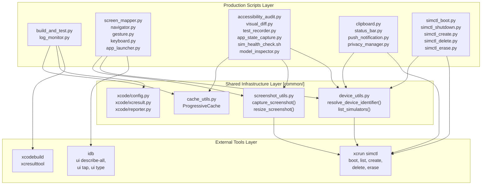
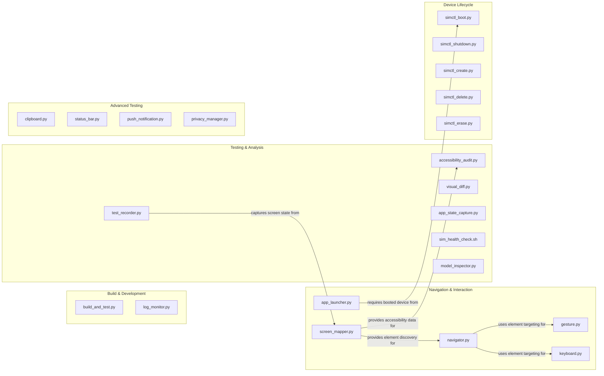

<!-- source: DeepWiki mcp.deepwiki.com · repo conorluddy/ios-simulator-skill · page 1 Overview · fetched 2026-10-26 -->

# Overview

Relevant source files

The following files were used as context for generating this wiki page:

- [.claude-plugin/marketplace.json](.claude-plugin/marketplace.json)
- [README.md](README.md)
- [ios-simulator-skill/.claude-plugin/plugin.json](ios-simulator-skill/.claude-plugin/plugin.json)

This document introduces the `ios-simulator-skill` system, a production-ready iOS simulator automation framework designed for AI agents and developers. The skill provides 22 Python scripts that wrap Apple's `xcrun simctl` and Facebook's `idb` command-line tools with semantic, accessibility-driven interfaces optimized for token efficiency. [README.md:1-12]()

This page covers the system's architecture, component organization, and integration model. For installation and initial setup, see [Getting Started](#2). For detailed documentation of individual scripts, see [Script Categories Overview](#4) and its subsections.

## System Purpose

The `ios-simulator-skill` transforms low-level iOS simulator operations into high-level, meaning-based interactions. Instead of requiring pixel coordinates or raw command-line tool invocations, the system enables semantic navigation through iOS accessibility APIs. [README.md:67-79]()

**Problem**: Traditional iOS automation relies on brittle pixel coordinates or verbose command-line tools that produce thousands of lines of output unsuitable for AI agent consumption. [README.md:85-90]()

**Solution**: The skill provides semantic interfaces (e.g., `python scripts/navigator.py --find-text "Login" --tap`) that query iOS accessibility trees to locate elements by meaning, then automatically calculate coordinates. [README.md:71-77]() Default output is 3-5 lines with progressive disclosure for details, achieving 96% token reduction versus raw tools. [README.md:83-84]()

| Approach | Example | Fragility |
|----------|---------|-----------|
| Pixel-based | `idb ui tap 320 400` | Breaks on different screen sizes, UI changes |
| Raw simctl | `xcrun simctl boot <UDID>` (200+ lines output) | Token-intensive, requires manual parsing |
| This skill | `python scripts/navigator.py --find-text "Login" --tap` | Device-agnostic, survives UI redesigns |

The system is implemented as a Claude Code Skill, meaning it loads minimal tokens into context but remains available for Claude to invoke based on conversation context. [ios-simulator-skill/.claude-plugin/plugin.json:1-4]()

**Sources**: [README.md:1-28](), [README.md:67-90](), [ios-simulator-skill/.claude-plugin/plugin.json:1-4]()

## Core Architecture

The system consists of three architectural layers: production scripts, shared infrastructure, and external tool integration.

The following diagram maps high-level system components to specific code entities and external dependencies.

**Diagram: System Architecture & Entity Mapping**

**Layer Responsibilities**:

1. **Production Scripts** (22 scripts): User-facing command-line interfaces organized into 5 categories. Each script implements a class-based architecture with an `execute()` method returning a success/message tuple. [README.md:91-141]()
2. **Shared Infrastructure**: Cross-cutting concerns supporting all scripts, including `device_utils.py` for UDID resolution and `cache_utils.py` for managing large output data via the `ProgressiveCache` system. [README.md:51-63]()
3. **External Tools**: Wrappers around `xcrun simctl` (lifecycle), `idb` (UI interaction), and `xcodebuild` (compilation). [README.md:9-12]()

For details, see [System Architecture](#1.1).

**Sources**: [README.md:9-12](), [README.md:51-63](), [README.md:91-141]()

## Script Organization by Category

The 22 scripts are organized into 5 functional categories with clear dependencies between layers.

**Diagram: Functional Categories and Interactions**

**Category Details**:

| Category | Scripts | Primary Purpose |
|----------|---------|-----------------|
| **Build & Development** | 2 | Build Xcode projects, run tests, and monitor logs. [README.md:95-101]() |
| **Navigation** | 5 | Discover and interact with UI elements semantically. [README.md:102-111]() |
| **Testing & Analysis** | 6 | WCAG audits, visual regression, and model inspection. [README.md:112-122]() |
| **Advanced Testing** | 4 | Manage clipboard, status bar, and push notifications. [README.md:123-131]() |
| **Device Lifecycle** | 5 | Boot, shutdown, create, delete, and reset simulators. [README.md:132-141]() |

**Sources**: [README.md:95-141]()

## Key Design Principles

The skill is built on several core principles to ensure it is effective for both human developers and AI agents. For details, see [Design Principles](#1.2).

### Progressive Disclosure and Token Efficiency
Large outputs (build logs, accessibility trees) are cached with unique IDs. Default output is minimal (summary line), achieving a 96% reduction in token usage compared to raw tool output. Users drill into details using specific flags like `--get-errors` or `--get-log`. [README.md:49-65](), [README.md:81-90]()

### Semantic Navigation
Instead of fragile pixel coordinates, the skill uses iOS accessibility APIs to find elements by text, type, or ID via `navigator.py`. This ensures interactions remain robust across different screen sizes and UI changes. [README.md:67-79]()

### Zero Configuration
The skill is designed for ease of use, automatically detecting project schemes, workspaces, and available simulators to minimize setup friction. [README.md:99](), [README.md:138]()

**Sources**: [README.md:49-90](), [README.md:99](), [README.md:138]()

## Claude Code Integration

The skill integrates deeply with Claude Code, providing a significant performance boost in automation tasks. For details, see [Claude Code Integration](#1.3).

- **Installation**: Can be installed via the plugin marketplace (`/plugin install`) or direct git clone into `~/.claude/skills/`. [README.md:18-35]()
- **Performance**: Evaluation results show a **100% pass rate** with the skill versus 46% without it when running standard iOS automation tasks. [README.md:142-154]()
- **Standardized Output**: Every script supports `--help` and `--json` for structured interaction with the AI agent. [README.md:93]()

**Sources**: [README.md:18-35](), [README.md:93](), [README.md:142-154]()

---

