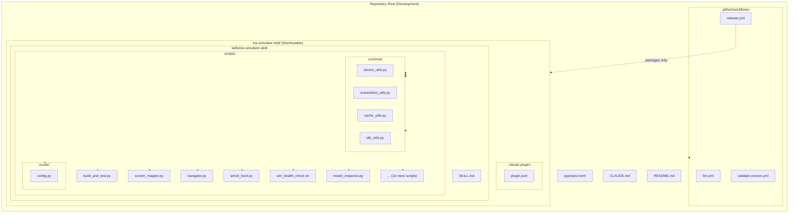
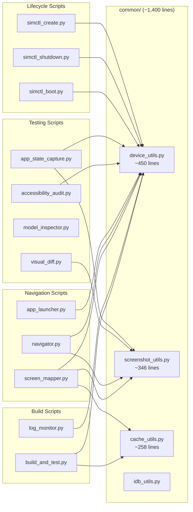
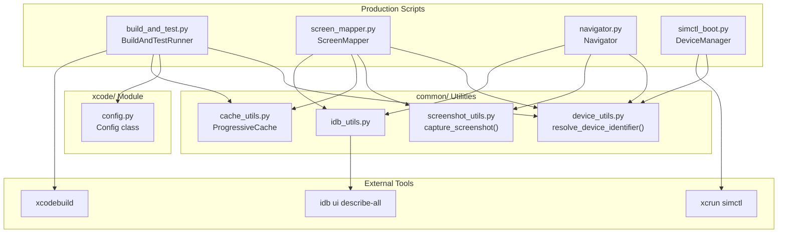
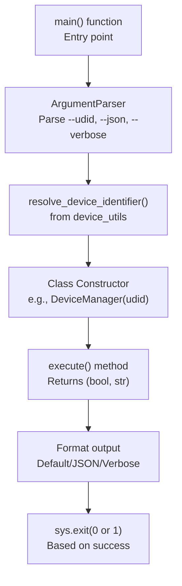

<!-- source: DeepWiki mcp.deepwiki.com · repo conorluddy/ios-simulator-skill · page 1.1 System Architecture · fetched 2026-10-26 -->

# System Architecture

Relevant source files

The following files were used as context for generating this wiki page:

- [CLAUDE.md](CLAUDE.md)
- [DEV.md](DEV.md)
- [README.md](README.md)

## Purpose and Scope

This document describes the structural organization of the ios-simulator-skill codebase, including the dual-purpose repository design, the 22-script catalog, shared utility modules, and the separation between development infrastructure and the distributable skill package.

---

## Dual-Purpose Repository Structure

The repository maintains two distinct structural layers: a **development repository** containing build tools and quality enforcement, and a **distributable skill package** containing only production scripts and documentation.

**Sources:** [CLAUDE.md:16-49](), [DEV.md:100-116]()

The root directory contains development-only artifacts:
- `pyproject.toml` - Black, Ruff, and mypy configuration [CLAUDE.md:51-51](), [DEV.md:113-113]().
- `.github/workflows/` - CI/CD pipeline definitions for linting, version validation, and automated releases [CLAUDE.md:50-50](), [DEV.md:108-111]().
- `CLAUDE.md`, `README.md`, `DEV.md` - Developer documentation and project guides [CLAUDE.md:1-3](), [DEV.md:1-15]().

The `ios-simulator-skill/` subdirectory is the **clean distributable package**. The release process packages this directory into a ZIP archive, excluding development infrastructure like `.github` and `pyproject.toml` [CLAUDE.md:197-200](), [DEV.md:179-182]().

---

## Script Organization and Categories

The codebase contains 22 production scripts totaling approximately 8,500 lines, organized into 5 functional categories [CLAUDE.md:9-11]().

| Category | Scripts | Purpose |
|----------|---------|---------|
| **Build & Development** | `build_and_test.py`, `log_monitor.py` | Xcode project compilation, test execution, and real-time log streaming [CLAUDE.md:118-120](). |
| **Navigation & Interaction** | `screen_mapper.py`, `navigator.py`, `gesture.py`, `keyboard.py`, `app_launcher.py` | Screen analysis, semantic element finding, touch simulation, and app lifecycle [CLAUDE.md:122-128](). |
| **Testing & Analysis** | `accessibility_audit.py`, `visual_diff.py`, `test_recorder.py`, `app_state_capture.py`, `model_inspector.py`, `sim_health_check.sh` | WCAG compliance, visual regression, debug snapshots, and model inspection [CLAUDE.md:129-135](). |
| **Advanced Testing** | `clipboard.py`, `status_bar.py`, `push_notification.py`, `privacy_manager.py` | Clipboard management, status bar override, push notifications, and permission control [CLAUDE.md:136-141](). |
| **Device Lifecycle** | `simctl_boot.py`, `simctl_shutdown.py`, `simctl_create.py`, `simctl_delete.py`, `simctl_erase.py` | Simulator creation, deletion, boot, shutdown, and factory reset [CLAUDE.md:142-148](). |

**Sources:** [CLAUDE.md:112-148](), [README.md:91-141]()

All scripts follow a consistent interface pattern:
- `--help` flag for usage documentation [CLAUDE.md:169-169]().
- `--json` flag for machine-readable output [CLAUDE.md:103-105]().
- `--verbose` flag for detailed human-readable output [CLAUDE.md:98-102]().
- `--udid` optional parameter with auto-detection fallback [CLAUDE.md:78-88]().

---

## Shared Utilities Architecture

Six shared utility modules in `common/` and `xcode/` provide approximately 1,400 lines of reusable functionality [CLAUDE.md:12-12]().

**Sources:** [CLAUDE.md:149-163]()

### device_utils.py (~450 lines)
Provides device identifier resolution and simulator enumeration:
- `resolve_device_identifier()`: Resolves UDID, device name, or "booted" to canonical UDID [CLAUDE.md:152-152]().
- `list_simulators()`: Returns simulator list with state filtering [CLAUDE.md:153-153]().
- `_extract_device_type()`: Parses device type from simulator name [CLAUDE.md:154-154]().

### screenshot_utils.py (~346 lines)
Handles screenshot capture and token-optimized image processing:
- `capture_screenshot()`: Captures screenshot to file or returns inline mode [CLAUDE.md:157-157]().
- `generate_screenshot_name()`: Creates semantic timestamp-based filenames [CLAUDE.md:158-158]().
- `resize_screenshot()`: Downscales images to reduce token consumption [CLAUDE.md:159-159]().

### cache_utils.py (~258 lines)
Implements the `ProgressiveCache` class for the progressive disclosure pattern:
- TTL-based caching for large outputs [CLAUDE.md:162-162]().
- Allows scripts like `build_and_test.py` to return a small ID (e.g., `xcresult-20251018-143052`) that can be used to retrieve full logs later [README.md:51-63]().

---

## Module Dependency Flow

The following diagram shows concrete import relationships using actual module and function names from the codebase:

**Sources:** [CLAUDE.md:57-88](), [CLAUDE.md:149-163](), [README.md:51-63]()

---

## Standard Script Pattern

All production scripts follow a class-based architecture pattern for testability and reusability [CLAUDE.md:57-76]():

**Sources:** [CLAUDE.md:57-76]()

### Class-Based Design
Each script defines a class (e.g., `DeviceManager`) encapsulating its core logic. The `execute()` method returns a tuple of `(success: bool, message: str)`, where `success` determines the exit code and `message` contains the formatted output [CLAUDE.md:61-68]().

### main() Function Structure
All scripts implement a consistent `main()` function that handles argument parsing, UDID resolution via `resolve_device_identifier()`, and exit code management [CLAUDE.md:70-76](), [CLAUDE.md:78-88]().

This pattern enables:
- **Token Efficiency**: 96% reduction in typical output by returning summaries instead of raw tool logs [CLAUDE.md:174-182](), [README.md:83-90]().
- **Structured Output**: Support for `--json` and `--verbose` across the entire suite [CLAUDE.md:90-105]().
- **Auto-Detection**: All scripts support optional `--udid` with intelligent resolution via `device_utils.py` [CLAUDE.md:78-88]().

**Sources:** [CLAUDE.md:57-105](), [CLAUDE.md:174-182](), [README.md:83-90]()

---

