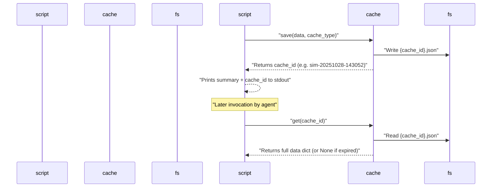
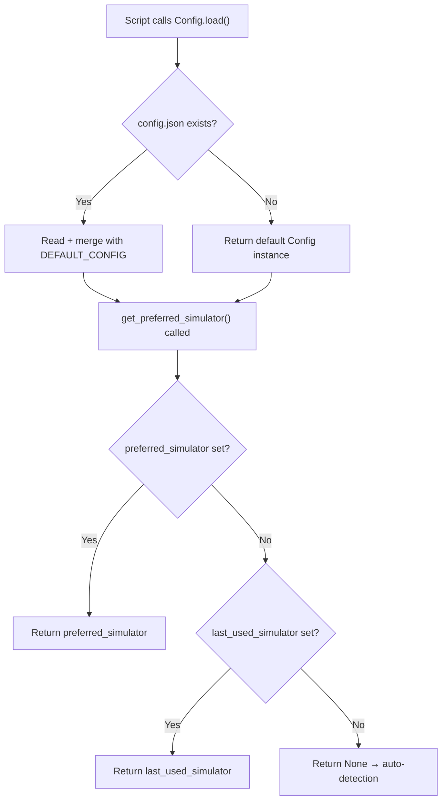
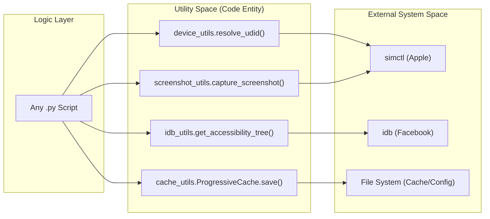

<!-- source: DeepWiki mcp.deepwiki.com · repo conorluddy/ios-simulator-skill · page 10 Shared Utilities · fetched 2026-10-26 -->

# Shared Utilities

Relevant source files

The following files were used as context for generating this wiki page:

- [ios-simulator-skill/skills/ios-simulator-skill/scripts/common/__init__.py](ios-simulator-skill/skills/ios-simulator-skill/scripts/common/__init__.py)
- [ios-simulator-skill/skills/ios-simulator-skill/scripts/common/cache_utils.py](ios-simulator-skill/skills/ios-simulator-skill/scripts/common/cache_utils.py)
- [ios-simulator-skill/skills/ios-simulator-skill/scripts/common/device_utils.py](ios-simulator-skill/skills/ios-simulator-skill/scripts/common/device_utils.py)

This page covers the shared utility layer located in `ios-simulator-skill/scripts/common/` and `ios-simulator-skill/scripts/xcode/config.py`. These modules provide cross-cutting functionality — device resolution, screenshot capture, output caching, and configuration persistence — that is imported by scripts across all five functional categories.

For documentation on individual scripts that *consume* these utilities, see the category-specific pages: [Build & Development Scripts](#5), [Navigation & Interaction Scripts](#6), [Testing & Analysis Scripts](#7), [Advanced Testing Scripts](#8), and [Device Lifecycle Scripts](#9).

---

## Overview

The shared layer exists to prevent duplicating common logic across the 21 scripts. Every script that needs to locate a device, capture a screenshot, cache a large output, or read a persistent preference delegates to one of these modules.

| Module | Location | Primary Responsibility |
|---|---|---|
| `device_utils.py` | `scripts/common/device_utils.py` | UDID resolution, command building, and screen size detection |
| `screenshot_utils.py` | `scripts/common/screenshot_utils.py` | Screenshot capture, semantic naming, and token-optimized resizing |
| `cache_utils.py` | `scripts/common/cache_utils.py` | Progressive disclosure caching with TTL |
| `idb_utils.py` | `scripts/common/idb_utils.py` | Accessibility tree parsing and element manipulation |
| `config.py` | `scripts/xcode/config.py` | Persistent device preference configuration |

Sources: [ios-simulator-skill/skills/ios-simulator-skill/scripts/common/__init__.py:1-12](), [ios-simulator-skill/skills/ios-simulator-skill/scripts/common/device_utils.py:1-15]()

---

## Dependency Map

The following diagram shows which utility modules are imported by which script categories.

**Diagram: Shared Utility Consumers**

```mermaid
graph TD
    subgraph "scripts/common/"
        DU["device_utils.py"]
        SU["screenshot_utils.py"]
        CU["cache_utils.py"]
        IU["idb_utils.py"]
    end

    subgraph "scripts/xcode/"
        CFG["config.py"]
    end

    subgraph "Device Lifecycle"
        BOOT["simctl_boot.py"]
        SHUT["simctl_shutdown.py"]
        CREATE["simctl_create.py"]
        DEL["simctl_delete.py"]
        ERASE["simctl_erase.py"]
    end

    subgraph "Navigation & Interaction"
        NAV["navigator.py"]
        SCM["screen_mapper.py"]
        GES["gesture.py"]
        KBD["keyboard.py"]
        APL["app_launcher.py"]
    end

    subgraph "Build & Development"
        BAT["build_and_test.py"]
        LGM["log_monitor.py"]
    end

    subgraph "Testing & Analysis"
        ACA["accessibility_audit.py"]
        VDF["visual_diff.py"]
        TRC["test_recorder.py"]
        ASC["app_state_capture.py"]
    end

    subgraph "Advanced Testing"
        CLB["clipboard.py"]
        STB["status_bar.py"]
        PNF["push_notification.py"]
        PRM["privacy_manager.py"]
    end

    BOOT --> DU
    SHUT --> DU
    CREATE --> DU
    DEL --> DU
    ERASE --> DU

    NAV --> DU
    NAV --> IU
    SCM --> IU
    GES --> DU
    KBD --> DU
    APL --> DU

    BAT --> DU
    BAT --> CU
    BAT --> CFG

    LGM --> DU

    ACA --> DU
    ACA --> SU
    VDF --> SU
    TRC --> SU
    ASC --> SU
    ASC --> CU

    CLB --> DU
    STB --> DU
    PNF --> DU
    PRM --> DU
```

Sources: [ios-simulator-skill/skills/ios-simulator-skill/scripts/common/__init__.py:14-35](), [ios-simulator-skill/skills/ios-simulator-skill/scripts/common/device_utils.py:10-15]()

---

## Module Descriptions

### `device_utils.py`

Handles device discovery, command construction, and UDID resolution. It standardizes how scripts call `simctl` and `idb` to prevent targeting errors. For details, see [device_utils.py](#10.1).

Key functions:

| Function | Purpose |
|---|---|
| `resolve_udid(udid_arg)` | Returns `udid_arg` or auto-detects booted simulator; raises `RuntimeError` if none found [ios-simulator-skill/skills/ios-simulator-skill/scripts/common/device_utils.py:161-199]() |
| `build_simctl_command(op, udid, *args)` | Wraps `xcrun simctl` with 'booted' fallback [ios-simulator-skill/skills/ios-simulator-skill/scripts/common/device_utils.py:22-66]() |
| `build_idb_command(op, udid, *args)` | Wraps `idb` CLI with proper `--udid` flag placement [ios-simulator-skill/skills/ios-simulator-skill/scripts/common/device_utils.py:69-121]() |
| `get_device_screen_size(udid)` | Queries accessibility tree for actual resolution [ios-simulator-skill/skills/ios-simulator-skill/scripts/common/device_utils.py:201-228]() |

Sources: [ios-simulator-skill/skills/ios-simulator-skill/scripts/common/device_utils.py:1-228]()

---

### `screenshot_utils.py`

Provides screenshot capture and image manipulation. It supports a dual-mode output: saving to disk for test artifacts or returning base64 strings for LLM vision analysis. For details, see [screenshot_utils.py](#10.2).

Key functions:

| Function | Purpose |
|---|---|
| `capture_screenshot(...)` | Captures screen with `inline` and `size` options [ios-simulator-skill/skills/ios-simulator-skill/scripts/common/screenshot_utils.py:29-30]() |
| `resize_screenshot(...)` | Uses Pillow to downscale images for token optimization [ios-simulator-skill/skills/ios-simulator-skill/scripts/common/screenshot_utils.py:34]() |
| `generate_screenshot_name(...)` | Creates semantic names for captured images [ios-simulator-skill/skills/ios-simulator-skill/scripts/common/screenshot_utils.py:32]() |

Sources: [ios-simulator-skill/skills/ios-simulator-skill/scripts/common/screenshot_utils.py:1-35]()

---

### `cache_utils.py`

Implements the progressive disclosure caching pattern used to reduce token consumption on large outputs such as simulator lists and UI trees. For details, see [cache_utils.py](#10.3).

**Diagram: ProgressiveCache Data Flow**

Sources: [ios-simulator-skill/skills/ios-simulator-skill/scripts/common/cache_utils.py:5-16]()

#### `ProgressiveCache` Class

[ios-simulator-skill/skills/ios-simulator-skill/scripts/common/cache_utils.py:25-30]()

| Method | Signature | Behavior |
|---|---|---|
| `save` | `(data, cache_type) -> str` | Writes JSON file; returns `cache_id` string [ios-simulator-skill/skills/ios-simulator-skill/scripts/common/cache_utils.py:48-81]() |
| `get` | `(cache_id) -> dict \| None` | Reads file; returns `None` if not found or expired [ios-simulator-skill/skills/ios-simulator-skill/scripts/common/cache_utils.py:83-112]() |
| `cleanup` | `(max_age_hours=None) -> int` | Explicit sweep of expired entries [ios-simulator-skill/skills/ios-simulator-skill/scripts/common/cache_utils.py:160-183]() |

Sources: [ios-simulator-skill/skills/ios-simulator-skill/scripts/common/cache_utils.py:25-215]()

---

### `idb_utils.py`

Provides helper functions for interacting with Facebook's `idb` utility, specifically for extracting and flattening the accessibility tree. For details, see [idb_utils.py](#10.5).

Key capabilities:
* `get_accessibility_tree(udid)`: Retrieves the full nested JSON UI tree [ios-simulator-skill/skills/ios-simulator-skill/scripts/common/idb_utils.py:26]().
* `flatten_tree(tree)`: Converts a nested tree into a flat list for easier element searching [ios-simulator-skill/skills/ios-simulator-skill/scripts/common/idb_utils.py:25]().
* `count_elements(tree)`: Returns a summary count of UI elements by type [ios-simulator-skill/skills/ios-simulator-skill/scripts/common/idb_utils.py:24]().

Sources: [ios-simulator-skill/skills/ios-simulator-skill/scripts/common/__init__.py:23-28]()

---

### `xcode/config.py`

Provides persistent configuration for device preferences. It allows the skill to "learn" which simulator a user prefers for a specific project. For details, see [xcode/config.py](#10.4).

**Diagram: Config Resolution Priority**

Sources: [ios-simulator-skill/skills/ios-simulator-skill/scripts/common/__init__.py:1-12]()

---

## Interaction Between Modules

The utilities are designed to be used in combination. A typical script workflow involves resolving a device via `device_utils`, performing an action via `idb_utils`, and potentially caching a large result via `cache_utils`.

**Diagram: Utility Interaction Space**

Sources: [ios-simulator-skill/skills/ios-simulator-skill/scripts/common/__init__.py:1-35](), [ios-simulator-skill/skills/ios-simulator-skill/scripts/common/device_utils.py:1-15]()

---

