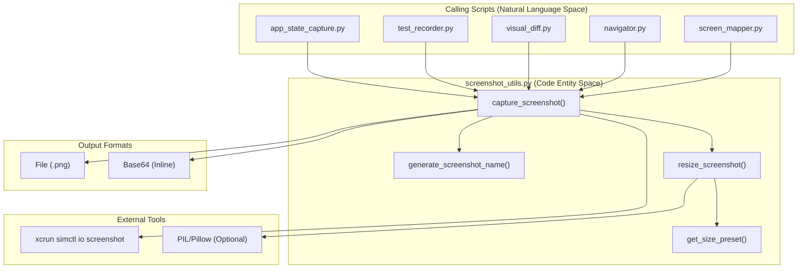
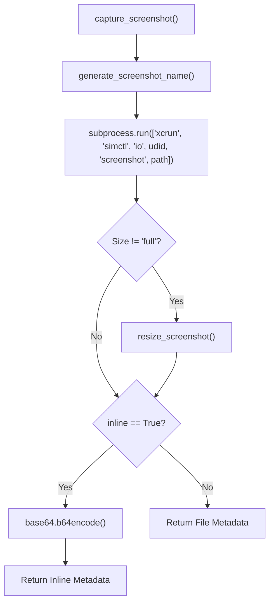
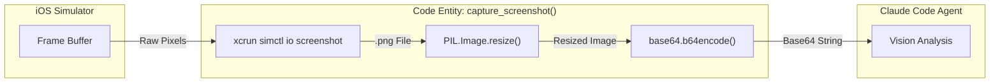

<!-- source: DeepWiki mcp.deepwiki.com · repo conorluddy/ios-simulator-skill · page 10.2 screenshot_utils.py · fetched 2026-10-26 -->

# screenshot_utils.py

Relevant source files

The following files were used as context for generating this wiki page:

- [ios-simulator-skill/skills/ios-simulator-skill/scripts/common/screenshot_utils.py](ios-simulator-skill/skills/ios-simulator-skill/scripts/common/screenshot_utils.py)

## Purpose and Scope

This document covers `screenshot_utils.py`, a shared utility module that provides unified screenshot capture, semantic naming, and token-optimized resizing for the `ios-simulator-skill` package. The module implements strategies to reduce image sizes for AI agent consumption while maintaining visual fidelity for debugging and testing workflows. [ios-simulator-skill/scripts/common/screenshot_utils.py:1-16]()

The module supports two primary modes:
- **File-based mode**: Persistent artifacts for test documentation and manual inspection. [ios-simulator-skill/scripts/common/screenshot_utils.py:6-6]()
- **Inline base64 mode**: Vision-based automation for agent analysis within JSON outputs. [ios-simulator-skill/scripts/common/screenshot_utils.py:7-7]()

**Sources:** [ios-simulator-skill/scripts/common/screenshot_utils.py:1-16]()

---

## Module Overview

The `screenshot_utils.py` module is part of the shared utilities layer. It provides three primary functions that abstract screenshot operations for iOS simulators:

| Function | Purpose | Primary Use Case |
|----------|---------|-----------------|
| `capture_screenshot()` | Captures simulator screen via `simctl` | All scripts requiring visual state capture |
| `generate_screenshot_name()` | Creates semantic, timestamped filenames | Organizing screenshots by context |
| `resize_screenshot()` | Reduces image dimensions using presets | Token optimization, inline base64 |

The module uses `PIL` (Pillow) for resizing but handles its absence gracefully by falling back to original sizes. [ios-simulator-skill/scripts/common/screenshot_utils.py:27-32]()

**Sources:** [ios-simulator-skill/scripts/common/screenshot_utils.py:35-190]()

---

## System Integration Architecture

**Diagram: Screenshot Utilities Integration**

This diagram illustrates how `screenshot_utils.py` serves as the central bridge between interaction scripts and the underlying `simctl` tool. It manages the transformation of raw simulator pixels into semantic, size-optimized assets.

**Sources:** [ios-simulator-skill/scripts/common/screenshot_utils.py:13-16](), [ios-simulator-skill/scripts/common/screenshot_utils.py:182-190]()

---

## Token Optimization via Size Presets

To minimize token usage when sending images to LLMs, the module defines specific scale factors via `get_size_preset()`. [ios-simulator-skill/scripts/common/screenshot_utils.py:78-97]()

| Preset | Scale Factor | Use Case |
|--------|--------------|----------|
| `full` | 1.0 (100%) | Visual regression, high-res archiving |
| `half` | 0.5 (50%) | Default for agent vision (Balanced) |
| `quarter`| 0.25 (25%) | Fast previews, low-token context |
| `thumb` | 0.1 (10%) | UI thumbnails, extreme optimization |

**Sources:** [ios-simulator-skill/scripts/common/screenshot_utils.py:91-96]()

---

## Core Function: capture_screenshot()

The `capture_screenshot()` function is the primary entry point. It returns a dictionary containing metadata and the resulting image (either as a path or base64 data). [ios-simulator-skill/scripts/common/screenshot_utils.py:205-226]()

### Execution Flow

**Diagram: Capture and Process Flow**

This flow shows how the function coordinates naming, execution of the `simctl` CLI, resizing via Pillow, and optional base64 encoding.

**Sources:** [ios-simulator-skill/scripts/common/screenshot_utils.py:182-237]()

---

## Semantic Naming: generate_screenshot_name()

The module implements a standardized naming convention to make artifacts self-documenting. [ios-simulator-skill/scripts/common/screenshot_utils.py:35-41]()

**Format**: `{appName}_{screenName}_{state}_{timestamp}.png` [ios-simulator-skill/scripts/common/screenshot_utils.py:44-44]()

- **appName**: e.g., 'Settings' [ios-simulator-skill/scripts/common/screenshot_utils.py:48-48]()
- **screenName**: e.g., 'Login' [ios-simulator-skill/scripts/common/screenshot_utils.py:49-49]()
- **state**: e.g., 'Empty', 'Filled', 'Error' [ios-simulator-skill/scripts/common/screenshot_utils.py:50-50]()
- **timestamp**: ISO-like format `YYYYMMDD-HHMMSS` [ios-simulator-skill/scripts/common/screenshot_utils.py:65-65]()

If no metadata is provided, it falls back to `screenshot_{timestamp}.png`. [ios-simulator-skill/scripts/common/screenshot_utils.py:73-73]()

**Sources:** [ios-simulator-skill/scripts/common/screenshot_utils.py:64-75]()

---

## Image Resizing: resize_screenshot()

The `resize_screenshot()` function handles the physical reduction of image dimensions. It uses `Image.Resampling.LANCZOS` for high-quality downsampling to ensure text remains readable even at smaller sizes. [ios-simulator-skill/scripts/common/screenshot_utils.py:167-167]()

### Key Implementation Details:
- **Safety**: If `PIL` is not installed and a size other than `full` is requested, it raises a `ValueError`. [ios-simulator-skill/scripts/common/screenshot_utils.py:152-155]()
- **Path Handling**: If no `output_path` is provided, it creates one by appending the size preset to the filename (e.g., `image_half.png`). [ios-simulator-skill/scripts/common/screenshot_utils.py:170-174]()
- **Optimization**: Uses `optimize=True` and a default quality of `85` when saving to further reduce file size. [ios-simulator-skill/scripts/common/screenshot_utils.py:177-177]()

**Sources:** [ios-simulator-skill/scripts/common/screenshot_utils.py:100-179]()

---

## Data Flow: From Simulator to Agent

**Diagram: Visual Data Pipeline**

This diagram illustrates the transformation of data from the raw simulator frame buffer into a format optimized for the Claude Code agent's vision capabilities.

**Sources:** [ios-simulator-skill/scripts/common/screenshot_utils.py:182-237]()

---

## Error Handling

The utility provides robust error handling for common simulator and environment issues:
1. **Missing File**: Raises `FileNotFoundError` if the input file for resizing doesn't exist. [ios-simulator-skill/scripts/common/screenshot_utils.py:132-133]()
2. **Dependency Check**: Gracefully detects if `PIL` is missing using the `HAS_PIL` flag. [ios-simulator-skill/scripts/common/screenshot_utils.py:27-32]()
3. **Invalid Configuration**: Raises `ValueError` if a user attempts to resize without the required Pillow dependency. [ios-simulator-skill/scripts/common/screenshot_utils.py:152-155]()

**Sources:** [ios-simulator-skill/scripts/common/screenshot_utils.py:27-32](), [ios-simulator-skill/scripts/common/screenshot_utils.py:132-133](), [ios-simulator-skill/scripts/common/screenshot_utils.py:152-155]()

---

