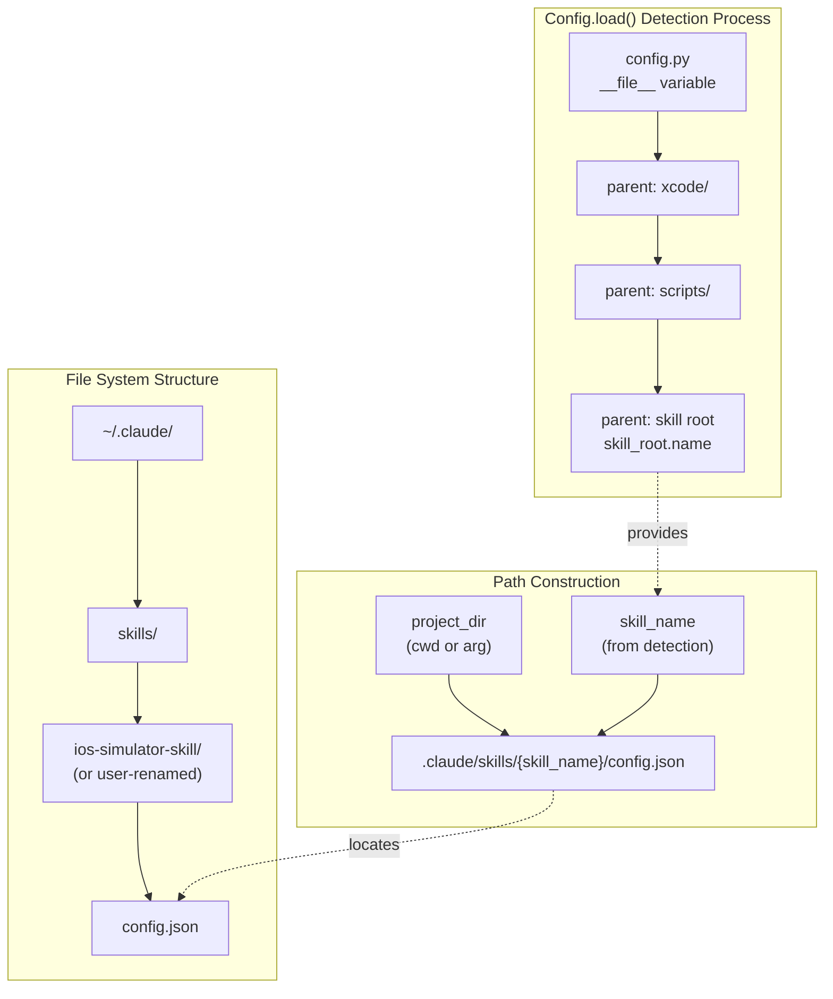
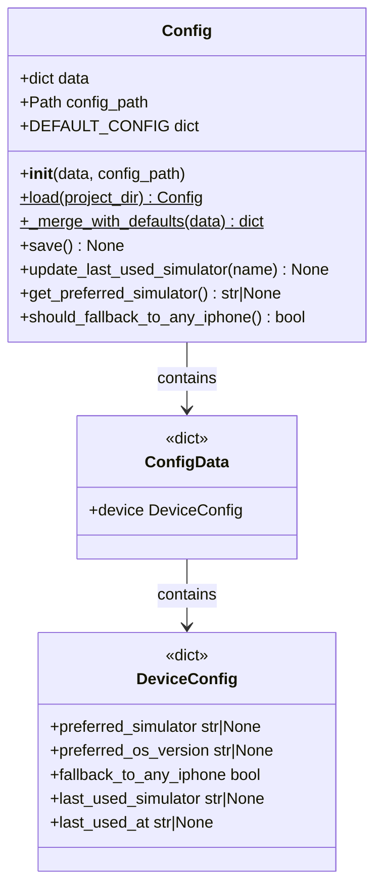
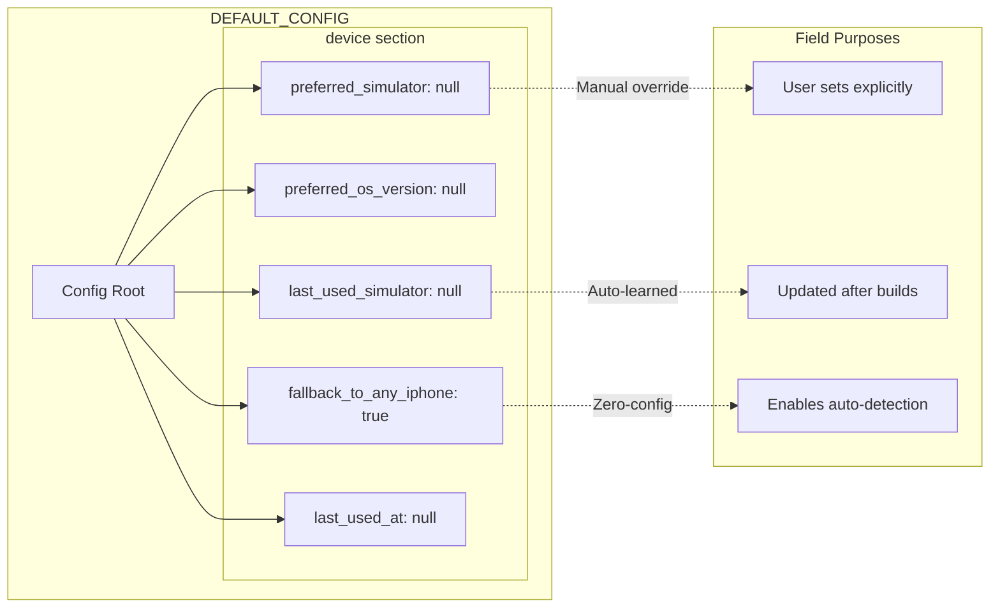
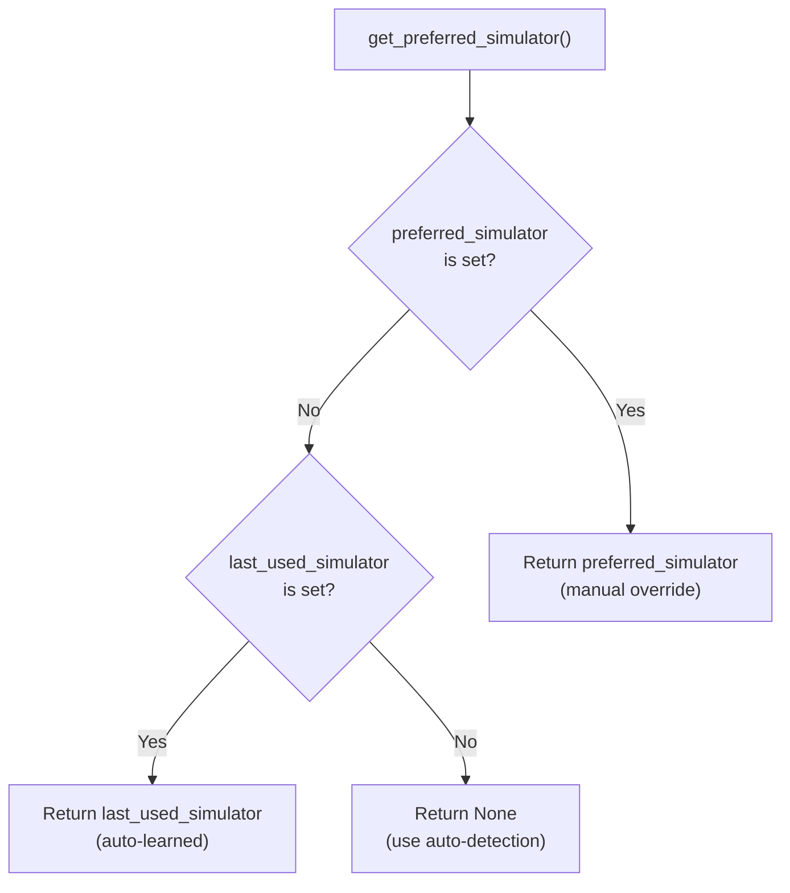
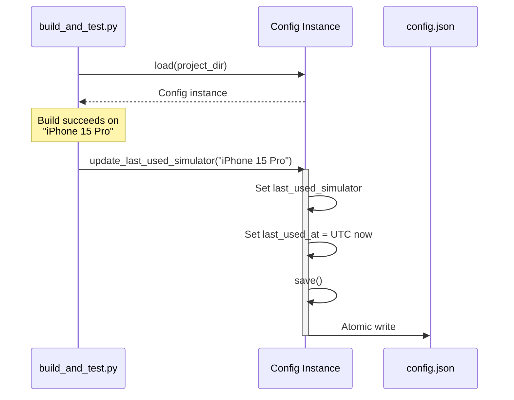
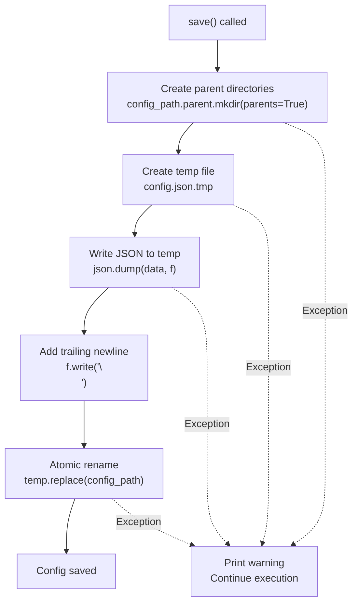
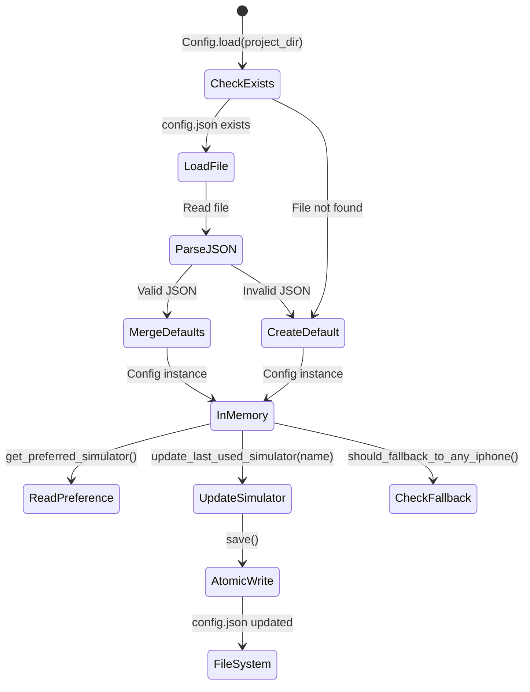
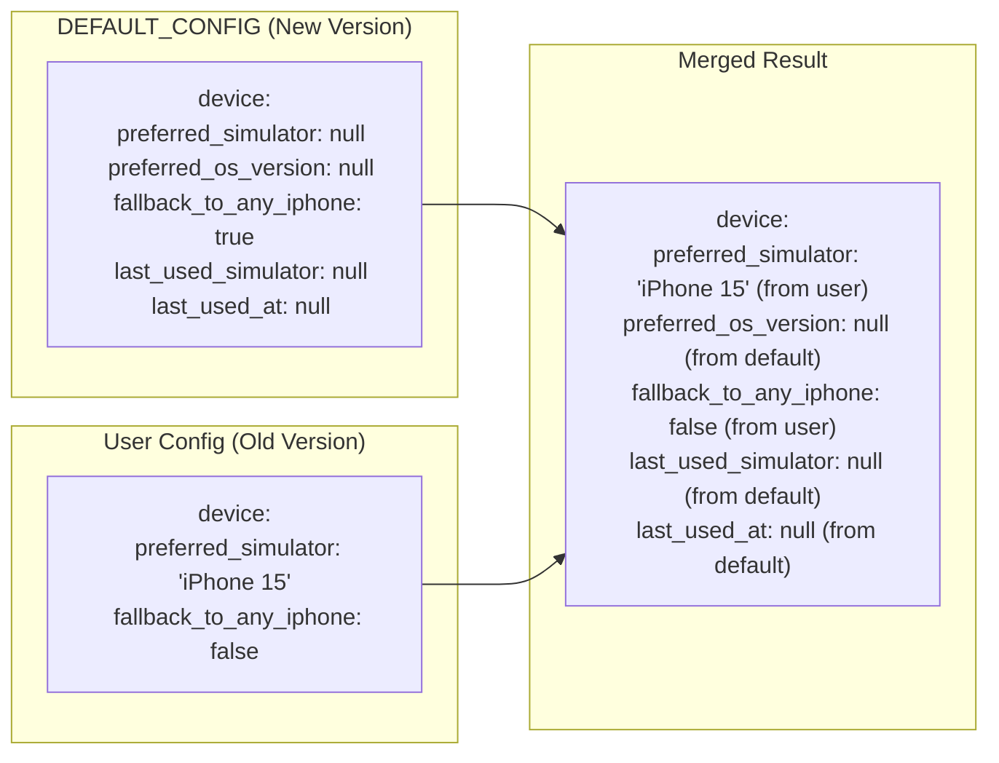
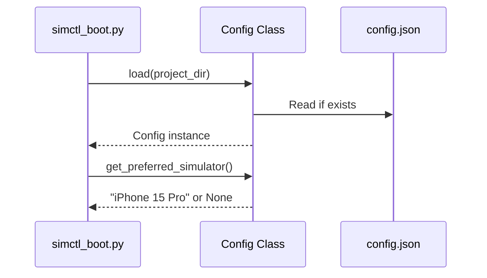
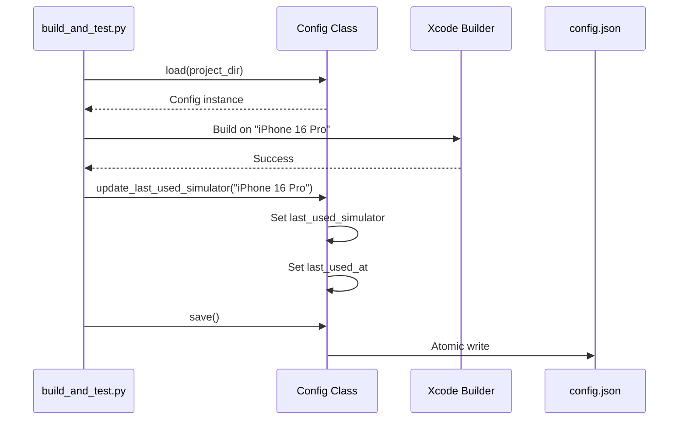

<!-- source: DeepWiki mcp.deepwiki.com · repo conorluddy/ios-simulator-skill · page 10.4 xcode/config.py · fetched 2026-10-26 -->

# xcode/config.py

Relevant source files

The following files were used as context for generating this wiki page:

- [ios-simulator-skill/skills/ios-simulator-skill/scripts/xcode/__init__.py](ios-simulator-skill/skills/ios-simulator-skill/scripts/xcode/__init__.py)
- [ios-simulator-skill/skills/ios-simulator-skill/scripts/xcode/config.py](ios-simulator-skill/skills/ios-simulator-skill/scripts/xcode/config.py)

This document describes the `Config` class in [ios-simulator-skill/skills/ios-simulator-skill/scripts/xcode/config.py](), which manages project-local configuration for iOS simulator preferences. The class implements auto-learning of simulator choices and provides atomic configuration persistence.

For information about how simulators are selected during boot operations, see [9.6 sim_list.py and simulator_selector.py](). For build script usage of configuration, see [5.1 build_and_test.py]().

---

## Purpose and Scope

The `Config` class provides project-specific configuration management with the following responsibilities:

- **Project-local config storage** at `.claude/skills/<skill-name>/config.json` [ios-simulator-skill/skills/ios-simulator-skill/scripts/xcode/config.py:18-18]()
- **Auto-detection of skill directory name** from installation location [ios-simulator-skill/skills/ios-simulator-skill/scripts/xcode/config.py:20-21]()
- **Auto-learning** of simulator preferences from successful builds [ios-simulator-skill/skills/ios-simulator-skill/scripts/xcode/config.py:23-23]()
- **Preference prioritization** (manual > auto-learned > auto-detection) [ios-simulator-skill/skills/ios-simulator-skill/scripts/xcode/config.py:154-157]()
- **Atomic writes** to prevent config corruption [ios-simulator-skill/skills/ios-simulator-skill/scripts/xcode/config.py:115-115]()

The configuration system enables zero-configuration workflows while allowing manual overrides when needed.

**Sources:** [ios-simulator-skill/skills/ios-simulator-skill/scripts/xcode/config.py:1-179]()

---

## Configuration File Location Resolution

The `Config` class automatically determines where to store configuration by detecting the skill's installation directory name.

### Skill Directory Auto-Detection

Title: Skill Directory Auto-Detection Process

**Auto-Detection Logic**

| Step | Code Reference | Operation |
|------|---------------|-----------|
| 1. Get config.py location | `Path(__file__)` [ios-simulator-skill/skills/ios-simulator-skill/scripts/xcode/config.py:68-68]() | Current file path |
| 2. Navigate to skill root | `.parent.parent.parent` [ios-simulator-skill/skills/ios-simulator-skill/scripts/xcode/config.py:68-68]() | xcode/ → scripts/ → skill/ |
| 3. Extract directory name | `skill_root.name` [ios-simulator-skill/skills/ios-simulator-skill/scripts/xcode/config.py:69-69]() | e.g., "ios-simulator-skill" |
| 4. Construct config path | `project_dir / ".claude" / "skills" / skill_name / "config.json"` [ios-simulator-skill/skills/ios-simulator-skill/scripts/xcode/config.py:71-71]() | Final path |

This design ensures configs work regardless of how users rename the skill directory during installation [ios-simulator-skill/skills/ios-simulator-skill/scripts/xcode/config.py:59-60]().

**Sources:** [ios-simulator-skill/skills/ios-simulator-skill/scripts/xcode/config.py:48-92]()

---

## Config Class Architecture

Title: Config Class Architecture

### Instance Attributes

| Attribute | Type | Purpose |
|-----------|------|---------|
| `data` | `dict[str, Any]` | Configuration dictionary [ios-simulator-skill/skills/ios-simulator-skill/scripts/xcode/config.py:44-44]() |
| `config_path` | `Path` | Location of config.json file [ios-simulator-skill/skills/ios-simulator-skill/scripts/xcode/config.py:45-45]() |
| `DEFAULT_CONFIG` | `dict` (class var) | Template for new configs [ios-simulator-skill/skills/ios-simulator-skill/scripts/xcode/config.py:26-34]() |

**Sources:** [ios-simulator-skill/skills/ios-simulator-skill/scripts/xcode/config.py:14-45]()

---

## Configuration Structure

The default configuration template defines the schema for all config files:

Title: Configuration Schema

### Configuration Fields

| Field | Type | Default | Purpose |
|-------|------|---------|---------|
| `preferred_simulator` | `str\|None` | `null` | Manually specified simulator name [ios-simulator-skill/skills/ios-simulator-skill/scripts/xcode/config.py:28-28]() |
| `preferred_os_version` | `str\|None` | `null` | Preferred iOS version [ios-simulator-skill/skills/ios-simulator-skill/scripts/xcode/config.py:29-29]() |
| `fallback_to_any_iphone` | `bool` | `true` | Allow auto-selection of any iPhone [ios-simulator-skill/skills/ios-simulator-skill/scripts/xcode/config.py:30-30]() |
| `last_used_simulator` | `str\|None` | `null` | Auto-learned from successful builds [ios-simulator-skill/skills/ios-simulator-skill/scripts/xcode/config.py:31-31]() |
| `last_used_at` | `str\|None` | `null` | ISO 8601 timestamp of last use [ios-simulator-skill/skills/ios-simulator-skill/scripts/xcode/config.py:32-32]() |

**Sources:** [ios-simulator-skill/skills/ios-simulator-skill/scripts/xcode/config.py:26-34]()

---

## Preference Prioritization Logic

The `get_preferred_simulator()` method implements a three-tier priority system [ios-simulator-skill/skills/ios-simulator-skill/scripts/xcode/config.py:154-157]():

Title: Preference Prioritization Flow

### Priority Tiers

| Priority | Field | Setter | Use Case |
|----------|-------|--------|----------|
| 1 (Highest) | `preferred_simulator` | Manual (user edits config) | "Always use iPhone 15 Pro" [ios-simulator-skill/skills/ios-simulator-skill/scripts/xcode/config.py:162-163]() |
| 2 (Medium) | `last_used_simulator` | Auto (after successful build) | "Reuse what worked last time" [ios-simulator-skill/skills/ios-simulator-skill/scripts/xcode/config.py:166-167]() |
| 3 (Lowest) | `None` | Default | "Auto-detect any booted iPhone" [ios-simulator-skill/skills/ios-simulator-skill/scripts/xcode/config.py:169-169]() |

**Sources:** [ios-simulator-skill/skills/ios-simulator-skill/scripts/xcode/config.py:147-169]()

---

## Auto-Learning Mechanism

The `update_last_used_simulator()` method records successful simulator usage with timestamps [ios-simulator-skill/skills/ios-simulator-skill/scripts/xcode/config.py:137-145]():

Title: Auto-Learning Sequence

### Update Process

| Step | Method | Action |
|------|--------|--------|
| 1. Set simulator | `update_last_used_simulator(name)` [ios-simulator-skill/skills/ios-simulator-skill/scripts/xcode/config.py:137-137]() | Store simulator name |
| 2. Timestamp | `datetime.now(UTC).isoformat()` [ios-simulator-skill/skills/ios-simulator-skill/scripts/xcode/config.py:145-145]() | Record when used |
| 3. Persist | `save()` [ios-simulator-skill/skills/ios-simulator-skill/scripts/xcode/config.py:113-113]() | Atomic write to disk |

**Sources:** [ios-simulator-skill/skills/ios-simulator-skill/scripts/xcode/config.py:137-145]()

---

## Atomic Save Operations

The `save()` method uses a temp-file-and-rename pattern to prevent config corruption [ios-simulator-skill/skills/ios-simulator-skill/scripts/xcode/config.py:115-115]():

Title: Atomic Save Operation

### Atomicity Guarantees

| Operation | Purpose | Failure Mode |
|-----------|---------|--------------|
| Write to `.tmp` file | Isolated write [ios-simulator-skill/skills/ios-simulator-skill/scripts/xcode/config.py:125-125]() | No corruption of existing config |
| `Path.replace()` | Atomic rename (POSIX) [ios-simulator-skill/skills/ios-simulator-skill/scripts/xcode/config.py:132-132]() | All-or-nothing replacement |
| Exception handling | Non-fatal failure [ios-simulator-skill/skills/ios-simulator-skill/scripts/xcode/config.py:134-135]() | Script continues with in-memory config |

**Sources:** [ios-simulator-skill/skills/ios-simulator-skill/scripts/xcode/config.py:113-135]()

---

## Configuration Lifecycle

Title: Configuration State Machine

### Lifecycle Methods

| Phase | Method | Operation |
|-------|--------|-----------|
| Load | `Config.load(project_dir)` [ios-simulator-skill/skills/ios-simulator-skill/scripts/xcode/config.py:48-48]() | Read or create config |
| Merge | `_merge_with_defaults(data)` [ios-simulator-skill/skills/ios-simulator-skill/scripts/xcode/config.py:95-95]() | Ensure all fields exist |
| Use | `get_preferred_simulator()` [ios-simulator-skill/skills/ios-simulator-skill/scripts/xcode/config.py:147-147]() | Query preferences |
| Update | `update_last_used_simulator(name)` [ios-simulator-skill/skills/ios-simulator-skill/scripts/xcode/config.py:137-137]() | Record successful usage |
| Persist | `save()` [ios-simulator-skill/skills/ios-simulator-skill/scripts/xcode/config.py:113-113]() | Write to disk atomically |

**Sources:** [ios-simulator-skill/skills/ios-simulator-skill/scripts/xcode/config.py:48-135]()

---

## Merge Strategy for Config Updates

The `_merge_with_defaults()` method ensures backward compatibility when new config fields are added [ios-simulator-skill/skills/ios-simulator-skill/scripts/xcode/config.py:95-111]():

Title: Configuration Merge Strategy

### Merge Behavior

| Scenario | Result |
|----------|--------|
| Field in user config | User value preserved |
| Field only in defaults | Default value added |
| Field in both | User value takes precedence |

**Sources:** [ios-simulator-skill/skills/ios-simulator-skill/scripts/xcode/config.py:94-111]()

---

## Usage Patterns in Scripts

### Pattern 1: Load and Query (Read-Only)

Title: Read-Only Configuration Flow

**Sources:** [ios-simulator-skill/skills/ios-simulator-skill/scripts/xcode/config.py:48-92]()

---

### Pattern 2: Load, Update, Save (Auto-Learning)

Title: Auto-Learning Configuration Flow

**Sources:** [ios-simulator-skill/skills/ios-simulator-skill/scripts/xcode/config.py:137-145]()

---

## Error Handling Strategy

The `Config` class implements graceful degradation for all error scenarios:

### Error Recovery Matrix

| Error Scenario | Detection Point | Recovery Action |
|----------------|----------------|-----------------|
| Config file not found | `load()` [ios-simulator-skill/skills/ios-simulator-skill/scripts/xcode/config.py:92-92]() | Return default config (not saved until first use) |
| Invalid JSON | `load()` → `json.load()` [ios-simulator-skill/skills/ios-simulator-skill/scripts/xcode/config.py:83-86]() | Print warning, return default config |
| Read permission error | `load()` → `open()` [ios-simulator-skill/skills/ios-simulator-skill/scripts/xcode/config.py:87-89]() | Print warning, return default config |
| Write permission error | `save()` → `open()` [ios-simulator-skill/skills/ios-simulator-skill/scripts/xcode/config.py:134-135]() | Print warning, continue with in-memory config |
| Disk full during save | `save()` → `json.dump()` [ios-simulator-skill/skills/ios-simulator-skill/scripts/xcode/config.py:134-135]() | Print warning, .tmp file not renamed |

**Sources:** [ios-simulator-skill/skills/ios-simulator-skill/scripts/xcode/config.py:73-135]()

---

## Summary

The `Config` class provides:

1. **Auto-detection** of skill directory name from file system location [ios-simulator-skill/skills/ios-simulator-skill/scripts/xcode/config.py:65-71]()
2. **Three-tier preference system** (manual > auto-learned > auto-detection) [ios-simulator-skill/skills/ios-simulator-skill/scripts/xcode/config.py:154-157]()
3. **Auto-learning** of simulator choices from successful operations [ios-simulator-skill/skills/ios-simulator-skill/scripts/xcode/config.py:137-145]()
4. **Atomic writes** via temp-file-and-rename for crash safety [ios-simulator-skill/skills/ios-simulator-skill/scripts/xcode/config.py:125-132]()
5. **Graceful degradation** that never halts script execution [ios-simulator-skill/skills/ios-simulator-skill/scripts/xcode/config.py:83-89]()
6. **Forward compatibility** via config merging with defaults [ios-simulator-skill/skills/ios-simulator-skill/scripts/xcode/config.py:105-111]()

**Sources:** [ios-simulator-skill/skills/ios-simulator-skill/scripts/xcode/config.py:1-179]()

---

