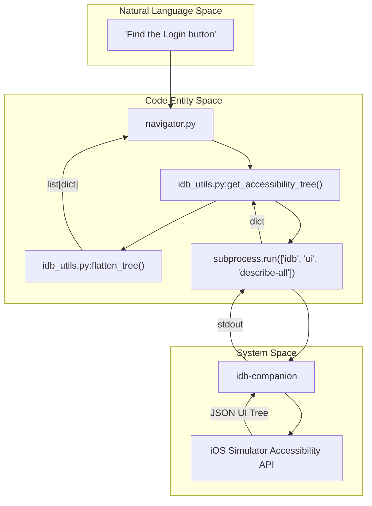
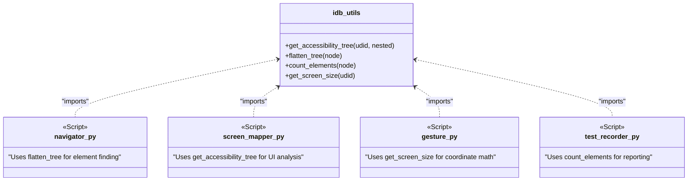

<!-- source: DeepWiki mcp.deepwiki.com · repo conorluddy/ios-simulator-skill · page 10.5 idb_utils.py · fetched 2026-10-26 -->

# idb_utils.py

Relevant source files

The following files were used as context for generating this wiki page:

- [ios-simulator-skill/skills/ios-simulator-skill/scripts/common/idb_utils.py](ios-simulator-skill/skills/ios-simulator-skill/scripts/common/idb_utils.py)

The `idb_utils.py` module serves as a shared utility wrapper for the **iOS Development Bridge (idb)**. It provides a clean Python interface for executing `idb` commands, specifically focusing on UI hierarchy extraction via accessibility APIs. This module is central to the skill's "Semantic Navigation" capabilities, allowing scripts to interact with UI elements based on their properties rather than raw pixel coordinates.

## Overview and Purpose

While `simctl` is used for device lifecycle management, `idb` is the primary engine for deep introspection of the running application's UI state. `idb_utils.py` abstracts the complexities of parsing `idb` JSON output and provides helper functions for tree traversal and coordinate calculation.

### Key Capabilities
*   **Accessibility Tree Extraction**: Fetches the complete UI hierarchy of the current screen [ios-simulator-skill/scripts/common/idb_utils.py:22-48]().
*   **Tree Flattening**: Converts hierarchical JSON structures into linear lists for easier searching and filtering [ios-simulator-skill/scripts/common/idb_utils.py:71-116]().
*   **Metric Calculation**: Provides screen dimensions and element counts for gesture calculations and reporting [ios-simulator-skill/scripts/common/idb_utils.py:119-143](), [ios-simulator-skill/scripts/common/idb_utils.py:146-181]().
*   **Error Handling**: Standardizes failure responses when `idb` is missing or the simulator is unresponsive [ios-simulator-skill/scripts/common/idb_utils.py:63-68]().

### Implementation Flow: Natural Language to IDB Execution

The following diagram illustrates how a request for UI information flows from the script level through `idb_utils.py` to the underlying system.

**UI Extraction Data Flow**

Sources: [ios-simulator-skill/scripts/common/idb_utils.py:22-68](), [ios-simulator-skill/scripts/common/idb_utils.py:71-116]()

## Key Functions

### UI Hierarchy Management

The module provides two primary functions for handling the iOS accessibility tree.

| Function | Purpose | Returns |
| :--- | :--- | :--- |
| `get_accessibility_tree` | Executes `idb ui describe-all --json` to fetch the raw UI hierarchy. | A `dict` representing the root window and its nested children. |
| `flatten_tree` | Recursively traverses the nested tree to create a linear list. | A `list[dict]` where each element contains its original data plus a `depth` key. |

#### `get_accessibility_tree(udid, nested)`
This function handles the command-line execution and JSON parsing. It specifically targets the root element of the returned array from `idb`.
*   **Nested Mode**: By default, it uses `--nested` to preserve the parent-child relationships [ios-simulator-skill/scripts/common/idb_utils.py:50-51]().
*   **UDID Targeting**: If a UDID is provided, it scopes the command to that specific simulator [ios-simulator-skill/scripts/common/idb_utils.py:52-53]().

#### `flatten_tree(node, depth, elements)`
This is a recursive utility used by high-level scripts like `navigator.py` and `screen_mapper.py` to perform fuzzy matching or attribute filtering across all elements on screen without complex recursion in the calling script [ios-simulator-skill/scripts/common/idb_utils.py:71-116]().

### Geometry and Metrics

The module provides helpers to determine the physical and logical constraints of the target device.

#### `count_elements(node)`
Traverses the entire tree recursively to count all elements, including the root and all descendants. This is primarily used for reporting and summary statistics [ios-simulator-skill/scripts/common/idb_utils.py:119-143]().

#### `get_screen_size(udid)`
Calculates the width and height of the simulator screen by inspecting the `frame` property of the root accessibility element [ios-simulator-skill/scripts/common/idb_utils.py:173-177]().
*   **Fallback Logic**: If `idb` fails or the tree is empty, it defaults to **390x844** (iPhone 14 dimensions) [ios-simulator-skill/scripts/common/idb_utils.py:169-171](), [ios-simulator-skill/scripts/common/idb_utils.py:178-180]().
*   **Usage**: Crucial for `gesture.py` to calculate coordinate normalization and positioning [ios-simulator-skill/scripts/common/idb_utils.py:153-154]().

**Entity Relationship: IDB Utilities and Consumers**

Sources: [ios-simulator-skill/scripts/common/idb_utils.py:8-15](), [ios-simulator-skill/scripts/common/idb_utils.py:119-128](), [ios-simulator-skill/scripts/common/idb_utils.py:146-181]()

## Error Handling and Fallbacks

`idb_utils.py` implements strict error handling for the underlying `idb` process:

1.  **Process Failure**: If `idb` is not installed or the command fails, the script catches `subprocess.CalledProcessError`, prints the error to `stderr`, and exits with code 1 [ios-simulator-skill/scripts/common/idb_utils.py:63-65]().
2.  **Invalid Data**: If `idb` returns malformed JSON, a `json.JSONDecodeError` is caught to prevent script crashes [ios-simulator-skill/scripts/common/idb_utils.py:66-68]().
3.  **Graceful Metrics**: Unlike the tree extraction, `get_screen_size` is designed to be resilient, returning default values via a broad `except Exception` block instead of crashing if the simulator is in a transient state where the UI tree is unavailable [ios-simulator-skill/scripts/common/idb_utils.py:178-180]().

## Integration in the Skill

This module follows "Jackson's Law"—only containing shared code that is truly reused across the skill [ios-simulator-skill/scripts/common/idb_utils.py:6](). It is a core dependency for the following scripts:

*   **Navigation**: `navigator.py` uses it to locate buttons by `AXLabel` [ios-simulator-skill/scripts/common/idb_utils.py:9]().
*   **Analysis**: `screen_mapper.py` and `accessibility_audit.py` use it to scan the screen for WCAG compliance and element descriptions [ios-simulator-skill/scripts/common/idb_utils.py:10-11]().
*   **Documentation**: `test_recorder.py` and `app_state_capture.py` use it for state snapshots and element counting [ios-simulator-skill/scripts/common/idb_utils.py:12-13]().
*   **Interactions**: `gesture.py` relies on it for screen boundaries and touch positioning [ios-simulator-skill/scripts/common/idb_utils.py:14]().

Sources: [ios-simulator-skill/scripts/common/idb_utils.py:1-181]()

---

