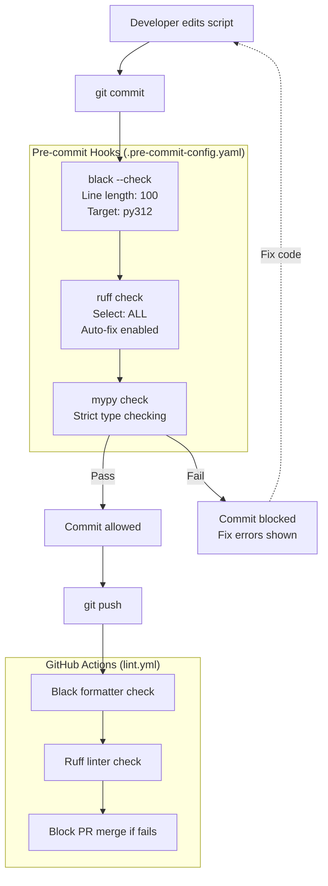
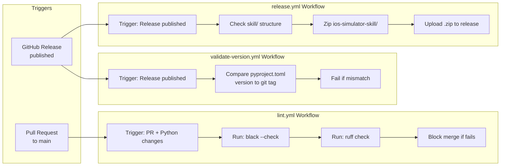

<!-- source: DeepWiki mcp.deepwiki.com · repo conorluddy/ios-simulator-skill · page 12 Development Guide · fetched 2026-10-26 -->

# Development Guide

<details>
<summary>Relevant source files</summary>

The following files were used as context for generating this wiki page:

- [.pre-commit-config.yaml](.pre-commit-config.yaml)
- [DEV.md](DEV.md)
- [pyproject.toml](pyproject.toml)

</details>


This guide is for contributors who want to modify or extend the ios-simulator-skill codebase. It covers development environment setup, code quality standards, CI/CD workflows, architecture patterns, and contribution guidelines.

For information about installing and using the skill as an end user, see [Installation and Prerequisites](#2.1) and [Getting Started](#2). For details on individual scripts and their functionality, see the script category pages ([Build & Development Scripts](#5), [Navigation & Interaction Scripts](#6), etc.).

---

## Development vs Distribution Model

The repository follows a **dual-purpose architecture** where the root contains development infrastructure while the `ios-simulator-skill/` subdirectory is the clean, distributable package.

### Repository Structure

```
ios-simulator-skill/                    # Repository root (development)
├── ios-simulator-skill/                # Distributable package (users receive this)
│   ├── SKILL.md                       # Entry point with frontmatter
│   └── scripts/                       # 21+ production scripts
│       ├── build_and_test.py
│       ├── screen_mapper.py
│       ├── navigator.py
│       ├── simctl_boot.py
│       └── common/                    # Shared utilities
│           ├── device_utils.py
│           ├── screenshot_utils.py
│           └── cache_utils.py
│
├── .github/workflows/                  # CI/CD automation (dev only)
│   ├── lint.yml
│   ├── release.yml
│   └── validate-version.yml
│
├── pyproject.toml                      # Tool configuration (dev only)
├── .pre-commit-config.yaml             # Git hooks (dev only)
└── DEV.md                              # Developer documentation
```

**Key Principle**: Files outside `ios-simulator-skill/` are never distributed to end users. The `release.yml` workflow packages **only** the skill directory.

Sources: [DEV.md:100-116](), [pyproject.toml:23-27]()

---

## Development Environment Setup

For details, see [Development Environment Setup](#12.1).

### Prerequisites

| Requirement | Minimum Version | Verification Command |
|------------|-----------------|---------------------|
| macOS | 11.0+ | `sw_vers` |
| Xcode Command Line Tools | Any | `xcode-select -p` |
| Python | 3.12+ | `python3 --version` |
| Git | Any | `git --version` |

**Installation**:

```bash
# Install Xcode Command Line Tools
xcode-select --install

# Install Python (if needed)
brew install python@3.12
```

Sources: [DEV.md:35-41]()

### Clone and Install Development Dependencies

```bash
# Clone repository
git clone https://github.com/conorluddy/ios-simulator-skill.git
cd ios-simulator-skill

# Install development tools
pip3 install black ruff mypy pre-commit

# Install pre-commit hooks (runs on git commit)
pre-commit install

# Verify setup
pre-commit run --all-files
```

Sources: [DEV.md:44-57]()

---

## Code Quality Standards

For details, see [Code Quality Standards](#12.2).

All Python code in `ios-simulator-skill/scripts/` is enforced with **strict** configuration.

### Development Workflow: Code Quality Gates



Sources: [DEV.md:59-98](), [.pre-commit-config.yaml:5-40]()

### Tool Configuration

Configuration is centralized in `pyproject.toml`:

| Tool | Key Settings | Purpose |
|------|-------------|---------|
| **Black** | `line-length = 100`<br/>`target-version = ["py312"]` | Consistent formatting [pyproject.toml:9-12]() |
| **Ruff** | `select = ["E", "F", "I", "N", "UP", "B", "C4", "SIM", "RET", "ARG", "PTH", "PL", "RUF"]` | Strict linting [pyproject.toml:29-46]() |

Sources: [DEV.md:74-98](), [pyproject.toml:9-72]()

---

## GitHub Actions CI/CD

For details, see [GitHub Actions CI/CD](#12.3).

### Workflow Overview



Sources: [DEV.md:177-190]()

---

## Architecture Patterns and Best Practices

For details, see [Architecture Patterns and Best Practices](#12.4).

### Pattern 1: Class-Based Script Design

All scripts with significant logic use a class-based architecture for testability and composability.

**Standard Structure**:
- Class-based design.
- `execute()` method returning `(success: bool, message: str)`.
- `main()` function handling CLI arguments.

### Pattern 2: Jackson's Law and Guard Clauses

Contributors must adhere to "Jackson's Law" (minimal code to solve the problem) and use guard clauses to handle errors early, keeping the "happy path" unindented at the end of functions.

Sources: [DEV.md:165-176]()

---

## Architecture: Script Class Pattern Mapping

This diagram maps the abstract class pattern to concrete implementations across the codebase.

```mermaid
classDiagram
    class "BasePattern" {
        <<interface>>
        +__init__(udid: str | None)
        +execute(**kwargs) tuple~bool, str~
    }
    
    class "DeviceBooter" {
        +execute() tuple~bool, str~
    }
    
    class "ScreenMapper" {
        +execute() tuple~bool, str~
    }
    
    class "BuildAndTest" {
        +execute() tuple~bool, str~
    }
    
    "BasePattern" <|.. "DeviceBooter" : implements
    "BasePattern" <|.. "ScreenMapper" : implements
    "BasePattern" <|.. "BuildAndTest" : implements
    
    note for "DeviceBooter" "ios-simulator-skill/scripts/simctl_boot.py"
    note for "ScreenMapper" "ios-simulator-skill/scripts/screen_mapper.py"
    note for "BuildAndTest" "ios-simulator-skill/scripts/build_and_test.py"
```

Sources: [DEV.md:100-116]()

---

## Contributing Workflow

For details, see [Contributing Guidelines](#12.5).

### Step-by-Step Contribution Process

1. **Fork** the repository.
2. **Create a branch**: `git checkout -b feature/my-feature`.
3. **Make changes**: Edit files in `ios-simulator-skill/scripts/`.
4. **Test**: Run scripts locally with a booted simulator.
5. **Commit**: Hooks (Black, Ruff, mypy) run automatically.
6. **Push and PR**: Create a PR and wait for lint workflows to pass.

Sources: [DEV.md:192-199]()

### Release Process

**For Maintainers Only**:
1. Update `version` in `pyproject.toml` [pyproject.toml:3-3]().
2. Commit and push: `git commit -m "chore: bump version to X.Y.Z"`.
3. Tag: `git tag vX.Y.Z` and `git push origin vX.Y.Z`.
4. GitHub Actions will automatically package the skill and attach it to the release.

Sources: [DEV.md:118-144]()

---

