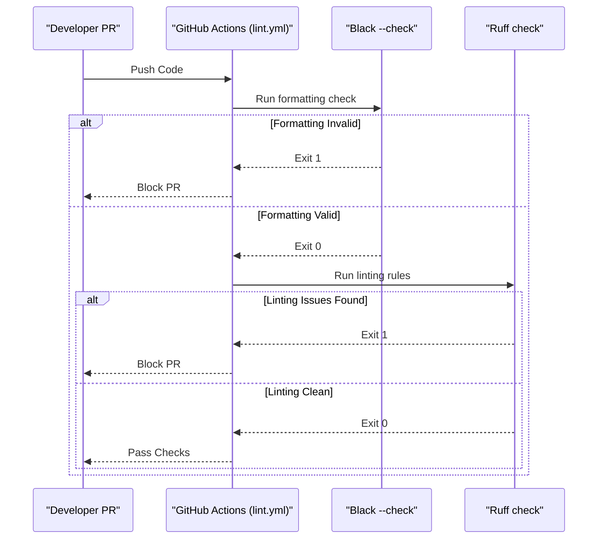

<!-- source: DeepWiki mcp.deepwiki.com · repo conorluddy/ios-simulator-skill · page 12.2 Code Quality Standards · fetched 2026-10-26 -->

# Code Quality Standards

<details>
<summary>Relevant source files</summary>

The following files were used as context for generating this wiki page:

- [.github/workflows/lint.yml](.github/workflows/lint.yml)
- [.pre-commit-config.yaml](.pre-commit-config.yaml)
- [pyproject.toml](pyproject.toml)

</details>


This page documents the toolchain used to enforce consistent formatting, linting, and type safety across the `ios-simulator-skill/scripts/` codebase. It covers the configuration of Black, Ruff, and mypy, the rationale behind ignored rules, and how pre-commit hooks tie these tools together at development time.

For how these checks are enforced in CI (blocking PRs and releases), see [12.3 GitHub Actions CI/CD](). For the broader coding conventions enforced at review time (guard clauses, function size limits, security rules), see [12.4 Architecture Patterns and Best Practices]().

---

## Toolchain Overview

Three primary tools enforce code quality, applied in sequence during the development lifecycle:

| Tool | Role | Mode | Scope |
|---|---|---|---|
| **Black** | Code formatter | Auto-fix on commit; check-only in CI | All `*.py` and `*.pyi` files [pyproject.toml:12]() |
| **Ruff** | Linter (multi-rule) | Auto-fix on commit; check-only in CI | `ios-simulator-skill/scripts/**/*.py` [pyproject.toml:27]() |
| **mypy** | Static type checker | Check-only | `ios-simulator-skill/scripts/` |

All tools are configured in `pyproject.toml`, which serves as the single source of truth for the skill's linting behavior [pyproject.toml:1-72]().

**Tool enforcement pipeline diagram:**

Title: "Code Quality Enforcement Pipeline"
```mermaid
flowchart LR
    subgraph "Dev_Machine"
        ["EDIT_SCRIPTS"] --> ["GIT_COMMIT"]
        subgraph "pre-commit_hooks"
            ["BLACK_HOOK"] --> ["RUFF_HOOK"]
            ["RUFF_HOOK"] --> ["GEN_HOOKS"]
        end
    end
    
    subgraph "CI_Enforcement"
        ["BLACK_CI"]
        ["RUFF_CI"]
    end

    ["GIT_COMMIT"] --> ["BLACK_HOOK"]
    ["GEN_HOOKS"] -->|"All pass"| ["GIT_PUSH"]
    ["GIT_PUSH"] --> ["BLACK_CI"]
    ["GIT_PUSH"] --> ["RUFF_CI"]
    ["BLACK_CI"] & ["RUFF_CI"] -->|"Fail"| ["BLOCKED"]
    ["BLACK_CI"] & ["RUFF_CI"] -->|"Pass"| ["MERGED"]
```

Sources: [pyproject.toml:1-72](), [.pre-commit-config.yaml:1-40]()

---

## Black — Formatter Configuration

Black is used as the canonical auto-formatter to ensure a uniform style. It runs in auto-fix mode during pre-commit and in check-only mode during CI.

**Configuration** ([pyproject.toml:9-21]()):

```toml
[tool.black]
line-length = 100
target-version = ["py312"]
include = '\.pyi?$'
extend-exclude = '''
/(
    \.git
  | \.ruff_cache
  | \.venv
  | build
  | dist
)/
'''
```

| Setting | Value | Rationale |
|---|---|---|
| `line-length` | `100` | Wider than Black's default 88; provides better readability for the complex type signatures and CLI argument parsing found in the skill scripts [pyproject.toml:10]() |
| `target-version` | `py312` | Matches the project's requirement for Python 3.12+ [pyproject.toml:11, pyproject.toml:6]() |
| `extend-exclude` | `.git`, `.venv`, etc. | Prevents accidental reformatting of generated files, virtual environments, or tooling caches [pyproject.toml:13-21]() |

Sources: [pyproject.toml:6-21]()

---

## Ruff — Linter Configuration

Ruff is employed as a high-performance linter that replaces several traditional tools (Flake8, isort, pyupgrade). It is configured in a strict mode but includes specific exceptions tailored for CLI automation tools.

### Scope

Ruff is specifically configured to lint the distributable skill code to ensure consistency in the scripts Claude interacts with:

[pyproject.toml:27]()
```toml
include = ["ios-simulator-skill/scripts/**/*.py"]
```

### Enabled Rule Groups

The skill enables a wide range of rules to maintain high code quality [pyproject.toml:31-46]():

| Prefix | Source | What It Checks |
|---|---|---|
| `E`, `W` | pycodestyle | Syntax-level style errors and whitespace [pyproject.toml:32-33]() |
| `F` | Pyflakes | Unused variables, undefined names [pyproject.toml:34]() |
| `I` | isort | Import ordering and grouping [pyproject.toml:35]() |
| `N` | pep8-naming | PEP8 naming conventions [pyproject.toml:36]() |
| `UP` | pyupgrade | Upgrades code to modern Python 3.12 syntax [pyproject.toml:37]() |
| `B` | flake8-bugbear | Potential bugs and design smells [pyproject.toml:38]() |
| `C4` | flake8-comprehensions | Optimized list/dict comprehension usage [pyproject.toml:39]() |
| `SIM` | flake8-simplify | Simplification of complex logic [pyproject.toml:40]() |
| `RET` | flake8-return | Streamlining of return statements [pyproject.toml:41]() |
| `ARG` | flake8-unused-arguments | Identification of unused function arguments [pyproject.toml:42]() |
| `PTH` | flake8-use-pathlib | Modern file path handling via `pathlib` [pyproject.toml:43]() |
| `PL` | Pylint | General code complexity and structure [pyproject.toml:44]() |
| `RUF` | Ruff-specific | Specialized rules unique to the Ruff linter [pyproject.toml:45]() |

### Ignored Rules and Rationale

The project ignores certain rules that conflict with the practical requirements of CLI scripts [pyproject.toml:49-68]().

Title: "Mapping Ignored Rules to Architectural Context"
```mermaid
graph TD
    subgraph "Rules_Ignored"
        ["PLR0913"]
        ["PLR2004"]
        ["PLR0912"]
        ["PLR0915"]
        ["PLC0415"]
        ["PTH123"]
        ["E501"]
        ["E722"]
        ["RUF001"]
    end

    subgraph "Context_Rationale"
        ["CLI_Complexity"]
        ["Acceptable_Patterns"]
        ["Black_Overlap"]
        ["Intentional_Patterns"]
    end

    ["PLR0913"] --> ["CLI_Complexity"]
    ["PLR0912"] --> ["CLI_Complexity"]
    ["PLR0915"] --> ["CLI_Complexity"]
    
    ["PLR2004"] --> ["Acceptable_Patterns"]
    ["E722"] --> ["Acceptable_Patterns"]
    
    ["E501"] --> ["Black_Overlap"]
    
    ["PLC0415"] --> ["Intentional_Patterns"]
    ["RUF001"] --> ["Intentional_Patterns"]
```

| Rule | Ignored Because |
|---|---|
| `PLR0913` | CLI scripts often require many arguments for fine-grained control (e.g., `navigator.py`) [pyproject.toml:50]() |
| `PLR2004` | Coordinate constants (X, Y) are meaningful "magic values" in UI automation [pyproject.toml:51]() |
| `PLR0912/15` | `main()` functions in CLI tools are inherently branchy due to argument parsing [pyproject.toml:52-53]() |
| `PLC0415` | Lazy imports are used for optional dependencies like `idb` [pyproject.toml:55]() |
| `E501` | Black handles most formatting; some long diagnostic strings are unavoidable [pyproject.toml:58]() |
| `RUF001` | Emoji and ambiguous characters are used intentionally for terminal UI feedback [pyproject.toml:61]() |

### isort Integration

[pyproject.toml:70-72]()

```toml
[tool.ruff.lint.isort]
known-first-party = ["xcode"]
```

The `xcode` package is declared as first-party so that imports from the internal utility modules are grouped correctly below standard libraries.

Sources: [pyproject.toml:23-72]()

---

## Pre-Commit Hook Configuration

Pre-commit hooks run automatically on `git commit`. They apply formatters and linters in "fix" mode. If any check fails or modifies a file, the commit is aborted, requiring the developer to stage the changes and try again.

[.pre-commit-config.yaml:1-40]()

Title: "Pre-commit Hook Execution Flow"
```mermaid
flowchart TD
    ["GIT_COMMIT"] --> ["BLACK_HOOK"]
    ["BLACK_HOOK"] --> ["RUFF_HOOK"]
    ["RUFF_HOOK"] --> ["WHITESPACE_HOOK"]
    ["WHITESPACE_HOOK"] --> ["EOF_HOOK"]
    ["EOF_HOOK"] --> ["YAML_HOOK"]
    ["YAML_HOOK"] --> ["LARGE_FILE_HOOK"]
    ["LARGE_FILE_HOOK"] --> ["LINE_ENDING_HOOK"]
    
    ["LINE_ENDING_HOOK"] -->|"Success"| ["COMMIT_OK"]
    ["LINE_ENDING_HOOK"] -->|"Failure"| ["COMMIT_FAIL"]
```

**Hook Details:**

- **Black**: Enforces Python 3.12 formatting standards on all script files [.pre-commit-config.yaml:7-13]().
- **Ruff**: Runs with `--fix` to automatically resolve linting issues and `--exit-non-zero-on-fix` to ensure automated changes are acknowledged by the developer [.pre-commit-config.yaml:16-22]().
- **File Integrity Hooks**:
    - `trailing-whitespace`: Trims unnecessary trailing spaces [.pre-commit-config.yaml:28-29]().
    - `end-of-file-fixer`: Ensures files terminate with a single newline [.pre-commit-config.yaml:30-31]().
    - `check-yaml`: Validates the syntax of YAML configuration files [.pre-commit-config.yaml:32-33]().
    - `check-added-large-files`: Prevents committing files larger than 500KB [.pre-commit-config.yaml:34-36]().
    - `mixed-line-ending`: Standardizes on LF line endings [.pre-commit-config.yaml:37-39]().

To initialize the local environment with these standards:
```bash
pre-commit install
```

Sources: [.pre-commit-config.yaml:1-40]()

---

## CI/CD Enforcement

While pre-commit hooks provide immediate feedback, the same rules are strictly enforced in GitHub Actions to protect the `main` branch.

Title: "CI Linting Workflow (lint.yml)"


The `lint.yml` workflow triggers on pull requests and pushes to `main` whenever Python files or the configuration files are modified [.github/workflows/lint.yml:3-15](). It specifically checks the scripts directory using the same standards defined in `pyproject.toml` [.github/workflows/lint.yml:39, 44]().

Sources: [.github/workflows/lint.yml:1-53](), [pyproject.toml:1-72]()

---

