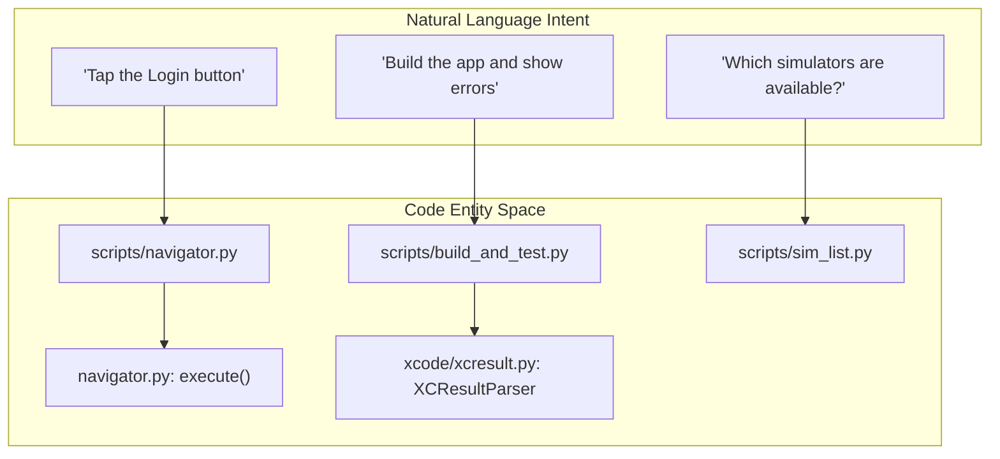
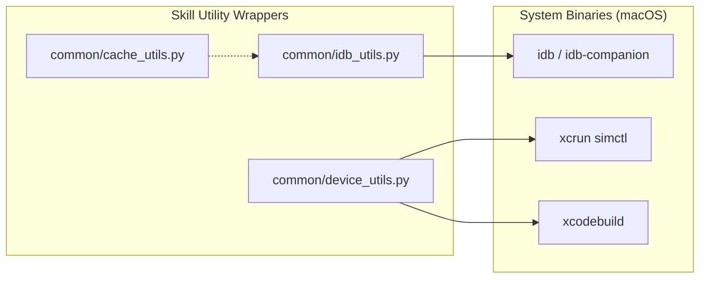

<!-- source: DeepWiki mcp.deepwiki.com · repo conorluddy/ios-simulator-skill · page 13 Reference · fetched 2026-10-26 -->

# Reference

Relevant source files

The following files were used as context for generating this wiki page:

- [README.md](README.md)
- [references/troubleshooting.md](references/troubleshooting.md)

This page provides quick reference materials for the `ios-simulator-skill`, including a complete script catalog, common flag patterns, and troubleshooting guidance. For installation and setup, see [Getting Started](#2). For detailed script documentation organized by category, see pages [Build & Development Scripts](#5) through [Device Lifecycle Scripts](#9).

## Complete Script Reference

All scripts are located in [scripts/]() and support `--help` for detailed usage. Scripts are organized into functional categories. For a full tabular reference, see [Complete Script Reference](#13.1).

### Build & Development Scripts
These scripts handle the compilation and monitoring of iOS applications.
- `build_and_test.py`: Build Xcode projects/workspaces and run tests with progressive disclosure. [scripts/build_and_test.py:1-10]()
- `log_monitor.py`: Real-time log monitoring with filtering by severity and duration. [scripts/log_monitor.py:1-10]()

Sources: [README.md:97-101](), [scripts/build_and_test.py:1-10](), [scripts/log_monitor.py:1-10]()

### Navigation & Interaction Scripts
These scripts facilitate semantic interaction with the simulator UI using accessibility APIs.
- `screen_mapper.py`: Analyzes the accessibility tree to list interactive elements. [scripts/screen_mapper.py:1-10]()
- `navigator.py`: Finds and interacts with elements by text, type, or ID. [scripts/navigator.py:1-10]()
- `gesture.py`: Performs complex gestures like swipes, scrolls, and pinches. [scripts/gesture.py:1-10]()
- `keyboard.py`: Simulates text input and hardware button presses. [scripts/keyboard.py:1-10]()
- `app_launcher.py`: Manages the application lifecycle (launch, terminate, install). [scripts/app_launcher.py:1-10]()

Sources: [README.md:104-110](), [scripts/navigator.py:1-10](), [scripts/screen_mapper.py:1-10]()

### Testing & Analysis Scripts
Tools for auditing, regression testing, and environment diagnostics.
- `accessibility_audit.py`: Checks for WCAG compliance on the current screen. [scripts/accessibility_audit.py:1-10]()
- `visual_diff.py`: Compares screenshots for visual regression. [scripts/visual_diff.py:1-10]()
- `test_recorder.py`: Generates automated test documentation. [scripts/test_recorder.py:1-10]()
- `app_state_capture.py`: Creates comprehensive debugging snapshots. [scripts/app_state_capture.py:1-10]()
- `sim_health_check.sh`: Verifies the local environment configuration. [scripts/sim_health_check.sh:1-10]()
- `model_inspector.py`: Inspects Core Data and SwiftData models from project files. [scripts/model_inspector.py:1-10]()

Sources: [README.md:114-121](), [scripts/model_inspector.py:1-10](), [scripts/sim_health_check.sh:1-10]()

### Advanced Testing & Device Lifecycle
Specialized tools for system-level simulation and simulator management.
- `clipboard.py`, `status_bar.py`, `push_notification.py`, `privacy_manager.py`: Handle system-level state and notifications. [README.md:127-130]()
- `simctl_boot.py`, `simctl_shutdown.py`, `simctl_create.py`, `simctl_delete.py`, `simctl_erase.py`: Manage the simulator lifecycle. [README.md:136-140]()

Sources: [README.md:125-140](), [scripts/simctl_boot.py:1-10](), [scripts/privacy_manager.py:1-10]()

## Common Flags and Conventions

The skill uses a standardized argument pattern across all Python scripts to ensure predictability for both human users and Claude. For details, see [Common Flags and Conventions](#13.2).

### Universal Flags
- `--help`: Display usage and examples. [README.md:93-94]()
- `--json`: Output structured data for programmatic consumption. [README.md:93-94]()
- `--verbose`: Enable detailed output for debugging. [README.md:106]()

### Device Targeting
Scripts resolve targets using internal device resolution logic.
- `--udid`: Target a specific unique identifier. [README.md:136]()
- `--name`: Fuzzy match against device names (e.g., "iPhone 16"). [README.md:136]()
- `--all`: Perform batch operations on all matching devices. [README.md:136-140]()

Sources: [README.md:93-94](), [README.md:136-140]()

## Code Entity Mapping

The following diagrams bridge the gap between Natural Language intent and the underlying Code Entities.

### Intent to Code Entity Map
This diagram shows how user intents map to specific Python modules and internal logic.

Sources: [scripts/navigator.py:1-100](), [scripts/build_and_test.py:1-100](), [README.md:139]()

### Tool Chain Integration
This diagram maps the skill's internal utility wrappers to the underlying system binaries.

Sources: [README.md:11-12](), [README.md:44-45]()

## Troubleshooting Guide

Common issues often stem from simulator state or environment configuration. For a full list of solutions, see the [Troubleshooting Guide](#13.3).

### Quick Fixes
| Problem | Primary Tool | Fix Command |
|---------|--------------|-------------|
| Simulator won't boot | `simctl` | `killall Simulator && xcrun simctl erase <udid>` |
| IDB not connecting | `idb` | `idb kill && idb companion --boot-status-check` |
| App won't launch | `simctl` | `xcrun simctl terminate booted <bundle-id>` |
| Permissions denied | `chmod` | `chmod +x scripts/*.sh` |
| Python module missing | `pip3` | `pip3 install pillow` |

Sources: [references/troubleshooting.md:5-27]()

### Diagnostic Commands
To quickly verify the state of the system, use these underlying commands:
- **Check Booted Devices**: `xcrun simctl list devices | grep Booted` [references/troubleshooting.md:45]()
- **Verify IDB Targets**: `idb list-targets` [references/troubleshooting.md:48]()
- **Test Interaction**: `xcrun simctl io booted screenshot test.png` [references/troubleshooting.md:51]()

Sources: [references/troubleshooting.md:41-52]()

## Underlying CLI References
The skill is a high-level wrapper around Apple's `simctl` and Facebook's `idb`. For advanced manual usage, see [simctl and idb Quick Reference](#13.4).

- **simctl**: Used for device lifecycle, app installation, and basic screenshots. [README.md:12]()
- **idb**: Used for advanced UI automation, accessibility tree inspection, and semantic interaction. [README.md:12](), [README.md:44]()

---

