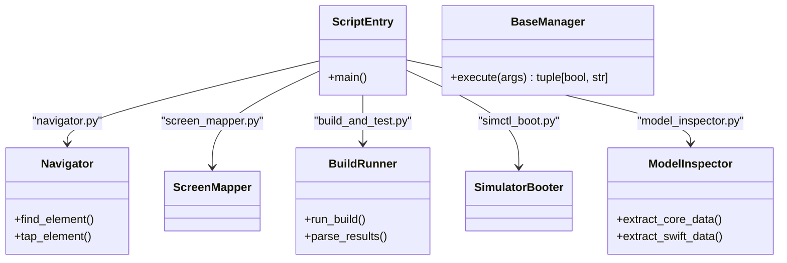

<!-- source: DeepWiki mcp.deepwiki.com · repo conorluddy/ios-simulator-skill · page 13.1 Complete Script Reference · fetched 2026-10-26 -->

# Complete Script Reference

Relevant source files

The following files were used as context for generating this wiki page:

- [CLAUDE.md](CLAUDE.md)
- [README.md](README.md)
- [ios-simulator-skill/skills/ios-simulator-skill/SKILL.md](ios-simulator-skill/skills/ios-simulator-skill/SKILL.md)

This page provides a comprehensive technical reference for the 22 scripts (21 Python scripts and 1 shell script) located in the `ios-simulator-skill/scripts/` directory. These scripts form the core functional layer of the Claude Code skill, wrapping lower-level tools like `simctl` and `idb` into an AI-optimized interface.

## Script Architecture and Dependencies

The scripts are organized into five functional categories. They leverage a shared utility layer in `common/` to handle device resolution, screenshot processing, and output caching.

**Script Dependency and Tool Mapping**

```mermaid
graph TD
    subgraph "Navigation_Interaction"
        NVG["navigator.py"]
        SCM["screen_mapper.py"]
        GES["gesture.py"]
        KBD["keyboard.py"]
        APL["app_launcher.py"]
    end

    subgraph "Build_Testing"
        BAT["build_and_test.py"]
        LGM["log_monitor.py"]
        ACA["accessibility_audit.py"]
        VDF["visual_diff.py"]
        MOD["model_inspector.py"]
    end

    subgraph "Device_Env"
        LIF["Lifecycle Scripts (5)"]
        PRM["privacy_manager.py"]
        SHC["sim_health_check.sh"]
    end

    subgraph "Common_Utilities"
        DUT["device_utils.py"]
        SUT["screenshot_utils.py"]
        CUT["cache_utils.py"]
        CFG["xcode/config.py"]
    end

    subgraph "System_Tools"
        SIM["xcrun simctl"]
        IDB["idb (Facebook)"]
        ACC["Accessibility APIs"]
        XCB["xcodebuild"]
    end

    NVG --> IDB
    NVG --> ACC
    SCM --> ACC
    GES --> IDB
    KBD --> IDB
    BAT --> XCB
    LIF --> SIM
    PRM --> SIM
    MOD --> XCB
    
    NVG & SCM & BAT & LIF --> DUT
    NVG & SCM & BAT --> CUT
    NVG & SCM --> SUT
```

Sources: [README.md:95-141](), [ios-simulator-skill/skills/ios-simulator-skill/SKILL.md:43-180](), [CLAUDE.md:116-148]()

## Manager Class Implementation

Each script follows a standardized class-based pattern where a `Manager` or `Controller` class encapsulates the logic, exposing an `execute()` method that returns a `(success, message)` tuple. This architecture is designed for testability and consistent integration with the Claude Code skill runner [CLAUDE.md:57-76]().

**Code Entity Association: Script to Class**

Sources: [CLAUDE.md:57-76](), [ios-simulator-skill/skills/ios-simulator-skill/SKILL.md:43-180](), [README.md:91-141]()

## 1. Build & Development Scripts

These scripts manage the compilation and diagnostic phase of the development lifecycle, focusing on token-efficient error reporting [README.md:49-65]().

| Script | Manager Class | Purpose | Key Flags |
| :--- | :--- | :--- | :--- |
| `build_and_test.py` | `BuildRunner` | Wraps `xcodebuild` with progressive disclosure of errors/warnings via `xcresult` parsing [README.md:49-65](). | `--project`, `--scheme`, `--test`, `--get-errors`, `--get-warnings`, `--get-log` |
| `log_monitor.py` | `LogMonitor` | Streams real-time simulator logs with severity filtering and deduplication [ios-simulator-skill/skills/ios-simulator-skill/SKILL.md:53-57](). | `--app`, `--severity`, `--follow`, `--duration` |

Sources: [README.md:95-101](), [ios-simulator-skill/skills/ios-simulator-skill/SKILL.md:45-57](), [CLAUDE.md:118-120]()

## 2. Navigation & Interaction Scripts

These scripts enable semantic interaction with the app UI, prioritizing the accessibility tree over raw pixels to save tokens and improve reliability [ios-simulator-skill/skills/ios-simulator-skill/SKILL.md:32-42]().

| Script | Manager Class | Purpose | Key Flags |
| :--- | :--- | :--- | :--- |
| `screen_mapper.py` | `ScreenMapper` | Extracts the accessibility tree to list interactive elements (buttons, text fields) [README.md:106](). | `--verbose`, `--hints`, `--json` |
| `navigator.py` | `Navigator` | Semantic interaction (find by text/type/ID) using Accessibility APIs [README.md:67-79](). | `--find-text`, `--find-type`, `--find-id`, `--tap`, `--enter-text` |
| `gesture.py` | `GestureController`| Simulates complex touch interactions like swipes, pinches, and scrolls [ios-simulator-skill/skills/ios-simulator-skill/SKILL.md:74-80](). | `--swipe`, `--scroll`, `--pinch`, `--long-press`, `--refresh` |
| `keyboard.py` | `KeyboardController`| Handles text input and hardware button (Home, Volume) simulation [ios-simulator-skill/skills/ios-simulator-skill/SKILL.md:82-87](). | `--type`, `--key`, `--button`, `--clear` |
| `app_launcher.py` | `AppLauncher` | Manages app lifecycle including installation, launching, and deep links [ios-simulator-skill/skills/ios-simulator-skill/SKILL.md:89-96](). | `--launch`, `--terminate`, `--install`, `--open-url`, `--list` |

Sources: [README.md:102-111](), [ios-simulator-skill/skills/ios-simulator-skill/SKILL.md:59-97](), [CLAUDE.md:122-128]()

## 3. Testing & Analysis Scripts

Tools for auditing app quality, visual regressions, and data structures.

| Script | Manager Class | Purpose | Key Flags |
| :--- | :--- | :--- | :--- |
| `accessibility_audit.py`| `AccessibilityAuditor`| Checks WCAG compliance (labels, touch targets) on the current screen [ios-simulator-skill/skills/ios-simulator-skill/SKILL.md:100-104](). | `--verbose`, `--output` |
| `visual_diff.py` | `VisualDiffer` | Compares two screenshots with a configurable pixel-matching threshold [ios-simulator-skill/skills/ios-simulator-skill/SKILL.md:106-110](). | `--threshold`, `--output`, `--details` |
| `test_recorder.py` | `TestRecorder` | Generates a Markdown report of test steps with screenshots and AX trees [ios-simulator-skill/skills/ios-simulator-skill/SKILL.md:112-115](). | `--test-name`, `--output` |
| `app_state_capture.py` | `AppStateCapture` | Creates a full debug bundle (logs, hierarchy, screenshot) for bug reporting [ios-simulator-skill/skills/ios-simulator-skill/SKILL.md:117-120](). | `--app-bundle-id`, `--output`, `--log-lines` |
| `model_inspector.py` | `ModelInspector` | Extracts Core Data schemas (`.xcdatamodeld`) and SwiftData `@Model` classes [ios-simulator-skill/skills/ios-simulator-skill/SKILL.md:127-132](). | `--project-path`, `--raw`, `--core-data-only`, `--swiftdata-only` |
| `sim_health_check.sh` | N/A (Bash) | Verifies environment (Xcode, IDB, Python, Pillow) and lists simulators [ios-simulator-skill/skills/ios-simulator-skill/SKILL.md:122-126](). | N/A |

Sources: [README.md:112-122](), [ios-simulator-skill/skills/ios-simulator-skill/SKILL.md:98-133](), [CLAUDE.md:129-135]()

## 4. Advanced Testing & Permissions

Scripts for simulating external triggers and managing system-level constraints.

| Script | Manager Class | Purpose | Key Flags |
| :--- | :--- | :--- | :--- |
| `clipboard.py` | `ClipboardManager` | Manages the simulator's system clipboard for testing paste functionality [ios-simulator-skill/skills/ios-simulator-skill/SKILL.md:136-139](). | `--copy`, `--test-name` |
| `status_bar.py` | `StatusBarController`| Overrides status bar elements (Time: 9:41, Battery, Network) for clean screenshots [ios-simulator-skill/skills/ios-simulator-skill/SKILL.md:141-144](). | `--preset`, `--time`, `--battery-level`, `--clear` |
| `push_notification.py` | `PushNotificationSender`| Sends simulated APNs payloads to a specific bundle ID [ios-simulator-skill/skills/ios-simulator-skill/SKILL.md:146-150](). | `--bundle-id`, `--title`, `--body`, `--payload` |
| `privacy_manager.py` | `PrivacyManager` | Grants or revokes TCC permissions (Camera, Location, Photos, etc.) [ios-simulator-skill/skills/ios-simulator-skill/SKILL.md:152-156](). | `--bundle-id`, `--grant`, `--revoke`, `--reset` |

Sources: [README.md:123-131](), [ios-simulator-skill/skills/ios-simulator-skill/SKILL.md:134-157](), [CLAUDE.md:136-141]()

## 5. Device Lifecycle Scripts

These scripts wrap `xcrun simctl` for managing virtual hardware instances and provide intelligent selection logic [CLAUDE.md:143-148]().

| Script | Manager Class | Purpose | Key Flags |
| :--- | :--- | :--- | :--- |
| `simctl_boot.py` | `SimulatorBooter` | Boots simulators with readiness polling [ios-simulator-skill/skills/ios-simulator-skill/SKILL.md:160-165](). | `--name`, `--wait-ready`, `--all` |
| `simctl_shutdown.py` | `SimulatorShutdowner`| Gracefully shuts down simulators [ios-simulator-skill/skills/ios-simulator-skill/SKILL.md:167-171](). | `--name`, `--verify`, `--all` |
| `simctl_create.py` | `SimulatorCreator` | Creates new simulator definitions [ios-simulator-skill/skills/ios-simulator-skill/SKILL.md:173-175](). | `--device`, `--runtime`, `--list-devices` |
| `simctl_delete.py` | `SimulatorDeleter` | Deletes simulators with smart cleanup for old/unused devices [ios-simulator-skill/skills/ios-simulator-skill/SKILL.md:177-179](). | `--name`, `--yes`, `--all`, `--old` |
| `simctl_erase.py` | `SimulatorEraser` | Factory resets (erases data) without deleting the device definition [ios-simulator-skill/skills/ios-simulator-skill/SKILL.md:180](). | `--name`, `--verify`, `--all`, `--booted` |
| `sim_list.py` | `SimulatorSelector` | Lists simulators with 96% token reduction via `cache_id` and smart suggestions. | `--suggest`, `--booted`, `--json` |

Sources: [README.md:132-141](), [ios-simulator-skill/skills/ios-simulator-skill/SKILL.md:158-180](), [CLAUDE.md:143-148]()

---

