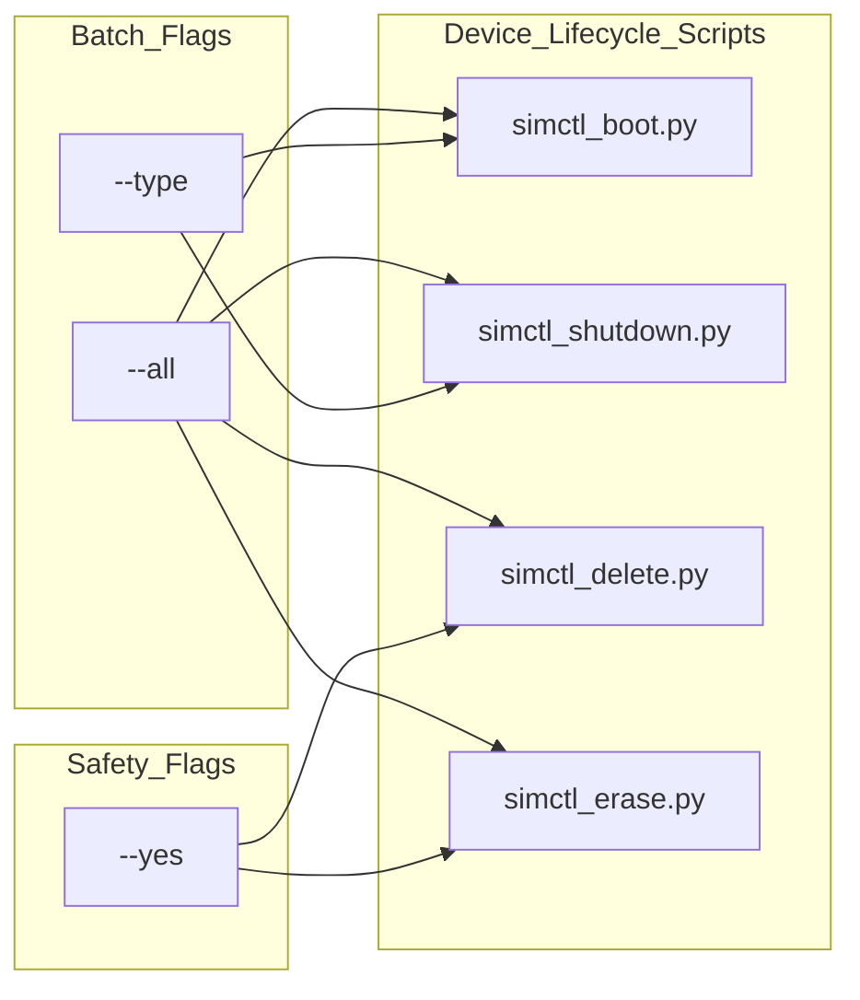
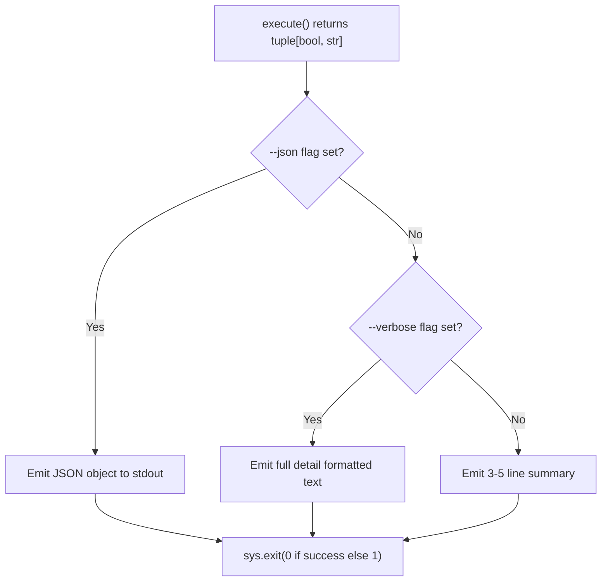
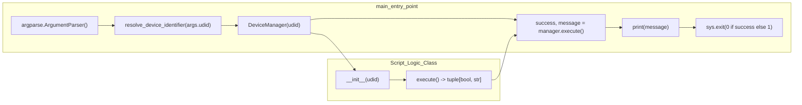
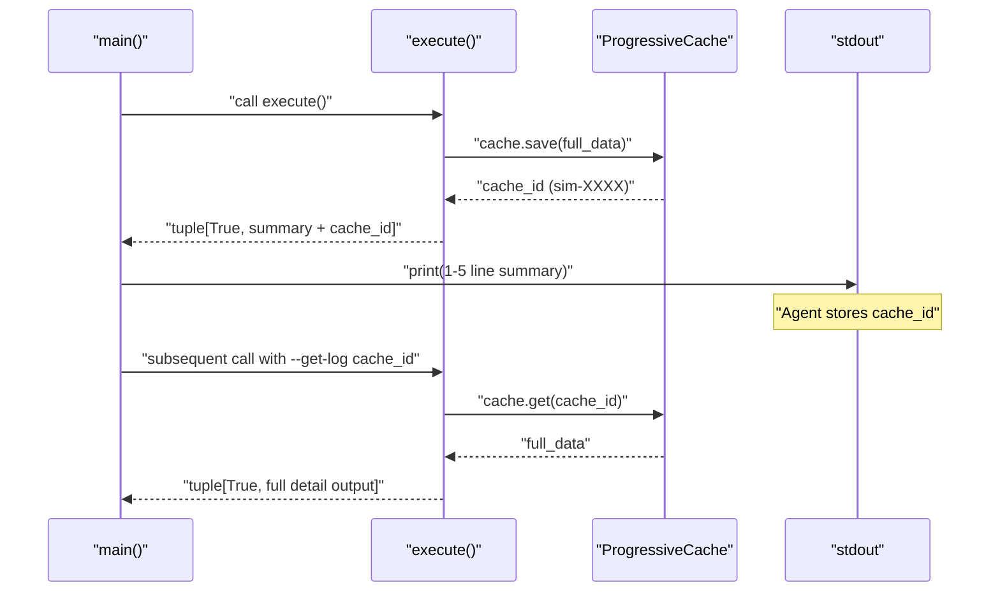
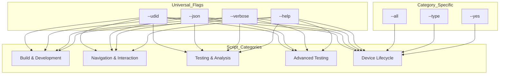

<!-- source: DeepWiki mcp.deepwiki.com · repo conorluddy/ios-simulator-skill · page 13.2 Common Flags and Conventions · fetched 2026-10-26 -->

# Common Flags and Conventions

<details>
<summary>Relevant source files</summary>

The following files were used as context for generating this wiki page:

- [CLAUDE.md](CLAUDE.md)
- [README.md](README.md)

</details>


This page is a reference for the CLI flags, output modes, and internal conventions that are shared across all 22 scripts in the skill. Understanding these patterns allows you to use any script predictably without reading its individual documentation first.

For the full list of scripts and their specific arguments, see **Complete Script Reference (13.1)**. For a conceptual explanation of output mode design, see **Progressive Disclosure and Token Efficiency (3.3)**. For UDID resolution behavior, see **Device Targeting and Auto-Detection (3.5)**.

---

## Universal Flags

The following flags are supported by every Python script in the repository. These are wired through the `argparse.ArgumentParser()` instance in each script's `main()` function [CLAUDE.md:70-76]().

| Flag | Type | Default | Description |
|------|------|---------|-------------|
| `--udid` | `str \| None` | `None` (auto-detect) | Target simulator UDID. If omitted, `resolve_device_identifier()` selects the device automatically. |
| `--json` | boolean | `False` | Emit structured JSON to stdout instead of formatted text. |
| `--verbose` | boolean | `False` | Emit full detail output (50+ lines). |
| `--help` | boolean | — | Print argument descriptions and exit. |

**Sources:** [CLAUDE.md:78-81](), [CLAUDE.md:90-105](), [README.md:91-93]()

---

## Conditional Flags

These flags appear on scripts that support batch operations or destructive actions, primarily within the Device Lifecycle category [CLAUDE.md:142-148]().

| Flag | Type | Applies To | Description |
|------|------|-----------|-------------|
| `--all` | boolean | Lifecycle scripts | Apply the operation to every simulator (e.g., `simctl_boot.py`). |
| `--type` | `str` | Lifecycle scripts | Filter batch operation by device family (e.g., `iPhone`, `iPad`). |
| `--yes` | boolean | Destructive scripts | Skip confirmation prompt (e.g., `simctl_delete.py`). |

**Title: Batch and Safety Flag Applicability**



**Sources:** [CLAUDE.md:107-114](), [README.md:132-140]()

---

## Output Modes

Every script produces one of three output formats depending on which flags are provided [CLAUDE.md:90-105](). The modes are mutually exclusive; `--json` takes precedence if both `--json` and `--verbose` are passed.

| Mode | Flag | Typical Line Count | Token Count | Use Case |
|------|----- |-------------------|-------------|----------|
| **Default** | *(none)* | 3–5 lines | ~5–10 tokens | AI agent loops, summary output |
| **Verbose** | `--verbose` | 50+ lines | 400+ tokens | Human debugging |
| **JSON** | `--json` | 20–30 lines | ~20–30 tokens | CI/CD pipelines, machine parsing |

**Title: Output Mode Selection Logic per Script**



**Sources:** [CLAUDE.md:90-105](), [CLAUDE.md:174-182](), [README.md:81-90]()

---

## The `execute()` Return Convention

Every script uses a class-based architecture for testability [CLAUDE.md:57-60](). The primary logic is contained within a manager class (e.g., `DeviceManager`) that implements a standard execution method [CLAUDE.md:61-68]().

```python
def execute(self, **kwargs) -> tuple[bool, str]:
    # Logic goes here
    return (success, message)
```

- The `bool` is `True` on success, `False` on failure [CLAUDE.md:67]().
- The `str` is the message to be printed to stdout [CLAUDE.md:74]().
- `main()` calls `sys.exit(0)` or `sys.exit(1)` based on the boolean value [CLAUDE.md:75]().

**Title: Manager Class and execute() Return Flow**



**Sources:** [CLAUDE.md:57-75]()

---

## The `--udid` Flag and Auto-Detection

Passing `--udid` is optional. When omitted, scripts use `resolve_device_identifier()` from `common/device_utils.py` to select a simulator automatically [CLAUDE.md:78-84]().

The resolution logic prioritizes:
1. An explicitly provided UDID.
2. A booted simulator if one is available [CLAUDE.md:151-152]().
3. A preferred simulator defined in `xcode/config.py` [CLAUDE.md:10.4]().

If no suitable device is found, the script prints an error to `stderr` and exits with code `1` [CLAUDE.md:85-87]().

```python
# Standard pattern in every script's main()
try:
    udid = resolve_device_identifier(args.udid)
except RuntimeError as e:
    print(f"Error: {e}", file=sys.stderr)
    sys.exit(1)
```

**Sources:** [CLAUDE.md:78-88](), [CLAUDE.md:151-155]()

---

## The `cache_id` Convention

To achieve token efficiency, scripts that generate large outputs (like `build_and_test.py` or `screen_mapper.py`) use the `ProgressiveCache` from `common/cache_utils.py` [CLAUDE.md:161-162]().

- **Summary**: The default output provides a 1-line summary [README.md:51-54]().
- **Cache ID**: The summary includes a `cache_id` (e.g., `xcresult-20251018-143052`) [README.md:54]().
- **Retrieval**: AI agents or users can retrieve full logs or errors by passing the `cache_id` back to the script with flags like `--get-errors` [README.md:59-63]().

This system results in a 96% reduction in typical token output for AI conversations [README.md:83-84]().

**Title: cache_id Lifecycle via ProgressiveCache**



**Sources:** [README.md:49-65](), [CLAUDE.md:161-162](), [README.md:81-90]()

---

## Flag Summary Quick Reference

**Title: Flag-to-Script-Category Applicability Matrix**



**Sources:** [CLAUDE.md:116-148](), [README.md:91-141]()

---

