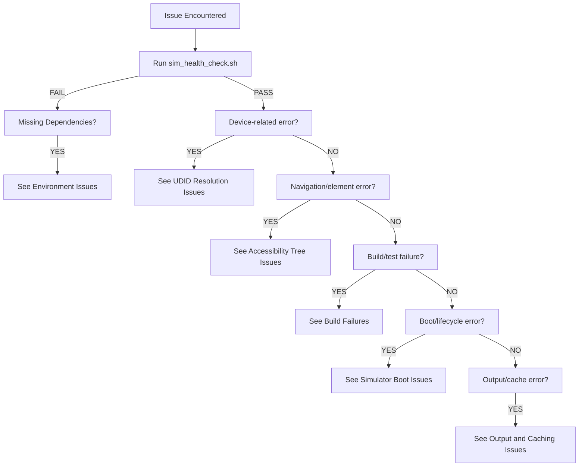
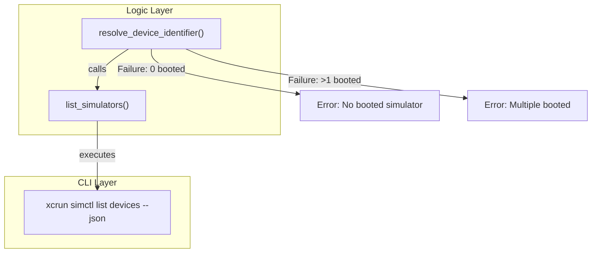

<!-- source: DeepWiki mcp.deepwiki.com · repo conorluddy/ios-simulator-skill · page 13.3 Troubleshooting Guide · fetched 2026-10-26 -->

# Troubleshooting Guide

<details>
<summary>Relevant source files</summary>

The following files were used as context for generating this wiki page:

- [ios-simulator-skill/skills/ios-simulator-skill/scripts/sim_health_check.sh](ios-simulator-skill/skills/ios-simulator-skill/scripts/sim_health_check.sh)
- [references/troubleshooting.md](references/troubleshooting.md)

</details>


This page provides diagnostic procedures and solutions for common issues encountered when using the `ios-simulator-skill`. It covers dependency problems, device resolution failures, accessibility tree errors, build failures, and simulator boot issues. For general usage patterns, see **13.2 Common Flags and Conventions**. For script-specific documentation, see **13.1 Complete Script Reference**.

## Diagnostic Workflow

Use this flowchart to identify the category of your issue:

**Flowchart: Problem Categorization**


**Sources:** [ios-simulator-skill/skills/ios-simulator-skill/scripts/sim_health_check.sh:1-150]()

## Environment Issues

### Missing Dependencies

The most common cause of failures is missing or incorrectly configured dependencies. Always start diagnostics with the health check script [ios-simulator-skill/skills/ios-simulator-skill/scripts/sim_health_check.sh:1-55]().

```bash
bash scripts/sim_health_check.sh
```

**Common Failure Patterns:**

| Symptom | Cause | Solution |
|---------|-------|----------|
| `xcrun: error: unable to find utility "simctl"` | Xcode CLI Tools not installed | `xcode-select --install` [ios-simulator-skill/skills/ios-simulator-skill/scripts/sim_health_check.sh:102-106]() |
| `command not found: idb` | IDB not installed | `brew tap facebook/fb && brew install idb-companion` [ios-simulator-skill/skills/ios-simulator-skill/scripts/sim_health_check.sh:132-132]() |
| `python: command not found` | Python not in PATH | `brew install python@3.12` [ios-simulator-skill/skills/ios-simulator-skill/scripts/sim_health_check.sh:144-144]() |
| `No module named 'PIL'` | Pillow not installed | `pip3 install pillow` [ios-simulator-skill/skills/ios-simulator-skill/scripts/sim_health_check.sh:213-213]() |
| `No simulators found` | No simulators installed | Create via `xcrun simctl create 'iPhone 15' 'iPhone 15'` [ios-simulator-skill/skills/ios-simulator-skill/scripts/sim_health_check.sh:171-171]() |

**Sources:** [ios-simulator-skill/skills/ios-simulator-skill/scripts/sim_health_check.sh:80-217](), [references/troubleshooting.md:27-27]()

### Xcode and System Compatibility

The skill requires macOS and a valid Xcode path. If `xcode-select -p` returns "not found", scripts using `xcrun` will fail [ios-simulator-skill/skills/ios-simulator-skill/scripts/sim_health_check.sh:94-103]().

**Diagnostic Check:**
```bash
# Verify macOS
sw_vers -productVersion

# Verify Xcode path
xcode-select -p

# Verify simctl availability
xcrun simctl help
```

**Sources:** [ios-simulator-skill/skills/ios-simulator-skill/scripts/sim_health_check.sh:80-118]()

## UDID Resolution Issues

Device identification failures occur when scripts cannot uniquely identify a target simulator.

### UDID Resolution Logic

**Diagram: Code Entity Mapping for Device Resolution**


**Common Errors:**

*   **"No booted simulator found"**: No simulator is running. Use `open -a Simulator` or `xcrun simctl boot <udid>` [references/troubleshooting.md:18-18]().
*   **"Multiple simulators are booted"**: The skill cannot auto-detect the target. Specify the UDID explicitly using the `--udid` flag.
*   **"IDB Target not found"**: IDB cannot see the device. Run `idb list-targets` to verify UDID visibility [references/troubleshooting.md:21-21]().

**Sources:** [references/troubleshooting.md:15-21](), [ios-simulator-skill/skills/ios-simulator-skill/scripts/sim_health_check.sh:172-194]()

## Accessibility Tree Issues

Navigation scripts (`navigator.py`, `screen_mapper.py`) depend on IDB to query the iOS accessibility hierarchy.

### IDB Connectivity Problems

If IDB fails to connect, the accessibility tree will be empty or the script will error out.

**Fixes:**
1.  **Restart IDB**: `idb kill && idb companion --boot-status-check` [references/troubleshooting.md:9-9]().
2.  **Verify IDB Path**: Ensure `idb` is in your `$PATH` [ios-simulator-skill/skills/ios-simulator-skill/scripts/sim_health_check.sh:129-129]().

### Empty Accessibility Tree

**Problem**: `screen_mapper.py` returns no elements.
**Fix**: The app must be in the foreground. Use `xcrun simctl launch booted <bundle-id>` to ensure the target application is active [references/troubleshooting.md:30-30]().

**Sources:** [references/troubleshooting.md:8-30]()

## Build Failures

The `build_and_test.py` script relies on `xcodebuild` and `xcresulttool`.

**Common Issues:**
*   **Build Errors**: If the build fails, check logs for compilation errors.
*   **Permission Denied**: If scripts fail to execute, run `chmod +x scripts/*.sh` [references/troubleshooting.md:24-24]().
*   **App won't launch**: Terminate and relaunch: `xcrun simctl terminate booted <bundle-id> && xcrun simctl launch booted <bundle-id>` [references/troubleshooting.md:12-12]().

**Sources:** [references/troubleshooting.md:11-25]()

## Simulator Boot Issues

**Problem**: Simulator hangs during boot or won't start.
**Fix**: Perform a factory reset on the device. **Warning**: This deletes all data on that specific simulator [references/troubleshooting.md:6-6]().
```bash
killall Simulator
xcrun simctl erase <udid>
```

**Diagnostic Command:**
```bash
# Check current booted state
xcrun simctl list devices | grep Booted
```

**Sources:** [references/troubleshooting.md:6-6](), [references/troubleshooting.md:45-45]()

## Quick Fix Table

| Issue | Command to Fix |
| :--- | :--- |
| **Simulator won't boot** | `killall Simulator && xcrun simctl erase <udid>` [references/troubleshooting.md:6-6]() |
| **IDB not connecting** | `idb kill && idb companion --boot-status-check` [references/troubleshooting.md:9-9]() |
| **App won't launch** | `xcrun simctl terminate booted <bundle-id> && xcrun simctl launch booted <bundle-id>` [references/troubleshooting.md:12-12]() |
| **Screenshot fails** | `xcrun simctl boot <udid>` [references/troubleshooting.md:15-15]() |
| **"No booted devices"** | `open -a Simulator` or `xcrun simctl boot <udid>` [references/troubleshooting.md:18-18]() |
| **Permission denied** | `chmod +x scripts/*.sh` [references/troubleshooting.md:24-24]() |
| **Python module missing** | `pip3 install pillow` [references/troubleshooting.md:27-27]() |
| **Accessibility tree empty**| `xcrun simctl launch booted <bundle-id>` [references/troubleshooting.md:30-30]() |
| **Device storage full** | `xcrun simctl erase <udid>` [references/troubleshooting.md:39-39]() |

**Sources:** [references/troubleshooting.md:1-40]()

---

