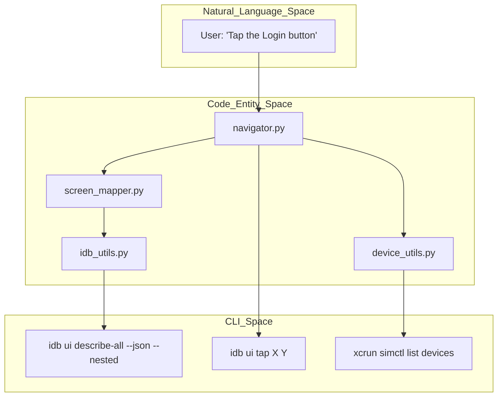
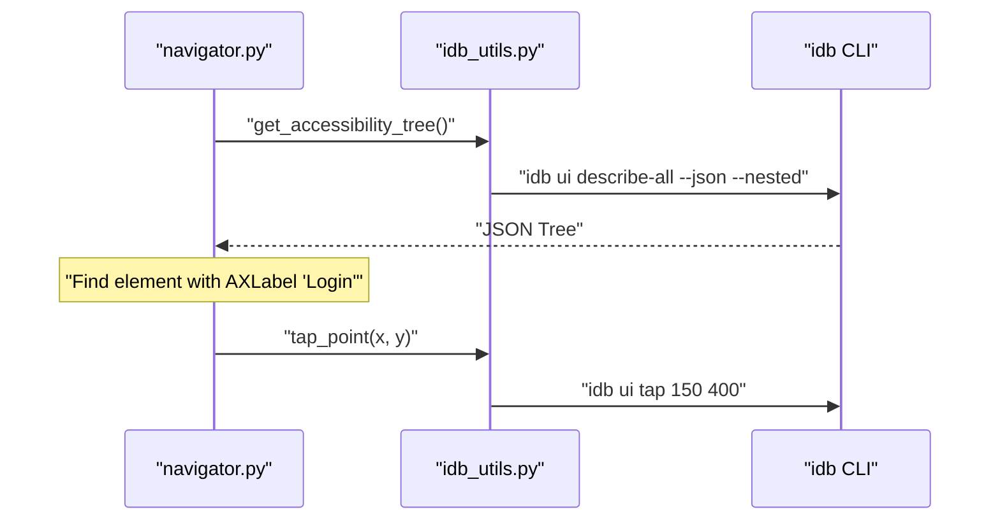

<!-- source: DeepWiki mcp.deepwiki.com · repo conorluddy/ios-simulator-skill · page 13.4 simctl and idb Quick Reference · fetched 2026-10-26 -->

# simctl and idb Quick Reference

<details>
<summary>Relevant source files</summary>

The following files were used as context for generating this wiki page:

- [references/accessibility_checklist.md](references/accessibility_checklist.md)
- [references/idb_quick.md](references/idb_quick.md)
- [references/simctl_quick.md](references/simctl_quick.md)

</details>


This page provides a condensed technical reference for the underlying Command Line Interface (CLI) tools—Apple's `simctl` and Meta's `idb`—that power the `ios-simulator-skill`. While the skill abstracts these commands into Python scripts, understanding the raw CLI syntax is essential for debugging and extending the system's capabilities.

## Overview of CLI Tooling

The skill operates by wrapping two primary toolsets:
1.  **simctl**: Part of Xcode's `xcrun` utility, used for lifecycle management (boot, shutdown, install) and basic I/O (screenshots, video).
2.  **idb (iOS Development Bridge)**: A powerful companion tool from Meta that provides advanced UI automation, accessibility tree extraction, and more granular interaction capabilities.

### Tool Selection Logic
The `ios-simulator-skill` attempts to use `idb` for complex UI interactions (tapping, swiping, accessibility tree extraction) due to its superior JSON output and performance. If `idb` is not installed, the skill falls back to `simctl` for basic operations where possible. This detection logic is managed by `idb_utils.py` [common/idb_utils.py:1-20]().

---

## 1. Apple simctl (xcrun simctl)

`simctl` is the standard tool for managing iOS simulators. It is invoked via `xcrun simctl <command>`.

### Device Management & Lifecycle
| Task | Command | Description |
| :--- | :--- | :--- |
| **List Devices** | `xcrun simctl list devices` | Shows all simulators, UDIDs, and states (Booted/Shutdown). [references/simctl_quick.md:5-9]() |
| **Boot Device** | `xcrun simctl boot <UDID>` | Starts the specified simulator. [references/simctl_quick.md:10-13]() |
| **Shutdown** | `xcrun simctl shutdown <UDID>` | Powers off the specified simulator. |
| **Install App** | `xcrun simctl install booted <path.app>` | Installs a `.app` bundle to the active simulator. [references/simctl_quick.md:18-21]() |
| **Launch App** | `xcrun simctl launch booted <bundle-id>` | Starts an installed app; returns the Process ID (PID). [references/simctl_quick.md:14-17]() |

### Media and Diagnostics
| Task | Command | Description |
| :--- | :--- | :--- |
| **Screenshot** | `xcrun simctl io booted screenshot <file.png>` | Captures the current screen. [references/simctl_quick.md:22-26]() |
| **Record Video** | `xcrun simctl io booted recordVideo <file.mp4>` | Starts screen recording (Ctrl+C to stop). [references/simctl_quick.md:27-31]() |
| **App Data Path** | `xcrun simctl get_app_container booted <bundle-id> data` | Locates the filesystem path for an app's sandbox. [references/simctl_quick.md:32-35]() |
| **Log Stream** | `xcrun simctl spawn booted log stream --predicate '...'` | Streams system/app logs in real-time. [references/simctl_quick.md:36-39]() |

**Sources:** [references/simctl_quick.md:1-54]()

---

## 2. Meta idb (iOS Development Bridge)

`idb` provides the "Semantic" layer of the skill, allowing for programmatic inspection of the UI hierarchy.

### UI Automation & Inspection
| Task | Command | Description |
| :--- | :--- | :--- |
| **Describe UI** | `idb ui describe-all --json --nested` | Returns the full accessibility tree in JSON format. [references/idb_quick.md:5-9]() |
| **Tap Point** | `idb ui tap <x> <y>` | Simulates a touch event at specific coordinates. [references/idb_quick.md:10-13]() |
| **Swipe** | `idb ui swipe <x1> <y1> <x2> <y2>` | Simulates a swipe gesture between two points. [references/idb_quick.md:14-17]() |
| **Input Text** | `idb ui text "<text>"` | Sends keyboard events to the focused element. [references/idb_quick.md:18-21]() |
| **Point Lookup** | `idb ui describe-point <x> <y> --json` | Identifies the UI element at specific coordinates. [references/idb_quick.md:22-25]() |

### Utility Commands
| Task | Command | Description |
| :--- | :--- | :--- |
| **List Targets** | `idb list-targets` | Lists simulators compatible with idb. [references/idb_quick.md:28-31]() |
| **List Apps** | `idb list-apps --udid <udid>` | Shows installed apps and their bundle identifiers. [references/idb_quick.md:36-39]() |
| **Screenshot** | `idb screenshot --udid <udid> output.png` | Captures screen via idb. [references/idb_quick.md:32-35]() |

**Sources:** [references/idb_quick.md:1-53]()

---

## Implementation Data Flow

The following diagram illustrates how the Python scripts in the skill translate high-level requests into these CLI commands.

### Diagram: Command Execution Flow



**Sources:** [references/idb_quick.md:5-13](), [references/simctl_quick.md:5-9](), [common/idb_utils.py:1-20]()

---

## Common CLI Patterns

The skill frequently uses these patterns to manage device state and interact with the UI.

### 1. Booting and Readiness Check
The skill often combines `simctl` listing with `idb` connectivity checks.
```bash
# Check if device is booted
xcrun simctl list devices | grep Booted

# Verify idb can see the target
idb list-targets | grep <UDID>
```
**Sources:** [references/simctl_quick.md:43-45](), [references/idb_quick.md:28-31]()

### 2. Semantic Interaction Workflow
To "Tap a button by text," the skill executes this sequence:
1.  **Map**: Run `idb ui describe-all --json --nested` to find the `AXLabel` matching the text. [references/idb_quick.md:43-44]()
2.  **Calculate**: Extract the `frame` (x, y, width, height) and calculate the center point.
3.  **Act**: Run `idb ui tap <center_x> <center_y>`. [references/idb_quick.md:47-49]()

### Diagram: Accessibility Interaction Sequence



**Sources:** [references/idb_quick.md:5-13](), [references/idb_quick.md:42-50]()

### 3. App Installation and Launch
Standard sequence for testing a fresh build:
```bash
# 1. Install
xcrun simctl install booted path/to/MyApp.app

# 2. Launch
xcrun simctl launch booted com.example.MyApp

# 3. Capture Initial State
xcrun simctl io booted screenshot initial_state.png
```
**Sources:** [references/simctl_quick.md:46-51]()

---

## Accessibility Auditing

The skill uses underlying `idb` data to perform accessibility checks based on the `accessibility_checklist.md`.

| Rule | Check Logic | CLI Data Source |
| :--- | :--- | :--- |
| **Interactive Labels** | `accessibilityLabel != nil` | `idb ui describe-all` [references/accessibility_checklist.md:5-7]() |
| **Button Text** | `label || value != ""` | `idb ui describe-all` [references/accessibility_checklist.md:9-11]() |
| **Touch Targets** | `frame.width >= 44 && frame.height >= 44` | `idb ui describe-all` [references/accessibility_checklist.md:41-43]() |

**Sources:** [references/accessibility_checklist.md:1-49](), [references/idb_quick.md:5-8]()

---

## Troubleshooting Reference

Common CLI-level issues often encountered when running these tools directly or via the skill.

| Issue | Tool | Potential Solution |
| :--- | :--- | :--- |
| **Target Not Found** | `idb` | Ensure `idb-companion` is running for the specific UDID. |
| **Device Stuck** | `simctl` | Run `xcrun simctl shutdown <UDID>` followed by `boot`. |
| **Screenshot Failed** | `simctl` | Check if the simulator is fully booted and the UI process is responsive. |

**Sources:** [references/simctl_quick.md:53-54](), [references/idb_quick.md:52-53]()

---

