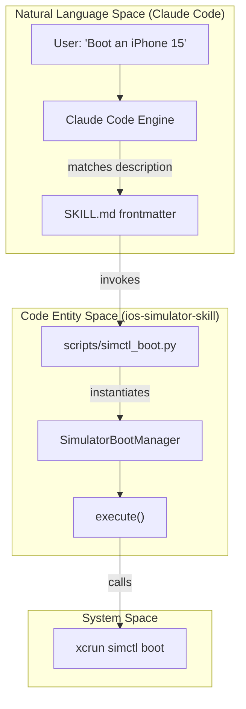
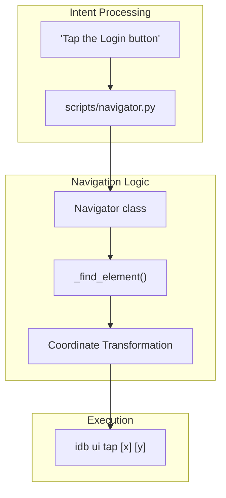

<!-- source: DeepWiki mcp.deepwiki.com · repo conorluddy/ios-simulator-skill · page 2 Getting Started · fetched 2026-10-26 -->

# Getting Started

<details>
<summary>Relevant source files</summary>

The following files were used as context for generating this wiki page:

- [README.md](README.md)
- [ios-simulator-skill/skills/ios-simulator-skill/scripts/sim_health_check.sh](ios-simulator-skill/skills/ios-simulator-skill/scripts/sim_health_check.sh)

</details>


This page guides you through initial setup and first steps with the `ios-simulator-skill`. It covers installation methods, environment verification using health checks, and a quick start tutorial to execute your first iOS automation workflow.

For detailed information about individual components, see the following child pages:
- [Installation and Prerequisites](#2.1) — Detailed installation methods and dependency management.
- [Environment Verification](#2.2) — Using `sim_health_check.sh` to validate your macOS setup.
- [Quick Start Tutorial](#2.3) — A step-by-step workflow example for new users.

---

## Installation Overview

The skill is designed to be installed either as a **Claude Code Skill** (recommended for AI-assisted development) or as a **Standalone Toolset** for manual scripting and CI/CD pipelines. Both methods provide access to the same 22 production scripts.

### Installation Paths



**Installation Methods:**
1.  **Plugin Marketplace (Recommended):** Use `/plugin marketplace add conorluddy/ios-simulator-skill` followed by `/plugin install ios-simulator-skill@conorluddy` within Claude Code [README.md:18-25]().
2.  **Git Clone:** Clone directly into your personal (`~/.claude/skills/`) or project-specific (`.claude/skills/`) Claude skills directory [README.md:27-35]().

**Sources:** [README.md:16-37]()

---

## Prerequisites

Before proceeding, ensure your environment meets these core requirements:
*   **macOS 12+** [README.md:41]() [ios-simulator-skill/skills/ios-simulator-skill/scripts/sim_health_check.sh:82-84]()
*   **Xcode Command Line Tools** (`xcode-select --install`) [README.md:42]() [ios-simulator-skill/skills/ios-simulator-skill/scripts/sim_health_check.sh:92-107]()
*   **Python 3.12+** (Required for scripts) [ios-simulator-skill/skills/ios-simulator-skill/scripts/sim_health_check.sh:137-151]()
*   **IDB (Optional):** Required for advanced interactive features (`brew tap facebook/fb && brew install idb-companion`) [README.md:44]() [ios-simulator-skill/skills/ios-simulator-skill/scripts/sim_health_check.sh:121-133]()
*   **Pillow (Optional):** Required for visual diffs (`pip3 install pillow`) [README.md:45]() [ios-simulator-skill/skills/ios-simulator-skill/scripts/sim_health_check.sh:208-214]()

For details, see [Installation and Prerequisites](#2.1).

**Sources:** [README.md:39-46](), [ios-simulator-skill/skills/ios-simulator-skill/scripts/sim_health_check.sh:80-151]()

---

## Environment Verification

Once installed, use the included health check script to verify that all dependencies (Xcode, simctl, IDB, Python, and Pillow) are correctly configured and that simulators are available.

```bash
# Run the health check from the skill root
bash scripts/sim_health_check.sh
```

The `sim_health_check.sh` script performs 8 distinct checks, including macOS version, Xcode path, `simctl` availability, Python 3.12+ presence, and the availability of both standard and booted simulator devices [ios-simulator-skill/skills/ios-simulator-skill/scripts/sim_health_check.sh:80-214]().

For details, see [Environment Verification](#2.2).

**Sources:** [README.md:120](), [ios-simulator-skill/skills/ios-simulator-skill/scripts/sim_health_check.sh:1-214]()

---

## Quick Start Workflow

The skill follows a "Semantic Navigation" pattern, allowing you to interact with the simulator using text labels instead of fragile pixel coordinates. This approach uses iOS accessibility APIs to identify elements by their meaning rather than their position [README.md:69-79]().

### From Intent to Action



**First Steps Example:**
1.  **Boot:** `python3 scripts/simctl_boot.py --wait-ready` — Boots a simulator and waits for it to be ready for interaction [README.md:136]().
2.  **Launch:** `python3 scripts/app_launcher.py --launch com.example.app` — Launches the target application [README.md:110]().
3.  **Map:** `python3 scripts/screen_mapper.py` — Analyzes the current screen to list interactive elements [README.md:106]().
4.  **Interact:** `python3 scripts/navigator.py --find-text "Login" --tap` — Performs a semantic tap on the "Login" button [README.md:76-77]().

For a detailed walkthrough, see [Quick Start Tutorial](#2.3).

**Sources:** [README.md:67-80](), [README.md:102-110](), [README.md:136]()

---

