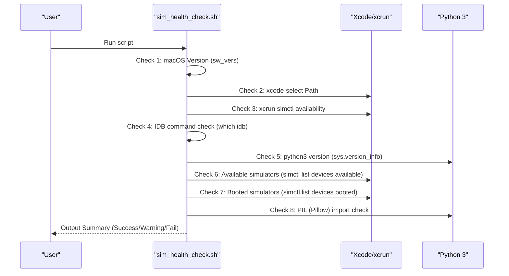

<!-- source: DeepWiki mcp.deepwiki.com · repo conorluddy/ios-simulator-skill · page 2.1 Installation and Prerequisites · fetched 2026-10-26 -->

# Installation and Prerequisites

<details>
<summary>Relevant source files</summary>

The following files were used as context for generating this wiki page:

- [.github/workflows/release.yml](.github/workflows/release.yml)
- [README.md](README.md)
- [ios-simulator-skill/skills/ios-simulator-skill/scripts/sim_health_check.sh](ios-simulator-skill/skills/ios-simulator-skill/scripts/sim_health_check.sh)

</details>


This document covers the system requirements, installation methods, and environment verification for the `ios-simulator-skill`. It explains the dependencies needed to run the 22 scripts, the difference between personal and project installation, and how to verify your setup using the health check utility.

## Purpose and Scope

The `ios-simulator-skill` runs on macOS and wraps native Apple tools (`xcrun simctl`, `xcodebuild`) and optional third-party tools (IDB). This page documents:

- **System requirements**: Operating system, Xcode, and Python versions. [README.md:41-43]()
- **Installation methods**: Marketplace, Git clone (personal vs project). [README.md:18-35]()
- **Dependency installation**: Required tools and optional packages like Pillow. [README.md:39-46]()
- **Environment verification**: Using `sim_health_check.sh` to validate setup. [README.md:120-120]()

## System Requirements

The skill requires a macOS environment with Xcode tooling. All scripts execute via standard Python 3 interpreters and macOS command-line tools.

### Required Dependencies

| Dependency | Minimum Version | Purpose | Verification Command |
|------------|----------------|---------|---------------------|
| macOS | 12.0+ | iOS Simulator host OS | `sw_vers -productVersion` |
| Xcode Command Line Tools | Latest | Provides `xcrun`, `simctl`, `xcodebuild` | `xcode-select -p` |
| Python 3 | 3.12+ | Script execution (3.12+ recommended) | `python3 --version` |

**Sources**: [README.md:41-43](), [ios-simulator-skill/skills/ios-simulator-skill/scripts/sim_health_check.sh:137-145]()

### Optional Dependencies

| Dependency | Purpose | Scripts That Use It | Installation |
|------------|---------|---------------------|--------------|
| IDB (iOS Development Bridge) | Advanced UI automation, faster element querying | `navigator.py`, `screen_mapper.py`, `gesture.py` | `brew tap facebook/fb && brew install idb-companion` |
| Pillow | Screenshot comparison and optimization | `visual_diff.py`, `screenshot_utils.py` | `pip3 install pillow` |

**Sources**: [README.md:44-45](), [ios-simulator-skill/skills/ios-simulator-skill/scripts/sim_health_check.sh:121-133]()

### Dependency Architecture

```mermaid
graph TB
    subgraph "Operating_System_Layer"
        ["macOS 12.0+ (sw_vers)"]
        ["Xcode Command Line Tools (xcode-select -p)"]
    end
    
    subgraph "Core_Tools_Required"
        ["xcrun simctl (Device lifecycle)"]
        ["xcodebuild (Build and test)"]
        ["python3 (Script execution)"]
    end
    
    subgraph "Optional_Tools"
        ["idb / idb-companion (Advanced UI automation)"]
        ["Pillow / PIL (Image processing)"]
    end
    
    subgraph "Skill_Scripts_22"
        ["Device Lifecycle: simctl_boot.py, simctl_create.py"]
        ["Build Scripts: build_and_test.py"]
        ["Navigation Scripts: navigator.py, screen_mapper.py"]
        ["Visual Testing: visual_diff.py"]
    end
    
    ["macOS 12.0+ (sw_vers)"] --> ["Xcode Command Line Tools (xcode-select -p)"]
    ["Xcode Command Line Tools (xcode-select -p)"] --> ["xcrun simctl (Device lifecycle)"]
    ["Xcode Command Line Tools (xcode-select -p)"] --> ["xcodebuild (Build and test)"]
    ["macOS 12.0+ (sw_vers)"] --> ["python3 (Script execution)"]
    
    ["Device Lifecycle: simctl_boot.py, simctl_create.py"] --> ["xcrun simctl (Device lifecycle)"]
    ["Build Scripts: build_and_test.py"] --> ["xcodebuild (Build and test)"]
    ["Navigation Scripts: navigator.py, screen_mapper.py"] --> ["xcrun simctl (Device lifecycle)"]
    ["Navigation Scripts: navigator.py, screen_mapper.py"] -. "Optional" .-> ["idb / idb-companion (Advanced UI automation)"]
    ["Visual Testing: visual_diff.py"] --> ["python3 (Script execution)"]
    ["Visual Testing: visual_diff.py"] -. "Optional" .-> ["Pillow / PIL (Image processing)"]
```

**Sources**: [README.md:7-14](), [README.md:91-141](), [ios-simulator-skill/skills/ios-simulator-skill/scripts/sim_health_check.sh:80-152]()

## Installation Methods

### Via Plugin Marketplace (Recommended)

This is the standard way to install the skill within Claude Code. [README.md:18-25]()

```bash
/plugin marketplace add conorluddy/ios-simulator-skill
/plugin install ios-simulator-skill@conorluddy
```

### Via Git Clone

You can manually clone the repository for global (Personal) or local (Project) use. [README.md:27-35]()

| Method | Command | Path |
|--------|---------|------|
| **Personal** | `git clone https://github.com/conorluddy/ios-simulator-skill.git ~/.claude/skills/ios-simulator-skill` | `~/.claude/skills/` |
| **Project** | `git clone https://github.com/conorluddy/ios-simulator-skill.git .claude/skills/ios-simulator-skill` | `.claude/skills/` |

**Sources**: [README.md:27-35]()

### Installation Source to Entity Mapping

```mermaid
graph LR
    subgraph "Installation_Source"
        ["Plugin Marketplace"]
        ["Git Clone (github.com/conorluddy/ios-simulator-skill)"]
    end
    
    subgraph "Installation_Targets"
        ["~/.claude/skills/ (Personal/Global)"]
        [".claude/skills/ (Project/Local)"]
    end
    
    subgraph "Code_Entities"
        ["SKILL.md (Entry point)"]
        ["scripts/ (22 Python/Bash scripts)"]
        ["common/ (Shared utilities)"]
    end
    
    ["Plugin Marketplace"] --> ["~/.claude/skills/ (Personal/Global)"]
    ["Git Clone (github.com/conorluddy/ios-simulator-skill)"] --> ["~/.claude/skills/ (Personal/Global)"]
    ["Git Clone (github.com/conorluddy/ios-simulator-skill)"] --> [".claude/skills/ (Project/Local)"]
    
    ["~/.claude/skills/ (Personal/Global)"] --> ["SKILL.md (Entry point)"]
    ["~/.claude/skills/ (Personal/Global)"] --> ["scripts/ (22 Python/Bash scripts)"]
    ["~/.claude/skills/ (Personal/Global)"] --> ["common/ (Shared utilities)"]
```

**Sources**: [README.md:18-35](), [README.md:91-141](), [.github/workflows/release.yml:19-24]()

## Xcode Command Line Tools Installation

The Xcode Command Line Tools provide `xcrun`, `simctl`, and `xcodebuild`. These are the primary dependencies. [README.md:42]()

### Installation and Verification

```bash
# Install tools
xcode-select --install

# Verify path
xcode-select -p

# Verify simctl availability
xcrun simctl help
```

**Sources**: [README.md:42](), [ios-simulator-skill/skills/ios-simulator-skill/scripts/sim_health_check.sh:91-118]()

## Optional Dependency Installation

### IDB (iOS Development Bridge)

IDB provides advanced UI automation. The skill uses it for semantic navigation and gesture support. [README.md:44]()

```bash
# Install via Homebrew
brew tap facebook/fb
brew install idb-companion
```

**Sources**: [README.md:44](), [ios-simulator-skill/skills/ios-simulator-skill/scripts/sim_health_check.sh:120-134]()

### Pillow (Python Imaging Library)

Required for `visual_diff.py` and optimized screenshot handling. [README.md:45]()

```bash
pip3 install pillow
```

**Sources**: [README.md:45](), [ios-simulator-skill/skills/ios-simulator-skill/scripts/sim_health_check.sh:207-213]()

## Environment Verification

The `sim_health_check.sh` script validates the environment by checking for required binaries, Python version, and simulator status. [README.md:120-120]()

### Running the Health Check

```bash
# From the repository root
bash scripts/sim_health_check.sh
```

**Sources**: [ios-simulator-skill/skills/ios-simulator-skill/scripts/sim_health_check.sh:8-8]()

### Health Check Logic

The script performs 8 specific checks to ensure the environment is ready for iOS automation. [ios-simulator-skill/skills/ios-simulator-skill/scripts/sim_health_check.sh:80-203]()



**Sources**: [ios-simulator-skill/skills/ios-simulator-skill/scripts/sim_health_check.sh:80-213]()

## Package Structure Validation

When packaging the skill for release or manual installation, the repository structure must contain key files to be recognized by Claude Code. [ios-simulator-skill/.github/workflows/release.yml:19-24]()

| Required Path | Purpose |
|---------------|---------|
| `ios-simulator-skill/SKILL.md` | Skill definition and entry point |
| `ios-simulator-skill/scripts/` | Directory containing all 22 executable scripts |

**Sources**: [.github/workflows/release.yml:19-24]()

---

