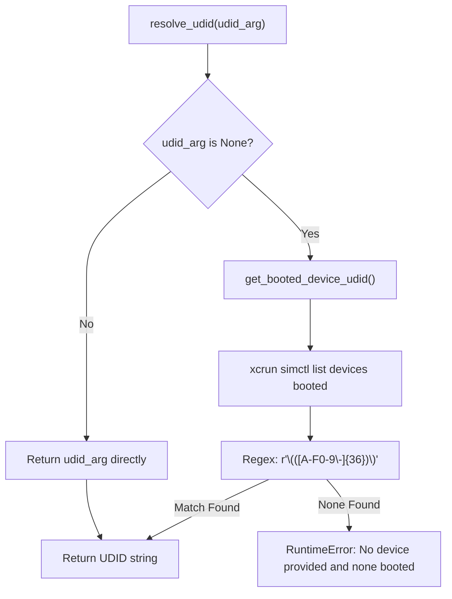
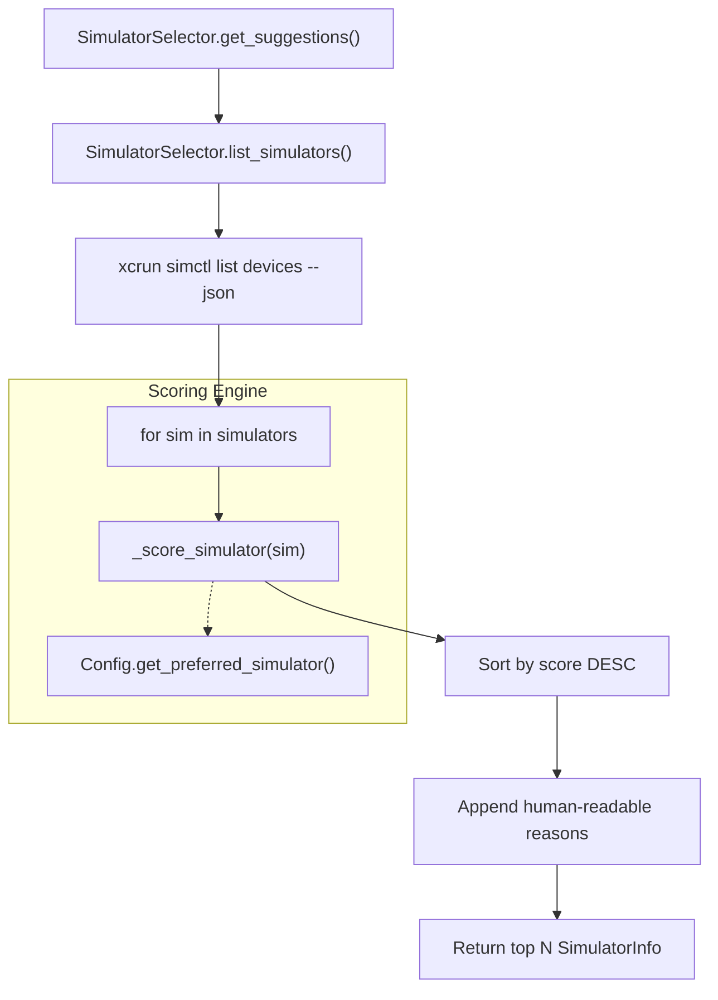

<!-- source: DeepWiki mcp.deepwiki.com · repo conorluddy/ios-simulator-skill · page 3.5 Device Targeting and Auto-Detection · fetched 2026-10-26 -->

# Device Targeting and Auto-Detection

<details>
<summary>Relevant source files</summary>

The following files were used as context for generating this wiki page:

- [CLAUDE.md](CLAUDE.md)
- [ios-simulator-skill/skills/ios-simulator-skill/scripts/common/device_utils.py](ios-simulator-skill/skills/ios-simulator-skill/scripts/common/device_utils.py)
- [ios-simulator-skill/skills/ios-simulator-skill/scripts/simulator_selector.py](ios-simulator-skill/skills/ios-simulator-skill/scripts/simulator_selector.py)

</details>


## Purpose and Scope

This page explains how the `ios-simulator-skill` automatically detects and resolves iOS simulator devices without requiring manual UDID specification. The system provides three targeting mechanisms: auto-detection of booted devices, flexible device identifier resolution (UDID or name), and intelligent simulator selection based on scoring. These features enable zero-configuration workflows where scripts operate on "the obvious device" by default.

For details on how individual lifecycle scripts use these features, see [Device Lifecycle Scripts](). For configuration of preferred devices, see [Shared Utilities: xcode/config.py]().

---

## Auto-UDID Detection Pattern

All scripts in the skill follow a consistent pattern for device targeting: the `--udid` argument is **optional**. When omitted, the script automatically detects the currently booted simulator. This eliminates the need to manually specify UDIDs in typical single-device workflows.

The pattern is implemented as follows:

```python
# Standard pattern used in scripts like navigator.py or app_launcher.py
try:
    udid = resolve_udid(args.udid)
except RuntimeError as e:
    print(f"Error: {e}", file=sys.stderr)
    sys.exit(1)
```

The `resolve_udid()` function accepts `None` as input and returns the UDID of the booted device. If no device is booted, it raises a descriptive error.

**Example Usage:**

```bash
# Auto-detects booted device
python scripts/navigator.py --find-text "Login" --tap

# Explicit UDID
python scripts/navigator.py --udid ABC123-DEF456 --find-text "Login" --tap
```

Sources: [ios-simulator-skill/skills/ios-simulator-skill/scripts/common/device_utils.py:161-199](), [CLAUDE.md:78-88]()

---

## Device Identifier Resolution

The `resolve_udid()` function in `device_utils.py` handles the logic of identifying which simulator to target. It is the primary entry point for device resolution across the skill.

### Resolution Flow Diagram



**Title:** Device identifier resolution flow from user input to UDID

Sources: [ios-simulator-skill/skills/ios-simulator-skill/scripts/common/device_utils.py:124-199]()

---

## Intelligent Simulator Selection

The `SimulatorSelector` class provides advanced logic for suggesting simulators when none are booted or when a user needs to pick a target. It ranks available devices based on a weighted scoring system.

### Scoring Criteria

The `_score_simulator()` method calculates a score for each device using the following weights:

| Criterion | Score Weight | Code Reference |
|-----------|--------------|----------------|
| Recently used (from `Config`) | +100 points | [ios-simulator-skill/skills/ios-simulator-skill/scripts/simulator_selector.py:215-217]() |
| Latest iOS version | +50 points | [ios-simulator-skill/skills/ios-simulator-skill/scripts/simulator_selector.py:219-222]() |
| Common models (iPhone 16, 15, etc.) | +20-30 points | [ios-simulator-skill/skills/ios-simulator-skill/scripts/simulator_selector.py:224-228]() |
| Currently booted | +10 points | [ios-simulator-skill/skills/ios-simulator-skill/scripts/simulator_selector.py:230-232]() |

### Selection Logic Diagram



**Title:** Intelligent selection process bridging Natural Language Space (reasons) to Code Entity Space (scoring logic)

Sources: [ios-simulator-skill/skills/ios-simulator-skill/scripts/simulator_selector.py:69-232]()

---

## Batch Operations

Lifecycle scripts like `simctl_boot.py` and `simctl_shutdown.py` support batch operations to target multiple devices simultaneously using the `--all` or `--type` flags.

### Implementation: Simulator Management

The skill enables targeting broad categories of devices through pattern matching:

1. **Target All**: Scripts support an `--all` flag to iterate through all known simulators.
2. **Target by Type**: The `--type` flag allows filtering by device name patterns (e.g., "iPhone"). This is often implemented by parsing device names using internal utilities like `_extract_device_type`.

Sources: [CLAUDE.md:107-114](), [ios-simulator-skill/skills/ios-simulator-skill/scripts/common/device_utils.py:154-154]()

---

## Standardized Command Building

To ensure device targeting is consistent across different underlying tools (`simctl` and `idb`), the skill uses centralized command builders in `device_utils.py`.

### simctl Targeting
The `build_simctl_command` function automatically defaults to the `"booted"` alias if no UDID is provided, ensuring that `xcrun simctl` operations target the active simulator by default.

```python
def build_simctl_command(operation, udid=None, *args):
    cmd = ["xcrun", "simctl", operation]
    cmd.append(udid if udid else "booted")
    cmd.extend(str(arg) for arg in args)
    return cmd
```
Sources: [ios-simulator-skill/skills/ios-simulator-skill/scripts/common/device_utils.py:22-66]()

### IDB Targeting
The `build_idb_command` function handles IDB's optional `--udid` flag. If a UDID is provided, it is appended to the command; otherwise, IDB's default behavior (targeting the booted device) is used.

```python
def build_idb_command(operation, udid=None, *args):
    cmd = ["idb"] + operation.split()
    cmd.extend(str(arg) for arg in args)
    if udid:
        cmd.extend(["--udid", udid])
    return cmd
```
Sources: [ios-simulator-skill/skills/ios-simulator-skill/scripts/common/device_utils.py:69-121]()

---

## Summary of Resolution Priority

The following table summarizes the complete resolution chain used by the skill to identify a target device:

| Priority | Method | Source | Fallback |
|----------|--------|--------|----------|
| 1 (Highest) | Explicit Argument | CLI `--udid <val>` | Step 2 |
| 2 | Auto-Detection | `get_booted_device_udid()` | Step 3 |
| 3 | Config Preference | `Config.get_preferred_simulator()` | Step 4 |
| 4 (Lowest) | Intelligent Suggestion | `SimulatorSelector.get_suggestions()` | User Prompt / Error |

This multi-layered approach ensures that the skill is both robust for automation (via explicit UDIDs) and highly ergonomic for interactive use (via auto-detection and intelligent suggestions).

Sources: [ios-simulator-skill/skills/ios-simulator-skill/scripts/common/device_utils.py:161-199](), [ios-simulator-skill/skills/ios-simulator-skill/scripts/simulator_selector.py:144-199]()

---

