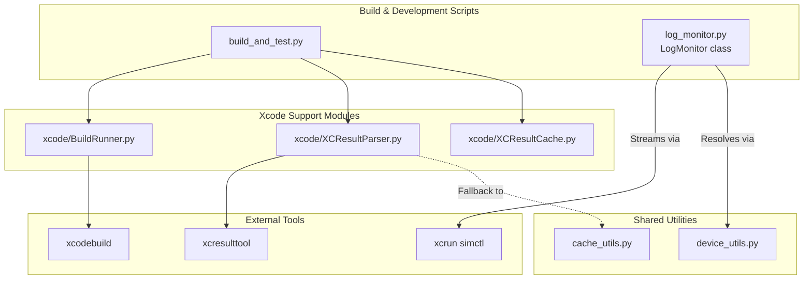
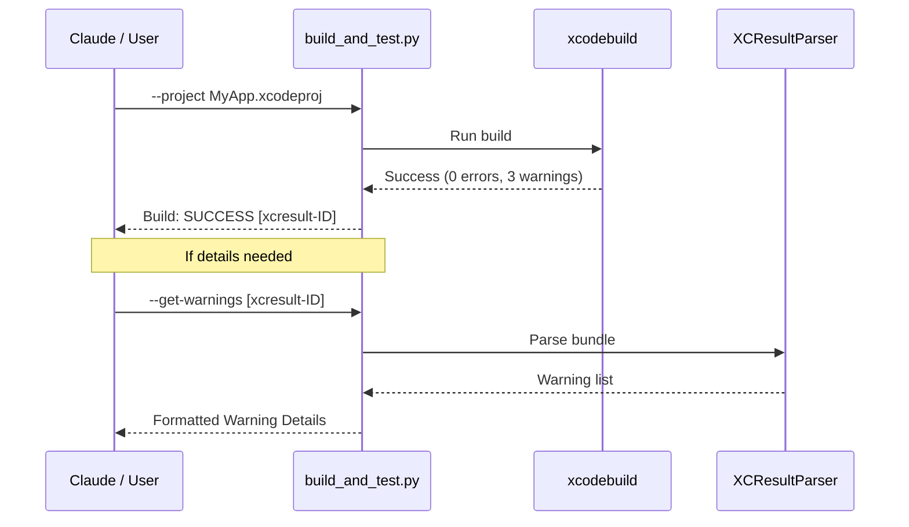

<!-- source: DeepWiki mcp.deepwiki.com · repo conorluddy/ios-simulator-skill · page 5 Build & Development Scripts · fetched 2026-10-26 -->

# Build & Development Scripts

<details>
<summary>Relevant source files</summary>

The following files were used as context for generating this wiki page:

- [ios-simulator-skill/skills/ios-simulator-skill/scripts/build_and_test.py](ios-simulator-skill/skills/ios-simulator-skill/scripts/build_and_test.py)
- [ios-simulator-skill/skills/ios-simulator-skill/scripts/log_monitor.py](ios-simulator-skill/skills/ios-simulator-skill/scripts/log_monitor.py)

</details>


This page documents the scripts in the Build & Development category that support Xcode project building, test execution, and development workflow monitoring. These scripts wrap Apple's `xcodebuild` and simulator logging tools with progressive disclosure outputs optimized for both AI agents and developers.

For information about testing and quality assurance scripts, see [Testing & Analysis Scripts](#7). For device management during CI/CD workflows, see [Device Lifecycle Scripts](#9).

**Sources:** [ios-simulator-skill/skills/ios-simulator-skill/scripts/build_and_test.py:1-12](), [ios-simulator-skill/skills/ios-simulator-skill/scripts/log_monitor.py:1-14]()

---

## Overview

The Build & Development category consists of scripts that handle the primary development workflow: compiling iOS projects, running test suites, and monitoring runtime behavior.

| Script | Purpose | Primary Use Case | Key Features |
|--------|---------|------------------|--------------|
| `build_and_test.py` | Build Xcode projects and execute tests | CI/CD integration, automated testing | Progressive disclosure, xcresult parsing, JSON output |
| `log_monitor.py` | Monitor simulator logs in real-time | Debugging, runtime analysis | Intelligent filtering, severity classification, follow mode |
| `xcode/xcresult.py` | Parse `.xcresult` bundles | Result analysis | Error/warning extraction, build log retrieval |

These scripts utilize modular components from the `xcode` package, including `BuildRunner`, `XCResultParser`, and `XCResultCache` [ios-simulator-skill/skills/ios-simulator-skill/scripts/build_and_test.py:42-42]().

**Sources:** [ios-simulator-skill/skills/ios-simulator-skill/scripts/build_and_test.py:1-35](), [ios-simulator-skill/skills/ios-simulator-skill/scripts/log_monitor.py:1-31]()

---

## System Context

The following diagram shows how Build & Development scripts interact with external Xcode tools and shared utilities.

### Diagram: Build & Development Architecture



**Analysis:** `build_and_test.py` acts as a high-level orchestrator using the `BuildRunner` to interface with `xcodebuild`. It leverages `XCResultParser` to decode the binary `.xcresult` bundles produced by Xcode, and `XCResultCache` to manage historical build data. `log_monitor.py` uses the `LogMonitor` class to stream logs via `xcrun simctl spawn [device] log stream` [ios-simulator-skill/skills/ios-simulator-skill/scripts/log_monitor.py:231-231](), applying severity filters to the raw output.

**Sources:** [ios-simulator-skill/skills/ios-simulator-skill/scripts/build_and_test.py:42-42](), [ios-simulator-skill/skills/ios-simulator-skill/scripts/log_monitor.py:43-83](), [ios-simulator-skill/skills/ios-simulator-skill/scripts/log_monitor.py:231-231]()

---

## build_and_test.py

The `build_and_test.py` script provides ultra token-efficient build automation with progressive disclosure via `.xcresult` bundles [ios-simulator-skill/skills/ios-simulator-skill/scripts/build_and_test.py:3-9](). It is designed to provide minimal output by default (5-10 tokens) while allowing deep dives into errors or logs on demand.

For details, see [build_and_test.py](#5.1).

### Key Capabilities
- **Project Detection**: Supports both `--project` (.xcodeproj) and `--workspace` (.xcworkspace) files [ios-simulator-skill/skills/ios-simulator-skill/scripts/build_and_test.py:72-73]().
- **Auto-Detection**: Automatically detects schemes if the `--scheme` flag is not specified [ios-simulator-skill/skills/ios-simulator-skill/scripts/build_and_test.py:75-75]().
- **Progressive Disclosure**: Allows retrieving specific error details (`--get-errors`), warnings (`--get-warnings`), or full logs (`--get-log`) using an `XCRESULT_ID` [ios-simulator-skill/skills/ios-simulator-skill/scripts/build_and_test.py:88-96]().
- **Result Management**: Lists recent builds with `--list-xcresults` [ios-simulator-skill/skills/ios-simulator-skill/scripts/build_and_test.py:101-101]().

### Workflow Diagram: Progressive Disclosure



**Analysis:** This workflow minimizes token usage by only returning a unique `XCRESULT_ID` upon completion [ios-simulator-skill/skills/ios-simulator-skill/scripts/build_and_test.py:16-16](). The user or agent can then selectively "disclose" more information using that ID [ios-simulator-skill/skills/ios-simulator-skill/scripts/build_and_test.py:134-142]().

**Sources:** [ios-simulator-skill/skills/ios-simulator-skill/scripts/build_and_test.py:5-35](), [ios-simulator-skill/skills/ios-simulator-skill/scripts/build_and_test.py:115-131]()

---

## log_monitor.py

The `log_monitor.py` script provides real-time log streaming from iOS simulators with intelligent filtering and error detection [ios-simulator-skill/skills/ios-simulator-skill/scripts/log_monitor.py:3-14]().

For details, see [log_monitor.py](#5.2).

### Core Features
- **Smart Filtering**: Filters by app bundle ID (`--app`), device UDID, or severity (`--severity`) [ios-simulator-skill/skills/ios-simulator-skill/scripts/log_monitor.py:58-62]().
- **Classification**: Automatically classifies log lines using regex patterns in `classify_log_line()` for errors, faults, exceptions, and warnings [ios-simulator-skill/skills/ios-simulator-skill/scripts/log_monitor.py:112-152]().
- **Deduplication**: Creates signatures for log messages via `deduplicate_message()` to avoid flooding the output with repetitive entries [ios-simulator-skill/skills/ios-simulator-skill/scripts/log_monitor.py:154-173]().
- **Flexible Modes**: Supports continuous `--follow` mode or fixed `--duration` captures [ios-simulator-skill/skills/ios-simulator-skill/scripts/log_monitor.py:18-21]().

**Sources:** [ios-simulator-skill/skills/ios-simulator-skill/scripts/log_monitor.py:43-83](), [ios-simulator-skill/skills/ios-simulator-skill/scripts/log_monitor.py:112-152](), [ios-simulator-skill/skills/ios-simulator-skill/scripts/log_monitor.py:154-173]()

---

## XCResult Parser and Reporter

The `xcode/xcresult.py` and associated reporting logic handle the complexity of Apple's structured build and test results.

For details, see [XCResult Parser and Reporter](#5.3).

### Components
- **XCResultParser**: Uses `xcresulttool` to extract errors, warnings, and logs from the `.xcresult` bundle [ios-simulator-skill/skills/ios-simulator-skill/scripts/build_and_test.py:146-186]().
- **OutputFormatter**: Provides static methods like `format_errors()` and `format_warnings()` to turn raw parser data into human-readable or AI-optimized text [ios-simulator-skill/skills/ios-simulator-skill/scripts/build_and_test.py:156-167]().
- **Stderr Fallback**: In cases where the `.xcresult` bundle is incomplete, the system can fall back to cached stderr logs via `cache.get_stderr(xcresult_id)` to identify build failures [ios-simulator-skill/skills/ios-simulator-skill/scripts/build_and_test.py:145-146]().

### Error Categorization
The parser categorizes issues to help Claude provide better "hints" for resolution, distinguishing between compilation errors, linker errors, and test failures.

**Sources:** [ios-simulator-skill/skills/ios-simulator-skill/scripts/build_and_test.py:42-42](), [ios-simulator-skill/skills/ios-simulator-skill/scripts/build_and_test.py:145-186]()

---

## Usage Examples

**Building a project:**
```bash
python scripts/build_and_test.py --project MyApp.xcodeproj
```

**Inspecting errors from a specific build:**
```bash
python scripts/build_and_test.py --get-errors xcresult-20251018-143052
```

**Monitoring app logs for errors only:**
```bash
python scripts/log_monitor.py --app com.myapp.bundle --severity error --follow
```

**Sources:** [ios-simulator-skill/skills/ios-simulator-skill/scripts/build_and_test.py:13-35](), [ios-simulator-skill/skills/ios-simulator-skill/scripts/log_monitor.py:16-31]()

---

