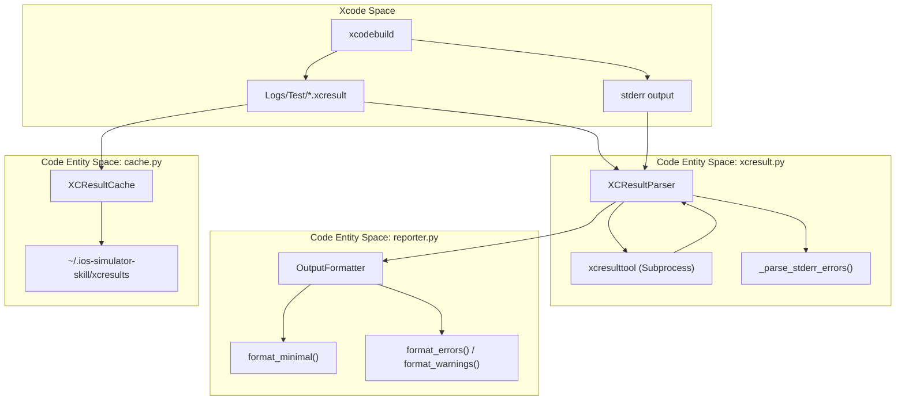
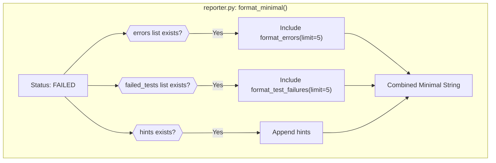

<!-- source: DeepWiki mcp.deepwiki.com · repo conorluddy/ios-simulator-skill · page 5.3 XCResult Parser and Reporter · fetched 2026-10-26 -->

# XCResult Parser and Reporter

<details>
<summary>Relevant source files</summary>

The following files were used as context for generating this wiki page:

- [ios-simulator-skill/skills/ios-simulator-skill/scripts/xcode/cache.py](ios-simulator-skill/skills/ios-simulator-skill/scripts/xcode/cache.py)
- [ios-simulator-skill/skills/ios-simulator-skill/scripts/xcode/reporter.py](ios-simulator-skill/skills/ios-simulator-skill/scripts/xcode/reporter.py)
- [ios-simulator-skill/skills/ios-simulator-skill/scripts/xcode/xcresult.py](ios-simulator-skill/skills/ios-simulator-skill/scripts/xcode/xcresult.py)

</details>


## Purpose and Scope

The `xcresult.py` and `reporter.py` modules provide structured parsing and intelligent reporting of Xcode build and test results. While `xcresult.py` handles the low-level extraction of data from Apple's `.xcresult` bundles using `xcresulttool`, `reporter.py` focuses on the "Progressive Disclosure" of that data—formatting it into token-efficient summaries for AI agents or detailed reports for developers.

These modules are primarily utilized by `build_and_test.py` to present actionable feedback after a build or test cycle. The system also includes `cache.py` to manage the lifecycle of these results for later retrieval.

**Sources:** [ios-simulator-skill/skills/ios-simulator-skill/scripts/xcode/xcresult.py:1-5](), [ios-simulator-skill/skills/ios-simulator-skill/scripts/xcode/reporter.py:1-5](), [ios-simulator-skill/skills/ios-simulator-skill/scripts/xcode/cache.py:1-5]()

---

## System Architecture: From Bundle to Report

The parsing and reporting pipeline transforms binary data into structured JSON, then into human-readable (or agent-readable) text.

**Diagram: Data Flow from Xcode to Output**



**Sources:** [ios-simulator-skill/skills/ios-simulator-skill/scripts/xcode/xcresult.py:15-32](), [ios-simulator-skill/skills/ios-simulator-skill/scripts/xcode/reporter.py:10-15](), [ios-simulator-skill/skills/ios-simulator-skill/scripts/xcode/cache.py:12-21]()

---

## XCResultParser: Data Extraction

The `XCResultParser` class extracts structured data from the `.xcresult` bundle. It is designed to be resilient to different Xcode versions by walking the result tree recursively.

### Key Functions and Data Flow

*   **`_run_xcresulttool(args, parse_json=True)`**: The core wrapper around the Xcode CLI. It executes commands like `get build-results` or `get test-results summary` [ios-simulator-skill/skills/ios-simulator-skill/scripts/xcode/xcresult.py:236-267]().
*   **`get_failed_tests()`**: Recursively traverses the `testNodes` tree to find failed test cases via `_collect_failed_tests`, capturing the name and failure message [ios-simulator-skill/skills/ios-simulator-skill/scripts/xcode/xcresult.py:55-101]().
*   **`count_issues()`**: Returns a tuple of `(error_count, warning_count)`. It attempts to use the modern `xcresult` format first, falls back to legacy `actions[0].buildResult.issues` format, and finally checks `stderr` if the bundle is empty [ios-simulator-skill/skills/ios-simulator-skill/scripts/xcode/xcresult.py:112-155]().

### Stderr Fallback Parsing
If a build fails so early that an `.xcresult` bundle isn't fully formed, `XCResultParser` uses regex in `_parse_stderr_errors()` to parse the captured `stderr` for common Xcode error patterns (e.g., `file:line:column: error: message`) [ios-simulator-skill/skills/ios-simulator-skill/scripts/xcode/xcresult.py:206-234]().

**Sources:** [ios-simulator-skill/skills/ios-simulator-skill/scripts/xcode/xcresult.py:55-101](), [ios-simulator-skill/skills/ios-simulator-skill/scripts/xcode/xcresult.py:112-155](), [ios-simulator-skill/skills/ios-simulator-skill/scripts/xcode/xcresult.py:206-234]()

---

## XCResultCache: Bundle Management

The `XCResultCache` class handles the persistence and lifecycle of `.xcresult` bundles, enabling progressive disclosure across multiple script executions.

*   **Storage**: Bundles are stored in `~/.ios-simulator-skill/xcresults` with timestamped IDs like `xcresult-20251018-143052` [ios-simulator-skill/skills/ios-simulator-skill/scripts/xcode/cache.py:21-44]().
*   **Metadata**: The `list()` method calculates bundle sizes and creation times to provide a directory of available results [ios-simulator-skill/skills/ios-simulator-skill/scripts/xcode/cache.py:102-131]().
*   **Cleanup**: Implements a retention policy via `cleanup(keep_recent=20)`, removing older bundles to manage disk space [ios-simulator-skill/skills/ios-simulator-skill/scripts/xcode/cache.py:133-157]().
*   **Stderr Persistence**: Specifically saves and retrieves the `stderr` stream alongside the bundle to ensure fallback parsing works even after the original build process terminates [ios-simulator-skill/skills/ios-simulator-skill/scripts/xcode/cache.py:176-204]().

**Sources:** [ios-simulator-skill/skills/ios-simulator-skill/scripts/xcode/cache.py:21-44](), [ios-simulator-skill/skills/ios-simulator-skill/scripts/xcode/cache.py:102-131](), [ios-simulator-skill/skills/ios-simulator-skill/scripts/xcode/cache.py:176-204]()

---

## OutputFormatter: Reporting and Hints

The `OutputFormatter` class in `reporter.py` implements the system's "Progressive Disclosure" principle. It ensures that the AI agent receives the most critical information first without consuming unnecessary tokens.

### Reporting Strategy

| Method | Token Usage | Content |
| :--- | :--- | :--- |
| `format_minimal()` | Ultra-Low (5-10) | Status, counts, and a unique `xcresult_id`. Automatically surfaces top errors/failures on `FAILED` status. [ios-simulator-skill/skills/ios-simulator-skill/scripts/xcode/reporter.py:18-81]() |
| `format_errors()` | Medium | Top errors (default limit 10) with file paths and line numbers. [ios-simulator-skill/skills/ios-simulator-skill/scripts/xcode/reporter.py:115-153]() |
| `format_test_failures()` | Medium | Names and messages for failed tests (default limit 5). [ios-simulator-skill/skills/ios-simulator-skill/scripts/xcode/reporter.py:84-112]() |
| `format_log()` | High | Shows the last N lines (default 50) of the build log. [ios-simulator-skill/skills/ios-simulator-skill/scripts/xcode/reporter.py:197-219]() |

### Hint Generation
When a build or test fails, `OutputFormatter` can include actionable hints. These are passed to `format_minimal()` and appended to the output if the status is `FAILED`, providing immediate guidance for resolution [ios-simulator-skill/skills/ios-simulator-skill/scripts/xcode/reporter.py:77-79]().

**Diagram: Minimal Reporting Logic**



**Sources:** [ios-simulator-skill/skills/ios-simulator-skill/scripts/xcode/reporter.py:66-81](), [ios-simulator-skill/skills/ios-simulator-skill/scripts/xcode/reporter.py:115-153]()

---

## Data Structures

### Error/Warning Dictionary
The parser standardizes disparate Xcode output formats into a consistent dictionary structure used by the reporter:

```python
{
    "message": str,
    "type": "error" | "warning",
    "location": {
        "file": str,
        "line": int,
        "column": int
    }
}
```
**Sources:** [ios-simulator-skill/skills/ios-simulator-skill/scripts/xcode/xcresult.py:171-179](), [ios-simulator-skill/skills/ios-simulator-skill/scripts/xcode/xcresult.py:269-301]()

### Test Results Summary
Used in `format_minimal()` to report test execution metrics:
```python
{
    "total": int,
    "passed": int,
    "failed": int,
    "duration": float
}
```
**Sources:** [ios-simulator-skill/skills/ios-simulator-skill/scripts/xcode/reporter.py:51-54]()

---

## Error Categorization and Recovery

The parser handles several failure modes of `xcresulttool` itself. If the tool is missing or the bundle is corrupted, it catches exceptions and returns empty results or `None` to allow the calling script to fall back to raw log analysis.

*   **File Validation**: The constructor verifies the existence of the `.xcresult` bundle before attempting any parsing [ios-simulator-skill/skills/ios-simulator-skill/scripts/xcode/xcresult.py:34-35]().
*   **Path Normalization**: Source URLs within the `.xcresult` (which often use `file://` schemes) are normalized to standard Unix paths for the reporter using `_extract_location_from_url()` [ios-simulator-skill/skills/ios-simulator-skill/scripts/xcode/xcresult.py:269-281]().

**Sources:** [ios-simulator-skill/skills/ios-simulator-skill/scripts/xcode/xcresult.py:34-35](), [ios-simulator-skill/skills/ios-simulator-skill/scripts/xcode/xcresult.py:269-281]()

---

