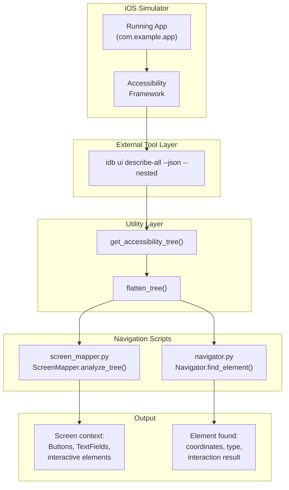
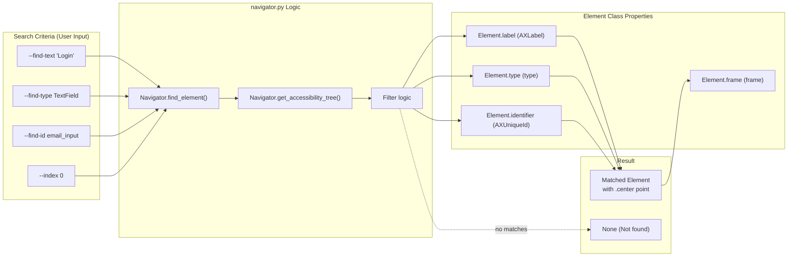

<!-- source: DeepWiki mcp.deepwiki.com · repo conorluddy/ios-simulator-skill · page 6 Navigation & Interaction Scripts · fetched 2026-10-26 -->

# Navigation & Interaction Scripts

Relevant source files

The following files were used as context for generating this wiki page:

- [ios-simulator-skill/skills/ios-simulator-skill/scripts/navigator.py](ios-simulator-skill/skills/ios-simulator-skill/scripts/navigator.py)
- [ios-simulator-skill/skills/ios-simulator-skill/scripts/screen_mapper.py](ios-simulator-skill/skills/ios-simulator-skill/scripts/screen_mapper.py)

This document covers the 5 scripts in the Navigation & Interaction category, which provide semantic UI automation for iOS simulators. These scripts enable finding and interacting with UI elements by their meaning (text, type, accessibility ID) rather than pixel coordinates, making automation robust to UI changes and screen size variations.

For information about building and testing applications, see [Build & Development Scripts](#5). For device lifecycle management, see [Device Lifecycle Scripts](#9). For advanced testing features like visual comparison and accessibility audits, see [Testing & Analysis Scripts](#7).

## Overview and Purpose

The Navigation & Interaction scripts form the core automation layer of the ios-simulator-skill. They translate high-level semantic actions ("tap the Login button", "enter text in the email field") into low-level `idb` commands by querying the iOS accessibility tree. This approach survives UI redesigns, works across different device sizes, and provides better accessibility compliance than coordinate-based automation.

**The five scripts:**

| Script | Primary Purpose | Key Capability |
|--------|----------------|----------------|
| `screen_mapper.py` | Analyze current UI state | Provides element inventory and screen context |
| `navigator.py` | Find and interact with elements | Semantic element targeting with fuzzy matching |
| `gesture.py` | Perform touch gestures | Swipes, scrolls, pinches, long press, pull-to-refresh |
| `keyboard.py` | Text input and hardware controls | Text entry, special keys, hardware button simulation |
| `app_launcher.py` | Application lifecycle control | Launch, terminate, install, uninstall, deep links |

These scripts work together: `screen_mapper.py` provides context about what's on screen [ios-simulator-skill/scripts/screen_mapper.py:8-10](), `navigator.py` finds specific elements within that context [ios-simulator-skill/scripts/navigator.py:8-10](), and the other scripts handle specialized interaction types. All five scripts share common utilities for device targeting, accessibility tree operations, and output formatting.

Sources: [ios-simulator-skill/scripts/screen_mapper.py:8-17](), [ios-simulator-skill/scripts/navigator.py:8-19]()

## Semantic Navigation Architecture

The core innovation of these scripts is semantic navigation via iOS accessibility APIs. Instead of brittle pixel coordinates, scripts identify elements by their semantic properties.

### Accessibility Tree Processing Pipeline

Title: Accessibility Tree Processing Pipeline

**Data flow explanation:**

1. **iOS Accessibility Framework** exposes UI hierarchy with semantic labels, traits, and identifiers.
2. **idb** queries this tree via `ui describe-all --json --nested`, returning a nested JSON structure [ios-simulator-skill/scripts/navigator.py:49]().
3. **Common Utilities** retrieve and flatten the tree into a searchable list of `Element` objects [ios-simulator-skill/scripts/navigator.py:73-89]().
4. **Navigation scripts** search the flattened list using semantic criteria like `AXLabel`, `AXValue`, and `AXUniqueId` [ios-simulator-skill/scripts/screen_mapper.py:134-136]().
5. **Output** provides actionable information or confirms successful interaction.

Sources: [ios-simulator-skill/scripts/navigator.py:48-55](), [ios-simulator-skill/scripts/screen_mapper.py:103-109](), [ios-simulator-skill/scripts/navigator.py:115-137]()

### Element Identification Strategies

Title: Semantic Search to Code Entity Mapping

**Matching strategies:**

- **Text matching**: Case-insensitive substring match with fuzzy tolerance [ios-simulator-skill/scripts/navigator.py:184-190]().
- **Type filtering**: Element class name matching (Button, TextField, etc.) [ios-simulator-skill/scripts/navigator.py:176-177]().
- **ID lookup**: Exact match on `AXUniqueId` property [ios-simulator-skill/scripts/navigator.py:179-180]().
- **Index-based**: When multiple elements match, `--index` selects the Nth occurrence [ios-simulator-skill/scripts/navigator.py:194-195]().
- **Disambiguation**: The `Navigator` class implements these strategies to handle complex multi-criteria searches [ios-simulator-skill/scripts/navigator.py:144-197]().

Sources: [ios-simulator-skill/scripts/navigator.py:144-197](), [ios-simulator-skill/scripts/screen_mapper.py:131-167]()

## The Five Scripts: Responsibilities and Interfaces

### Script Responsibility Overview

| Script | Responsibility |
|--------|----------------|
| `screen_mapper.py` | Read-only analysis of the current screen's UI hierarchy [ios-simulator-skill/scripts/screen_mapper.py:55-71](). |
| `navigator.py` | Finding specific elements and performing taps or text entry [ios-simulator-skill/scripts/navigator.py:98-100](). |
| `gesture.py` | Coordinate-based interaction for gestures like swipes, scrolls, and pinches [ios-simulator-skill/scripts/gesture.py:8-19](). |
| `keyboard.py` | Text-focused interaction and hardware button simulation (Volume, Home). |
| `app_launcher.py` | Process-level control: launch, terminate, install, and deep links. |

This separation allows composing complex workflows: use `screen_mapper.py` to understand current state, `navigator.py` to find specific elements, `keyboard.py` for text entry, and `gesture.py` for scrolling.

Sources: [ios-simulator-skill/scripts/screen_mapper.py:8-17](), [ios-simulator-skill/scripts/navigator.py:8-19](), [ios-simulator-skill/scripts/gesture.py:8-19]()

### Class-Based Architecture Pattern

All scripts follow a consistent class-based pattern defined in the architecture guidelines:

1. **Class initialization**: Accepts UDID and configuration flags [ios-simulator-skill/scripts/navigator.py:101-104]().
2. **Execution logic**: Main entry point often orchestrated by an `execute()` or similar method.
3. **Helper methods**: Private methods for specific operations like `_flatten_tree` [ios-simulator-skill/scripts/navigator.py:115-137]().
4. **Error handling**: Consistent exception handling and error messages.

Example from `navigator.py`:
- `Navigator.get_accessibility_tree(force_refresh)` - retrieves and caches the UI tree [ios-simulator-skill/scripts/navigator.py:106-113]().
- `Navigator.find_element(...)` - implements search logic [ios-simulator-skill/scripts/navigator.py:144-151]().
- `Navigator.tap(element)` - executes tap action via idb [ios-simulator-skill/scripts/navigator.py:199-202]().

Example from `gesture.py`:
- `GestureController.swipe(direction)` - calculates coordinates for directional swipes [ios-simulator-skill/scripts/gesture.py:89-120]().
- `GestureController.scroll(direction, amount)` - performs multiple small swipes [ios-simulator-skill/scripts/gesture.py:152-167]().

Sources: [ios-simulator-skill/scripts/navigator.py:98-202](), [ios-simulator-skill/scripts/screen_mapper.py:55-101](), [ios-simulator-skill/scripts/gesture.py:73-87]()

## Child Pages

For detailed documentation on specific scripts, refer to the following pages:

- **[screen_mapper.py](#6.1)**: Document screen analysis: accessibility tree querying, element listing, --verbose and --hints modes. For details, see [screen_mapper.py](#6.1).
- **[navigator.py](#6.2)**: Document semantic element finding and interaction: --find-text/type/id, fuzzy vs exact matching, tap and text entry, screenshot coordinate transformation. For details, see [navigator.py](#6.2).
- **[gesture.py](#6.3)**: Document complex gesture simulation: swipe, scroll, pinch, long-press, pull-to-refresh. For details, see [gesture.py](#6.3).
- **[keyboard.py](#6.4)**: Document text input and hardware button simulation: --type, --key, --button flags. For details, see [keyboard.py](#6.4).
- **[app_launcher.py](#6.5)**: Document app lifecycle management: launch, terminate, install, uninstall, open-url, state querying. For details, see [app_launcher.py](#6.5).

## Summary

The Navigation & Interaction scripts provide a semantic automation layer for iOS simulators through specialized tools:

1. **[screen_mapper.py](#6.1)**: Analyzes screen state without side effects, provides context.
2. **[navigator.py](#6.2)**: Finds and interacts with elements using semantic search.
3. **[gesture.py](#6.3)**: Performs touch gestures (swipes, scrolls, pinches).
4. **[keyboard.py](#6.4)**: Handles text input and hardware button simulation.
5. **[app_launcher.py](#6.5)**: Controls application lifecycle and deep linking.

For information on the shared utilities these scripts depend on, see [Shared Utilities](#10).

---

