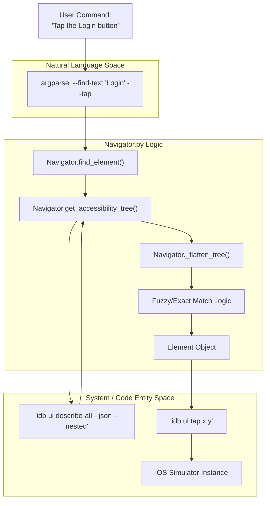
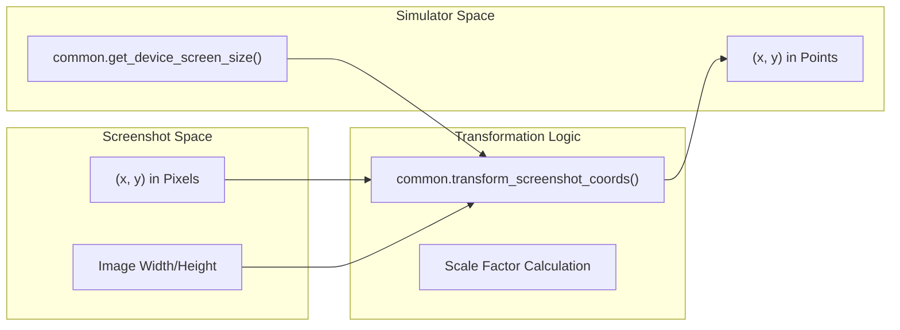

<!-- source: DeepWiki mcp.deepwiki.com · repo conorluddy/ios-simulator-skill · page 6.2 navigator.py · fetched 2026-10-26 -->

# navigator.py

<details>
<summary>Relevant source files</summary>

The following files were used as context for generating this wiki page:

- [ios-simulator-skill/skills/ios-simulator-skill/scripts/common/screenshot_utils.py](ios-simulator-skill/skills/ios-simulator-skill/scripts/common/screenshot_utils.py)
- [ios-simulator-skill/skills/ios-simulator-skill/scripts/navigator.py](ios-simulator-skill/skills/ios-simulator-skill/scripts/navigator.py)

</details>


## Purpose and Scope

The `navigator.py` script is the core semantic interaction engine for the iOS Simulator Skill. Unlike coordinate-based automation, it leverages iOS accessibility APIs to find UI elements by text, type, or accessibility identifier. This approach provides robust automation that is resilient to UI layout changes, different screen sizes, and localization. [scripts/navigator.py:8-10]()

Key capabilities include:
- **Semantic Finding**: Locating elements using `AXLabel`, `AXValue`, or `AXUniqueId`. [scripts/navigator.py:54]()
- **Fuzzy Matching**: Handling minor text variations or typos during element lookup via case-insensitive substring matching. [scripts/navigator.py:186-188]()
- **Action Execution**: Performing taps at element center points and entering text into input fields. [scripts/navigator.py:199-233]()
- **Coordinate Transformation**: Converting screenshot-relative coordinates to simulator points for fallback interactions using `transform_screenshot_coords`. [scripts/navigator.py:68-69]()
- **Tree Caching**: Optimizing performance by reusing accessibility data across multiple operations within the class instance. [scripts/navigator.py:106-113]()

**File location:** [scripts/navigator.py:1-437]()

**Sources:** [scripts/navigator.py:1-70]()

---

## Architecture and Data Model

The script is built around the `Navigator` class [scripts/navigator.py:98-324]() and a structured `Element` dataclass that represents a node in the iOS accessibility hierarchy.

### The Element Dataclass
The `Element` class [scripts/navigator.py:72-96]() encapsulates the properties of a UI component extracted from the `idb` accessibility tree:

| Attribute | Type | Source Field | Description |
|-----------|------|--------------|-------------|
| `type` | `str` | `type` | The XCUI element type (e.g., Button, TextField) |
| `label` | `str?` | `AXLabel` | The accessibility label (visible text) |
| `value` | `str?` | `AXValue` | The current value (e.g., text in a field) |
| `identifier` | `str?` | `AXUniqueId` | The developer-defined accessibility identifier |
| `frame` | `dict` | `frame` | Dictionary containing `x`, `y`, `width`, `height` |
| `traits` | `list` | `traits` | Accessibility traits (e.g., "button", "header") |
| `enabled` | `bool` | `enabled` | Interaction state of the element |

**Sources:** [scripts/navigator.py:72-83]()

### Coordinate Logic
The `Element` class provides a `center` property [scripts/navigator.py:84-89]() that calculates the midpoint of the element's frame for precise tapping:
```python
x = int(self.frame["x"] + self.frame["width"] / 2)
y = int(self.frame["y"] + self.frame["height"] / 2)
```
**Sources:** [scripts/navigator.py:84-89]()

---

## Implementation Detail: Finding Elements

The `Navigator` uses a multi-stage process to resolve a natural language query (like "Find the Login button") into a specific code entity.

### From Natural Language to Code Entity
This diagram illustrates how user intent is transformed into `idb` commands through the `Navigator` logic.

Title: Semantic Navigation Resolution



**Sources:** [scripts/navigator.py:49-53](), [scripts/navigator.py:106-202](), [scripts/navigator.py:327-437]()

### Finding Strategies
The `find_element` method [scripts/navigator.py:144-197]() implements a prioritized search:

1.  **Accessibility Identifier**: Exact match on `AXUniqueId`. This is the most reliable method for stable automation. [scripts/navigator.py:179-181]()
2.  **Text Content**: Searches both `AXLabel` and `AXValue`. [scripts/navigator.py:184-190]()
    - **Exact**: Match against label or value directly. [scripts/navigator.py:189-190]()
    - **Fuzzy**: Case-insensitive substring match (default behavior). [scripts/navigator.py:186-188]()
3.  **Element Type**: Filters by class (e.g., `Button`) and uses the `index` parameter to disambiguate multiple matches on the screen. [scripts/navigator.py:176-177]()

**Sources:** [scripts/navigator.py:144-197]()

---

## Interaction and Coordinate Transformation

`navigator.py` handles the complexity of interacting with elements that might have been identified via screenshots or accessibility trees.

### Coordinate Transformation Logic
When interacting with elements identified from a screenshot (e.g., via the `--tap-at` flag), the script utilizes `transform_screenshot_coords` from shared utilities [scripts/navigator.py:68]() to ensure the tap lands correctly regardless of the image resolution vs simulator points. This is critical when the input coordinates come from a resized or scaled image (e.g., a "half" or "quarter" size preset from `screenshot_utils.py`). [common/screenshot_utils.py:78-97]()

Title: Coordinate Space Transformation



**Sources:** [scripts/navigator.py:63-69](), [scripts/navigator.py:204-215](), [scripts/navigator.py:365-370](), [common/screenshot_utils.py:78-97]()

### Interaction Methods
- **Tapping**: The `tap()` method [scripts/navigator.py:199-202]() takes an `Element` object, retrieves its `center`, and calls `tap_at()`.
- **Direct Tap**: `tap_at(x, y)` [scripts/navigator.py:204-215]() executes the shell command `idb ui tap <x> <y>`.
- **Text Entry**: `enter_text()` [scripts/navigator.py:217-233]() first focuses an element (via tap) and then executes `idb ui text <text>`.

**Sources:** [scripts/navigator.py:199-233]()

---

## Caching and Performance

To achieve high performance, the `Navigator` implements a local tree cache to avoid expensive calls to `idb` when multiple lookups are performed. [scripts/navigator.py:106-113]()

- **Lazy Loading**: The accessibility tree is only fetched when a find operation or listing is requested. [scripts/navigator.py:108-112]()
- **Persistence**: Once fetched, `_tree_cache` is reused for all subsequent calls in the same `Navigator` instance. [scripts/navigator.py:104-109]()
- **Force Refresh**: The `force_refresh=True` flag allows bypassing the cache when the screen state is known to have changed (e.g., after a tap or navigation). [scripts/navigator.py:106-113]()

**Sources:** [scripts/navigator.py:104-113]()

---

## CLI Usage and Output

The script provides a rich CLI for direct automation or integration with Claude Code.

### Command Flags
| Flag | Description |
|------|-------------|
| `--find-text` | Search for element with matching label or value. |
| `--find-type` | Search for element of specific type (e.g., Button, TextField). |
| `--find-id` | Search for element with specific Accessibility ID (`AXUniqueId`). |
| `--index` | Specify which match to use (0-based) when multiple elements match. |
| `--tap` | Tap the found element at its center point. |
| `--enter-text` | Type text into the found element. |
| `--list` | Output all interactive elements found on the current screen. |
| `--tap-at` | Fallback to tap at specific `x,y` coordinates. |

**Sources:** [scripts/navigator.py:327-377]()

### Output Format
The script prioritizes human-readable status messages but supports `--json` for structured data integration. [scripts/navigator.py:374-375]()
- **Success Example**: `Tapped: Button "Login" at (320, 450)` [scripts/navigator.py:38]()
- **Failure Example**: `Not found: text='Submit'` [scripts/navigator.py:40]()

**Sources:** [scripts/navigator.py:37-40]()

---

