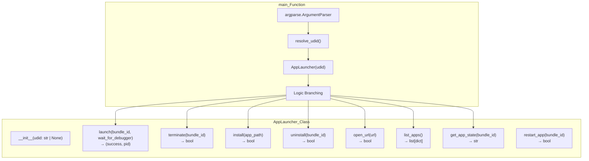
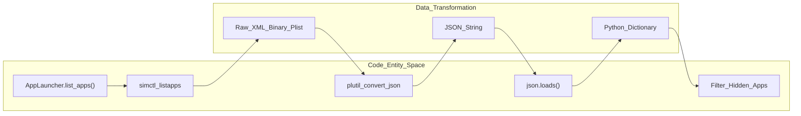
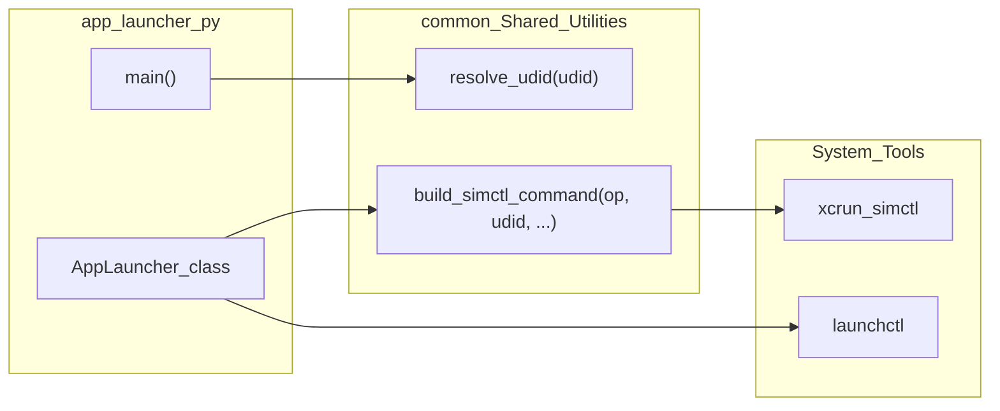
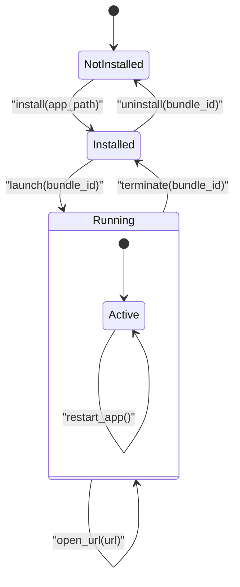

<!-- source: DeepWiki mcp.deepwiki.com · repo conorluddy/ios-simulator-skill · page 6.5 app_launcher.py · fetched 2026-10-26 -->

# app_launcher.py

<details>
<summary>Relevant source files</summary>

The following files were used as context for generating this wiki page:

- [ios-simulator-skill/skills/ios-simulator-skill/scripts/app_launcher.py](ios-simulator-skill/skills/ios-simulator-skill/scripts/app_launcher.py)

</details>


## Purpose and Scope

The `app_launcher.py` script manages the complete lifecycle of iOS applications on simulators, including launching, terminating, installing, uninstalling, and state querying. This script provides semantic app control through bundle identifiers rather than manual interaction with the home screen. It serves as the primary interface for transitioning an application between execution states.

For finding and interacting with UI elements within a running app, see [navigator.py](). For building and testing apps, see [build_and_test.py](). For simulator device lifecycle, see the Device Lifecycle Scripts category.

Sources: [ios-simulator-skill/skills/ios-simulator-skill/scripts/app_launcher.py:1-9](), [ios-simulator-skill/skills/ios-simulator-skill/scripts/app_launcher.py:20-21]()

---

## Core Operations

`app_launcher.py` supports several primary app lifecycle operations implemented via the `AppLauncher` class:

| Operation | Description | Implementation |
|-----------|-------------|-----------------|
| **Launch** | Start an app by bundle ID | `simctl launch` [ios-simulator-skill/skills/ios-simulator-skill/scripts/app_launcher.py:27-55]() |
| **Terminate** | Stop a running app | `simctl terminate` [ios-simulator-skill/skills/ios-simulator-skill/scripts/app_launcher.py:57-73]() |
| **Install** | Install .app bundle to simulator | `simctl install` [ios-simulator-skill/skills/ios-simulator-skill/scripts/app_launcher.py:75-91]() |
| **Uninstall** | Remove app from simulator | `simctl uninstall` [ios-simulator-skill/skills/ios-simulator-skill/scripts/app_launcher.py:93-109]() |
| **Open URL** | Launch app with deep link/URL | `simctl openurl` [ios-simulator-skill/skills/ios-simulator-skill/scripts/app_launcher.py:111-127]() |
| **List Apps** | Enumerate installed applications | `simctl listapps` + `plutil` [ios-simulator-skill/skills/ios-simulator-skill/scripts/app_launcher.py:129-177]() |
| **Query State** | Check if app is running | `simctl spawn ... launchctl list` [ios-simulator-skill/skills/ios-simulator-skill/scripts/app_launcher.py:179-198]() |
| **Restart** | Terminate then launch app | `terminate()` + `launch()` [ios-simulator-skill/skills/ios-simulator-skill/scripts/app_launcher.py:200-217]() |

All operations use bundle identifiers (e.g., `com.example.MyApp`) for semantic app targeting, avoiding fragile UI automation to locate apps on the home screen.

Sources: [ios-simulator-skill/skills/ios-simulator-skill/scripts/app_launcher.py:27-218]()

---

## Command-Line Interface

### Basic Launch and Terminate

```bash
# Launch app by bundle ID
python scripts/app_launcher.py --launch com.example.app

# Terminate running app
python scripts/app_launcher.py --terminate com.example.app

# Launch and wait for debugger attachment
python scripts/app_launcher.py --launch com.example.app --wait-for-debugger
```

### Installation Management

```bash
# Install .app bundle to simulator
python scripts/app_launcher.py --install /path/to/MyApp.app

# Uninstall app by bundle ID
python scripts/app_launcher.py --uninstall com.example.app
```

### Deep Linking and Listing

```bash
# Open app with URL scheme
python scripts/app_launcher.py --open-url "myapp://login?token=xyz"

# List all user-installed apps
python scripts/app_launcher.py --list-apps
```

Sources: [ios-simulator-skill/skills/ios-simulator-skill/scripts/app_launcher.py:222-230]()

---

## Architecture Pattern

### Class-Based Design

The script follows the standard architecture of the skill, encapsulating logic within the `AppLauncher` class.



**Diagram: AppLauncher class structure and main() flow**

The `launch` method is notable for parsing the standard output of `simctl` to extract the Process ID (PID) of the newly started application [ios-simulator-skill/skills/ios-simulator-skill/scripts/app_launcher.py:45-53]().

Sources: [ios-simulator-skill/skills/ios-simulator-skill/scripts/app_launcher.py:20-218]()

---

## Data Flow: App Listing and Parsing

One of the more complex data flows in the script is the retrieval of installed applications. Since `simctl listapps` returns a Property List (plist), the script uses a pipeline to convert this to JSON for easier processing.



**Diagram: Data flow for listing installed applications**

The script specifically filters out internal system applications where `ApplicationType` is "Hidden" [ios-simulator-skill/skills/ios-simulator-skill/scripts/app_launcher.py:158-159]() to provide a clean list of user-facing apps. It extracts metadata including `CFBundleDisplayName`, `Path`, `CFBundleVersion`, and `ApplicationType` [ios-simulator-skill/skills/ios-simulator-skill/scripts/app_launcher.py:163-170]().

Sources: [ios-simulator-skill/skills/ios-simulator-skill/scripts/app_launcher.py:129-177]()

---

## Integration with Device Utilities

The script leverages shared utilities for device resolution and command construction:



**Diagram: External tool integration via common utilities**

- `resolve_udid`: Used in `main()` to determine the target simulator UDID from arguments or environment [ios-simulator-skill/skills/ios-simulator-skill/scripts/app_launcher.py:17]().
- `build_simctl_command`: Used by every method in `AppLauncher` to ensure consistent formatting of `xcrun simctl` calls [ios-simulator-skill/skills/ios-simulator-skill/scripts/app_launcher.py:38](), [ios-simulator-skill/skills/ios-simulator-skill/scripts/app_launcher.py:67](), [ios-simulator-skill/skills/ios-simulator-skill/scripts/app_launcher.py:85]().

Sources: [ios-simulator-skill/skills/ios-simulator-skill/scripts/app_launcher.py:17](), [ios-simulator-skill/skills/ios-simulator-skill/scripts/app_launcher.py:38](), [ios-simulator-skill/skills/ios-simulator-skill/scripts/app_launcher.py:136]()

---

## App Lifecycle State Machine

The script manages transitions between the following conceptual states:



**Diagram: Application lifecycle states and transitions**

The `get_app_state` method determines if an app is "running" by executing `launchctl list` inside the simulator via `simctl spawn` and checking for the presence of the bundle identifier [ios-simulator-skill/skills/ios-simulator-skill/scripts/app_launcher.py:190-196]().

Sources: [ios-simulator-skill/skills/ios-simulator-skill/scripts/app_launcher.py:179-198](), [ios-simulator-skill/skills/ios-simulator-skill/scripts/app_launcher.py:200-217]()

---

## Deep Linking and URL Schemes

The `open_url` method allows for testing deep links and universal links:

```python
# Implementation detail [ios-simulator-skill/skills/ios-simulator-skill/scripts/app_launcher.py:111-127]
def open_url(self, url: str) -> bool:
    cmd = build_simctl_command("openurl", self.udid, url)
    # ... executes subprocess ...
```

This uses the underlying `simctl openurl` command [ios-simulator-skill/skills/ios-simulator-skill/scripts/app_launcher.py:121](). If the application associated with the URL scheme is not running, iOS will launch it. If it is already running, it will be brought to the foreground and the URL will be passed to the application's openURL delegate.

Sources: [ios-simulator-skill/skills/ios-simulator-skill/scripts/app_launcher.py:111-127]()

---

## Error Handling

The script utilizes `subprocess.run(..., check=True)` within `try-except` blocks to catch `CalledProcessError` [ios-simulator-skill/skills/ios-simulator-skill/scripts/app_launcher.py:44-55](). 

- **Launch Failures**: Returns `(False, None)` if the bundle ID is invalid or the simulator is not in a state to launch apps [ios-simulator-skill/skills/ios-simulator-skill/scripts/app_launcher.py:54-55]().
- **State Query Failures**: Returns `"unknown"` if the `launchctl` command fails [ios-simulator-skill/skills/ios-simulator-skill/scripts/app_launcher.py:197-198]().
- **List Failures**: Returns an empty list if `plutil` conversion or `simctl` fails [ios-simulator-skill/skills/ios-simulator-skill/scripts/app_launcher.py:176-177]().

Sources: [ios-simulator-skill/skills/ios-simulator-skill/scripts/app_launcher.py:43-55](), [ios-simulator-skill/skills/ios-simulator-skill/scripts/app_launcher.py:138-151](), [ios-simulator-skill/skills/ios-simulator-skill/scripts/app_launcher.py:192-198]()

---

