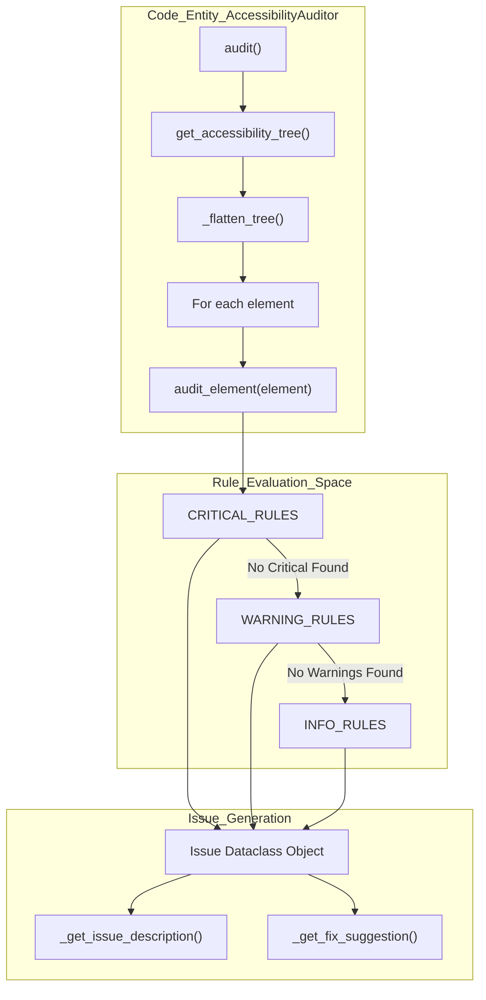
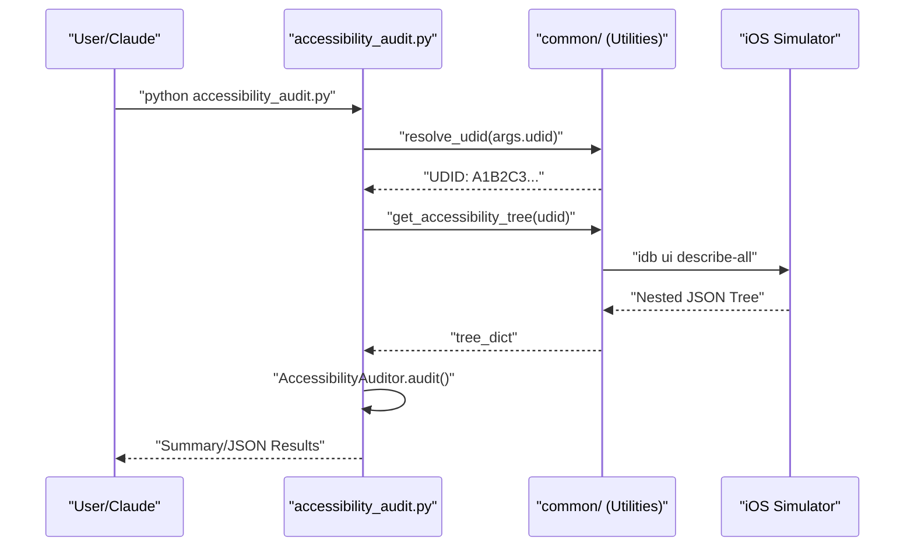

<!-- source: DeepWiki mcp.deepwiki.com · repo conorluddy/ios-simulator-skill · page 7.1 accessibility_audit.py · fetched 2026-10-26 -->

# accessibility_audit.py

<details>
<summary>Relevant source files</summary>

The following files were used as context for generating this wiki page:

- [ios-simulator-skill/skills/ios-simulator-skill/scripts/accessibility_audit.py](ios-simulator-skill/skills/ios-simulator-skill/scripts/accessibility_audit.py)
- [references/accessibility_checklist.md](references/accessibility_checklist.md)

</details>


`accessibility_audit.py` audits the currently visible iOS Simulator screen for WCAG compliance issues by inspecting the iOS accessibility tree. The script implements a rule-based evaluation engine that categorizes issues by severity (critical, warnings, info), provides human-readable fix suggestions, and outputs a structured report optimized for LLM token efficiency.

**Script location:** [ios-simulator-skill/scripts/accessibility_audit.py:1-210]()

The script is part of the Testing & Analysis category. Unlike `navigator.py` which uses the accessibility tree for element interaction, `accessibility_audit.py` evaluates the tree structure against accessibility success criteria.

---

## Testing & Analysis Category Position

`accessibility_audit.py` operates as a read-only analysis tool. It queries the accessibility tree via the shared utility `get_accessibility_tree` and evaluates the returned structure against rule implementations defined in the `AccessibilityAuditor` class.

**Testing & Analysis Category Script Relationships:**

```mermaid
graph TB
    subgraph "Testing_Analysis_Scripts"
        ["accessibility_audit.py"]
        ["visual_diff.py"]
        ["test_recorder.py"]
        ["app_state_capture.py"]
        ["sim_health_check.sh"]
    end

    subgraph "Shared_Utilities_common"
        CU["common.get_accessibility_tree"]
        FT["common.flatten_tree"]
        RU["common.resolve_udid"]
    end

    subgraph "Data_Entities"
        ISSUE["Issue Dataclass"]
        ACCTREE["Accessibility Tree JSON"]
    end

    ["accessibility_audit.py"] -->|"calls"| CU
    ["accessibility_audit.py"] -->|"calls"| FT
    ["accessibility_audit.py"] -->|"calls"| RU
    CU -->|"returns"| ACCTREE
    ["accessibility_audit.py"] -->|"populates"| ISSUE

    ["test_recorder.py"] -->|"orchestrates"| ["accessibility_audit.py"]
    ["app_state_capture.py"] -->|"captures state for"| ["accessibility_audit.py"]
```

Sources: [ios-simulator-skill/scripts/accessibility_audit.py:18-18](), [ios-simulator-skill/scripts/accessibility_audit.py:36-37]()

---

## WCAG Compliance Rules

The script evaluates accessibility tree elements against criteria defined in three severity tiers. Each element in the tree includes properties like `AXLabel`, `AXValue`, `type`, `frame`, and `traits`.

### Issue Categories and Detection Logic

| Severity | Rule Key | Check Logic | Fix Suggestion |
|---|---|---|---|
| **Critical** | `missing_label` | `type` in Button/Link and no `AXLabel` | Add accessibilityLabel |
| **Critical** | `empty_button` | `type` is Button and no `AXLabel` or `AXValue` | Set button title or label |
| **Critical** | `image_no_alt` | `type` is Image and no `AXLabel` | Add accessibilityLabel description |
| **Warning** | `missing_hint` | `type` in Slider/TextField and no `help` | Add accessibilityHint |
| **Warning** | `missing_traits` | Element has `type` but no `traits` | Set accessibilityTraits |
| **Info** | `no_identifier` | Element missing `AXUniqueId` | Add accessibilityIdentifier |
| **Info** | `deep_nesting` | Element `depth` > 5 | Simplify view hierarchy |

**Audit Logic Flow:**



Sources: [ios-simulator-skill/scripts/accessibility_audit.py:40-57](), [ios-simulator-skill/scripts/accessibility_audit.py:128-152](), [references/accessibility_checklist.md:3-44]()

---

## Implementation Detail

### Data Structures
The script uses an `Issue` dataclass to standardize findings.
- `severity`: critical, warning, or info [ios-simulator-skill/scripts/accessibility_audit.py:25-25]()
- `rule`: The internal rule key [ios-simulator-skill/scripts/accessibility_audit.py:26-26]()
- `element_type`: The iOS class type (e.g., "Button") [ios-simulator-skill/scripts/accessibility_audit.py:27-27]()
- `issue`: Human-readable description [ios-simulator-skill/scripts/accessibility_audit.py:28-28]()
- `fix`: Actionable suggestion [ios-simulator-skill/scripts/accessibility_audit.py:29-29]()

### AccessibilityAuditor Class
The core logic resides in `AccessibilityAuditor`. It utilizes the `flatten_tree` utility to convert the nested iOS view hierarchy into a list for linear processing [ios-simulator-skill/scripts/accessibility_audit.py:75-77]().

**Key Functions:**
- `audit_element(element)`: Applies rules in priority order. If a critical issue is found, it stops further checks for that element to minimize noise [ios-simulator-skill/scripts/accessibility_audit.py:79-124]().
- `_is_small_target(element)`: Evaluates if the `frame` dimensions meet the minimum 44x44pt requirement [ios-simulator-skill/scripts/accessibility_audit.py:68-73]().
- `audit(verbose)`: Orchestrates the full process, aggregates results, and builds a summary [ios-simulator-skill/scripts/accessibility_audit.py:154-210]().

---

## Command-Line Interface

The script provides flexible output modes, including a JSON mode for CI/CD integration and a verbose mode for detailed debugging.

```bash
# Basic audit on the booted simulator
python scripts/accessibility_audit.py

# JSON output for automated pipelines
python scripts/accessibility_audit.py --json

# Detailed report including element labels and types
python scripts/accessibility_audit.py --verbose
```

### Supported Arguments

| Flag | Description |
|---|---|
| `--udid` | Target a specific simulator [ios-simulator-skill/scripts/accessibility_audit.py:218-218]() |
| `--verbose` | Include detailed element info in output [ios-simulator-skill/scripts/accessibility_audit.py:219-219]() |
| `--json` | Output results in JSON format [ios-simulator-skill/scripts/accessibility_audit.py:220-220]() |

### Output Example (Summary)
The script produces a token-efficient summary by default:
```json
{
  "summary": {
    "total": 42,
    "issues": 5,
    "critical": 1,
    "warning": 3,
    "info": 1
  }
}
```
Sources: [ios-simulator-skill/scripts/accessibility_audit.py:181-188](), [ios-simulator-skill/scripts/accessibility_audit.py:212-230]()

---

## Workflow Integration

`accessibility_audit.py` is typically used after a navigation event to ensure the resulting screen is accessible.

**Code Entity to System Space Mapping:**



Sources: [ios-simulator-skill/scripts/accessibility_audit.py:154-165](), [ios-simulator-skill/scripts/accessibility_audit.py:232-250]()

---

