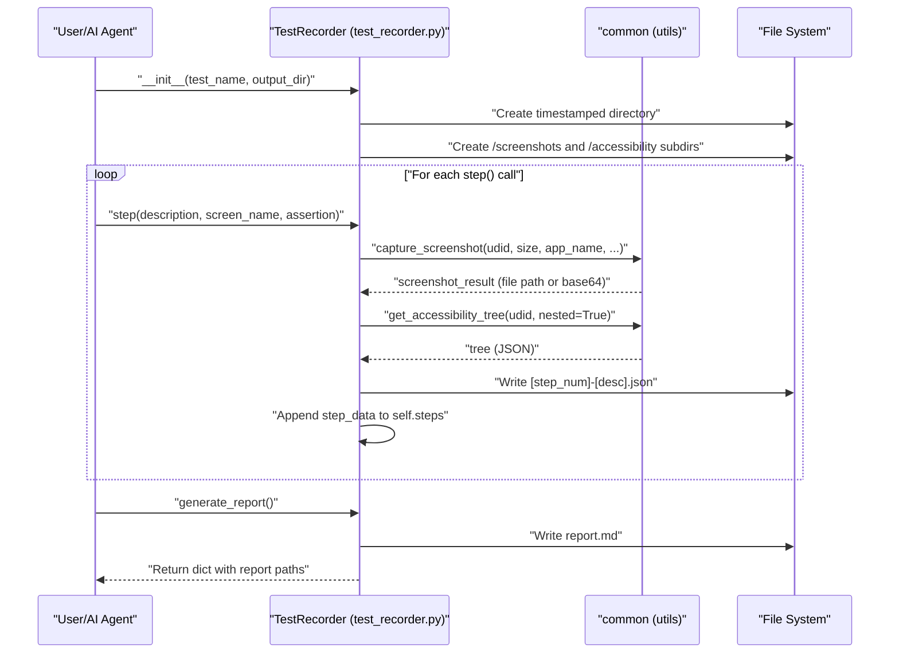
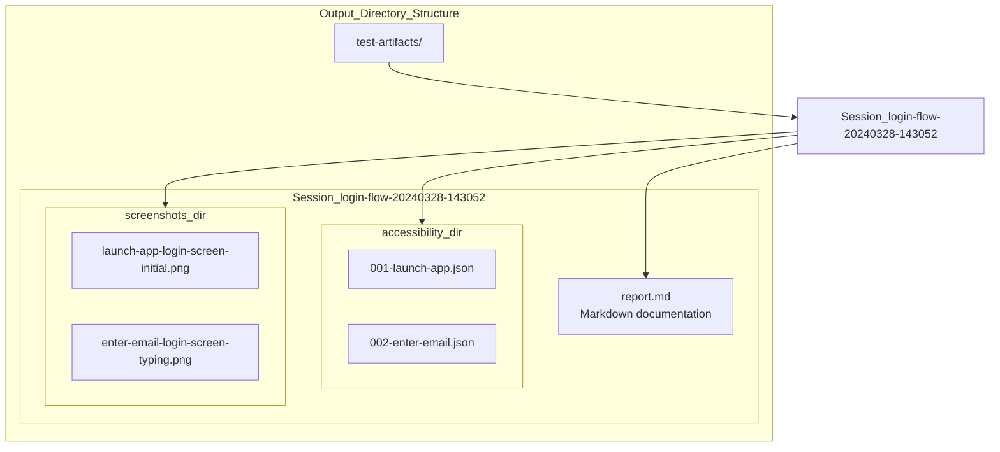
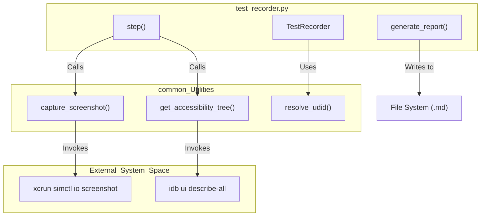

<!-- source: DeepWiki mcp.deepwiki.com · repo conorluddy/ios-simulator-skill · page 7.3 test_recorder.py · fetched 2026-10-26 -->

# test_recorder.py

<details>
<summary>Relevant source files</summary>

The following files were used as context for generating this wiki page:

- [ios-simulator-skill/skills/ios-simulator-skill/scripts/common/screenshot_utils.py](ios-simulator-skill/skills/ios-simulator-skill/scripts/common/screenshot_utils.py)
- [ios-simulator-skill/skills/ios-simulator-skill/scripts/test_recorder.py](ios-simulator-skill/skills/ios-simulator-skill/scripts/test_recorder.py)

</details>


## Purpose and Scope

`test_recorder.py` automates the documentation of iOS simulator test executions by capturing screenshots and accessibility tree snapshots at each step, then generating a structured markdown report with timing data. This script is part of the Testing & Analysis category and serves as a test documentation generator, not a test executor. It is designed to be used both as a standalone script and as a module within larger automation workflows.

For actual test execution and result parsing, see [ios-simulator-skill/scripts/build_and_test.py:1-15](). For single-point debugging snapshots, see [ios-simulator-skill/scripts/app_state_capture.py:1-15](). For visual regression testing, see [ios-simulator-skill/scripts/visual_diff.py:1-15]().

**Sources:** [ios-simulator-skill/scripts/test_recorder.py:1-11](), [ios-simulator-skill/scripts/test_recorder.py:29-30]()

---

## Recording Process Flow

The `TestRecorder` class manages the lifecycle of a recording session, from directory initialization to final report generation.

Title: Test Recorder Execution Sequence


**Sources:** [ios-simulator-skill/scripts/test_recorder.py:32-76](), [ios-simulator-skill/scripts/test_recorder.py:82-159](), [ios-simulator-skill/scripts/test_recorder.py:193-210]()

---

## Implementation Details

### The TestRecorder Class

The core logic is encapsulated in the `TestRecorder` class defined in [ios-simulator-skill/scripts/test_recorder.py:29-30]().

#### Key Functions

| Function | Purpose |
|----------|---------|
| `__init__` | Initializes the session, sets up the timestamped output directory, and handles "inline" mode for vision-based automation [ios-simulator-skill/scripts/test_recorder.py:32-80](). |
| `step` | The primary recording method. It captures a screenshot using `capture_screenshot`, fetches the accessibility tree, and logs the step metadata [ios-simulator-skill/scripts/test_recorder.py:82-159](). |
| `_capture_accessibility` | Internal helper that uses `get_accessibility_tree` and `count_elements` to save the UI hierarchy and return the element count [ios-simulator-skill/scripts/test_recorder.py:178-191](). |
| `generate_report` | Compiles all recorded `steps` into a Markdown report including timing, screenshots, and step descriptions [ios-simulator-skill/scripts/test_recorder.py:193-210](). |

### Data Flow and Utilities

The script leverages several shared utilities from the `common` module (imported at [ios-simulator-skill/scripts/test_recorder.py:20-26]()):
- `capture_screenshot`: Used for consistent image capture with sizing presets [ios-simulator-skill/scripts/test_recorder.py:104-111]().
- `get_accessibility_tree`: Used to query the accessibility hierarchy [ios-simulator-skill/scripts/test_recorder.py:182]().
- `resolve_udid`: Used to identify the target simulator [ios-simulator-skill/scripts/test_recorder.py:25]().
- `generate_screenshot_name`: Provides semantic naming for saved files [ios-simulator-skill/scripts/common/screenshot_utils.py:35-75]().

**Sources:** [ios-simulator-skill/scripts/test_recorder.py:20-26](), [ios-simulator-skill/scripts/test_recorder.py:104-111](), [ios-simulator-skill/scripts/test_recorder.py:182](), [ios-simulator-skill/scripts/common/screenshot_utils.py:35-75]()

---

## Output Artifact Structure

The recorder creates a structured directory for every session, typically named `[test-name]-[timestamp]` [ios-simulator-skill/scripts/test_recorder.py:62-64]().

Title: File System Layout of Test Recorder Output


**Sources:** [ios-simulator-skill/scripts/test_recorder.py:62-75](), [ios-simulator-skill/scripts/test_recorder.py:114-118](), [ios-simulator-skill/scripts/test_recorder.py:201-205]()

---

## Screenshot Sizing and Token Efficiency

The recorder supports multiple screenshot sizes via the `screenshot_size` parameter [ios-simulator-skill/scripts/test_recorder.py:49](). This leverages `get_size_preset` in the common utilities to balance visual detail with token usage when reports are fed into LLMs.

| Preset | Description | Use Case |
|--------|-------------|----------|
| `full` | Original resolution (1.0 scale) | Pixel-perfect visual regression |
| `half` | 50% scale | **Default** - Balanced for readability |
| `quarter`| 25% scale | Low-token overview |
| `thumb` | 10% scale | Icon-level identification |

**Sources:** [ios-simulator-skill/scripts/test_recorder.py:49](), [ios-simulator-skill/scripts/test_recorder.py:106](), [ios-simulator-skill/scripts/common/screenshot_utils.py:78-97]()

---

## Code Entity Integration Map

This diagram associates high-level recording concepts with specific code entities and the underlying CLI tools.

Title: Mapping Test Recorder to Code Entities and CLI Tools


**Sources:** [ios-simulator-skill/scripts/test_recorder.py:20-26](), [ios-simulator-skill/scripts/test_recorder.py:104-118](), [ios-simulator-skill/scripts/test_recorder.py:161-176](), [ios-simulator-skill/scripts/common/screenshot_utils.py:182-237]()

---

## Usage Modes

### As a Module (Recommended for Automation)

The primary intended use is within an automation script to document progress.

```python
from scripts.test_recorder import TestRecorder

recorder = TestRecorder(test_name="Login Flow", app_name="MyApp")
recorder.step("Launch App", screen_name="Splash")
# ... perform actions ...
recorder.step("Enter Credentials", screen_name="Login", state="Typing")
recorder.generate_report()
```

### Inline Mode (Vision-Based Automation)

If `inline=True` is passed to the constructor [ios-simulator-skill/scripts/test_recorder.py:54](), the recorder returns screenshots as base64 strings within the `step_data` instead of just saving them to disk [ios-simulator-skill/scripts/test_recorder.py:136-141](). This allows AI agents to "see" the current screen state immediately after a step is recorded.

**Sources:** [ios-simulator-skill/scripts/test_recorder.py:9-10](), [ios-simulator-skill/scripts/test_recorder.py:54](), [ios-simulator-skill/scripts/test_recorder.py:136-141]()

---

## Error Handling

The script includes robust error handling for common simulator issues:
- **Accessibility Capture**: If the accessibility tree cannot be fetched (e.g., app crash or simulator lag), `_capture_accessibility` returns `0` elements rather than crashing the recording session [ios-simulator-skill/scripts/test_recorder.py:190-191]().
- **Screenshot Capture**: If `simctl` fails to capture a screenshot, the internal `_capture_screenshot` returns `False`, and the step data reflects the failure [ios-simulator-skill/scripts/test_recorder.py:172-176]().

**Sources:** [ios-simulator-skill/scripts/test_recorder.py:172-176](), [ios-simulator-skill/scripts/test_recorder.py:190-191]()

---

