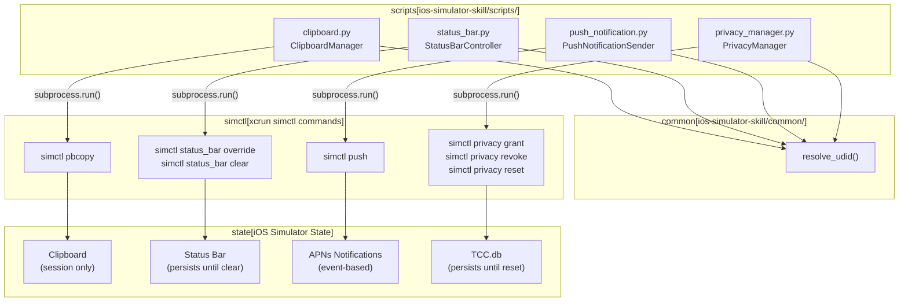
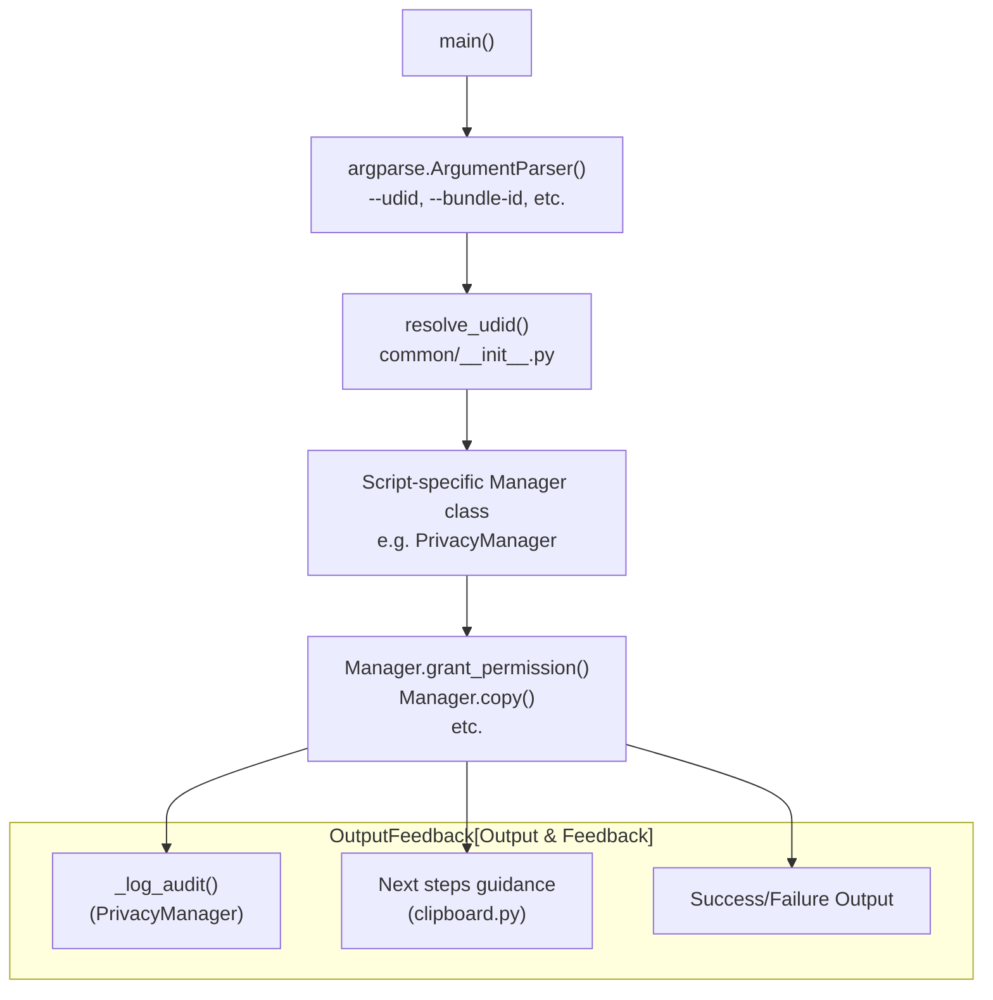

<!-- source: DeepWiki mcp.deepwiki.com · repo conorluddy/ios-simulator-skill · page 8 Advanced Testing Scripts · fetched 2026-10-26 -->

# Advanced Testing Scripts

Relevant source files

The following files were used as context for generating this wiki page:

- [ios-simulator-skill/skills/ios-simulator-skill/scripts/clipboard.py](ios-simulator-skill/skills/ios-simulator-skill/scripts/clipboard.py)
- [ios-simulator-skill/skills/ios-simulator-skill/scripts/privacy_manager.py](ios-simulator-skill/skills/ios-simulator-skill/scripts/privacy_manager.py)
- [ios-simulator-skill/skills/ios-simulator-skill/scripts/push_notification.py](ios-simulator-skill/skills/ios-simulator-skill/scripts/push_notification.py)
- [ios-simulator-skill/skills/ios-simulator-skill/scripts/status_bar.py](ios-simulator-skill/skills/ios-simulator-skill/scripts/status_bar.py)

This section covers four scripts in the `Advanced Testing & Permissions` category. Each script targets a specific category of simulator state manipulation that is impractical to reproduce through standard UI interaction.

| Script | Child Page | Purpose |
|--------|------------|---------|
| `clipboard.py` | [clipboard.py](#8.1) | Read/write simulator clipboard content |
| `status_bar.py` | [status_bar.py](#8.2) | Override status bar appearance with presets or custom values |
| `push_notification.py` | [push_notification.py](#8.3) | Deliver simulated APNs push notifications |
| `privacy_manager.py` | [privacy_manager.py](#8.4) | Grant, revoke, or reset app permissions for iOS privacy services |

All four scripts follow the standard class-based architecture described in [3.6](), support `--udid` auto-detection (see [3.5]()), and utilize `common.resolve_udid` for device targeting.

For build and test automation, see [5](). For UI interaction and navigation, see [6](). For standard testing analysis, see [7]().

Sources: [scripts/clipboard.py:15-15](), [scripts/status_bar.py:15-15](), [scripts/push_notification.py:18-18](), [scripts/privacy_manager.py:16-16]()

## System Architecture

All four scripts exclusively use `xcrun simctl` subcommands. They rely on `common.resolve_udid` for UDID resolution, following the same pattern as every other script in the skill.

**Script-to-simctl subcommand mapping**

Sources: [scripts/clipboard.py:39-49](), [scripts/status_bar.py:82-104](), [scripts/push_notification.py:79-89](), [scripts/privacy_manager.py:71-81]()

## Script Comparison

| Script | `simctl` Subcommand | Supported Operations | State Persistence | Manager Class | Detail Page |
|--------|---------------------|---------------------|-------------------|---------------|-------------|
| `clipboard.py` | `pbcopy` | Copy text to clipboard | Session only | `ClipboardManager` | [clipboard.py](#8.1) |
| `status_bar.py` | `status_bar` | 4 presets + custom overrides | Until `clear` is called | `StatusBarController` | [status_bar.py](#8.2) |
| `push_notification.py` | `push` | Simple payload; custom JSON payload | Event-based (one-shot) | `PushNotificationSender` | [push_notification.py](#8.3) |
| `privacy_manager.py` | `privacy` | Grant, revoke, reset (13 services) | Persists until `reset` or erase | `PrivacyManager` | [privacy_manager.py](#8.4) |

Sources: [scripts/clipboard.py:18-19](), [scripts/status_bar.py:18-19](), [scripts/push_notification.py:21-22](), [scripts/privacy_manager.py:19-20]()

## Script Summaries

### clipboard.py — [clipboard.py](#8.1)

**Manager Class:** `ClipboardManager` [scripts/clipboard.py:18-19]()  
**Primary Command:** `xcrun simctl pbcopy` [scripts/clipboard.py:39-39]()

Manages simulator clipboard content. The `ClipboardManager` class provides a `copy()` method that targets either a specific UDID or the `booted` simulator [scripts/clipboard.py:29-52](). It is used to test paste flows and provides usage guidance for following up with `navigator.py` or `keyboard.py` [scripts/clipboard.py:92-95]().

### status_bar.py — [status_bar.py](#8.2)

**Manager Class:** `StatusBarController` [scripts/status_bar.py:18-19]()  
**Primary Commands:** `xcrun simctl status_bar override`, `xcrun simctl status_bar clear` [scripts/status_bar.py:82-123]()

Overrides simulator status bar appearance for clean screenshots. The `StatusBarController` class includes built-in `PRESETS` such as `clean`, `testing`, `low_battery`, and `airplane` [scripts/status_bar.py:22-51](). It supports individual overrides for time, data network, wifi mode, and battery state [scripts/status_bar.py:61-81]().

### push_notification.py — [push_notification.py](#8.3)

**Manager Class:** `PushNotificationSender` [scripts/push_notification.py:21-22]()  
**Primary Command:** `xcrun simctl push` [scripts/push_notification.py:79-79]()

Delivers simulated APNs push notifications. The `PushNotificationSender` class supports `send_simple()` for common alerts [scripts/push_notification.py:103-143]() and `send()` for custom JSON payloads [scripts/push_notification.py:32-98](). It automatically handles payload wrapping in the required `aps` dictionary if missing [scripts/push_notification.py:69-70]().

### privacy_manager.py — [privacy_manager.py](#8.4)

**Manager Class:** `PrivacyManager` [scripts/privacy_manager.py:19-20]()  
**Primary Commands:** `xcrun simctl privacy grant/revoke/reset` [scripts/privacy_manager.py:71-172]()

Controls app permissions for iOS privacy services. The `PrivacyManager` supports 13 services including `camera`, `location`, `photos`, and `contacts` [scripts/privacy_manager.py:23-37](). It maintains an audit trail of permission changes for test tracking [scripts/privacy_manager.py:175-198]().

## Common Patterns

All four scripts follow a shared execution path, utilizing the `common` utilities for environment-aware device resolution.

**Shared execution path for advanced scripts**

Key shared behaviors:
- **UDID Resolution**: Scripts use `resolve_udid(args.udid)` to find the target device, defaulting to the booted simulator [scripts/clipboard.py:70-70]().
- **Error Handling**: Standardized use of `subprocess.run(..., check=True)` inside try-except blocks to catch `CalledProcessError` [scripts/status_bar.py:103-107]().
- **Audit Trails**: Permission changes are logged with timestamps and scenario names to provide transparency during automated runs [scripts/privacy_manager.py:195-197]().

Sources: [scripts/clipboard.py:69-73](), [scripts/privacy_manager.py:80-88](), [scripts/status_bar.py:103-107]()

---

