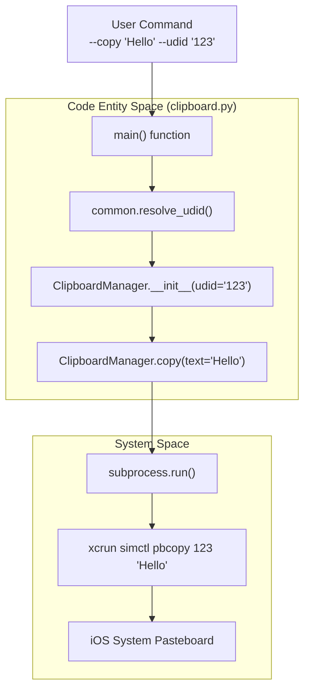
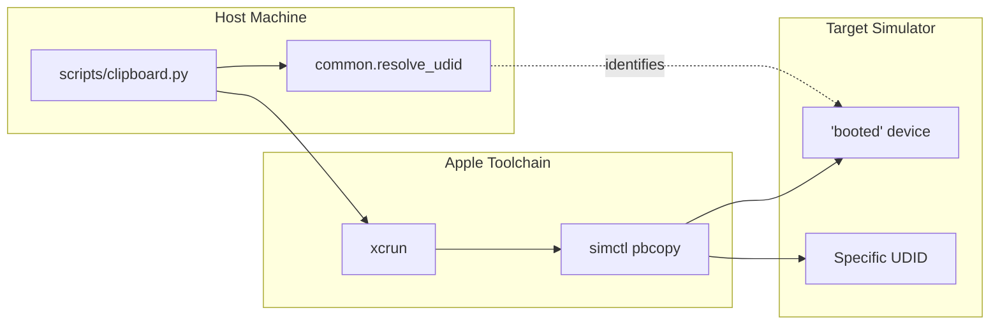

<!-- source: DeepWiki mcp.deepwiki.com · repo conorluddy/ios-simulator-skill · page 8.1 clipboard.py · fetched 2026-10-26 -->

# clipboard.py

Relevant source files

The following files were used as context for generating this wiki page:

- [ios-simulator-skill/skills/ios-simulator-skill/scripts/clipboard.py](ios-simulator-skill/skills/ios-simulator-skill/scripts/clipboard.py)

**Purpose**: `clipboard.py` manages the iOS simulator's clipboard to enable automated testing of paste flows. It allows copying text to the simulator clipboard programmatically, eliminating the need for manual text entry when testing input validation or clipboard-dependent features. [ios-simulator-skill/skills/ios-simulator-skill/scripts/clipboard.py:1-9]()

**Scope**: This script is part of the Advanced Testing Scripts category. It specifically handles the transfer of string data into the simulator's system pasteboard using the `simctl pbcopy` utility. [ios-simulator-skill/skills/ios-simulator-skill/scripts/clipboard.py:18-19](), [ios-simulator-skill/skills/ios-simulator-skill/scripts/clipboard.py:39-39]()

---

## Overview

The `ClipboardManager` class provides a programmatic interface to the simulator's clipboard. This is optimized for minimal token output when used with Claude Code, providing concise confirmation of the action and suggested next steps for interaction. [ios-simulator-skill/skills/ios-simulator-skill/scripts/clipboard.py:3-6](), [ios-simulator-skill/skills/ios-simulator-skill/scripts/clipboard.py:91-95]()

The script is primarily used to:
- Seed the clipboard with test data (emails, passwords, long strings). [ios-simulator-skill/skills/ios-simulator-skill/scripts/clipboard.py:58-59]()
- Facilitate "Copy/Paste" integration tests when combined with `navigator.py` and `keyboard.py`. [ios-simulator-skill/skills/ios-simulator-skill/scripts/clipboard.py:92-95]()
- Track test scenarios via optional metadata and documentation of expected outcomes. [ios-simulator-skill/skills/ios-simulator-skill/scripts/clipboard.py:63-64]()

**Sources**: [ios-simulator-skill/skills/ios-simulator-skill/scripts/clipboard.py:1-9](), [ios-simulator-skill/skills/ios-simulator-skill/scripts/clipboard.py:18-19](), [ios-simulator-skill/skills/ios-simulator-skill/scripts/clipboard.py:91-95]()

---

## Implementation Details

### ClipboardManager Class

The core logic resides in the `ClipboardManager` class, which wraps the `xcrun simctl pbcopy` command. [ios-simulator-skill/skills/ios-simulator-skill/scripts/clipboard.py:18-52]()

| Method | Description |
|--------|-------------|
| `__init__(udid)` | Initializes the manager with a specific device UDID or defaults to `None`. [ios-simulator-skill/skills/ios-simulator-skill/scripts/clipboard.py:21-27]() |
| `copy(text)` | Executes the subprocess command to push text into the simulator's pasteboard. If no UDID is provided to the manager, it defaults the command target to `"booted"`. [ios-simulator-skill/skills/ios-simulator-skill/scripts/clipboard.py:29-52]() |

### Data Flow: Natural Language to Code Entities

The following diagram illustrates how a user's intent to copy text is translated through the script's internal entities to the system level.

**Diagram: Command Translation Flow**

**Sources**: [ios-simulator-skill/skills/ios-simulator-skill/scripts/clipboard.py:21-52](), [ios-simulator-skill/skills/ios-simulator-skill/scripts/clipboard.py:55-78](), [ios-simulator-skill/skills/ios-simulator-skill/scripts/clipboard.py:15-15]()

---

## Command-Line Interface

### Primary Arguments

| Argument | Requirement | Description |
|----------|-------------|-------------|
| `--copy` | **Required** | The string content to be placed on the clipboard. [ios-simulator-skill/skills/ios-simulator-skill/scripts/clipboard.py:58]() |
| `--udid` | Optional | Specific simulator UDID. If omitted, `resolve_udid` attempts to find the active booted simulator. [ios-simulator-skill/skills/ios-simulator-skill/scripts/clipboard.py:59-62]() |
| `--test-name` | Optional | Label for the current test scenario, included in the output for logging. [ios-simulator-skill/skills/ios-simulator-skill/scripts/clipboard.py:63]() |
| `--expected` | Optional | Documentation of the expected behavior after a subsequent paste. [ios-simulator-skill/skills/ios-simulator-skill/scripts/clipboard.py:64]() |

**Sources**: [ios-simulator-skill/skills/ios-simulator-skill/scripts/clipboard.py:57-66]()

---

## Tool Integration and Workflow

`clipboard.py` serves as a bridge between the host machine's environment and the virtualized iOS environment.

**Diagram: Toolchain Integration**

### Integration Pattern: The "Copy-Paste" Sequence

Because `pbcopy` only places text in the buffer, it must be paired with interaction scripts to complete a test case. The script explicitly suggests these next steps in its standard output. [ios-simulator-skill/skills/ios-simulator-skill/scripts/clipboard.py:91-95]()

1. **Copy**: `python scripts/clipboard.py --copy "test@example.com"` [ios-simulator-skill/skills/ios-simulator-skill/scripts/clipboard.py:8-9]()
2. **Focus**: `python scripts/navigator.py --find-type TextField --tap` [ios-simulator-skill/skills/ios-simulator-skill/scripts/clipboard.py:93]()
3. **Paste**: `python scripts/keyboard.py --key return` or `python scripts/keyboard.py --key cmd+v` [ios-simulator-skill/skills/ios-simulator-skill/scripts/clipboard.py:94-95]()

**Sources**: [ios-simulator-skill/skills/ios-simulator-skill/scripts/clipboard.py:39-46](), [ios-simulator-skill/skills/ios-simulator-skill/scripts/clipboard.py:92-95]()

---

## Output and Error Handling

### Token-Efficient Success Output
The script generates a concise string to save context window space:
`Copied: "text" (test: scenario_name)` [ios-simulator-skill/skills/ios-simulator-skill/scripts/clipboard.py:80-85]()

If `--expected` is provided, it adds:
`Expected: behavior_description` [ios-simulator-skill/skills/ios-simulator-skill/scripts/clipboard.py:88-89]()

### Error Handling
- **UDID Resolution Failure**: If `resolve_udid` (imported from `common`) cannot find a target or fails, the script prints the error and exits with code `1`. [ios-simulator-skill/skills/ios-simulator-skill/scripts/clipboard.py:69-73]()
- **Subprocess Failure**: If `simctl pbcopy` fails (e.g., simulator is not booted or unresponsive), the `copy` method catches the `subprocess.CalledProcessError`, returns `False`, and the script exits with code `1`. [ios-simulator-skill/skills/ios-simulator-skill/scripts/clipboard.py:51-52](), [ios-simulator-skill/skills/ios-simulator-skill/scripts/clipboard.py:98-99]()

**Sources**: [ios-simulator-skill/skills/ios-simulator-skill/scripts/clipboard.py:48-52](), [ios-simulator-skill/skills/ios-simulator-skill/scripts/clipboard.py:69-73](), [ios-simulator-skill/skills/ios-simulator-skill/scripts/clipboard.py:78-99]()

---

