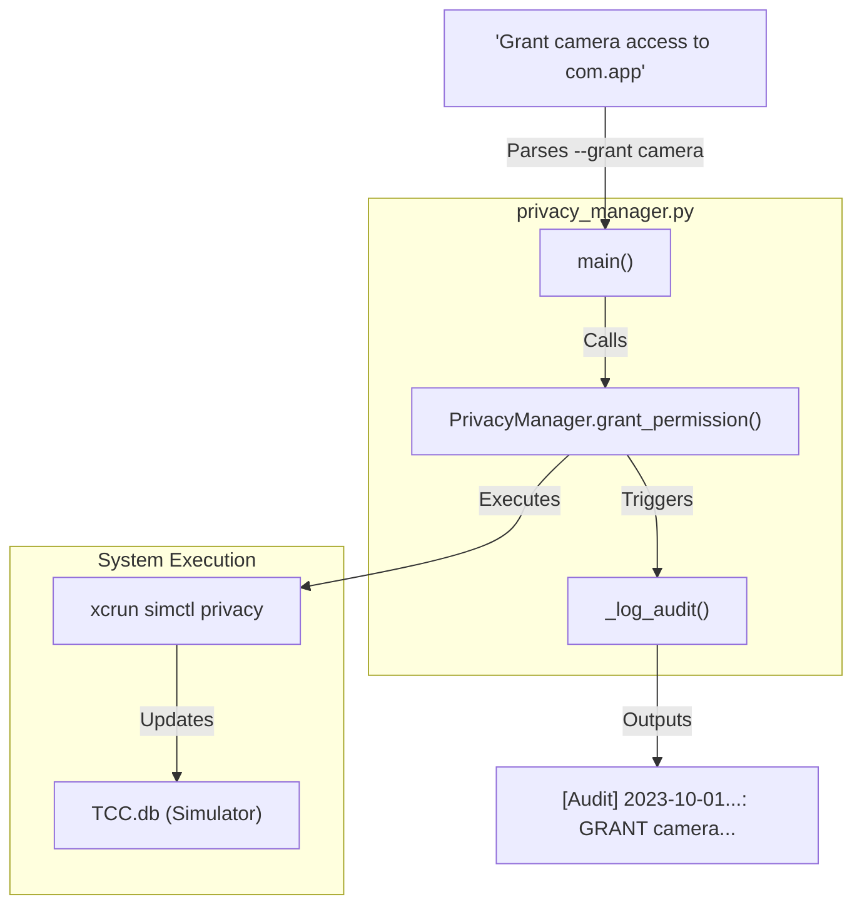

<!-- source: DeepWiki mcp.deepwiki.com · repo conorluddy/ios-simulator-skill · page 8.4 privacy_manager.py · fetched 2026-10-26 -->

# privacy_manager.py

<details>
<summary>Relevant source files</summary>

The following files were used as context for generating this wiki page:

- [ios-simulator-skill/skills/ios-simulator-skill/scripts/privacy_manager.py](ios-simulator-skill/skills/ios-simulator-skill/scripts/privacy_manager.py)

</details>


`privacy_manager.py` is a specialized utility in the **Advanced Testing & Permissions** category. It provides a command-line interface for granting, revoking, and resetting iOS app permissions on a simulator without requiring manual UI interaction with system permission dialogs. This is essential for testing app behavior under various privacy states (e.g., location denied, camera granted) and for automating flows that would otherwise be blocked by TCC (Transparency, Consent, and Control) prompts.

The script supports 13+ system services and includes an audit trail feature to track permission changes during test execution [ios-simulator-skill/skills/ios-simulator-skill/scripts/privacy_manager.py:2-9]().

---

## Purpose

iOS apps request permissions at runtime through system-level dialogs. In automated testing, interacting with these dialogs is often unreliable. `privacy_manager.py` bypasses the UI layer by calling `xcrun simctl privacy` directly, allowing a test workflow to programmatically configure the permission state of any app.

**Key capabilities:**
*   **Grant/Revoke/Reset:** Modify access to services like Camera, Photos, and Location [ios-simulator-skill/skills/ios-simulator-skill/scripts/privacy_manager.py:47-173]().
*   **Audit Logging:** Automatically logs permission changes with timestamps and optional test scenario/step metadata [ios-simulator-skill/skills/ios-simulator-skill/scripts/privacy_manager.py:175-198]().
*   **Service Discovery:** Lists all supported iOS privacy services [ios-simulator-skill/skills/ios-simulator-skill/scripts/privacy_manager.py:221-224]().

Sources: [ios-simulator-skill/skills/ios-simulator-skill/scripts/privacy_manager.py:1-9](), [ios-simulator-skill/skills/ios-simulator-skill/scripts/privacy_manager.py:22-37]()

---

## Architecture

The script is built around the `PrivacyManager` class, which encapsulates the logic for interacting with the `simctl` privacy sub-command.

**Diagram: PrivacyManager Code Entity Space**

```mermaid
classDiagram
    class PrivacyManager {
        +dict "SUPPORTED_SERVICES"
        +str "udid"
        +grant_permission("bundle_id", "service", "scenario", "step") "bool"
        +revoke_permission("bundle_id", "service", "scenario", "step") "bool"
        +reset_permission("bundle_id", "service", "scenario", "step") "bool"
        -_log_audit("action", "bundle_id", "service", "scenario", "step") "void"
    }
    class main {
        +argparse.ArgumentParser "parser"
    }
    "PrivacyManager" ..> "main" : "Instantiated in"
    "main" ..> "resolve_udid" : "Calls"
```

### Data Flow and Implementation
1.  **UDID Resolution:** The script uses `resolve_udid` from `common` to identify the target simulator [ios-simulator-skill/skills/ios-simulator-skill/scripts/privacy_manager.py:16](). If no UDID is provided via `--udid`, it defaults to the currently `booted` device [ios-simulator-skill/skills/ios-simulator-skill/scripts/privacy_manager.py:73-76]().
2.  **Command Construction:** Methods like `grant_permission` construct a command list `["xcrun", "simctl", "privacy", <device>, <action>, <service>, <bundle_id>]` [ios-simulator-skill/skills/ios-simulator-skill/scripts/privacy_manager.py:71-78]().
3.  **Execution:** The command is executed via `subprocess.run` with `capture_output=True` [ios-simulator-skill/skills/ios-simulator-skill/scripts/privacy_manager.py:81]().
4.  **Audit Trail:** Upon success, `_log_audit` prints a timestamped entry to stdout, including the service, bundle ID, and optional test context [ios-simulator-skill/skills/ios-simulator-skill/scripts/privacy_manager.py:192-197]().

Sources: [ios-simulator-skill/skills/ios-simulator-skill/scripts/privacy_manager.py:39-45](), [ios-simulator-skill/skills/ios-simulator-skill/scripts/privacy_manager.py:71-88](), [ios-simulator-skill/skills/ios-simulator-skill/scripts/privacy_manager.py:175-181]()

---

## Supported Privacy Services

The script maintains a mapping of internal `simctl` tokens to human-readable descriptions in the `SUPPORTED_SERVICES` dictionary [ios-simulator-skill/skills/ios-simulator-skill/scripts/privacy_manager.py:23-37]().

| Service Token | Description |
|---|---|
| `camera` | Camera access |
| `microphone` | Microphone access |
| `location` | Location services |
| `contacts` | Contacts access |
| `photos` | Photos library access |
| `calendar` | Calendar access |
| `health` | Health data access |
| `reminders` | Reminders access |
| `motion` | Motion & fitness |
| `keyboard` | Keyboard access |
| `mediaLibrary` | Media library |
| `calls` | Call history |
| `siri` | Siri access |

Sources: [ios-simulator-skill/skills/ios-simulator-skill/scripts/privacy_manager.py:23-37]()

---

## CLI Reference

The `main()` function handles argument parsing and routing to the appropriate `PrivacyManager` methods [ios-simulator-skill/skills/ios-simulator-skill/scripts/privacy_manager.py:200-240]().

| Argument | Description |
|---|---|
| `--bundle-id` | **Required.** The target app bundle identifier (e.g., `com.apple.mobilesafari`) [ios-simulator-skill/skills/ios-simulator-skill/scripts/privacy_manager.py:205]() |
| `--grant` | Grant permission for a specific service [ios-simulator-skill/skills/ios-simulator-skill/scripts/privacy_manager.py:209-212]() |
| `--revoke` | Revoke permission for a specific service [ios-simulator-skill/skills/ios-simulator-skill/scripts/privacy_manager.py:213-215]() |
| `--reset` | Reset permission to the system default state [ios-simulator-skill/skills/ios-simulator-skill/scripts/privacy_manager.py:216-219]() |
| `--list` | List all supported services and exit [ios-simulator-skill/skills/ios-simulator-skill/scripts/privacy_manager.py:220-224]() |
| `--scenario` | Optional string for audit logging (e.g., "LoginFlow") [ios-simulator-skill/skills/ios-simulator-skill/scripts/privacy_manager.py:228-230]() |
| `--step` | Optional integer for audit logging (e.g., 5) [ios-simulator-skill/skills/ios-simulator-skill/scripts/privacy_manager.py:231]() |
| `--udid` | Target specific simulator UDID [ios-simulator-skill/skills/ios-simulator-skill/scripts/privacy_manager.py:235-237]() |

Sources: [ios-simulator-skill/skills/ios-simulator-skill/scripts/privacy_manager.py:202-238]()

---

## Integration and Workflow

`privacy_manager.py` bridges the gap between natural language requests ("Give the app camera access") and the low-level TCC database modifications required by the iOS Simulator.

**Diagram: Natural Language to Code Entity Mapping**



### Usage Examples

**Granting permissions for a specific test step:**
```bash
python scripts/privacy_manager.py --bundle-id com.test.app --grant location --scenario "Onboarding" --step 2
```

**Resetting permissions to trigger the system prompt again:**
```bash
python scripts/privacy_manager.py --bundle-id com.test.app --reset camera
```

Sources: [ios-simulator-skill/skills/ios-simulator-skill/scripts/privacy_manager.py:8-9](), [ios-simulator-skill/skills/ios-simulator-skill/scripts/privacy_manager.py:195-197]()

---

