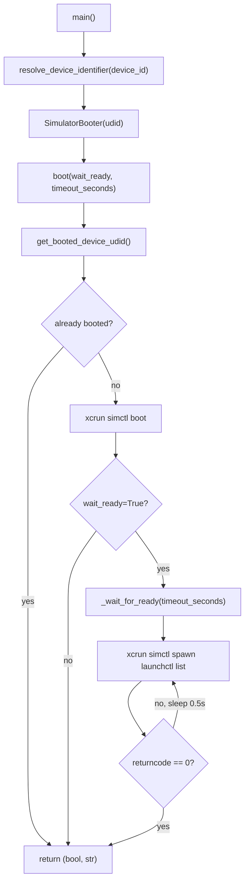
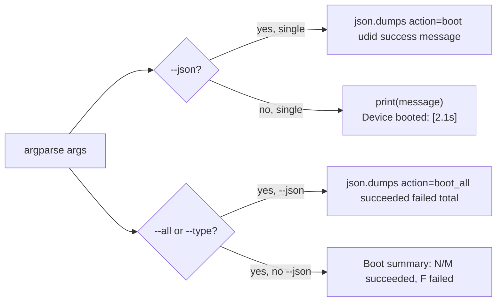
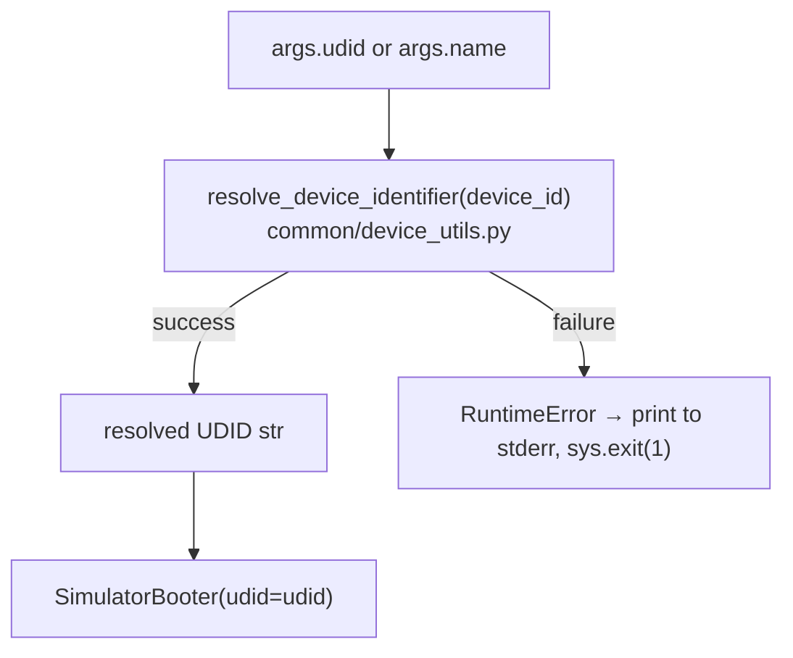

<!-- source: DeepWiki mcp.deepwiki.com · repo conorluddy/ios-simulator-skill · page 9.1 simctl_boot.py · fetched 2026-10-26 -->

# simctl_boot.py

<details>
<summary>Relevant source files</summary>

The following files were used as context for generating this wiki page:

- [ios-simulator-skill/skills/ios-simulator-skill/scripts/common/device_utils.py](ios-simulator-skill/skills/ios-simulator-skill/scripts/common/device_utils.py)
- [ios-simulator-skill/skills/ios-simulator-skill/scripts/simctl_boot.py](ios-simulator-skill/skills/ios-simulator-skill/scripts/simctl_boot.py)

</details>


This page documents `simctl_boot.py`, the script responsible for booting iOS simulator instances. It covers the `SimulatorBooter` class, all CLI flags, readiness polling behavior, and batch boot modes. For related device lifecycle operations (shutdown, create, delete, erase), see the sibling pages in section [9]().

---

## Purpose

`simctl_boot.py` wraps `xcrun simctl boot` with three additions that the raw tool does not provide:

1. **Idempotent boot** — detects if the target device is already booted and exits cleanly [ios-simulator-skill/scripts/simctl_boot.py:52-56]().
2. **Readiness polling** — optionally blocks until the device is fully operational, not just started [ios-simulator-skill/scripts/simctl_boot.py:87-127]().
3. **Batch operations** — boots all simulators or all simulators of a given device type in one call [ios-simulator-skill/scripts/simctl_boot.py:129-175]().

The script lives at [ios-simulator-skill/scripts/simctl_boot.py:1-14]().

---

## SimulatorBooter Class

The `SimulatorBooter` class encapsulates the logic for single-device and batch boot operations [ios-simulator-skill/scripts/simctl_boot.py:28-29]().

**Execution flow diagram: single device boot**



Sources: [ios-simulator-skill/scripts/simctl_boot.py:28-127](), [ios-simulator-skill/scripts/common/device_utils.py:124-159]()

---

### `__init__`

[ios-simulator-skill/scripts/simctl_boot.py:31-33]()

Accepts an optional `udid: str | None`. When `udid` is `None`, the instance cannot boot a single device; callers should use `--all` or `--type` instead.

---

### `boot(wait_ready, timeout_seconds)`

[ios-simulator-skill/scripts/simctl_boot.py:35-85]()

Boots the device identified by `self.udid`.

| Step | Mechanism | Source lines |
|---|---|---|
| Check boot state | `get_booted_device_udid()` from `common.device_utils` | [ios-simulator-skill/scripts/simctl_boot.py:52-58]() |
| Issue boot command | `xcrun simctl boot <udid>` via `subprocess.run`, 30 s timeout | [ios-simulator-skill/scripts/simctl_boot.py:62-69]() |
| Measure elapsed time | `time.time()` before and after | [ios-simulator-skill/scripts/simctl_boot.py:49-81]() |
| Optionally wait | delegates to `_wait_for_ready(timeout_seconds)` | [ios-simulator-skill/scripts/simctl_boot.py:74-79]() |

Return value is always a `tuple[bool, str]`: a success flag and a human-readable message including elapsed time.

If the device is already booted, the method returns `True` immediately without issuing the `simctl boot` command [ios-simulator-skill/scripts/simctl_boot.py:54-56]().

---

### `_wait_for_ready(timeout_seconds)`

[ios-simulator-skill/scripts/simctl_boot.py:87-127]()

Polls the device in a 0.5-second loop until it responds to:

```bash
xcrun simctl spawn <udid> launchctl list
```

A `returncode == 0` from that command indicates the device's `launchd` is running and it can accept app launches [ios-simulator-skill/scripts/simctl_boot.py:113-117](). The loop records the total number of checks performed and reports them in the returned message. If `timeout_seconds` elapses before the device responds, the method returns `(False, "Boot timeout: ...")` [ios-simulator-skill/scripts/simctl_boot.py:124-127]().

---

### `boot_all()` — static method

[ios-simulator-skill/scripts/simctl_boot.py:129-149]()

Calls `list_simulators(state="available")` from `common.device_utils` to enumerate all non-booted simulators, then instantiates a `SimulatorBooter` per device and calls `boot(wait_ready=False)` on each. Returns `(succeeded, failed)` counts.

---

### `boot_by_type(device_type)` — static method

[ios-simulator-skill/scripts/simctl_boot.py:151-175]()

Identical to `boot_all()` but filters the simulator list by checking whether `device_type.lower()` appears in each simulator's `name` field [ios-simulator-skill/scripts/simctl_boot.py:167-168](). For example, `--type iPhone` matches `iPhone 16`, `iPhone SE`, etc.

---

## CLI Reference

```bash
python scripts/simctl_boot.py [OPTIONS]
```

| Flag | Type | Default | Description |
|---|---|---|---|
| `--udid` | `str` | — | UDID or device name; passed to `resolve_device_identifier()` |
| `--name` | `str` | — | Alternative to `--udid`; both feed the same resolution path |
| `--wait-ready` | flag | `False` | Block until device responds to `launchctl list` |
| `--timeout` | `int` | `120` | Seconds before `--wait-ready` gives up |
| `--all` | flag | `False` | Boot every available simulator |
| `--type` | `str` | — | Boot all simulators whose name contains this string |
| `--json` | flag | `False` | Emit structured JSON instead of plain text |

Exactly one of `--udid`, `--name`, `--all`, or `--type` must be supplied; the script exits with an error message to stderr and code `1` if none is given.

Sources: [ios-simulator-skill/scripts/simctl_boot.py:178-214]()

---

## Output Modes

**Output format diagram: mode selection**



Sources: [ios-simulator-skill/scripts/simctl_boot.py:218-292]()

### Single device — default

```text
Device booted: ABC123DEF456 [boot in 1.4s] (use --wait-ready to wait for availability)
```

### Single device — `--wait-ready`

```text
Device booted and ready: ABC123DEF456 [3.7s total]
```

### Single device — `--json`

```json
{
  "action": "boot",
  "device_id": "iPhone 16 Pro",
  "udid": "ABC123DEF456...",
  "success": true,
  "message": "Device booted: ABC123DEF456... [boot in 1.4s]"
}
```

### Batch — `--all` or `--type` with `--json`

```json
{
  "action": "boot_all",
  "succeeded": 3,
  "failed": 0,
  "total": 3
}
```

---

## Device Identifier Resolution

**Resolution path for `--udid` / `--name`**



Sources: [ios-simulator-skill/scripts/simctl_boot.py:259-272](), [ios-simulator-skill/scripts/common/device_utils.py:161-199]()

`resolve_device_identifier()` (imported from `common.device_utils`) accepts either a raw UDID string or a device name (e.g. `"iPhone 16 Pro"`) and returns a canonical UDID [ios-simulator-skill/scripts/simctl_boot.py:259-261](). If neither `--udid` nor `--name` is provided and neither `--all` nor `--type` is set, the script prints an error and exits before calling `resolve_device_identifier()`. See page [10.1]() for full documentation of that utility function.

---

## Dependencies

| Import | Role |
|---|---|
| `common.device_utils.get_booted_device_udid` | Checks whether a device is already booted |
| `common.device_utils.list_simulators` | Enumerates simulators for batch operations |
| `common.device_utils.resolve_device_identifier` | Converts name/UDID argument to a canonical UDID |
| `subprocess` | Executes `xcrun simctl boot` and `xcrun simctl spawn` |
| `time` | Measures boot duration; drives polling loop |

Sources: [ios-simulator-skill/scripts/simctl_boot.py:21-25]()

---

## Exit Codes

| Code | Meaning |
|---|---|
| `0` | All requested boots succeeded |
| `1` | One or more boots failed, or a required argument was missing |

For batch modes, the exit code is `1` if **any** device failed; `succeeded` and `failed` counts in the output identify the breakdown [ios-simulator-skill/scripts/simctl_boot.py:246-249]().

---

## Typical Usage Examples

Boot a specific device and wait until it is interactive:

```bash
python scripts/simctl_boot.py --udid "iPhone 16 Pro" --wait-ready --timeout 90
```

Boot all iPhone simulators, capturing counts in JSON for a CI script:

```bash
python scripts/simctl_boot.py --type iPhone --json
```

Boot a device by UDID directly, minimal output:

```bash
python scripts/simctl_boot.py --udid ABC123DEF456...
```

---

## Related Pages

- [9]() — Device Lifecycle Scripts overview and workflow ordering
- [9.2]() — `simctl_shutdown.py` — shuts down booted simulators
- [9.3]() — `simctl_create.py` — creates a new simulator
- [10.1]() — `device_utils.py` — `resolve_device_identifier()`, `list_simulators()`, `get_booted_device_udid()`
- [3.5]() — Device Targeting and Auto-Detection concepts

---

