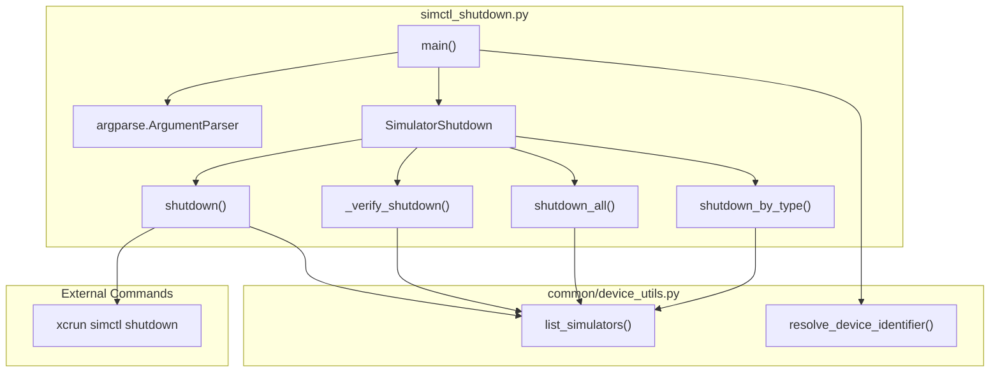
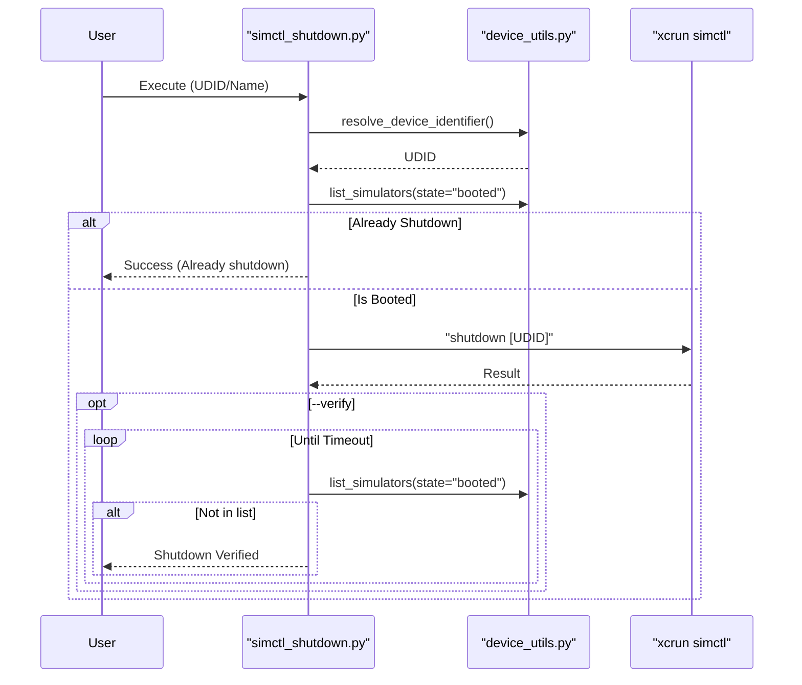

<!-- source: DeepWiki mcp.deepwiki.com · repo conorluddy/ios-simulator-skill · page 9.2 simctl_shutdown.py · fetched 2026-10-26 -->

# simctl_shutdown.py

<details>
<summary>Relevant source files</summary>

The following files were used as context for generating this wiki page:

- [ios-simulator-skill/skills/ios-simulator-skill/scripts/simctl_shutdown.py](ios-simulator-skill/skills/ios-simulator-skill/scripts/simctl_shutdown.py)

</details>


`simctl_shutdown.py` is a device lifecycle management script that provides graceful shutdown of iOS simulators with optional state verification. The script wraps `xcrun simctl shutdown` with enhanced targeting, batch operations, and structured output.

For creating simulators, see [simctl_create.py](9.3). For booting simulators, see [simctl_boot.py](9.1). For permanent deletion, see [simctl_delete.py](9.4). For factory reset without deletion, see [simctl_erase.py](9.5).

Sources: [scripts/simctl_shutdown.py:2-13](), [scripts/simctl_shutdown.py:170-172]()

## Purpose and Scope

`simctl_shutdown.py` shuts down running iOS simulators using the `xcrun simctl shutdown` command. It supports:

- **Single device shutdown** by UDID or device name [scripts/simctl_shutdown.py:30-32]()
- **Batch operations** for shutting down all simulators or filtering by device type [scripts/simctl_shutdown.py:119-165]()
- **Optional verification** to confirm shutdown completion within a timeout period [scripts/simctl_shutdown.py:83-117]()
- **Structured output** in human-readable or JSON format for CI/CD integration [scripts/simctl_shutdown.py:202-205]()

The script is part of the device lifecycle category alongside boot, create, delete, and erase operations.

Sources: [scripts/simctl_shutdown.py:2-13]()

## Core Architecture

### Class-Based Script Structure

The script follows the standard class-based architecture of the skill. The `SimulatorShutdown` class encapsulates the shutdown logic, while `main()` handles the CLI interface.

| Code Entity | Responsibility |
|:---|:---|
| `SimulatorShutdown` | Primary class for managing shutdown state and verification [scripts/simctl_shutdown.py:27](). |
| `shutdown()` | Executes the `simctl` command and manages the verification flow [scripts/simctl_shutdown.py:34](). |
| `_verify_shutdown()` | Internal polling method to confirm the simulator has exited the `booted` state [scripts/simctl_shutdown.py:83](). |
| `shutdown_all()` | Static method to iterate and shutdown every booted simulator found [scripts/simctl_shutdown.py:119](). |
| `shutdown_by_type()` | Static method to filter booted simulators by name (e.g., "iPhone") and shut them down [scripts/simctl_shutdown.py:141](). |



Sources: [scripts/simctl_shutdown.py:27-165](), [scripts/simctl_shutdown.py:168-207]()

### Command Execution Flow

The script first checks if a device is already shut down before attempting the command to avoid unnecessary overhead.



Sources: [scripts/simctl_shutdown.py:34-81](), [scripts/simctl_shutdown.py:83-117]()

## Device Targeting Strategies

### Single Device Shutdown

The script resolves device identifiers using `resolve_device_identifier` from `device_utils.py`.

| Flag | Example | Resolution Method |
|------|---------|------------------|
| `--udid` | `--udid 12345678-ABCD-...` | Explicit UDID [scripts/simctl_shutdown.py:173-176]() |
| `--name` | `--name "iPhone 16 Pro"` | Name lookup via `resolve_device_identifier` [scripts/simctl_shutdown.py:177-180]() |

If neither `--udid` nor `--name` is provided for a single-device operation, the script returns an error [scripts/simctl_shutdown.py:45-46]().

Sources: [scripts/simctl_shutdown.py:45-46](), [scripts/simctl_shutdown.py:173-180]()

### Batch Operations

The script provides static methods for batch operations:

1.  **`shutdown_all()`**: Queries all booted simulators using `list_simulators(state="booted")` and iterates through them to trigger shutdown [scripts/simctl_shutdown.py:119-139]().
2.  **`shutdown_by_type(device_type)`**: Filters the booted simulator list by checking if the `device_type` string (e.g., "iPhone") is present in the device name [scripts/simctl_shutdown.py:141-165]().

Sources: [scripts/simctl_shutdown.py:119-165]()

## Shutdown Verification

### Verification Mechanism

The `_verify_shutdown` method [scripts/simctl_shutdown.py:83]() implements a polling loop to ensure the device has fully transitioned out of the "booted" state.

- **Poll Interval**: 0.5 seconds [scripts/simctl_shutdown.py:94]().
- **Check Method**: Calls `list_simulators(state="booted")` and checks if the target UDID is still present [scripts/simctl_shutdown.py:101-102]().
- **Timeout**: Default is 30 seconds, configurable via `--timeout` [scripts/simctl_shutdown.py:83](), [scripts/simctl_shutdown.py:187-191]().

Sources: [scripts/simctl_shutdown.py:83-117]()

## Output Modes

### Default Human-Readable Output

The script provides timing information and status messages:
- `Device already shutdown: [UDID] [checked in 0.1s]` [scripts/simctl_shutdown.py:54]().
- `Device shutdown confirmed: [UDID] [2.5s total]` [scripts/simctl_shutdown.py:74]().

### JSON Output

When the `--json` flag is used, the script outputs structured data [scripts/simctl_shutdown.py:202-205]().

**Batch operation JSON output**:
```json
{
    "action": "shutdown_all",
    "succeeded": 3,
    "failed": 0,
    "total": 3
}
```
Sources: [scripts/simctl_shutdown.py:210-224]()

## Command Reference

### All Flags

| Flag | Type | Description |
|------|------|-------------|
| `--udid` | String | Target specific simulator by UDID |
| `--name` | String | Target simulator by device name |
| `--verify` | Boolean | Wait for shutdown to complete and verify state |
| `--timeout` | Integer | Timeout for --verify in seconds (default: 30) |
| `--all` | Boolean | Shutdown all booted simulators |
| `--type` | String | Filter by device type (e.g., iPhone) |
| `--json` | Boolean | Output structured JSON |

Sources: [scripts/simctl_shutdown.py:173-205]()

### Common Usage Examples

```bash
# Shutdown by device name with verification
python scripts/simctl_shutdown.py --name "iPhone 16 Pro" --verify

# Shutdown all booted simulators
python scripts/simctl_shutdown.py --all

# Shutdown only booted iPads
python scripts/simctl_shutdown.py --type iPad

# CI/CD mode with JSON output
python scripts/simctl_shutdown.py --udid 12345678-ABCD-1234-5678-1234567890AB --json
```

Sources: [scripts/simctl_shutdown.py:170-205]()

## Implementation Details

### Error Handling

The script handles several failure modes:
- **Return Code Check**: Inspects `result.returncode` from the `simctl` process [scripts/simctl_shutdown.py:61]().
- **Timeout**: Catches `subprocess.TimeoutExpired` if the `simctl` command itself hangs [scripts/simctl_shutdown.py:64-65]().
- **Verification Timeout**: Returns a specific failure message if the device remains "booted" beyond the specified timeout [scripts/simctl_shutdown.py:114-117]().

Sources: [scripts/simctl_shutdown.py:57-67](), [scripts/simctl_shutdown.py:113-117]()

---

