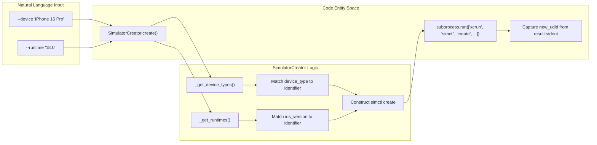
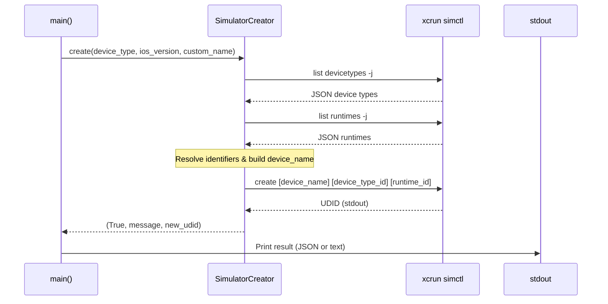

<!-- source: DeepWiki mcp.deepwiki.com · repo conorluddy/ios-simulator-skill · page 9.3 simctl_create.py · fetched 2026-10-26 -->

# simctl_create.py

Relevant source files

The following files were used as context for generating this wiki page:

- [ios-simulator-skill/skills/ios-simulator-skill/scripts/simctl_create.py](ios-simulator-skill/skills/ios-simulator-skill/scripts/simctl_create.py)

This document describes `simctl_create.py`, a Device Lifecycle script that creates iOS simulators dynamically by wrapping `xcrun simctl create`. It enables programmatic simulator provisioning for CI/CD pipelines, automated testing environments, and ephemeral device creation.

For managing existing simulators, see [simctl_boot.py]() [9.1], [simctl_shutdown.py]() [9.2], [simctl_delete.py]() [9.4], and [simctl_erase.py]() [9.5].

**Sources:** [skills/ios-simulator-skill/scripts/simctl_create.py:2-14](), [README.md:130](), [README.md:214-224]()

## Purpose and Core Functionality

`simctl_create.py` provisions new iOS simulator instances by specifying device type and runtime version. Unlike scripts that operate on existing simulators, this script generates new devices with unique UDIDs. The script returns the UDID of the newly created simulator for immediate use in automation workflows [skills/ios-simulator-skill/scripts/simctl_create.py:121-125]().

Primary features:
- **Device Type Targeting**: Create by name (e.g., "iPhone 16 Pro", "iPad Air") [skills/ios-simulator-skill/scripts/simctl_create.py:9]().
- **Runtime Specification**: Specify iOS version (e.g., "17.0", "18.0") or default to the latest available [skills/ios-simulator-skill/scripts/simctl_create.py:10](), [skills/ios-simulator-skill/scripts/simctl_create.py:89-90]().
- **Custom Naming**: Optional user-defined device names [skills/ios-simulator-skill/scripts/simctl_create.py:11]().
- **UDID Capture**: Returns the newly created device UDID to stdout [skills/ios-simulator-skill/scripts/simctl_create.py:12]().
- **Discovery**: List available device types and runtimes on the host machine [skills/ios-simulator-skill/scripts/simctl_create.py:13]().

**Sources:** [skills/ios-simulator-skill/scripts/simctl_create.py:1-14](), [skills/ios-simulator-skill/scripts/simctl_create.py:31-47]()

## Implementation: SimulatorCreator Class

The script logic is encapsulated in the `SimulatorCreator` class [skills/ios-simulator-skill/scripts/simctl_create.py:24]().

### Main Execution Flow

**Diagram: Mapping User Input to SimulatorCreator Implementation**

**Sources:** [skills/ios-simulator-skill/scripts/simctl_create.py:31-131]()

### Discovery and Normalization

The script performs normalization to bridge human-readable names to `simctl` identifiers:

1.  **Device Types**: `_get_device_types()` executes `xcrun simctl list devicetypes -j` [skills/ios-simulator-skill/scripts/simctl_create.py:141](). It returns a list of dictionaries containing `name` and `identifier` [skills/ios-simulator-skill/scripts/simctl_create.py:149-155]().
2.  **Runtimes**: `_get_runtimes()` executes `xcrun simctl list runtimes -j` [skills/ios-simulator-skill/scripts/simctl_create.py:170](). It filters specifically for "iOS" runtimes, skipping watchOS or tvOS [skills/ios-simulator-skill/scripts/simctl_create.py:181-188]().
3.  **Matching**: The `create()` method performs case-insensitive matching on the device type string [skills/ios-simulator-skill/scripts/simctl_create.py:55-58](). If no iOS version is provided, it defaults to the latest runtime found in the sorted list [skills/ios-simulator-skill/scripts/simctl_create.py:89-90]().

**Sources:** [skills/ios-simulator-skill/scripts/simctl_create.py:49-93](), [skills/ios-simulator-skill/scripts/simctl_create.py:133-195]()

## Command Line Interface

### Arguments and Options

The `main()` function defines the following CLI arguments [skills/ios-simulator-skill/scripts/simctl_create.py:217-251]():

| Argument | Flag | Description |
| :--- | :--- | :--- |
| Device Type | `--device` | e.g., "iPhone 16 Pro". Required unless listing [skills/ios-simulator-skill/scripts/simctl_create.py:221-224](). |
| iOS Version | `--runtime` | e.g., "18.0". Defaults to latest [skills/ios-simulator-skill/scripts/simctl_create.py:225-228](). |
| Custom Name | `--name` | Custom name for the simulator [skills/ios-simulator-skill/scripts/simctl_create.py:229-232](). |
| List Devices | `--list-devices` | Print available device types and exit [skills/ios-simulator-skill/scripts/simctl_create.py:233-236](). |
| List Runtimes | `--list-runtimes` | Print available iOS runtimes and exit [skills/ios-simulator-skill/scripts/simctl_create.py:237-240](). |
| Output Mode | `--json` | Return results in JSON format [skills/ios-simulator-skill/scripts/simctl_create.py:241-244](). |

**Sources:** [skills/ios-simulator-skill/scripts/simctl_create.py:217-251]()

### Output Formatting

The script supports both human-readable and machine-readable output:

- **JSON Mode**: If `--json` is specified, the script outputs a dictionary containing `success`, `message`, and `new_udid` [skills/ios-simulator-skill/scripts/simctl_create.py:276-282]().
- **Default Mode**: Prints a descriptive message to stdout upon success, including the name, device type, version, and UDID [skills/ios-simulator-skill/scripts/simctl_create.py:121-125]().

**Sources:** [skills/ios-simulator-skill/scripts/simctl_create.py:274-284]()

## Data Flow: Simulator Creation

**Diagram: Data Flow from CLI to simctl**

**Sources:** [skills/ios-simulator-skill/scripts/simctl_create.py:31-131](), [skills/ios-simulator-skill/scripts/simctl_create.py:253-294]()

## Error Handling

The script implements several layers of validation:
- **Missing Device Type**: Returns an error if the specified `--device` is not found in `simctl list devicetypes` [skills/ios-simulator-skill/scripts/simctl_create.py:60-66]().
- **Missing Runtime**: Returns an error if the specified `--runtime` version is not installed [skills/ios-simulator-skill/scripts/simctl_create.py:81-87]().
- **Execution Failure**: Captures `stderr` from the `simctl create` command if the return code is non-zero [skills/ios-simulator-skill/scripts/simctl_create.py:113-115]().
- **Timeouts**: Implements a 60-second timeout for the creation command [skills/ios-simulator-skill/scripts/simctl_create.py:111](), [skills/ios-simulator-skill/scripts/simctl_create.py:127-128]().

**Sources:** [skills/ios-simulator-skill/scripts/simctl_create.py:60-130]()

## Integration with Shared Utilities

`simctl_create.py` imports `list_simulators` from `common.device_utils` [skills/ios-simulator-skill/scripts/simctl_create.py:21](), though the core creation logic primarily relies on direct `subprocess` calls to `simctl` to handle the specific JSON output of `devicetypes` and `runtimes` [skills/ios-simulator-skill/scripts/simctl_create.py:141](), [skills/ios-simulator-skill/scripts/simctl_create.py:170]().

**Sources:** [skills/ios-simulator-skill/scripts/simctl_create.py:21](), [skills/ios-simulator-skill/common/device_utils.py:1-10]()

---

