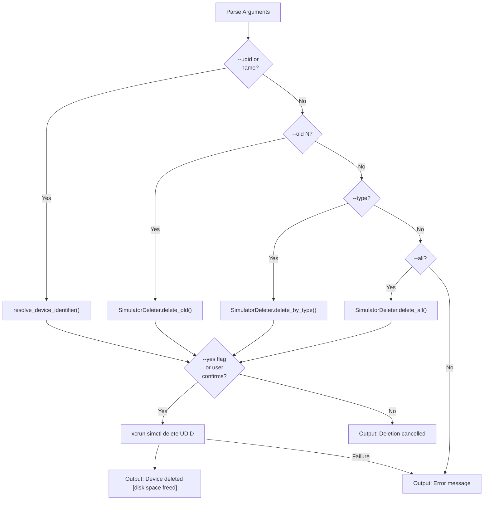
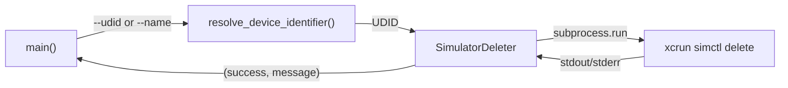

<!-- source: DeepWiki mcp.deepwiki.com · repo conorluddy/ios-simulator-skill · page 9.4 simctl_delete.py · fetched 2026-10-26 -->

# simctl_delete.py

<details>
<summary>Relevant source files</summary>

The following files were used as context for generating this wiki page:

- [ios-simulator-skill/skills/ios-simulator-skill/scripts/simctl_delete.py](ios-simulator-skill/skills/ios-simulator-skill/scripts/simctl_delete.py)

</details>


This page documents `simctl_delete.py`, a Device Lifecycle Management script that permanently deletes iOS simulator instances from the system. The script provides safe deletion with confirmation prompts, supports batch operations, and implements smart deletion strategies to maintain a clean simulator environment.

For creating simulators, see [simctl_create.py](ios-simulator-skill/scripts/simctl_create.py:1-10)(). For factory resetting simulators without deletion, see [simctl_erase.py](ios-simulator-skill/scripts/simctl_erase.py:1-10)(). For other lifecycle operations, see [Device Lifecycle Scripts](ios-simulator-skill/scripts/simctl_boot.py:1-10)().

---

## Purpose and Scope

`simctl_delete.py` wraps the `xcrun simctl delete` command to permanently remove simulator instances from the macOS system. The script extends the basic simctl functionality with:

- **Safety confirmations** - Prevents accidental deletion with interactive prompts [ios-simulator-skill/scripts/simctl_delete.py:47-55]().
- **Flexible targeting** - Delete by UDID, device name, or batch criteria [ios-simulator-skill/scripts/simctl_delete.py:218-225]().
- **Smart deletion** - Keep N most recent simulators per device type, delete the rest [ios-simulator-skill/scripts/simctl_delete.py:154-167]().
- **Report freed disk space** - Provides feedback on the operation's impact [ios-simulator-skill/scripts/simctl_delete.py:66-66]().

The script does not delete the simulator until explicitly confirmed (unless the `--yes` flag is used). Deletion is permanent and cannot be undone.

**Sources:** [ios-simulator-skill/scripts/simctl_delete.py:1-13]()

---

## Deletion Modes

The script supports four distinct deletion modes, processed in order of specificity:

| Mode | Trigger | Behavior | Safety |
|------|---------|----------|--------|
| **Single Device** | `--udid` or `--name` | Delete one specific simulator [ios-simulator-skill/scripts/simctl_delete.py:33-45]() | Confirmation required |
| **Smart Deletion** | `--old N` | Keep N newest per device type, delete rest [ios-simulator-skill/scripts/simctl_delete.py:154-167]() | Confirmation required |
| **Type Filter** | `--type DEVICE_TYPE` | Delete all simulators matching type [ios-simulator-skill/scripts/simctl_delete.py:111-124]() | Confirmation required |
| **All Devices** | `--all` | Delete all available simulators [ios-simulator-skill/scripts/simctl_delete.py:73-84]() | Confirmation required |

All modes respect the `--yes` flag to skip interactive confirmation prompts in automated environments [ios-simulator-skill/scripts/simctl_delete.py:227-231]().

**Sources:** [ios-simulator-skill/scripts/simctl_delete.py:215-245]()

---

## Command-Line Interface

### Deletion Flow Diagram



**Sources:** [ios-simulator-skill/scripts/simctl_delete.py:215-275](), [ios-simulator-skill/scripts/simctl_delete.py:33-71]()

### Arguments Reference

```
Required (one of):
  --udid UDID               Device UDID or name
  --name NAME               Device name (alternative to --udid)
  --all                     Delete all simulators
  --type DEVICE_TYPE        Delete all simulators of specific type (e.g., "iPhone")
  --old N                   Delete older simulators, keeping most recent N per type

Optional:
  --yes                     Skip confirmation prompt
  --json                    Output results in JSON format
  --verbose                 Detailed output
```

**Sources:** [ios-simulator-skill/scripts/simctl_delete.py:217-245]()

---

## Safety Mechanisms

### Interactive Confirmation

By default, the script requires user confirmation before deleting any simulators [ios-simulator-skill/scripts/simctl_delete.py:47-53](). The confirmation prompt displays the UDID or the count of simulators to be deleted.

Example confirmation prompt:
```
Permanently delete simulator ABC-123-DEF? (type 'yes' to confirm): 
```

### Automation Mode

The `--yes` flag bypasses the confirmation prompt for CI/CD environments [ios-simulator-skill/scripts/simctl_delete.py:227-231](). When `confirm=True` is passed to the `delete()` method, the interactive `input()` block is skipped [ios-simulator-skill/scripts/simctl_delete.py:47-48]().

**Sources:** [ios-simulator-skill/scripts/simctl_delete.py:47-56]()

---

## Smart Deletion Strategy

The `delete_old(keep_count, confirm)` method implements a cleanup strategy that maintains a specific number of recent simulators per device type [ios-simulator-skill/scripts/simctl_delete.py:154-167]().

### Algorithm

1. **List All**: Call `list_simulators(state=None)` to get all devices [ios-simulator-skill/scripts/simctl_delete.py:168]().
2. **Group**: Organize simulators by their `type` field [ios-simulator-skill/scripts/simctl_delete.py:171-176]().
3. **Sort**: Within each group, sort simulators by `runtime` (iOS version) in reverse order (newest first) [ios-simulator-skill/scripts/simctl_delete.py:182]().
4. **Select**: Mark all simulators after the first `keep_count` for deletion [ios-simulator-skill/scripts/simctl_delete.py:184]().
5. **Execute**: Iterate through candidates and call `delete(confirm=True)` [ios-simulator-skill/scripts/simctl_delete.py:204-212]().

**Sources:** [ios-simulator-skill/scripts/simctl_delete.py:154-212]()

---

## Implementation Architecture

### Class Structure: SimulatorDeleter

| Method | Role | Data Flow |
|--------|------|-----------|
| `__init__(udid)` | Stores target UDID | Sets `self.udid` [ios-simulator-skill/scripts/simctl_delete.py:29-31]() |
| `delete(confirm)` | Executes `simctl delete` | Calls `subprocess.run` with `xcrun simctl delete` [ios-simulator-skill/scripts/simctl_delete.py:59-60]() |
| `delete_all(confirm)` | Batch delete all devices | Loops through `list_simulators()` and instantiates `SimulatorDeleter` [ios-simulator-skill/scripts/simctl_delete.py:73-108]() |
| `delete_by_type(type, confirm)` | Filtered batch delete | Filters `list_simulators()` by name match [ios-simulator-skill/scripts/simctl_delete.py:111-151]() |
| `delete_old(keep, confirm)` | Smart cleanup | Groups by type, sorts by runtime, deletes older ones [ios-simulator-skill/scripts/simctl_delete.py:154-212]() |

### Data Flow Diagram



**Sources:** [ios-simulator-skill/scripts/simctl_delete.py:26-212](), [ios-simulator-skill/scripts/simctl_delete.py:215-280]()

---

## Integration with Utilities

### Device Resolution via device_utils.py

The script relies on `common.device_utils` for identifying targets:

- `resolve_device_identifier(udid_or_name)`: Used in `main()` to convert user input into a valid UDID [ios-simulator-skill/scripts/simctl_delete.py:252]().
- `list_simulators(state=None)`: Used in batch methods (`delete_all`, `delete_by_type`, `delete_old`) to fetch the full simulator inventory [ios-simulator-skill/scripts/simctl_delete.py:84, 122, 168]().

**Sources:** [ios-simulator-skill/scripts/simctl_delete.py:20-23]()

---

## Simctl Integration

The script executes the following command structure via `subprocess.run`:

```python
cmd = ["xcrun", "simctl", "delete", self.udid]
result = subprocess.run(cmd, check=False, capture_output=True, text=True, timeout=60)
```

It captures `stderr` and `stdout` to provide detailed error messages if the `returncode` is non-zero [ios-simulator-skill/scripts/simctl_delete.py:62-64]().

**Sources:** [ios-simulator-skill/scripts/simctl_delete.py:58-71]()

---

## Error Handling

`SimulatorDeleter.delete()` includes specific exception handling:

- **TimeoutExpired**: Catches commands that hang for more than 60 seconds [ios-simulator-skill/scripts/simctl_delete.py:68-69]().
- **General Exceptions**: Catches unexpected system errors during execution [ios-simulator-skill/scripts/simctl_delete.py:70-71]().
- **KeyboardInterrupt**: Gracefully handles user cancellation during the confirmation prompt [ios-simulator-skill/scripts/simctl_delete.py:54-55]().

**Sources:** [ios-simulator-skill/scripts/simctl_delete.py:47-71]()

---

