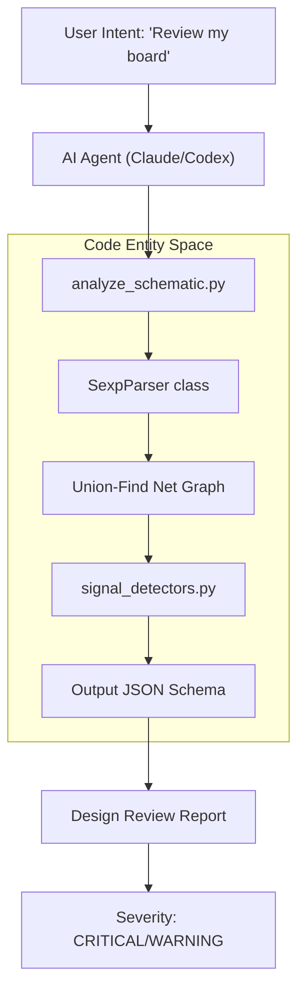
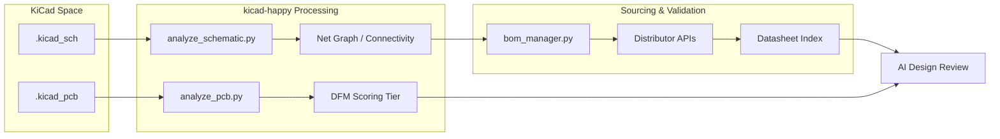

<!-- source: DeepWiki mcp.deepwiki.com · repo aklofas/kicad-happy · page 1 Overview · fetched 2026-10-26 -->

# Overview

Relevant source files

The following files were used as context for generating this wiki page:

- [README.md](README.md)
- [how-it-works.md](how-it-works.md)
- [skills/kicad/SKILL.md](skills/kicad/SKILL.md)

`kicad-happy` is a suite of AI coding agent skills designed to transform terminal-based LLMs (like Claude Code or OpenAI Codex) into specialized electronics design assistants. By bridging the gap between unstructured natural language and the rigid S-expression schemas of KiCad, it enables automated schematic analysis, PCB layout review, and BOM management.

The system relies on a "Deterministic Extraction + AI Reasoning" architecture. Pure Python scripts parse EDA files into high-fidelity JSON, which the AI then cross-references against manufacturer datasheets and industry standards (IPC/IEC) to produce professional-grade design reviews.

## System Architecture

The workflow is divided into a six-step pipeline that ensures data integrity by separating the extraction of "facts" from the "reasoning" performed by the LLM.

### The Analysis Pipeline

1.  **Parse**: S-expression files are converted into generic trees [how-it-works.md:21-23]().
2.  **Extract**: Components, hierarchical sheets, and properties are indexed [how-it-works.md:25-28]().
3.  **Detect**: 21 specialized signal path detectors identify subcircuits (regulators, filters, etc.) [how-it-works.md:31-45]().
4.  **Ground**: The agent fetches real-world datasheets via distributor APIs [how-it-works.md:53-58]().
5.  **Review**: AI cross-references the extracted netlist against datasheet specifications [how-it-works.md:59-67]().
6.  **Decide**: A structured report is generated with severity-categorized findings [how-it-works.md:69-71]().

### Natural Language to Code Entity Mapping

The following diagram maps high-level user intents to the underlying Python entities and data structures.

**Intent-to-Entity Mapping**

Sources: [skills/kicad/SKILL.md:38-49](), [how-it-works.md:5-16](), [how-it-works.md:19-51]()

## Core Capabilities

The project is organized into several "skills" that can be symlinked into an agent's environment [README.md:41-46]().

| Skill | Primary Code Entities | Purpose |
| :--- | :--- | :--- |
| **kicad** | `analyze_schematic.py`, `analyze_pcb.py` | Parses `.kicad_sch` and `.kicad_pcb` into structured data. |
| **bom** | `bom_manager.py`, `edit_properties.py` | Manages the 11-step BOM lifecycle and MPN synchronization. |
| **distributors** | `digikey`, `mouser`, `lcsc`, `element14` | API integration for part sourcing and datasheet retrieval. |
| **fab** | `jlcpcb`, `pcbway` | Validates designs against manufacturer-specific DFM limits. |

For details on the underlying logic, see [Project Purpose and Architecture](#1.1).

## AI-Assisted EDA Workflow

`kicad-happy` fits into the design cycle by providing a "second pair of eyes" before fabrication. It automates tedious checks like calculating voltage divider outputs, verifying regulator feedback resistors against $V_{ref}$ lookups, and checking decoupling capacitor proximity.

**Workflow Integration**

Sources: [README.md:91-117](), [skills/kicad/SKILL.md:54-70](), [how-it-works.md:59-67]()

## Navigation Map

This wiki is structured to guide you from initial setup to advanced design analysis:

*   **[Project Purpose and Architecture](#1.1)**: Deep dive into the deterministic parsing philosophy and the six-step pipeline.
*   **[Getting Started and Installation](#1.2)**: Guide on symlinking skills, setting up API keys (DigiKey, Mouser), and running your first analysis.
*   **[Example Design Review Report](#1.3)**: A walkthrough of an analysis of an ESP32-S3 board, showcasing the power tree and signal findings.
*   **[KiCad Analysis Scripts](#2)**: Technical details on the Python analyzers, S-expression parsing, and the 21 signal path detectors.
*   **[BOM Management](#4)**: How to use the BOM skill to sync MPNs and generate order files.
*   **[Component Sourcing and Datasheet Skills](#5)**: Documentation for the distributor API integrations and datasheet synchronization.
*   **[Testing and Validation](#6)**: Overview of the 1,000+ project test corpus and regression testing framework.

Sources: [README.md:9-20](), [README.md:34-68](), [skills/kicad/SKILL.md:8-20]()

---

