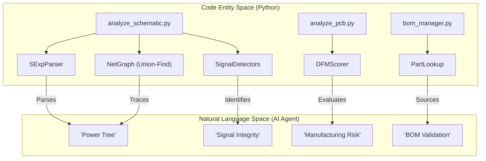
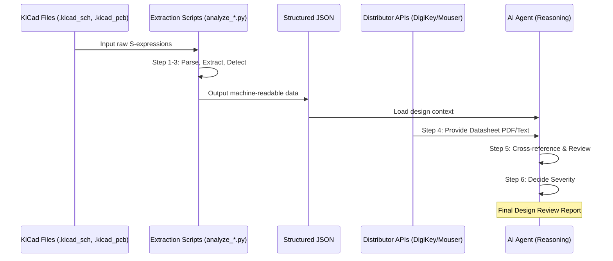

<!-- source: DeepWiki mcp.deepwiki.com · repo aklofas/kicad-happy · page 1.1 Project Purpose and Architecture · fetched 2026-10-26 -->

# Project Purpose and Architecture

Relevant source files

The following files were used as context for generating this wiki page:

- [README.md](README.md)
- [how-it-works.md](how-it-works.md)

The `kicad-happy` project provides a suite of AI coding agent skills designed to transform a terminal-based agent (such as Claude Code or OpenAI Codex) into a specialized electronics design assistant [README.md:1-7](). The core philosophy is the strict separation of **deterministic data extraction** from **probabilistic AI reasoning** [how-it-works.md:5-15](). By using pure Python scripts to parse KiCad files into structured JSON, the system provides an auditable foundation that eliminates the hallucinations typically associated with LLMs processing raw CAD files.

### The Core Architecture: Separation of Concerns

The architecture is divided into two distinct layers:

1.  **Extraction Layer (Deterministic Python):** A set of analyzers that parse KiCad S-expressions and Gerber files. These scripts use standard algorithms (like Union-Find for net connectivity) to produce a "machine-readable" ground truth [how-it-works.md:7-15]().
2.  **Reasoning Layer (AI Agent):** The agent consumes the structured JSON, cross-references it with manufacturer datasheets fetched via distributor APIs, and applies engineering judgment to identify design flaws [how-it-works.md:59-68]().

#### System Entity Map: From Code to Natural Language
The following diagram illustrates how specific Python classes and functions in the codebase map to the high-level concepts used by the AI agent during a design review.

**Diagram: Entity Mapping (Code Space to Reasoning Space)**

**Sources:** [how-it-works.md:19-51](), [README.md:11-20]()

---

### The Six-Step Analysis Pipeline

The end-to-end workflow follows a rigorous six-step pipeline to ensure accuracy and depth in the final design review.

#### 1. Parse (S-Expression Traversal)
The `analyze_schematic.py` script reads `.kicad_sch` files. It utilizes a generic `SExpParser` to handle KiCad versions 5 through 9 by focusing on the S-expression structure rather than a fixed schema [how-it-works.md:21-24](). It performs a breadth-first traversal of hierarchical sheets, remapping reference designators for multi-instance sub-sheets [how-it-works.md:25-26]().

#### 2. Extract (Component & Connectivity)
The analyzer extracts every component, including its value, footprint, and MPN [how-it-works.md:27-28](). Simultaneously, it builds a **Net Graph** using a union-find algorithm on pin coordinates. Points within 0.01mm are merged, and labels are unioned with the wires they touch to resolve net names [how-it-works.md:29-30]().

#### 3. Detect (Signal Path Identification)
A suite of 21 deterministic signal path detectors scans the net graph for specific circuit topologies [how-it-works.md:31-45]().
*   **Voltage Dividers:** Finds resistor pairs to compute ratios.
*   **Regulators:** Identifies ICs and their feedback networks to calculate $V_{out}$ based on $V_{ref}$ [how-it-works.md:37]().
*   **Buses:** Detects I2C, SPI, and CAN interfaces, including termination and pull-up checks [how-it-works.md:44]().

#### 4. Ground (Datasheet Integration)
The agent uses distributor skills (`digikey`, `mouser`, `lcsc`) to download PDFs for every component with a Manufacturer Part Number (MPN) [how-it-works.md:54-55](). This "grounds" the analysis in physical reality, allowing the agent to check if a design's calculated values (e.g., a 14.95V rail) match the actual component specifications (e.g., a 12V regulator) [how-it-works.md:57-59]().

#### 5. Review (Cross-Reference)
The agent performs a multi-domain verification:
*   **Schematic vs. PCB:** Ensures all nets are routed and decoupling caps are physically near their IC supply pins [how-it-works.md:65]().
*   **DFM Assessment:** The `analyze_pcb.py` script calculates tombstoning risks and thermal via adequacy [how-it-works.md:80-84]().

#### 6. Decide (Categorized Findings)
The final output is a structured report. Findings are categorized by severity: `CRITICAL`, `WARNING`, or `SUGGESTION` [how-it-works.md:67]().

**Diagram: Data Flow and Pipeline Logic**

**Sources:** [how-it-works.md:17-72]()

---

### Avoiding Hallucination

The "hallucination gap" in AI EDA tools is typically caused by the model attempting to "read" complex CAD files directly. `kicad-happy` avoids this through three specific architectural choices:

| Feature | Implementation | Anti-Hallucination Benefit |
| :--- | :--- | :--- |
| **Deterministic Extraction** | `analyze_schematic.py` uses coordinate-based Union-Find [how-it-works.md:29](). | The agent doesn't "guess" connections; it receives a verified netlist. |
| **Auditable Data** | The intermediate JSON is human-readable [how-it-works.md:15](). | Users can verify the "ground truth" used by the AI. |
| **Reference Grounding** | Automatic datasheet fetching via `sync_datasheets.py` [README.md:15-18](). | The AI's conclusions are based on manufacturer specs, not its internal weights. |

**Sources:** [how-it-works.md:5-16](), [README.md:11-20]()

---

