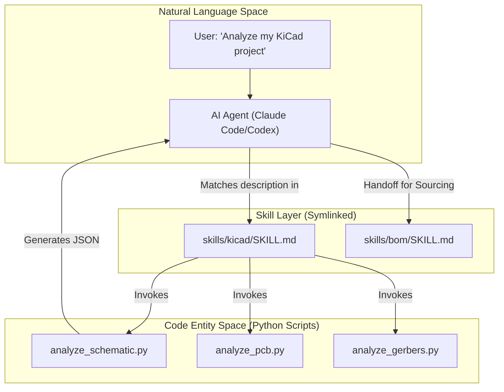
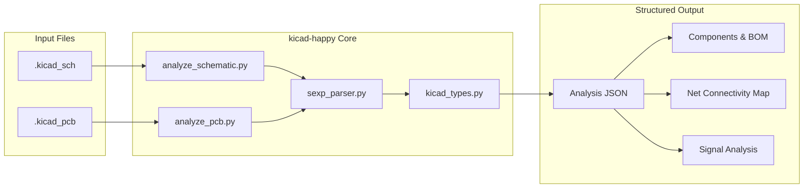

<!-- source: DeepWiki mcp.deepwiki.com · repo aklofas/kicad-happy · page 1.2 Getting Started and Installation · fetched 2026-10-26 -->

# Getting Started and Installation

<details>
<summary>Relevant source files</summary>

The following files were used as context for generating this wiki page:

- [.claude-plugin/plugin.json](.claude-plugin/plugin.json)
- [.codex-plugin/plugin.json](.codex-plugin/plugin.json)
- [README.md](README.md)
- [skills/kicad/SKILL.md](skills/kicad/SKILL.md)
- [skills/kicad/references/pdf-schematic-extraction.md](skills/kicad/references/pdf-schematic-extraction.md)

</details>


This page provides a technical guide for installing and configuring the `kicad-happy` skills for use with AI coding agents like Claude Code and OpenAI Codex. It covers the symlink-based installation architecture, API credential management for distributor integration, and the execution of initial design analyses.

## Installation Architecture

The `kicad-happy` toolkit is designed as a collection of "skills"—modular directories containing logic that an AI agent can execute. Installation relies on a symlink convention where the agent's local configuration directory points to the `skills/` subdirectory within the cloned repository.

### Skill Symlink Convention

AI agents typically look for executable skills in specific hidden directories within the user's home folder or project root. By symlinking rather than copying, any updates pulled via `git` are immediately available to the agent.

| Agent | Global Skill Path | Project-Specific Path |
| :--- | :--- | :--- |
| **Claude Code** | `~/.claude/skills/` | `<project-root>/.claude/skills/` |
| **OpenAI Codex** | `~/.codex/skills/` | `<project-root>/.codex/skills/` |

**Manual Installation Steps:**
1. Clone the repository: `git clone https://github.com/aklofas/kicad-happy.git` [README.md:38-39]()
2. Create the target directory: `mkdir -p ~/.claude/skills` [README.md:42]()
3. Symlink the desired skills:
```bash
for skill in kicad bom digikey mouser lcsc element14 jlcpcb pcbway; do
  ln -sf "$(pwd)/skills/$skill" ~/.claude/skills/$skill
done
```
[README.md:43-45]()

### System Dependencies
The core analysis scripts are written in pure Python 3 and have no mandatory external dependencies for basic KiCad file parsing [README.md:72](). However, advanced features require specific packages:

*   **`requests`**: Used for robust HTTP/2 handling during datasheet downloads [README.md:74]().
*   **`playwright`**: Required for JavaScript-heavy manufacturer sites (e.g., Broadcom, Espressif) [README.md:75]().
*   **`pdftotext` (poppler-utils)**: Enhances text extraction accuracy when validating component values against PDF datasheets [README.md:76]().

**Sources:** [README.md:22-68](), [README.md:70-77]()

---

## Configuration and API Keys

While the `kicad` skill functions without external access, the sourcing and datasheet skills (`digikey`, `mouser`, `element14`) perform best when configured with API credentials. Without these, the agent falls back to standard web searches, which may be less precise [README.md:80]().

### Distributor API Integration

| Distributor | Environment Variable | Auth Method |
| :--- | :--- | :--- |
| **DigiKey** | `DIGIKEY_CLIENT_ID`, `DIGIKEY_CLIENT_SECRET` | OAuth 2.0 [README.md:86]() |
| **Mouser** | `MOUSER_SEARCH_API_KEY` | Search API Key [README.md:87]() |
| **element14** | `ELEMENT14_API_KEY` | Partner API Key [README.md:88]() |
| **LCSC** | N/A | Community API (`jlcsearch`) [README.md:89]() |

### Data Flow: Natural Language to Code Execution

The following diagram illustrates how a user request triggers the skill infrastructure, moving from the AI's natural language understanding into the specific Python execution environment.

**Skill Execution Path**

**Sources:** [skills/kicad/SKILL.md:1-20](), [skills/kicad/SKILL.md:38-50](), [README.md:91-95]()

---

## Running the First Analysis

Once installed, the primary entry point is the `analyze_schematic.py` script. The agent typically invokes this script to generate a structured JSON representation of the hardware design, which it then interprets to provide a human-readable review.

### Execution Flow

1.  **Parsing**: The script reads `.kicad_sch` (S-expression) or legacy `.sch` files [skills/kicad/SKILL.md:56-73]().
2.  **Extraction**: It extracts components, nets, and hierarchical sheet data [skills/kicad/SKILL.md:58-60]().
3.  **Detection**: Automated subcircuit detectors identify regulators, filters, and communication buses [skills/kicad/SKILL.md:61-66]().
4.  **Grounding**: The agent cross-references the extracted MPNs (Manufacturer Part Numbers) with distributor APIs to verify specifications [skills/kicad/SKILL.md:20]().

### Analysis Initialization Diagram

This diagram bridges the gap between the high-level analysis command and the specific data structures created in the `kicad-happy` codebase.

**Analysis Data Flow**


**Sources:** [skills/kicad/SKILL.md:54-71](), [README.md:97-116](), [skills/kicad/SKILL.md:38-50]()

### Verification Command
To verify the installation and view the available data schema, run the analyzer with the `--schema` flag. This outputs the exact field names and types that the AI agent uses for reasoning:

```bash
python3 skills/kicad/scripts/analyze_schematic.py --schema
```
[skills/kicad/SKILL.md:44-46]()

**Sources:** [skills/kicad/SKILL.md:40-52]()

---

