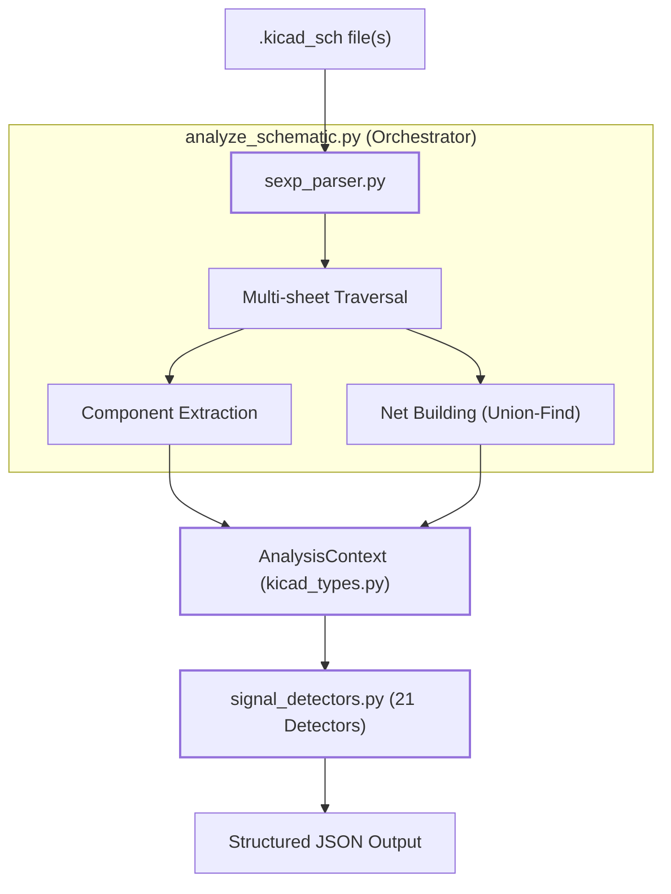

<!-- source: DeepWiki mcp.deepwiki.com · repo aklofas/kicad-happy · page 2.1 Schematic Analyzer (analyze_schematic.py) · fetched 2026-10-26 -->

# Schematic Analyzer (analyze_schematic.py)

Relevant source files

The following files were used as context for generating this wiki page:

- [.gitignore](.gitignore)
- [skills/element14/scripts/sync_datasheets_element14.py](skills/element14/scripts/sync_datasheets_element14.py)
- [skills/kicad/references/manual-pcb-parsing.md](skills/kicad/references/manual-pcb-parsing.md)
- [skills/kicad/references/manual-schematic-parsing.md](skills/kicad/references/manual-schematic-parsing.md)
- [skills/kicad/references/schematic-analysis.md](skills/kicad/references/schematic-analysis.md)
- [skills/kicad/scripts/analyze_schematic.py](skills/kicad/scripts/analyze_schematic.py)
- [skills/kicad/scripts/methodology_pcb.md](skills/kicad/scripts/methodology_pcb.md)
- [skills/kicad/scripts/methodology_schematic.md](skills/kicad/scripts/methodology_schematic.md)

The Schematic Analyzer is the primary extraction engine for KiCad schematic data. It performs a single-pass, deterministic crawl of `.kicad_sch` (and legacy `.sch`) files to transform graphical CAD data into a structured JSON representation. This output serves as the "ground truth" for subsequent AI-assisted design reviews and BOM management.

## Purpose and Scope

The analyzer provides a data extraction layer that avoids opinionated Design Rule Checking (DRC) in favor of neutral observations [skills/kicad/scripts/methodology_schematic.md:5-13](). Its primary goal is to provide a complete connectivity graph and component inventory, including:
- **Component Inventory:** BOM properties, footprints, and absolute positions.
- **Net Connectivity:** A resolved graph of all wires, labels, and power symbols.
- **Subcircuit Identification:** Automated detection of common circuit patterns (e.g., regulators, filters).
- **Design Statistics:** Component counts, net counts, and sheet hierarchy metadata.

### System Architecture

The analysis pipeline follows a modular approach to separate parsing from circuit logic:

Sources: [skills/kicad/scripts/methodology_schematic.md:17-34]()

---

## Core Analysis Pipeline

### 1. S-Expression Parsing
The analyzer utilizes `sexp_parser.py` to convert KiCad's Lisp-like S-expression format into nested Python lists [skills/kicad/scripts/methodology_schematic.md:50-68](). This parser is schema-agnostic, treating all values as strings to maintain compatibility across KiCad versions 5 through 10 [skills/kicad/scripts/methodology_schematic.md:70-72]().

### 2. Hierarchical Sheet Traversal
KiCad designs often span multiple files. The analyzer performs a breadth-first traversal starting from the root sheet [skills/kicad/scripts/methodology_schematic.md:80-88]():
- **Multi-Instance Support:** If a sub-sheet is used multiple times (e.g., a multi-channel amplifier), the analyzer tracks unique instance UUIDs and remaps reference designators (e.g., `R1` becomes `R101` in instance 1) [skills/kicad/scripts/methodology_schematic.md:89-100]().
- **Sheet Isolation:** Elements are tagged with a `_sheet` index to prevent coordinate collisions between different physical pages [skills/kicad/scripts/methodology_schematic.md:102-105]().

### 3. Component and Pin Extraction
Each `(symbol ...)` block is converted into a component dictionary. A critical step is the **Pin Position Computation**, which transforms relative library coordinates into absolute schematic coordinates [skills/kicad/scripts/analyze_schematic.py:101-107]().
- **Transforms:** The logic accounts for symbol rotation, X/Y mirroring, and Y-axis inversion [skills/kicad/scripts/methodology_schematic.md:129-138]().
- **Multi-Unit Handling:** For components like quad op-amps or MCUs with separate power/IO units, the analyzer merges unit-specific pins with "Unit 0" pins (shared power/ground) [skills/kicad/scripts/analyze_schematic.py:144-159]().

### 4. Property Normalization
Because KiCad allows arbitrary field names, the analyzer uses fuzzy matching to extract Manufacturer Part Numbers (MPN) and distributor information. It checks common aliases like `mfr_no`, `part#`, or `digikey-pn` to populate the final BOM data [skills/kicad/scripts/analyze_schematic.py:63-87]().

---

## Connectivity and Signal Detection

The analyzer goes beyond simple netlisting by attempting to understand the *function* of the circuitry.

### Net Graph Construction
Connectivity is resolved using a **Union-Find algorithm** based on coordinate snapping. For a deep dive into how wires, junctions, and labels are merged into nets, see **[Net Building and Connectivity Resolution](#2.1.2)**.

### Signal Path Detectors
Once the net graph is built, the analyzer runs 21 specialized detectors from `signal_detectors.py` [skills/kicad/scripts/methodology_schematic.md:43](). These identify:
- **Power Trees:** LDOs, DC/DC converters, and voltage dividers.
- **Signal Integrity:** RC/LC filters, decoupling capacitor coverage, and I2C/SPI bus pull-ups.
- **Complex Blocks:** Op-amp configurations, transistor switches, and crystal oscillators.

For a complete list of patterns and detection logic, see **[Signal Path Detectors](#2.1.1)**.

---

## Output Schema

The final JSON output provides a comprehensive snapshot of the design state.

| Section | Description |
| :--- | :--- |
| `metadata` | Project name, KiCad version, and sheet count. |
| `components` | List of all parts with resolved MPNs, values, and pin-to-net mappings. |
| `nets` | Map of net names to the list of pins and labels connected to them. |
| `signal_analysis` | Results from the 21 detectors (e.g., `voltage_dividers`, `regulators`). |
| `design_observations` | Heuristic-based findings (e.g., "Missing decoupling on U1"). |

Sources: [skills/kicad/scripts/analyze_schematic.py:5-10](), [skills/kicad/references/schematic-analysis.md:34-38]()

---

## Child Pages

- **[Signal Path Detectors](#2.1.1)**: Details on the 21 circuit pattern recognition functions.
- **[Net Building and Connectivity Resolution](#2.1.2)**: Technical explanation of the spatial union-find and label scoping rules.

---

