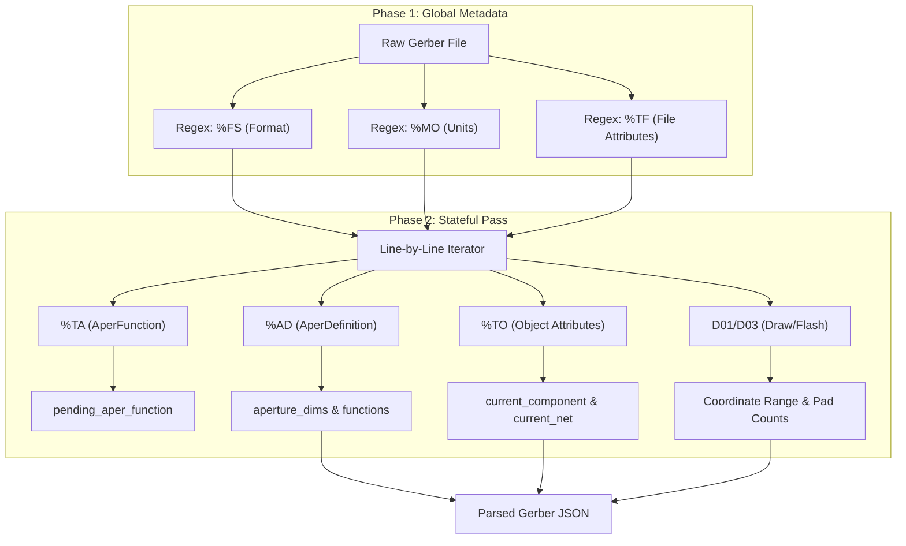
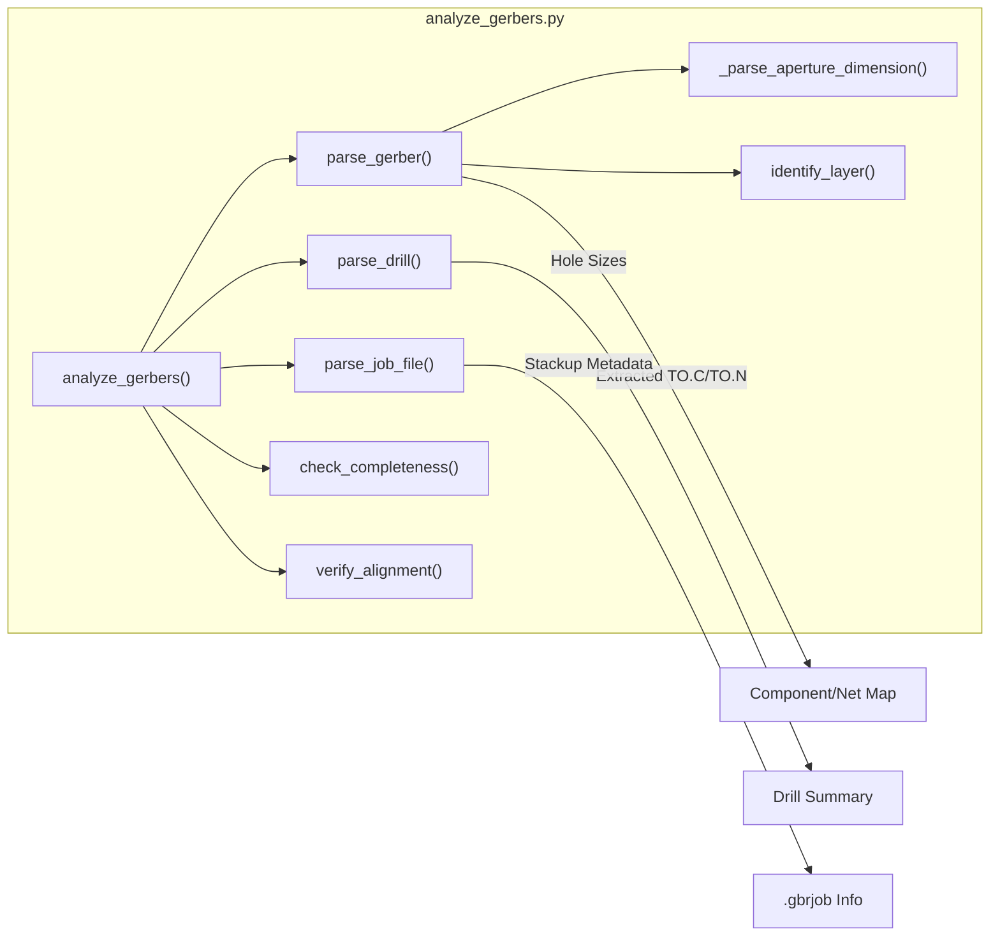

<!-- source: DeepWiki mcp.deepwiki.com · repo aklofas/kicad-happy · page 2.3 Gerber Analyzer (analyze_gerbers.py) · fetched 2026-10-26 -->

# Gerber Analyzer (analyze_gerbers.py)

Relevant source files

The following files were used as context for generating this wiki page:

- [skills/kicad/references/file-formats.md](skills/kicad/references/file-formats.md)
- [skills/kicad/references/gerber-parsing.md](skills/kicad/references/gerber-parsing.md)
- [skills/kicad/references/manual-gerber-parsing.md](skills/kicad/references/manual-gerber-parsing.md)
- [skills/kicad/references/standards-compliance.md](skills/kicad/references/standards-compliance.md)
- [skills/kicad/scripts/analyze_gerbers.py](skills/kicad/scripts/analyze_gerbers.py)
- [skills/kicad/scripts/kicad_types.py](skills/kicad/scripts/kicad_types.py)
- [skills/kicad/scripts/methodology_gerbers.md](skills/kicad/scripts/methodology_gerbers.md)

The Gerber Analyzer provides a comprehensive single-pass extraction pipeline for Gerber RS-274X and Excellon drill files. It serves as the final verification layer in the `kicad-happy` workflow, ensuring that the machine-readable fabrication outputs—which are what a manufacturer actually receives—match the design intent captured in the schematic and PCB layout files [skills/kicad/scripts/analyze_gerbers.py:3-19]().

## Gerber Parsing Pipeline

The core of the analyzer is a stateful RS-274X parser that extracts structural metadata, aperture definitions, and X2 extended attributes. The process is split into two phases to ensure coordinate data is interpreted correctly based on header definitions [skills/kicad/scripts/analyze_gerbers.py:36-45]().

### Data Flow and State Machine
The parser maintains a state machine to track the "current" context (aperture, component, net) as it traverses the file. This allows it to attribute specific flashes or draws to logical board entities like "R1" or "GND" [skills/kicad/scripts/analyze_gerbers.py:105-111]().

**Gerber Extraction Architecture**

Sources: [skills/kicad/scripts/analyze_gerbers.py:66-180](), [skills/kicad/scripts/methodology_gerbers.md:56-70]()

### X2 Attribute Extraction
The analyzer extracts three levels of X2 attributes to reconstruct the design's netlist and component placement directly from the Gerber files:

1.  **File Attributes (TF):** Used for layer identification (e.g., `FileFunction,Copper,L1,Top`) and software identification [skills/kicad/scripts/analyze_gerbers.py:85-93]().
2.  **Aperture Attributes (TA):** Classifies apertures as `SMDPad`, `ViaPad`, or `Conductor`. This is critical for minimum feature size analysis [skills/kicad/scripts/analyze_gerbers.py:119-145]().
3.  **Object Attributes (TO):** Maps specific flashes to component references (`TO.C`), net names (`TO.N`), and pins (`TO.P`) [skills/kicad/scripts/analyze_gerbers.py:154-179]().

The script supports both modern `%TF...%` syntax and the legacy KiCad 5 `G04 #@! TF...` comment format [skills/kicad/scripts/analyze_gerbers.py:89-93]().

Sources: [skills/kicad/scripts/analyze_gerbers.py:84-112](), [skills/kicad/references/gerber-parsing.md:197-205]()

## Layer Identification and Completeness

The analyzer identifies layers using a prioritized heuristic: X2 `FileFunction` attributes first, followed by KiCad 5 comment strings, and finally filename pattern matching [skills/kicad/scripts/analyze_gerbers.py:330-350]().

### Verification Checks
*   **Completeness:** The script compares detected layers against the `.gbrjob` file or a set of standard defaults (Copper, Mask, Silk, Paste, Edge) to identify missing files [skills/kicad/scripts/analyze_gerbers.py:440-460]().
*   **Alignment:** It verifies that the `coordinate_range` (bounding box) of all copper, mask, and silk layers are consistent. Significant deviations suggest misaligned exports [skills/kicad/scripts/analyze_gerbers.py:465-485]().
*   **Staleness:** If a `.zip` archive exists in the directory, the script compares its timestamp against the individual `.gbr` files to warn if the archive is out of date [skills/kicad/scripts/analyze_gerbers.py:490-510]().

Sources: [skills/kicad/scripts/analyze_gerbers.py:6-15](), [skills/kicad/scripts/methodology_gerbers.md:180-200]()

## Drill Classification (Excellon)

The `parse_drill` function processes Excellon files to extract hole sizes and counts [skills/kicad/scripts/analyze_gerbers.py:220-250]().

### Tool and Hole Analysis
Holes are classified based on the tool definition and the presence of "plated" (PTH) vs "non-plated" (NPTH) attributes in the header [skills/kicad/scripts/analyze_gerbers.py:260-280]().

| Feature | Extraction Method |
| :--- | :--- |
| **Units** | Detected via `METRIC` or `INCH` keywords [skills/kicad/scripts/analyze_gerbers.py:225-230]() |
| **Tool Size** | Parsed from `TnnCddd.ddd` definitions [skills/kicad/scripts/analyze_gerbers.py:235-240]() |
| **Hole Count** | Incremented for every `X...Y...` coordinate following a tool selection [skills/kicad/scripts/analyze_gerbers.py:285-300]() |
| **Plating** | Determined by file context (e.g., `-PTH.drl` vs `-NPTH.drl`) or header flags [skills/kicad/scripts/analyze_gerbers.py:310-320]() |

Sources: [skills/kicad/scripts/analyze_gerbers.py:220-325](), [skills/kicad/scripts/methodology_gerbers.md:137-150]()

## Technical Implementation Summary

**Key Functions and Classes**
| Entity | Role |
| :--- | :--- |
| `parse_gerber(path)` | Main entry point for RS-274X parsing; implements the two-phase state machine [skills/kicad/scripts/analyze_gerbers.py:36]() |
| `parse_drill(path)` | Parses Excellon drill files, extracting tool diameters and hole counts [skills/kicad/scripts/analyze_gerbers.py:220]() |
| `analyze_gerbers(dir)` | Orchestrates the full directory scan, job file parsing, and completeness/alignment checks [skills/kicad/scripts/analyze_gerbers.py:380]() |
| `_parse_aperture_dimension()` | Normalizes dimensions across Circle, Rect, and Obround types into mm [skills/kicad/scripts/analyze_gerbers.py:139]() |

**Code Entity Interaction Map**

Sources: [skills/kicad/scripts/analyze_gerbers.py:36-400](), [skills/kicad/scripts/methodology_gerbers.md:34-45]()

---

