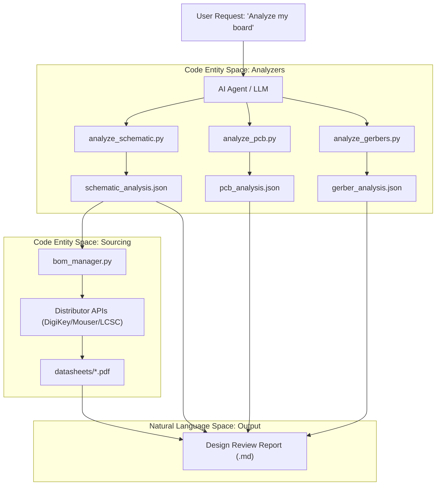
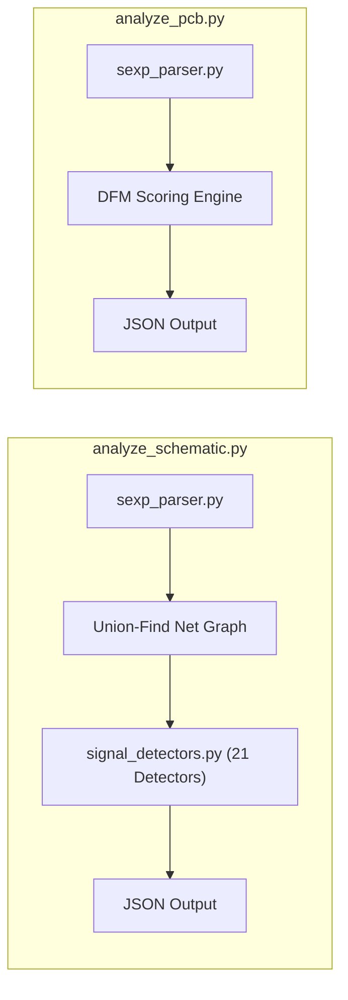

<!-- source: DeepWiki mcp.deepwiki.com · repo aklofas/kicad-happy · page 3 Design Review Workflow · fetched 2026-10-26 -->

# Design Review Workflow

Relevant source files

The following files were used as context for generating this wiki page:

- [how-it-works.md](how-it-works.md)
- [skills/kicad/SKILL.md](skills/kicad/SKILL.md)
- [skills/kicad/references/report-generation.md](skills/kicad/references/report-generation.md)

The design review workflow in `kicad-happy` is a structured, four-step process that transforms raw KiCad EDA files into a comprehensive engineering report. It relies on a "data-first" philosophy where deterministic Python scripts extract design intent into JSON, which is then reasoned about by an AI agent or a human reviewer.

## High-Level Process Flow

The workflow bridges the gap between raw S-expression files and actionable engineering findings through the following stages:

1.  **Extraction**: Running `analyze_schematic.py`, `analyze_pcb.py`, and `analyze_gerbers.py` to generate structured data [how-it-works.md:19-52]().
2.  **Sourcing**: Gathering manufacturer datasheets via distributor APIs (DigiKey, Mouser, LCSC, element14) to ground the analysis in physical component reality [how-it-works.md:53-58]().
3.  **Cross-Reference**: Validating the extracted netlist against PCB layout and Gerber fabrication files [how-it-works.md:59-67]().
4.  **Reporting**: Synthesizing findings into a structured document categorized by severity [skills/kicad/references/report-generation.md:18-52]().

### Workflow Data Integration
The following diagram illustrates how code entities interact to move data from the "Natural Language Space" (user request) to the "Code Entity Space" (structured analysis).

**Design Review Data Flow**

Sources: [how-it-works.md:17-71](), [skills/kicad/SKILL.md:40-73]()

---

## Core Analysis Components

The workflow is powered by three primary scripts that handle different aspects of the hardware design. These scripts avoid "hallucinations" by operating deterministically on the file structure [how-it-works.md:5-15]().

### 1. Schematic Analysis
The `analyze_schematic.py` script builds a complete net graph using a union-find algorithm on pin coordinates [how-it-works.md:29-30](). It runs 21 specific signal path detectors to identify subcircuits like power regulators, filters, and bus topologies [skills/kicad/SKILL.md:61-66]().

### 2. PCB Layout Analysis
The `analyze_pcb.py` script extracts footprints, tracks, and zones to perform DFM (Design for Manufacturing) scoring. It checks for issues like tombstoning risk, via-in-pad usage, and courtyard overlaps [skills/kicad/SKILL.md:77-80]().

### 3. Gerber Validation
The `analyze_gerbers.py` script ensures the fabrication outputs match the design files. It verifies layer completeness, drill alignment, and detects "stale" zip archives where the exported Gerbers are older than the source PCB file [skills/kicad/SKILL.md:82-84]().

**Analyzer Internal Logic**

Sources: [how-it-works.md:21-49](), [skills/kicad/SKILL.md:54-85]()

---

## Child Pages

### [Report Generation and Output Schema](#3.1)
Details the standard template for design reviews, including the mandatory **Severity Taxonomy** (CRITICAL, WARNING, SUGGESTION) and the mapping of JSON fields to report sections.
For details, see [Report Generation and Output Schema](#3.1).

### [Standards Compliance and File Formats](#3.2)
Covers the technical specifications used for validation, such as IPC-2221A for current capacity and IEC 60664-1 for creepage/clearance. It also documents the KiCad S-expression node structures parsed by the tools.
For details, see [Standards Compliance and File Formats](#3.2).

### [Supplementary Data Sources and Legacy Support](#3.3)
Explains how the workflow handles KiCad 5 (legacy) designs using `.net` netlists and `-cache.lib` files, as well as the methodology for extracting circuit data from PDF schematics.
For details, see [Supplementary Data Sources and Legacy Support](#3.3).

---

## Severity Taxonomy
The workflow categorizes all findings into three levels to help engineers prioritize fixes [skills/kicad/references/report-generation.md:446-452]():

| Severity | Definition | Example |
| :--- | :--- | :--- |
| **CRITICAL** | Board will not function, safety hazard, or certain fab failure. | Shorted power rails, incorrect IC pinout. |
| **WARNING** | Suboptimal design; board may work but has reliability risks. | Marginal I2C pull-ups, missing ESD on USB. |
| **SUGGESTION** | Best practice improvements or optimization opportunities. | Inconsistent reference designators, BOM cost reduction. |

Sources: [skills/kicad/references/report-generation.md:43-52](), [how-it-works.md:73-85]()

---

