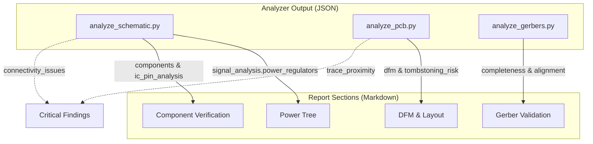

<!-- source: DeepWiki mcp.deepwiki.com · repo aklofas/kicad-happy · page 3.1 Report Generation and Output Schema · fetched 2026-10-26 -->

# Report Generation and Output Schema

<details>
<summary>Relevant source files</summary>

The following files were used as context for generating this wiki page:

- [skills/kicad/references/output-schema.md](skills/kicad/references/output-schema.md)
- [skills/kicad/references/report-generation.md](skills/kicad/references/report-generation.md)

</details>


This page documents the design review report generation process, the structured template used for hardware audits, and the JSON schemas produced by the core analysis scripts. The report generation workflow transforms raw extraction data into an actionable, severity-categorized document for electronic engineers.

## 1. Report Structure and Design Review Template

The design review report is a structured Markdown document generated by synthesizing outputs from `analyze_schematic.py`, `analyze_pcb.py`, and `analyze_gerbers.py`. It follows a standardized template to ensure consistency across different hardware projects.

### 1.1 Section Hierarchy
The report is organized to prioritize critical failures while providing deep-dive technical verification for subcircuits.

| Section | Purpose | Key Data Sources |
| :--- | :--- | :--- |
| **Overview** | High-level project context (MCU, Layers, Domain). | `title_block`, `statistics` |
| **Previous Review Delta** | Tracking progress and regressions from prior audits. | Local `.md` file diffing |
| **Critical Findings** | High-priority issues (CRITICAL/WARNING). | `connectivity_issues`, `erc_warnings` |
| **Power Tree** | ASCII visualization of voltage regulation and distribution. | `signal_analysis.power_regulators` |
| **Analyzer Verification** | Manual spot-checks against raw files and datasheets. | `components`, `nets`, `ic_pin_analysis` |
| **Signal Analysis Review** | Validation of detected subcircuits (Filters, Dividers, etc.). | `signal_analysis` |
| **PCB & DFM Analysis** | Layout-specific metrics and manufacturing risks. | `analyze_pcb.py` output |
| **Gerber Validation** | Verification of fabrication files and alignment. | `analyze_gerbers.py` output |

### 1.2 Severity Taxonomy
Findings are categorized using a three-tier taxonomy to guide the designer's attention.

*   **CRITICAL**: The board will likely not function, contains a safety hazard, or will fail fabrication (e.g., swapped VCC/GND, missing power to MCU, shorted nets).
*   **WARNING**: Suboptimal design that may work but carries reliability risks or violates best practices (e.g., missing decoupling, tight voltage margins, high tombstoning risk).
*   **SUGGESTION**: Minor optimizations, BOM improvements, or cosmetic labeling issues.

**Sources:** [skills/kicad/references/report-generation.md:18-52](), [skills/kicad/references/report-generation.md:446-452]()

---

## 2. Data Flow: From Scripts to Report

The reporting process bridges the gap between deterministic Python extraction and human-readable analysis.

### 2.1 JSON-to-Report Mapping
The following diagram illustrates how specific JSON fields from the analyzers are mapped into the final report sections.

**Diagram: Analyzer Data Mapping**

**Sources:** [skills/kicad/references/report-generation.md:342-444](), [skills/kicad/references/output-schema.md:5-21]()

---

## 3. Schematic-to-PCB Cross-Reference

A vital part of the report is the **Analyzer Verification** section, which performs a cross-module audit to ensure the schematic and PCB data are synchronized.

### 3.1 Verification Workflow
1.  **Component Count Match**: Compares the `total_components` from the schematic against the `footprint_count` in the PCB.
2.  **Pinout Verification**: Cross-references `ic_pin_analysis` from the schematic with `pad_nets` in the PCB footprints.
3.  **Datasheet Grounding**: Requires the reviewer to verify the "Assumed Pinout" (from KiCad symbols) against the "Datasheet Pinout" (from manufacturer PDFs).

### 3.2 Data Entities in Code
The system uses specific code entities to maintain this mapping:
*   `AnalysisContext`: A dataclass used to pass state between analysis functions.
*   `comp_lookup`: A dictionary for O(1) access to component properties by reference.
*   `parsed_values`: Standardized `{value: float, unit: string}` objects for calculation.

**Diagram: Verification Entity Relationship**
```mermaid
classDiagram
    class "analyze_schematic.py" {
        +nets: Object
        +components: Array
        +signal_analysis: Object
    }
    class "analyze_pcb.py" {
        +footprints: Array
        +tracks: Object
        +dfm: Object
    }
    class "Report_Generator" {
        +verify_pinout(ref)
        +calculate_power_tree()
        +map_severity(issue)
    }

    "analyze_schematic.py" -- "Report_Generator" : provides "ic_pin_analysis"
    "analyze_pcb.py" -- "Report_Generator" : provides "pad_nets"
    "Report_Generator" ..> "kicad_types.py" : uses "AnalysisContext"
```
**Sources:** [skills/kicad/references/report-generation.md:63-71](), [skills/kicad/references/output-schema.md:40-49](), [skills/kicad/references/output-schema.md:127-134]()

---

## 4. Output Schema Reference

The analyzers produce a structured JSON format designed for both automated parsing and LLM consumption.

### 4.1 Schematic Schema (`analyze_schematic.py`)
| Key | Type | Description |
| :--- | :--- | :--- |
| `statistics` | object | Summary of components, nets, and missing MPNs. |
| `bom` | array | Deduplicated list of parts with manufacturer data. |
| `nets` | object | Connectivity map keyed by net name with pin details. |
| `signal_analysis` | object | Detected subcircuits (regulators, filters, etc.). |
| `connectivity_issues` | object | Lists of single-pin nets, floating nets, and ERC warnings. |

### 4.2 PCB Schema (`analyze_pcb.py`)
| Key | Type | Description |
| :--- | :--- | :--- |
| `footprints` | array | Placements including `pad_nets` and `connected_nets`. |
| `net_lengths` | object | Trace lengths and via counts per net. |
| `dfm` | object | Manufacturing risks (annular rings, clearances, tombstoning). |
| `trace_proximity` | object | Potential crosstalk issues (enabled with `--proximity`). |

### 4.3 Gerber Schema (`analyze_gerbers.py`)
| Key | Type | Description |
| :--- | :--- | :--- |
| `completeness` | object | Checks if all required layers (Copper, Mask, Paste, Silk) exist. |
| `alignment` | object | Verifies that all layers share the same coordinate origin. |
| `drill_classification` | object | Categorizes holes into via, component, or mounting. |

**Sources:** [skills/kicad/references/output-schema.md:5-21](), [skills/kicad/references/output-schema.md:96-115](), [skills/kicad/references/output-schema.md:156-171]()

---

## 5. Power Tree Generation

The `Power Tree` is a mandatory visualization in the report. It is constructed by traversing the `signal_analysis.power_regulators` and `voltage_dividers` data.

### 5.1 Construction Logic
1.  **Identify Sources**: Start with nets identified as input sources (e.g., `VBUS`, `VIN`, `BATT`).
2.  **Trace Regulators**: For each regulator in `signal_analysis`, map `input_rail` to `output_rail`.
3.  **Calculate Vout**: If `vout_estimated` is present, it is compared against the rail name.
4.  **Reference Verification**: Note whether `vref_source` is "lookup" (datasheet-verified) or "heuristic" (calculated from common patterns).

**Sources:** [skills/kicad/references/report-generation.md:58-62](), [skills/kicad/references/output-schema.md:65]()

---

