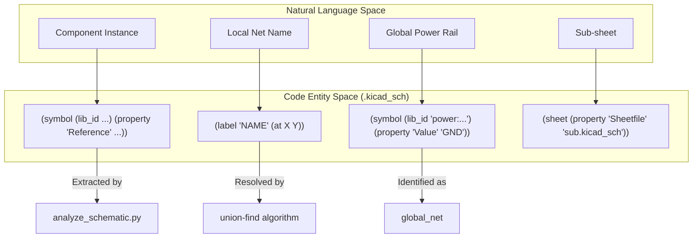
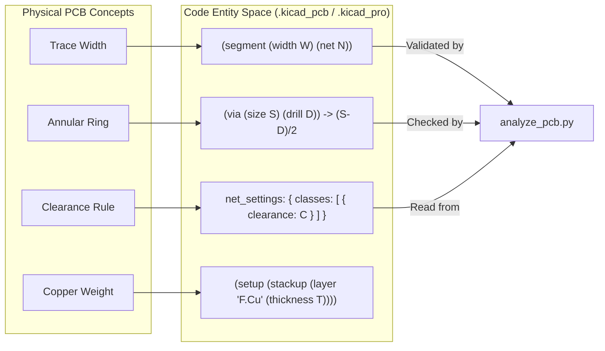
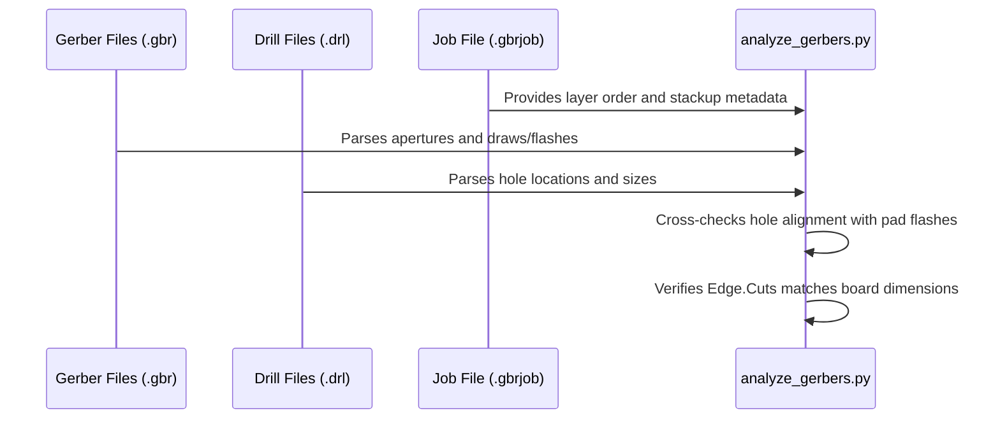

<!-- source: DeepWiki mcp.deepwiki.com · repo aklofas/kicad-happy · page 3.2 Standards Compliance and File Formats · fetched 2026-10-26 -->

# Standards Compliance and File Formats

Relevant source files

The following files were used as context for generating this wiki page:

- [skills/kicad/references/file-formats.md](skills/kicad/references/file-formats.md)
- [skills/kicad/references/gerber-parsing.md](skills/kicad/references/gerber-parsing.md)
- [skills/kicad/references/pcb-layout-analysis.md](skills/kicad/references/pcb-layout-analysis.md)
- [skills/kicad/references/standards-compliance.md](skills/kicad/references/standards-compliance.md)

This page details the technical implementation of industry standards and the parsing of KiCad's underlying file formats within the `kicad-happy` ecosystem. It covers the mathematical formulas for current capacity, clearance/creepage rules for high-voltage safety, and the structural specifications for KiCad S-expressions and Gerber X2 files.

## Standards Implementation

The analyzer maps physical PCB characteristics (trace width, spacing, layer stackup) to industry-standard constraints to provide automated DFM and safety reviews.

### IPC-2221A Current Capacity
The system implements the classic IPC-2221A formula to estimate the temperature rise of a conductor based on current and cross-sectional area [skills/kicad/references/standards-compliance.md:113-117]().

**Formula:**
`I = k * ΔT^0.44 * A^0.725`

| Variable | Description | Source |
| :--- | :--- | :--- |
| `I` | Current in Amperes | Derived |
| `k` | Constant (0.048 for outer layers, 0.024 for inner) | [skills/kicad/references/standards-compliance.md:124-125]() |
| `ΔT` | Temperature rise above ambient (°C) | User/Default |
| `A` | Cross-sectional area in sq mils | [skills/kicad/references/standards-compliance.md:123-123]() |

### IEC 60664-1 / ECMA-287 Insulation Coordination
For high-voltage and mains-referenced designs, the analyzer references ECMA-287 (derived from IEC 60664-1) to verify creepage and clearance [skills/kicad/references/standards-compliance.md:313-315]().

*   **Clearance:** The shortest distance through air between two conductive parts [skills/kicad/references/standards-compliance.md:318-318]().
*   **Creepage:** The shortest distance along the surface of an insulating material between two conductive parts [skills/kicad/references/standards-compliance.md:319-319]().

The implementation checks these against Pollution Degree 2 (standard office/laboratory environments) and Material Group IIIa/IIIb (standard FR4) [skills/kicad/references/standards-compliance.md:364-367]().

### IPC-A-600G Product Classes
The analyzer categorizes designs into three IPC classes to determine acceptable imperfection levels [skills/kicad/references/standards-compliance.md:58-60]():
*   **Class 1:** General Electronic Products (Consumer).
*   **Class 2:** Dedicated Service Electronic Products (Industrial/Telecom).
*   **Class 3:** High Reliability Electronic Products (Medical/Aerospace).

**Sources:**
*   [skills/kicad/references/standards-compliance.md:56-164]()
*   [skills/kicad/references/standards-compliance.md:313-440]()

---

## KiCad S-Expression File Formats

KiCad 6+ uses Lisp-like S-expressions for all design files. Coordinates are in millimeters with the origin at the top-left (Y increases downwards) [skills/kicad/references/file-formats.md:19-23]().

### Schematic (.kicad_sch) Structure
The schematic parser traverses the `(kicad_sch ...)` tree to build a connectivity graph.

**Natural Language to Code Entity Map: Schematic Parsing**

**Sources:**
*   [skills/kicad/references/file-formats.md:32-50]()
*   [skills/kicad/references/file-formats.md:80-97]()

### PCB Layout (.kicad_pcb) Structure
The PCB parser extracts physical geometry for DFM analysis. Key nodes include `(footprint)`, `(segment)` for tracks, and `(via)` [skills/kicad/references/file-formats.md:113-137]().

**Natural Language to Code Entity Map: PCB Analysis**

**Sources:**
*   [skills/kicad/references/file-formats.md:113-185]()
*   [skills/kicad/references/pcb-layout-analysis.md:31-41]()
*   [skills/kicad/references/pcb-layout-analysis.md:68-92]()

---

## Gerber X2 and Excellon Formats

The `analyze_gerbers.py` script validates the manufacturing output files against the source design.

### Gerber RS-274X / X2
Modern KiCad exports include X2 attributes (TF/TA/TO) that embed metadata directly in the Gerber file [skills/kicad/references/gerber-parsing.md:200-210]().

*   **Aperture Definitions (%AD):** Define the shape of the "pen" (Circle, Rectangle, Obround) [skills/kicad/references/gerber-parsing.md:78-86]().
*   **Flash Commands (D03):** Used for pads and vias [skills/kicad/references/gerber-parsing.md:126-130]().
*   **Draw Commands (D01):** Used for traces [skills/kicad/references/gerber-parsing.md:126-128]().

### Excellon Drill Files
Drill files define the holes in the board. The parser checks for alignment between the drill file and the copper pads in the Gerber files [skills/kicad/references/gerber-parsing.md:231-255]().

| Command | Description |
| :--- | :--- |
| `T1C0.3` | Tool 1, Circle, 0.3mm diameter [skills/kicad/references/gerber-parsing.md:244-244]() |
| `X150.0Y100.0` | Drill hole at coordinate (150, 100) [skills/kicad/references/gerber-parsing.md:251-251]() |

### Data Flow: Gerber Validation

**Sources:**
*   [skills/kicad/references/gerber-parsing.md:18-43]()
*   [skills/kicad/references/gerber-parsing.md:185-199]()
*   [skills/kicad/references/gerber-parsing.md:231-260]()

---

