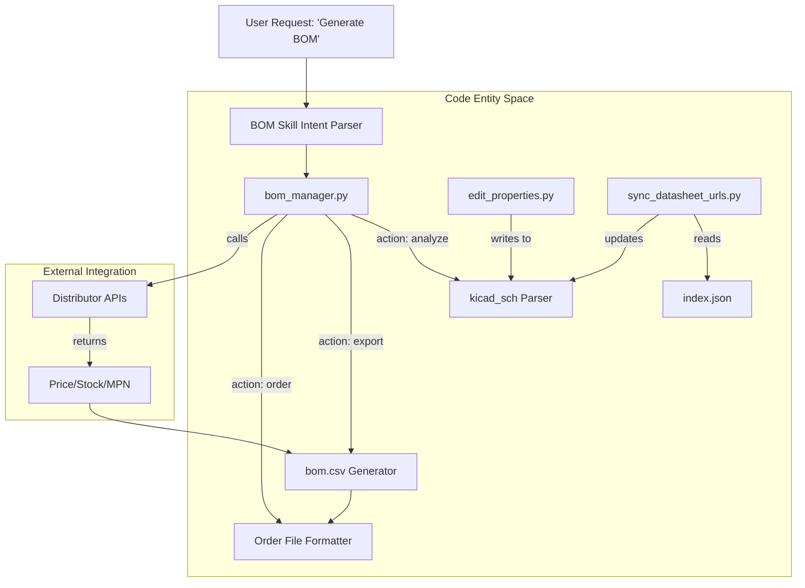
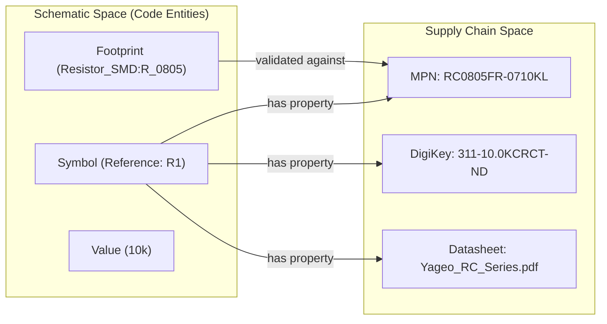

<!-- source: DeepWiki mcp.deepwiki.com · repo aklofas/kicad-happy · page 4 BOM Management · fetched 2026-10-26 -->

# BOM Management

Relevant source files

The following files were used as context for generating this wiki page:

- [skills/bom/SKILL.md](skills/bom/SKILL.md)

The BOM (Bill of Materials) Management skill serves as the primary orchestrator for component sourcing, pricing, and ordering. It treats the **KiCad schematic symbol properties** as the single source of truth for all component data, coordinating between distributor APIs (DigiKey, Mouser, LCSC, element14) and fabrication services (JLCPCB, PCBWay).

## Workflow Overview

The system follows a structured 11-step lifecycle to move from a raw schematic to a validated, order-ready BOM. This process ensures that part numbers (MPNs), distributor SKUs, and datasheet URLs are synchronized across the design files and external supply chain databases.

### The 11-Step BOM Lifecycle

1.  **Analyze Schematic**: Identify existing fields, missing data, and preferred distributors using `bom_manager.py analyze` [[skills/bom/SKILL.md:55-63]]().
2.  **Sync Datasheets**: Download PDF datasheets to a local `datasheets/` directory and build an `index.json` manifest [[skills/bom/SKILL.md:65-80]]().
3.  **Backfill URLs**: Write discovered datasheet URLs from the index back into the schematic `Datasheet` field [[skills/bom/SKILL.md:81-88]]().
4.  **Gather Part Info**: Search distributors by MPN, SKU, or Value+Footprint descriptions [[skills/bom/SKILL.md:89-99]]().
5.  **Validate Matches**: Verify package compatibility, technical specs, and lifecycle status (avoiding EOL/Obsolete parts) [[skills/bom/SKILL.md:100-112]]().
6.  **Update Schematic**: Write validated MPNs and distributor PNs back to the `.kicad_sch` files using `edit_properties.py` [[skills/bom/SKILL.md:113-125]]().
7.  **Export Tracking CSV**: Generate a master `bom.csv` that merges schematic data with live pricing and stock [[skills/bom/SKILL.md:130-137]]().
8.  **Review Gaps**: Identify components missing critical ordering information [[skills/bom/SKILL.md:51-51]]().
9.  **Select Distributors**: Assign a `Chosen_Distributor` for each line item in the tracking CSV [[skills/bom/SKILL.md:139-145]]().
10. **Generate Order Files**: Create distributor-specific upload files (e.g., DigiKey CSV, Mouser BOM) [[skills/bom/SKILL.md:147-152]]().
11. **Final Validation**: Perform a last check against stock levels and minimum order quantities (MOQ) before purchase.

For a detailed breakdown of these steps and the scripts involved, see **[BOM Scripts and Workflow](#4.1)**.

## System Architecture

The BOM skill bridges the gap between the "Natural Language Space" of user requests and the "Code Entity Space" of Python scripts and KiCad S-expressions.

### Logic Flow: Natural Language to Code Execution

The following diagram illustrates how user intent (e.g., "Find parts for this board") is translated into specific script executions and data transformations.

**BOM Orchestration Logic**

**Sources:** [[skills/bom/SKILL.md:3-8]](), [[skills/bom/scripts/bom_manager.py:1-50]]()

## Data Conventions

To maintain consistency across projects, the system enforces specific field naming conventions and part number patterns. This allows the `bom_manager.py` script to deterministically identify which fields contain manufacturer information versus distributor-specific SKUs.

| Field Name | Description |
| :--- | :--- |
| `MPN` | Manufacturer Part Number (The primary identifier) |
| `Manufacturer` | The company that produced the part |
| `DigiKey` / `Mouser` | Distributor-specific Stock Keeping Units (SKUs) |
| `LCSC` | LCSC Part Number (e.g., C12345) |
| `DNP` | "Do Not Populate" flag for assembly |

For the full list of supported fields and package cross-reference tables, see **[KiCad Fields, Part Numbers, and Ordering](#4.2)**.

### Component Mapping: Schematic to Physical Part

This diagram bridges the conceptual schematic symbol to the physical entities tracked in the BOM.

**Entity Mapping**

**Sources:** [[skills/bom/SKILL.md:100-112]](), [[skills/bom/scripts/edit_properties.py:1-40]]()

## Child Pages

*   **[BOM Scripts and Workflow](#4.1)**: Deep dive into `bom_manager.py`, `edit_properties.py`, and the 11-step automation workflow.
*   **[KiCad Fields, Part Numbers, and Ordering](#4.2)**: Reference for field naming conventions, part number patterns, and distributor-specific order formats.

**Sources:**
*   `skills/bom/SKILL.md` [[1-152]]()
*   `skills/bom/scripts/bom_manager.py` [[1-50]]()
*   `skills/bom/scripts/edit_properties.py` [[1-45]]()

---

