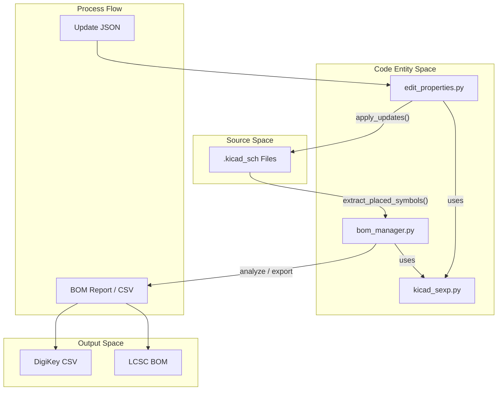
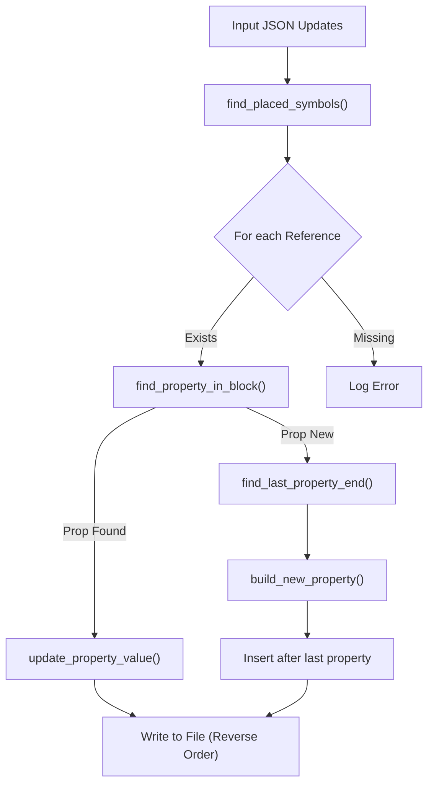

<!-- source: DeepWiki mcp.deepwiki.com · repo aklofas/kicad-happy · page 4.1 BOM Scripts and Workflow · fetched 2026-10-26 -->

# BOM Scripts and Workflow

Relevant source files

The following files were used as context for generating this wiki page:

- [skills/bom/scripts/bom_manager.py](skills/bom/scripts/bom_manager.py)
- [skills/bom/scripts/edit_properties.py](skills/bom/scripts/edit_properties.py)

This page documents the Bill of Materials (BOM) management system within `kicad-happy`. The system treats the KiCad schematic as the single source of truth for component data, providing a set of scripts to analyze properties, synchronize datasheet URLs, and write manufacturer/distributor information back to the `.kicad_sch` files.

## 11-Step BOM Workflow

The following workflow describes the lifecycle of a BOM from initial schematic capture to final order generation.

1.  **Schematic Capture**: Components are placed in KiCad.
2.  **Initial Analysis**: Run `bom_manager.py analyze` to detect the project's part number convention and identify missing fields [skills/bom/scripts/bom_manager.py:9-10]().
3.  **Identify Gaps**: Use the `--gaps-only` flag to isolate components missing MPN or distributor fields [skills/bom/scripts/bom_manager.py:15-16]().
4.  **Component Selection**: Research parts using distributor API skills (DigiKey, Mouser, LCSC).
5.  **Property Update Generation**: Create a JSON update file containing the new MPN and distributor SKUs.
6.  **Dry Run Verification**: Run `edit_properties.py --dry-run` to preview changes to the schematic [skills/bom/scripts/edit_properties.py:19-20]().
7.  **Schematic Write-back**: Execute `edit_properties.py` to commit properties (MPN, Manufacturer, etc.) to the `.kicad_sch` files [skills/bom/scripts/edit_properties.py:11-12]().
8.  **Datasheet Sync**: Run `sync_datasheet_urls.py` to update the `Datasheet` field with direct PDF links from distributor APIs.
9.  **BOM Export**: Generate a tracking CSV using `bom_manager.py export` [skills/bom/scripts/bom_manager.py:21-22]().
10. **Review and Merge**: Compare the exported CSV against previous versions or stock levels.
11. **Order Generation**: Use `bom_manager.py order` to produce distributor-specific upload files (e.g., DigiKey CSV).

**Sources:**
- [skills/bom/scripts/bom_manager.py:1-26]()
- [skills/bom/scripts/edit_properties.py:1-38]()

## Core BOM Scripts

### bom_manager.py
The primary entry point for BOM operations. It handles S-expression parsing to extract symbol properties while respecting hierarchical sheet structures.

*   **Implementation**: It uses `re` and `find_matching_paren` to locate symbol blocks within the `.kicad_sch` file [skills/bom/scripts/bom_manager.py:132-156]().
*   **Field Normalization**: Uses `FIELD_ALIASES` to map various user-defined field names (e.g., "Mfr No", "Part#") to canonical internal keys like `mpn` [skills/bom/scripts/bom_manager.py:44-75]().
*   **DNP Logic**: Detects "Do Not Populate" status by checking both KiCad 9 native `(dnp yes)` flags and custom fields like `DONOTPLACE` [skills/bom/scripts/bom_manager.py:178-192]().

### edit_properties.py
A precision tool for modifying `.kicad_sch` files without corrupting the S-expression structure.

*   **Data Flow**: Accepts a JSON mapping of `Reference -> {Property: Value}` [skills/bom/scripts/edit_properties.py:22-33]().
*   **Safe Writing**: It calculates updates in reverse file order to ensure that character offsets remain valid as the file size changes during the write process [skills/bom/scripts/edit_properties.py:215-217]().
*   **Formatting Preservation**: When adding new properties, it detects the existing indentation level of the symbol block to maintain file consistency [skills/bom/scripts/edit_properties.py:127-133]().

### kicad_sexp.py
A utility module providing low-level S-expression manipulation functions.

*   **`find_matching_paren`**: A fundamental parser utility that tracks nested parentheses to extract complete blocks [skills/bom/scripts/kicad_sexp.py:38-58]().
*   **`escape_kicad_string`**: Ensures that property values containing quotes or backslashes are correctly escaped for the KiCad file format [skills/bom/scripts/kicad_sexp.py:12-24]().

**Sources:**
- [skills/bom/scripts/bom_manager.py:44-192]()
- [skills/bom/scripts/edit_properties.py:57-220]()
- [skills/bom/scripts/kicad_sexp.py:12-58]()

## System Architecture Diagrams

### Data Flow: Schematic to Order
This diagram illustrates how data moves from the KiCad source files through the Python processing layer to final outputs.

**Sources:**
- [skills/bom/scripts/bom_manager.py:132-156]()
- [skills/bom/scripts/edit_properties.py:183-197]()
- [skills/bom/scripts/kicad_sexp.py:38-58]()

### Property Update Logic
This diagram details the internal logic of `edit_properties.py` when modifying a schematic file.

**Sources:**
- [skills/bom/scripts/edit_properties.py:57-85]()
- [skills/bom/scripts/edit_properties.py:92-107]()
- [skills/bom/scripts/edit_properties.py:110-124]()
- [skills/bom/scripts/edit_properties.py:136-153]()
- [skills/bom/scripts/edit_properties.py:156-176]()

## Implementation Details

### Field Alias Mapping
The system uses a robust alias dictionary to handle the variety of field naming conventions found in community KiCad projects.

| Canonical Key | Common Aliases |
| :--- | :--- |
| `mpn` | `MPN`, `Mfg Part`, `PartNumber`, `Mfr_No`, `MFPN` |
| `lcsc` | `LCSC`, `LCSC Part #`, `JLCPCB Part`, `JLC` |
| `element14` | `Newark`, `Farnell`, `element14` |

[skills/bom/scripts/bom_manager.py:44-75]()

### Hierarchical Sheet Handling
The `bom_manager.py` script supports recursive analysis of sub-sheets. It uses `find_sub_sheets` from `kicad_sexp.py` to identify nested `.kicad_sch` files referenced by the root schematic [skills/bom/scripts/bom_manager.py:37]().

### Safety Features
1.  **Dry Run**: The `--dry-run` flag in `edit_properties.py` allows users to see a diff of changes before they are applied to the file [skills/bom/scripts/edit_properties.py:186-187]().
2.  **Backups**: The `--backup` flag creates a timestamped copy of the schematic before any modification [skills/bom/scripts/edit_properties.py:16-17]().
3.  **Reverse Insertion**: By applying changes from the end of the file to the beginning, the script ensures that character offsets for pending updates remain accurate [skills/bom/scripts/edit_properties.py:215-217]().

**Sources:**
- [skills/bom/scripts/bom_manager.py:44-75]()
- [skills/bom/scripts/edit_properties.py:16-217]()

---

